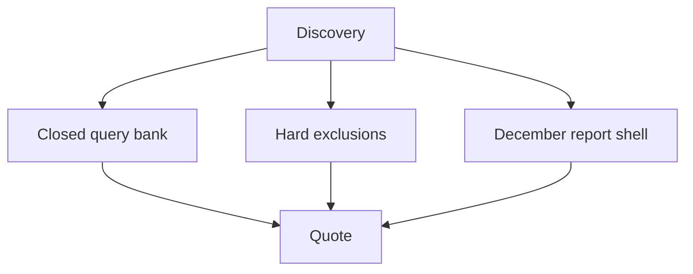

# What a Winning AI Visibility Agency Proposal Looks Like

**A winning AI visibility agency proposal is three closed sheets: the query bank, the hard exclusions, and a December report a client can read without you in the room.** I quote after those sheets exist. I do not send a rate card.

I'm **William Spurlock**, AI Systems Architect and Fractional AI CTO at Spurlock Studios LLC. I've built **600+ automations**, with **500+ live**. I've spent **20,000+ hours** architecting agentic systems, and that work has saved clients **35,000+ hours**. I've been SEO-certified since 2021. The work now sits under AEO, AIO, and GEO. I do not invent client names, and I do not print a return on a proposal.

The monthly operating card, the October lock, and the January bill live in [what to include in an AI visibility monthly retainer](/blog/what-to-include-in-an-ai-visibility-monthly-retainer). Price ranges I have actually seen live in [how to sell AI visibility services](/blog/how-to-sell-ai-visibility-services-packaging-pricing-and-positioning). This is the packet both posts assume you already have. If the bank is still open, you do not have a number yet.

## What does a winning AI visibility agency proposal look like?

**It looks like a short packet with a last line on every sheet, not a menu called GEO.** A buyer should be able to see which questions you own, which jobs you refuse, and what December will show, before anyone says a fee.

I keep the packet to one sitting. If it needs a narrator, it is not done. [Google's AI features guide](https://developers.google.com/search/docs/appearance/ai-features), updated December 10, 2025, says there are no additional requirements to appear in **Google AI Overviews** or **Google AI Mode**, and no special schema.org markup, machine-readable file, or AI text file that you have to add. A proposal that sells a schema product as the win is selling a requirement Google says is not there.

<table>
<thead>
<tr>
<th>Sheet</th>
<th>Closed means</th>
<th>A buyer can check</th>
</tr>
</thead>
<tbody>
<tr>
<td>Query bank</td>
<td>Buyer questions, each with one URL or the words "no URL yet"</td>
<td>There is a last line. Nothing sits under it</td>
</tr>
<tr>
<td>Hard exclusions</td>
<td>Named jobs you will not do, each marked out</td>
<td>The client can point at a row and see the word out</td>
</tr>
<tr>
<td>December report</td>
<td>The columns, the due date, and empty cells allowed</td>
<td>Someone who missed the call can still read the page</td>
</tr>
</tbody>
</table>

I put the sheets in this order, and I do not shuffle them to make the deck feel larger.

1. The query bank, in the buyer's words.
2. The exclusions, including the promises I will not make.
3. The December report shell, with this year's due date written on it.
4. What discovery still has to confirm before I will quote.
5. One line that says the fee is not on this page.

### What closed means on each sheet

A bank is closed when adding a question means opening a new phase. An exclusion list is closed when a verbal "can you also" has a row to land on. The December report is closed when the columns will not grow in the meeting where someone asks for a guarantee.

I leave these off the packet on purpose.

- A public rate, or a range copied from another agency's site.
- A promise that a URL will show in an AI Overview. That same Google guide says AI Overviews often do not trigger, because they show up when Google's systems decide they add something beyond classic Search.
- A stack diagram. The buyer did not ask how your tools talk to each other.
- A word-count target. The helpful-content page, updated October 5, 2026, says Google does not have a preferred word count.

If the only thing that changed from last year's SEO proposal is the title, you do not have a new offer. You have a sticker.

## How do I scope an AI visibility project correctly to avoid undercharging?

**Scope is the closed bank plus the exclusions, written down before the number.** You undercharge when the bank can still grow after the signature, or when "AI visibility" is a paragraph a buyer can talk past.

I have watched the leak happen in a predictable way. The proposal says you will "cover AI search." The buyer hears every question their sales team might ask a chatbot. By month two you are logging prompts that were never on the page, inside a fee that assumed a short list. The fix is not a higher card. The fix is a last line.

<table>
<thead>
<tr>
<th>Open scope</th>
<th>What you end up doing</th>
<th>Closed version</th>
</tr>
</thead>
<tbody>
<tr>
<td>"All buyer questions"</td>
<td>The list grows every time sales forwards a prompt</td>
<td>The bank on the packet, and a rule for a new phase</td>
</tr>
<tr>
<td>"Content as needed"</td>
<td>A page quota appears after the kickoff</td>
<td>One URL per bank row, or "no URL yet"</td>
</tr>
<tr>
<td>"AI Overview placement"</td>
<td>You owe a result Google says often does not trigger</td>
<td>A dated note: named or not named</td>
</tr>
<tr>
<td>"We'll include schema"</td>
<td>A line item for markup the guide says you do not need</td>
<td>Visible text that matches any markup you already have</td>
</tr>
<tr>
<td>Fee on page one</td>
<td>The scope stretches until it feels worth the number</td>
<td>Quote after the three sheets are real</td>
</tr>
</tbody>
</table>

Before I quote, discovery has to answer these. If one of them is still "we'll see," I do not send a number.

1. Which buyer questions are real, in their words, not in a keyword export.
2. Which URL should answer each one, or whether that URL does not exist yet.
3. Who is allowed to sign pages that touch health, money, or safety.
4. Whether any of those URLs are set to noindex or nosnippet.
5. Whether this work is already hiding inside the current SEO invoice.

### Why fan-out is not a blank check

The AI features guide describes a **query fan-out**: while an answer is being built, Google may issue multiple related searches across subtopics and data sources. One buyer question can turn into several lookups. That is Google's behavior. It is not a clause that lets the bank double after you sign.

I write the bank in the buyer's language and I stop. The related lookups are a reason to make the on-page facts match the frozen wording. They are not new rows. If the client wants those rows, that is a second sheet and a second quote.

I use the same rule for word counts. A proposal that sells "eight articles at 1,500 words" is guessing a quota Google has said it does not prefer. I would rather own eight questions I can show in December than own a pile of pages nobody asked for.

### The sentence I send instead of a rate

When the three sheets are real, the note I send is short.

1. The bank has this many lines, and here is the last one.
2. The exclusions are attached, including placement promises.
3. The December report will use these columns.
4. The fee is for that packet, not for "AI" as a mood.
5. If you add a question, we open a phase. We do not fold it in.

I still do not put the dollar figure in the public version of this post. Ranges I have seen belong in the packaging pillar. A number here would be the rate card I am telling you not to send.

## What's the difference between an SEO retainer and an AI visibility retainer?

**An SEO retainer is the ongoing search program. An AI visibility retainer is a closed bank, a log of named or not named, and the December report that reads that bank.** The same agency can sell both. The proposal has to say which document is which.

The keep, drop, and add map already lives in [where SEO and AI visibility overlap](/blog/the-overlap-between-seo-and-ai-visibility-and-where-they-split). I am not redrawing it. The invoice card, and the rule against folding the new work into the old fee for free, lives in the retainer post. I am talking about the proposal language a buyer sees before either of those is running.

<table>
<thead>
<tr>
<th></th>
<th>SEO retainer proposal</th>
<th>AI visibility proposal</th>
</tr>
</thead>
<tbody>
<tr>
<td>Job named</td>
<td>Rankings, pages, technical fixes, the report you already send</td>
<td>Closed bank, exclusions, December reading</td>
</tr>
<tr>
<td>Success line</td>
<td>The KPIs already on the SEO report</td>
<td>Each bank row has a URL and a dated named or not named</td>
</tr>
<tr>
<td>What changes the fee</td>
<td>The scope already written in that statement of work</td>
<td>A new question, or an exclusion the client wants removed</td>
</tr>
<tr>
<td>What I will not do</td>
<td>Retitle that scope as GEO and call it new</td>
<td>Paste the SEO deliverable list under a new heading</td>
</tr>
</tbody>
</table>

Sentences I will not put in an AI visibility proposal:

- "Includes all AI search."
- "We will get you into AI Overviews." The guide says they often do not trigger, and that indexing and serving are not guaranteed even when a page meets the technical requirements.
- "This replaces your SEO." It does not. Classic SEO fundamentals still apply, on that same page.
- "A content package" with no bank under it.
- "Same links on AI Overviews and AI Mode." The guide says those two features may use different models and techniques, so the links vary.

### Same buyer, two proposals

If the buyer already has an SEO retainer with you, send two documents or one document with two labeled parts. A single heading that says "Search + AI" feels tidy and then hides the new work. I want the SEO success line and the bank success line far enough apart that a finance reader can see they are not the same promise.

Google AI Overviews and Google AI Mode are features inside **Google Search**, not a second website you rank. The AI features guide says appearances there are counted in **Google Search Console** under the Web search type in the Performance report. That is a measurement note for the December page. It is not a reason to merge the two retainers into one vague line.

When a buyer asks me to "just add it" to the SEO proposal, I add the three sheets or I decline. I do not add a paragraph.

## What is out of scope on an AI visibility engagement?

**Out of scope means a row the client can read, with the word out, before anyone talks about a fee.** If it is not on that list, a buyer will assume it is in, and you will do it at the price you already said.

I write the same exclusions on every first engagement. The names of the URLs change. The refusals do not. This is the list that keeps the quote honest.

<table>
<thead>
<tr>
<th>Out</th>
<th>Why it is out</th>
<th>Where that comes from</th>
</tr>
</thead>
<tbody>
<tr>
<td>A promise the page will appear in an AI Overview or AI Mode</td>
<td>Overviews often do not trigger. Indexing is not guaranteed. The two features may not show the same links</td>
<td>AI features guide, updated December 10, 2025</td>
</tr>
<tr>
<td>Special schema, an AI text file, or new markup as the product</td>
<td>Google says you do not need them to be eligible</td>
<td>Same guide</td>
</tr>
<tr>
<td>A word-count or page-count quota</td>
<td>Google says it has no preferred word count</td>
<td>Helpful content, updated October 5, 2026</td>
</tr>
<tr>
<td>Unreviewed generative pages</td>
<td>Producing large amounts of text with generative tools and no manual oversight is described as little to no effort</td>
<td>Same helpful-content page</td>
</tr>
<tr>
<td>Trying to manipulate generative AI responses in Search</td>
<td>That sits inside Google's definition of spam</td>
<td>Spam policies, updated August 28, 2026</td>
</tr>
<tr>
<td>Many model-written pages that do not help anyone</td>
<td>Listed as an example of scaled content abuse</td>
<td>Same spam page</td>
</tr>
<tr>
<td>A fabricated byline</td>
<td>Made-up names, false credentials, or a fake expert photo are called deception</td>
<td>Helpful content, updated October 5, 2026</td>
</tr>
<tr>
<td>A public rate card, or a dollar return</td>
<td>The quote waits on the closed bank. I will not invent a return</td>
<td>My rule for this packet</td>
</tr>
</tbody>
</table>

A page can still be in the bank and be blocked. Eligibility for a supporting link, on the AI features guide, requires the page to be indexed and eligible to show in Google Search with a snippet. There are no extra technical requirements beyond that, and meeting them still does not guarantee indexing. If a money URL is noindex or nosnippet, the exclusion is not "we skip technical work." The exclusion is "we do not pretend December will cite a page that cannot be quoted." Fixing the control can be in scope. Promising the citation cannot.

### How an exclusion sneaks back in

I watch for these after the PDF goes out. Each one is a scope change, even when it arrives as a friendly note.

- "While you're in there, can you also do the blog?"
- "The other agency includes AI Overviews."
- "Legal wants a guarantee on the big queries."
- "Can the byline be the brand, not a person?" On topics that can affect health, money, or safety, the helpful-content page says Google gives more weight to experience, expertise, authoritativeness, and trust. A brand name with no reviewer is a weaker December row, and on those topics I will not invent a person to make it look reviewed.
- A yes in a meeting that never lands on the exclusion sheet.

If the client wants a row removed from the out list, I re-quote. I do not "make it work" inside the old number. Otherwise I am doing extra work at the old price.

## What does the December AI visibility report have to show a client?

**The December report shows the closed bank: the question, the URL, the blocker, and named or not named.** It is the checkpoint the proposal promised. It is not a new scoreboard, and it is not the January retainer page.

The retainer post already sets the calendar I use when a bill starts in January: October freezes the card, November is access and a baseline, December removes blockers, January is the first billed month, and day 90 is a later grade. This December report is how the client sees that pre-bill reading. If you are handing the packet in a sales meeting and no work has started, the same columns are on the page and empty cells say "not checked yet." I show the same columns before work starts, even when they are blank. I do not fill them with guesses.

<table>
<thead>
<tr>
<th>Column</th>
<th>What December fills in</th>
<th>What it must not say</th>
</tr>
</thead>
<tbody>
<tr>
<td>Question</td>
<td>The wording from the proposal, unchanged</td>
<td>A fresh keyword export</td>
</tr>
<tr>
<td>URL</td>
<td>The page, or "no URL yet"</td>
<td>A pile of new URLs that were never in the bank</td>
</tr>
<tr>
<td>Blocker</td>
<td>noindex, nosnippet, missing reviewer, page not indexed</td>
<td>"AI changed"</td>
</tr>
<tr>
<td>Named or not named</td>
<td>One dated note for each surface you actually checked</td>
<td>A guarantee, or a single lucky screenshot treated as the month</td>
</tr>
<tr>
<td>Performance, if you have access</td>
<td>Clicks, impressions, CTR, and average position for those URLs, with the date filter visible</td>
<td>A fifth number you invented and called an AI score</td>
</tr>
</tbody>
</table>

I read [Search Console's Performance report](https://support.google.com/webmasters/answer/7576553) again on October 17, 2026. The default view is the past three months. The metrics on the report are clicks, impressions, CTR, and average position. A December note should change the date filter to the window you are actually reporting. The three-month default is a cross-check, not the page.

A few facts from that same reading, kept separate on purpose:

- The newest points can be preliminary. Google marks that with a dotted line, and the points can still change. I do not grade a dotted segment as final.
- Chart totals and table totals can differ, because some groupings aggregate by property and some by page. If the numbers differ, I say which view I used.
- Web is split into text-based queries and multimodal queries. Multimodal, on that page, means searches with images, including Google Lens, Circle to Search, uploaded images, and Chrome image search. The AI features guide's "Web search type" sentence is about AI Overviews and AI Mode being included in Web. I do not tell a client those are the same switch.
- You might not see your site for a query that still appears in the report, because results depend on time, place, device, and recent history. One phone check is not the December grade.

### What I refuse to add in December

I keep the report boring. Adding any of this turns it into a negotiation.

- A fee, or a revised rate, in the middle of the columns.
- A new question. That opens a phase.
- A placement promise, including "we expect an Overview next month."
- A word count, or a date change presented as a fix. The helpful-content page calls out changing dates when the content has not really changed.
- A recrawl request presented as a result. The AI features guide says crawling can take anywhere from several days to several months. A request is not a row that says named.

Empty cells are allowed. "Not checked yet" is a real status. So is "not named." I would rather show three honest blanks than one slide that implies a citation you did not log.

Day 90 still belongs to the operating card in the retainer post. Do not let a buyer treat this December page as the final grade, and do not let your team treat the day-90 grade as an excuse to skip December. They are two dates. Write both of them on the proposal.

## FAQ

### How do I compete with big SEO agencies that are now offering GEO?

**Compete with the closed packet, not with a GEO menu that matches theirs.** A large agency can add a slide faster than you can. They are slower to freeze a bank, write exclusions, and show a December report with "not named" allowed. I would rather lose a buyer who wanted an Overview guarantee than match a promise [Google's AI features guide](https://developers.google.com/search/docs/appearance/ai-features) says often will not trigger. Packaging and the ranges I have seen stay in the [pricing pillar](/blog/how-to-sell-ai-visibility-services-packaging-pricing-and-positioning). The packet is the difference.

### How do I build case studies for AI visibility work?

**A case study is a December report you have permission to show, with the bank and the named or not named rows still visible.** I do not invent client names, and I do not invent a return to make the page sell. If you cannot show the rows, you have a compliment, not a case study. Wait until December has a real reading. A logo wall does not show the next buyer what you measured.

### What are the deliverables in an AI visibility engagement?

**The deliverables are the three sheets, then only the work those sheets name.** That means a URL a named person can sign, a log, and the December reading. It does not mean a dashboard, a guarantee, or a page quota. The monthly five-line card is a different document. I describe it in the [retainer post](/blog/what-to-include-in-an-ai-visibility-monthly-retainer). If a buyer asks for a tool build, sell the tool build. Do not hide it inside this packet.

### How do I upsell AI visibility services to existing SEO clients?

**Put the three sheets beside the current SEO statement of work and ask which rows are already inside the fee.** If they are in, cut something else before you add the bank. If they are out, the AI visibility proposal is a separate document with its own quote. I do not retitle the old scope and call the meeting an upsell. The invoice split is already written up in the retainer post. Use that when the argument moves from the proposal to the bill.

### How many buyer queries should one AI visibility engagement own?

**Own the questions that fit on the December report, and close the list before you quote.** I do not publish a universal count. A second page is a second phase. [Query fan-out](https://developers.google.com/search/docs/appearance/ai-features), on Google's December 10, 2025 guide, means one buyer question can become several related searches. Those related searches are not extra line items the client can add after the signature. If sales wants them in the bank, you re-quote.

### What is a fair price to charge for AI visibility optimization in 2026?

**A fair price is the one you can defend from a closed bank and a written exclusion list, after discovery.** I do not publish a rate card on this page. Ranges I have seen, and the audit-then-sprint-then-retainer sequence, stay in the packaging pillar. A number on a public card is how the scope grows until it matches the number. If the bank is still "all AI search," you are not ready to say the fee is fair.

### What does an AI visibility audit look like for a client deliverable?

**The audit is discovery. It produces the closed bank, the exclusion draft, and an empty December report.** The proposal is that packet plus the line that says the quote comes next. A long slide with the bank still open is not a finished audit. I do not need a separate theater for findings the three sheets already hold. If a URL is noindex or nosnippet, that fact belongs in the blocker column, not in an appendix nobody reads.

### Should I rebrand my SEO agency to include GEO and AEO services?

**No. Change the proposal. Leave the agency name alone until the packet is something you can deliver.** A new wordmark on the old SEO scope is the sticker problem again. Buyers who only know SEO need the two documents labeled, which is the split above, not a new company. I use AI visibility as the words on the packet. GEO and AEO can sit in a footnote for the people who ask. Changing the agency name does not close the bank.

### How do I demonstrate ROI of AI visibility work to clients?

**You don't, not as a dollar return I am willing to print.** The December report shows named or not named, the blocker, and Search Console's own metrics for those URLs if you have access. Google's AI features guide, updated December 10, 2025, says clicks from results pages that include AI Overviews tend to be higher quality, meaning the person is more likely to spend more time on the site. There is no percentage on that sentence. I will not turn it into a client return, and I will not invent one to win the signature.

## Get an AI-visibility-ready site, then send the packet

The packet is wasted on a URL that cannot be indexed or quoted. I build **AI-visibility-ready sites** for that gap: the answer in the first sentences, a real byline, visible text that matches any structured data, and no nosnippet on the page you are asking Google to cite. I'm William Spurlock. I use the three sheets so I can quote after the scope is clear.

Bring the buyer questions, even if the list is still messy. I want to see whether it can close.

[Bring the three sheets](/contact).
