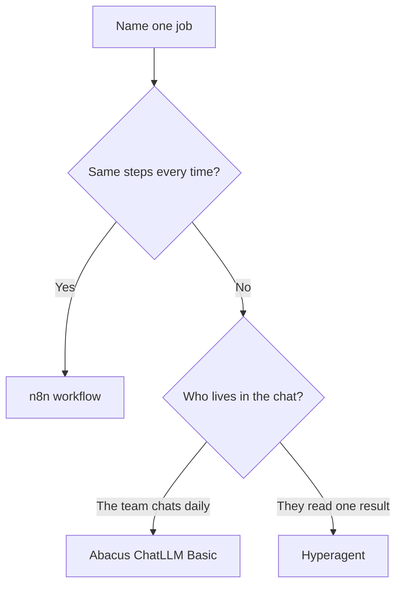

# Best AI Agent Platform for a Non-Technical Team in 2026

**The best AI agent tool for a non-technical business owner in 2026 is Hyperagent when one named job should run again next week, and Abacus ChatLLM when the team mostly shares a chat seat.** I would not send a non-technical team into n8n, CrewAI, LangChain, or AutoGen to make that purchase.

I'm William Spurlock, founder of Spurlock Studios LLC, an AI Systems Architect and Fractional AI CTO. I've built 600+ automations, with 500+ still live, spent 20,000+ hours architecting agentic systems, and helped clients save 35,000+ hours. I have already written the click loop for a canvas. Here, I am choosing what to buy.

The drag-and-click loop lives in [no-code AI agents: drag, click, add the variables](/blog/no-code-ai-agents-drag-click-add-the-variables-run-until-it-works). Scope and persona live in [how to build your first AI agent](/blog/how-to-build-your-first-ai-agent-a-no-nonsense-setup-guide). If the work is the same steps every time, leave this page and use [the 30-day start for someone with no technical background](/blog/how-to-start-with-ai-automation-when-you-have-zero-technical-background).

My own Abacus seat is research and writing, not a team's first agent product. That split is in [when I use Abacus AI instead of an always-on ops teammate](/blog/abacus-ai-research-writing-seat). My Abacus seat is not the template for a company that has never named one job.

## What is the best AI agent tool for a non-technical business owner?

**Hyperagent is the best AI agent tool for a non-technical business owner when the artifact is one repeating job. Abacus ChatLLM Basic is the buy when the artifact is a shared chat and the agent runs a few times a month.** I keep send, spend, and promises off until a person has read the result.

Hyperagent's own start path is four lessons and an hour: a thread, an agent, a memory, then Slack, a schedule, or an inbox, on the [get started](https://www.hyperagent.com/docs/get-started) page I read October 12, 2026. The [agents](https://www.hyperagent.com/docs/concepts/agents) page says you create that teammate from a coworker starter, an idea, or a plain-English prompt. Meeting summaries, support triage, and research are the starter examples. One of those. Not a department.

Abacus.AI's [billing FAQ](https://abacus.ai/help/chatllm-ai-super-assistant/faqs/billing), retrieved the same day, prices ChatLLM Basic at $10 per user per month with 20K credits and a hard cap: 3 Abacus AI Agent tasks of limited complexity. Three tasks tell me exactly what Basic is for. If the agent is the job, 3 tasks is a demo. If chat is the job, 3 tasks is a spare tire.

<table>
<thead>
<tr><th>What finished work looks like</th><th>Buy</th><th>Leave on the shelf</th></tr>
</thead>
<tbody>
<tr><td>One named result, every week, same instructions</td><td>Hyperagent</td><td>A new chat thread each Monday</td></tr>
<tr><td>People live in chat. An agent task is rare</td><td>Abacus ChatLLM Basic</td><td>A Python framework</td></tr>
<tr><td>The same fields move the same way every time</td><td>n8n, as an automation</td><td>Any agent product</td></tr>
<tr><td>A developer will own a graph or a role crew</td><td>LangGraph or CrewAI, later</td><td>Today's owner purchase</td></tr>
</tbody>
</table>

The card I fill before anyone types a card number:

1. **Job.** One sentence. "Monday pipeline brief" is a job. "Help the team with AI" is not.
2. **Home.** Hyperagent if they will read a result. Abacus if they will live in the chat.
3. **Door.** One doorway first: a schedule, Slack, or the app. Not all of them.
4. **Off.** Send, spend, and promises stay off.
5. **Stop.** If you cannot name the job, you are not ready to buy.



A prompt I would paste into the Hyperagent instructions, or into the Abacus agent task, before any tool is allowed to write:

```text
You do one job. You do not send, spend, or promise.

Job: Monday pipeline brief.
Facts: the CRM view I name. If the chat and the CRM disagree, the CRM wins. Say so.
Tools: read that view. Write the brief in the thread.
Off: email, Slack sends, discounts, dates I did not already write down.
Output: the brief, the record you read, and one line on anything you could not see.
```

That prompt is the fence. The product's job is to keep that fence in place next week. A fresh chatbot thread will not.

## What is the best AI agent tool for a small team with no developers?

**A small team with no developers should share one Hyperagent plan when they share one job, and should pay Abacus per seat only for the seats that actually chat.** I would not install a framework on a laptop and call that the company platform.

Abacus bills the owner for the team. The billing FAQ says there is no invite cap, and each added user is billed immediately at $10 per user per month. Six Basic seats are six times $10, which is $60 a month, and each of those seats still has the 3-task agent cap. Pro is another $10 per user, $20 total, if you need the agent without that cap. I do the multiplication in the open so nobody treats $10 as the company price.

Hyperagent, on the [plans](https://www.hyperagent.com/docs/billing/plans) page, bills a monthly plan that comes back as credit. Hyperagent 20 is $20 and returns $20 of credit. Hyperagent 50 is $50 and returns $55. I am not going to invent a per-seat count the plans page does not print. I compare the meters: one credit pool for the job, versus a seat for every chatter.

<table>
<thead>
<tr><th>Team shape</th><th>What I buy</th><th>Bill I will say out loud</th></tr>
</thead>
<tbody>
<tr><td>One job. Several people only read the result</td><td>One Hyperagent plan</td><td>$20, $50, or $100 a month, charged up front as credit</td></tr>
<tr><td>Several people chat every day. Agent work is rare</td><td>Abacus Basic per chatting seat</td><td>$10 per user per month. Six seats are $60</td></tr>
<tr><td>The agent is the job and Basic's 3-task cap is already a joke</td><td>Hyperagent, or Abacus Pro per seat that will run tasks</td><td>Pro is $20 total per user per month</td></tr>
<tr><td>Nobody will open a settings page</td><td>Nothing yet</td><td>A tool with no operator is a receipt, not a teammate</td></tr>
</tbody>
</table>

What I refuse to put on a team with no developers:

- **CrewAI on a laptop.** New crews are JSONC files. AMP has a visual builder. The visual builder still belongs to a framework product.
- **LangGraph.** The install line is `pip install -U langgraph`. That is a developer sentence.
- **AutoGen Studio.** Microsoft's README says the local GUI is not a production app.
- **n8n as the first screen.** The Agents tab exists. It is still the wrong first buy. The next section says why.

Someone on the team still has to read the first five runs. "No developers" does not mean "no adult in the room."

## How do I choose between CrewAI, LangChain, and n8n for AI agents?

**Choose n8n when the job is a fixed workflow, CrewAI when a developer will run a role crew, and LangChain or LangGraph when a developer will own the graph.** A non-technical owner chooses none of the three as the agent platform.

I read all three sets of docs on October 12, 2026. These products are sold as alternatives, but they do not belong on the same shelf.

n8n's [AI Agent node](https://docs.n8n.io/integrations/builtin/cluster-nodes/root-nodes/n8n-nodes-langchain.agent) still requires at least one tool sub-node. The old agent-type setting is deprecated from n8n 1.82.0, and v1 of that node is scheduled for removal in n8n 3.0. Separate from that node, n8n's [build and manage agents](https://docs.n8n.io/build/build-and-manage-agents) page marks Agents as Preview on every Cloud plan, and on self-hosted n8n from version 2.32.3. One turn counts as one execution and shares the workflow quota. I will not turn Preview plus a shared quota into the company agent.

CrewAI's [agent docs](https://docs.crewai.com/edge/en/concepts/agents) describe an agent as a role, a goal, and a backstory. New projects use JSONC. The documented default max iterations is 20. CrewAI AMP includes a Visual Agent Builder. I still would not hand AMP to a team that has never shipped a workflow.

LangChain's [LangGraph overview](https://docs.langchain.com/oss/python/langgraph/overview) draws a clean line between the products: LangChain is the framework for models, tools, and agent loops. LangGraph is the orchestration runtime, with durable execution and human checkpoints. The same page names LangSmith Fleet as the no-code builder. I did not find a public seat price there, so I will not invent one and I will not crown Fleet.

<table>
<thead>
<tr><th>Choice</th><th>Who it is for</th><th>First thing you touch</th><th>My call for a non-technical team</th></tr>
</thead>
<tbody>
<tr><td>n8n workflow</td><td>A fixed path with mapped fields</td><td>A trigger and a canvas</td><td>Yes, and it is not an agent buy</td></tr>
<tr><td>n8n Agents, Preview</td><td>A team already living in n8n</td><td>Agents tab, a model, instructions, publish</td><td>Not the first agent buy</td></tr>
<tr><td>CrewAI</td><td>A developer who wants role crews</td><td>JSONC, or AMP's visual builder</td><td>No</td></tr>
<tr><td>LangChain / LangGraph</td><td>A developer who wants a graph</td><td>pip, then a graph</td><td>No</td></tr>
</tbody>
</table>

This is the disqualifier I use in every sales call, including my own:

1. If the next step is a terminal, the owner is in the wrong product.
2. If the next step is "connect at least one tool" on a canvas, they are building an automation. Send them to the no-code click loop, not to a platform bake-off.
3. If the next step is "name the Monday job and pick a schedule," Hyperagent or Abacus is the conversation.
4. If two of those show up in one sentence, split the sentence. Do not buy a bundle to avoid the split.

n8n stays the automation pick. I will not start the agent buy on that canvas, Preview tab included.

## How do AI agent platforms compare on pricing for business use in 2026?

**On October 12, 2026, the prices I will quote a non-technical team are Hyperagent from $20 a month in credit, Abacus ChatLLM at $10 or $20 per user, and n8n Cloud at 20€, 50€, or 667€ a month billed annually.** Frameworks can be free to install. They are not free to own.

Sources for the table: Hyperagent [plans](https://www.hyperagent.com/docs/billing/plans) (the page dates the Pay As You Go and Annual cutoff at August 26, 2026), the Abacus [billing FAQ](https://abacus.ai/help/chatllm-ai-super-assistant/faqs/billing), and the [n8n pricing](https://n8n.io/pricing/) page. The n8n figures below are the annual prices printed on the cards. I am not guessing the monthly toggle.

<table>
<thead>
<tr><th>Plan</th><th>Price I will say</th><th>What the vendor includes</th><th>Trap</th></tr>
</thead>
<tbody>
<tr><td>Hyperagent 20</td><td>$20 a month, up front</td><td>$20 credit, 0% bonus</td><td>Credit expires at period end. Runs pause when it is gone</td></tr>
<tr><td>Hyperagent 50</td><td>$50 a month</td><td>$55 credit, 10% bonus</td><td>Same expiry. A top-up is opt-in, and it should stay opt-in</td></tr>
<tr><td>Hyperagent 100</td><td>$100 a month</td><td>$115 credit, 15% bonus</td><td>The bonus is not a discount on a seat you did not buy</td></tr>
<tr><td>Hyperagent 10000</td><td>$10,000 a month</td><td>$14,500 credit, 45% bonus</td><td>That is a spend ceiling, not a starter plan</td></tr>
<tr><td>Abacus Basic</td><td>$10 per user per month</td><td>20K credits, 3 agent tasks of limited complexity</td><td>A $7 first month is 14k credits, not 20K</td></tr>
<tr><td>Abacus Pro</td><td>$20 total per user per month</td><td>30K credits, agent access while credits last, SuperComputer</td><td>SuperComputer is 1 credit per 5 minutes while it runs</td></tr>
<tr><td>n8n Starter</td><td>20€ a month, billed annually</td><td>5 concurrent executions, 1,600 Assistant credits, agents and AI nodes</td><td>Assistant credits do not roll over</td></tr>
<tr><td>n8n Pro</td><td>50€ a month, billed annually</td><td>Up to 50 concurrent executions, up to 9,600 Assistant credits</td><td>Agent turns share the workflow execution quota</td></tr>
<tr><td>n8n Business</td><td>667€ a month, billed annually</td><td>SSO, LDAP, Git version control, on the Business card</td><td>Still not the agent platform I start with</td></tr>
</tbody>
</table>

Five billing facts I make the buyer repeat before they click:

1. **Hyperagent credit dies with the period.** The plans page says unused credit expires, and runs pause unless you buy a credit block or turn on auto-recharge. Leave auto-recharge off until you have seen a week of real runs.
2. **A ChatGPT subscription on Hyperagent is not a blank check.** Supported GPT model usage can draw on that allowance. Other models, tools, and media still bill through Hyperagent.
3. **Abacus meters are not the same pile.** Purchased credits roll over. The monthly 20K resets on the renewal date. Enterprise starts at $5,000. The billing FAQ also lists GPT-5.4 Mini and Gemini 3.5 Flash Lite among models you can keep using after the credit limit, while those calls still accrue credits.
4. **SuperComputer is a clock.** One credit per 5 minutes while it is running, and it auto-shuts down when nothing is running. Agent use inside it bills separately. I do not start a non-technical team on that computer.
5. **n8n's trial is 1,000 executions**, with 5 concurrent executions and a 180-second timeout, on the pricing page. An execution is one run of the whole workflow, not one step. Unlimited users is real. Unlimited judgment is not.

Hyperagent's top bonus is 45% on the $10,000 plan. Ignore it until the $20 or $50 plan has survived a month. A bonus on a plan you do not need is a larger bill.

## What is the best AI agent framework for business use in 2026?

**The best AI agent framework for business use in 2026 is LangGraph when a developer must pause and resume a graph, and CrewAI when that developer wants role crews.** AutoGen is the wrong place to start a new build. A business with no developer does not have a framework problem.

Microsoft's [AutoGen README](https://github.com/microsoft/autogen/blob/main/README.md), as I read it on October 12, 2026, puts AutoGen in maintenance mode. It will not get new features. It wants Python 3.10 or later. New users are pointed at Microsoft Agent Framework. AutoGen Studio, installed with `autogenstudio` and run as a local UI, is called out as not a production app. I believe that warning. A local GUI on one laptop is a prototype, not a team platform.

LangGraph is the framework I would hand a developer who already knows they need checkpoints. LangChain's overview says you can use it without LangChain, and that LangChain remains the layer for models and tools. CrewAI is the framework I would hand a developer who thinks in roles. Default max iterations of 20 is a ceiling, not a quality score.

Flowise is the visual option, but it is not my pick. The [Flowise docs](https://docs.flowiseai.com/) describe three builders: Assistant, Chatflow, and Agentflow. Assistant is the beginner path, and it can pull a knowledge base from uploaded files. Their capability table says the platform connects to 100+ sources. I still treat Flowise as something you host. An owner who will not operate a server should not make it the first buy.

<table>
<thead>
<tr><th>Framework</th><th>Start a new business build?</th><th>Why</th></tr>
</thead>
<tbody>
<tr><td>LangGraph</td><td>Yes, if a developer owns it</td><td>Durable runs, human checkpoints, persistence</td></tr>
<tr><td>CrewAI</td><td>Yes, if a developer owns the crew</td><td>Role, goal, backstory, JSONC, AMP visual builder</td></tr>
<tr><td>LangChain alone</td><td>Only as the tool and model layer under a runtime</td><td>It is the framework, not the company agent</td></tr>
<tr><td>AutoGen</td><td>No</td><td>Maintenance mode. Studio is not a production app</td></tr>
<tr><td>Microsoft Agent Framework</td><td>Only for a developer Microsoft already points there</td><td>AutoGen's README names it as the successor</td></tr>
<tr><td>Flowise</td><td>Not for the first non-technical buy</td><td>Visual, and still a platform you run</td></tr>
</tbody>
</table>

If a vendor calls a code framework "no code" because a form fills in a role name, I still ask who deploys it on Friday. That person's name tells me which framework the business can actually own.

- **Developer on staff, graph you must inspect:** LangGraph.
- **Developer on staff, roles you can explain:** CrewAI.
- **No developer:** Hyperagent or Abacus. Close the framework tab.
- **Fixed steps:** n8n. Close the agent tab.

I would rather a team buy the smaller hosted plan and name one job than adopt a framework they will not upgrade.

## FAQ

**These are the questions I would settle before a non-technical team buys an agent platform.**

### What is CrewAI and how does it help businesses build AI agent teams?

**CrewAI is a framework where each agent has a role, a goal, and a backstory, and crews let those agents work a task together.** New projects use JSONC files, and the [agent docs](https://docs.crewai.com/edge/en/concepts/agents) set a default max of 20 iterations. CrewAI AMP adds a Visual Agent Builder. I still want a developer on the account before a business treats that as the team platform.

### What is LangChain and should my business use it?

**LangChain is the framework for models, tools, and agent loops. A non-technical business should not adopt it as the company agent.** LangChain's [LangGraph overview](https://docs.langchain.com/oss/python/langgraph/overview) puts LangChain under the runtime, not in front of an owner. Use it when a developer is already building. Do not buy it instead of naming the Monday job.

### How does LangGraph differ from LangChain for building AI agents?

**LangChain supplies models, tools, and agent loops. LangGraph is the orchestration runtime: durable execution, streaming, and human checkpoints.** The overview says you can run LangGraph without LangChain. Install is `pip install -U langgraph`. That difference matters to a developer. It does not change the buy for an owner.

### What is AutoGen and how is it used for multi-agent workflows?

**AutoGen is Microsoft's multi-agent framework, and the README now marks it maintenance mode.** It can run agent chats and group-style tool use, and AutoGen Studio can prototype on a local port. Microsoft says Studio is not a production app and tells new users to start with Microsoft Agent Framework. I would not put a business workflow on AutoGen in 2026.

### What is the difference between n8n agents and custom-coded agents?

**n8n agents are a Preview product inside n8n, and one turn spends a workflow execution. Custom-coded agents are LangGraph, CrewAI, or a successor you run yourself.** The [n8n agents docs](https://docs.n8n.io/build/build-and-manage-agents) put agents on all Cloud plans and on self-hosted n8n from 2.32.3. Custom code asks for Python and a person who will keep it. Neither one is the non-technical purchase in this post.

### What is the best platform for deploying AI agents without coding?

**Hyperagent, for a named job, or Abacus ChatLLM, for a chat seat with a small agent cap.** Both are hosted. You are not deploying a server. n8n can publish an agent, and that publish still sits on an automation product I would not make the first deploy. Flowise and AutoGen Studio are visual and still ask you to run something.

### How does CrewAI compare to AutoGen for business use cases?

**I would start a new developer-owned build on CrewAI, not on AutoGen.** CrewAI is still shipping the role-crew model and an AMP visual builder. AutoGen's README says it will not receive new features and points new work at Microsoft Agent Framework. For a business with no developer, the comparison is a distraction. Buy Hyperagent or Abacus instead.

### What is Flowise and how does it help you build AI agents visually?

**Flowise is an open-source visual platform with three builders: Assistant, Chatflow, and Agentflow.** Assistant is the beginner path: instructions, tools, and a knowledge base from uploaded files, per the [Flowise docs](https://docs.flowiseai.com/). The same page's capability table says it connects to 100+ sources. I like the canvas. I do not like it as the first home for a team that will not host it.

### How do I use n8n to build and run AI agents for my business?

**Use the AI Agent node only when you already have a workflow, a chat model, and at least one tool. Use the Agents tab only after you accept Preview and the execution meter.** One turn is one execution, on the agents docs. Knowledge files on n8n Cloud can be csv, pdf, markdown, or txt. Episodic memory needs an OpenAI credential. If you do not already run n8n, do not learn it in order to get an agent. Buy Hyperagent or Abacus, or build the fixed workflow first.

### What is the best AI agent platform for automating marketing tasks?

**There isn't one marketing platform. A weekly research brief or a meeting summary is a Hyperagent job. A fixed "form to sheet to email draft" is an n8n workflow.** Hyperagent's starter list includes research and meeting summaries. That is a job name, not a license to automate "marketing." I would not point an agent at send until a person has approved the draft for a week.

### What is OpenAI Assistants API and how does it compare to other agent tools?

**The Assistants API is gone. OpenAI's deprecations page says developers were notified on August 26, 2025, and the API was removed on August 26, 2026.** The replacement listed is the Responses API and the Conversations API, on the [deprecations](https://developers.openai.com/api/docs/deprecations) table dated 2025-08-20. Do not start a business agent there. It is not a hosted team product you can buy this month, and it is not a substitute for Hyperagent or Abacus.

### What is a vector database and why do AI agents need one?

**A vector store is a database that stores embeddings and searches them by similarity, which is how a retriever finds a passage that is close in meaning to the question.** LangChain's [retrieval](https://docs.langchain.com/oss/python/langchain/retrieval) docs use that definition. An agent needs one when the files are bigger than the prompt and you want the relevant chunk, not the whole folder. A non-technical team should not buy the database first. Upload the files in the product you already chose.

### What is RAG (Retrieval Augmented Generation) and how does it power AI agents?

**RAG fetches outside knowledge at question time because a model cannot hold your whole corpus and its training data is frozen.** LangChain describes 2-step RAG as retrieve, then answer, and agentic RAG as the agent deciding when to look. That is the mechanism behind "answer from our docs." It is not a separate product you have to purchase before Hyperagent documents or an n8n knowledge file will work.

### Can I build an AI agent that uses my own documents and data as its knowledge base?

**Yes. On Hyperagent, documents, memories, and skills are the knowledge that survives between jobs, and the old thread stays in that thread unless you save something from it.** On n8n Cloud, the agents docs allow csv, pdf, markdown, and txt in the knowledge base. Flowise Assistant retrieves from uploaded files. I am not quoting an Abacus file cap here, because the billing FAQ I used for prices does not state one. Upload a small set first. A dump of every drive folder makes the agent confident and wrong.

### What are the top AI agent tools every business owner should know about in 2026?

**Know four, and buy one.** Hyperagent for a named repeating job. Abacus ChatLLM for a shared chat seat with a 3-task Basic cap. n8n for a fixed workflow, including its Preview agents if you already live there. A framework, LangGraph or CrewAI, only after a developer owns it. AutoGen, the Assistants API, and a vector database are names to recognize so you can refuse them as the starting point.

## Book a custom agent build

**Bring one job, the record it should read, and the name of the person who will check the first week of results.** I am William Spurlock. I do this work at Spurlock Studios LLC. On a [custom agent build](/contact) I will tell you whether that job belongs on Hyperagent, on an Abacus seat, or on an n8n workflow that should never have been called an agent.

I will not start you on a framework to sound technical. I will not start you on the n8n canvas if the thing you wanted was a teammate with a name. One job. One product. Send stays off until the result is boring.
