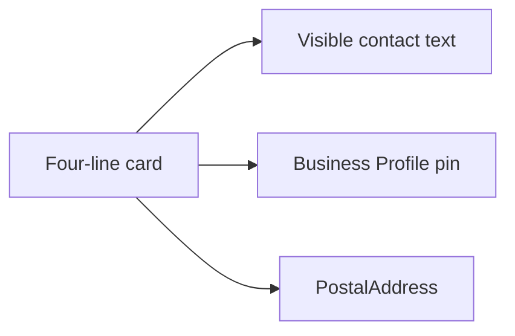

# Does having a physical address listed consistently across the web help AI visibility?

**Yes, when the address is a real door customers can visit, and the page, the markup, and the Google Business Profile all name that same door.** A second street, a P.O. box, or a mailbox you do not staff does not help. Google has not published a citation bonus for matching addresses.

I call the record a **door line**. Four lines: street with the suite on it, city, region, postal code. The country code sits next to them in the markup. If those four lines name one door, you have an address a model can repeat. If they name two doors, you have a fight.

I'm William Spurlock, AI Systems Architect and Fractional AI CTO at Spurlock Studios LLC. I've built 600+ automations, with 500+ live. I've spent 20,000+ hours architecting agentic systems, and that work has saved clients 35,000+ hours. I've been SEO-certified since 2021. The work now sits under AEO, AIO, and GEO. None of those hours make a rented mailbox into a shop.

This page scores the door only. The name and the phone live on [how to get your local business into AI-generated recommendations](/blog/how-to-get-your-local-business-into-ai-generated-recommendations). The long JSON-LD field list lives on [how brand consistency and NAP schema build entity authority for AI](/blog/how-brand-consistency-and-nap-schema-build-entity-authority-for-ai). The city-level recommendation stack lives on [AI visibility for local businesses](/blog/ai-visibility-for-local-businesses-getting-recommended-in-your-city). I will not reprint those three.

## Does having a physical address listed consistently across the web help AI visibility?

**A consistent physical address helps when it is the door you actually staff, written the same way on the page a person can read, in the PostalAddress, and on the Business Profile.** It does not help when the string is a mailbox, a second street, or a home address you were told to hide. I have no percentage that says matching strings raise AI citations.

Google's [local ranking help](https://support.google.com/business/answer/7091), as I read it on 24 October 2026, says local results are mainly based on relevance, distance, and popularity. **Distance** is how far each business is from the customer who is searching. If that customer does not share a location, Google uses what it knows about their location. The same page says complete, accurate information makes a profile more likely to show in local search, and inaccurate information can keep it from showing for relevant searches in the area. If customers can visit, provide the full address. There is no way to request or pay for a better local ranking.

That distance sentence is about local results on Maps and Search. It is not a published formula for [Google AI Overviews](https://developers.google.com/search/docs/appearance/ai-features). The AI features guide, as I read it the same day, says there are no additional requirements to appear in AI Overviews or AI Mode, and no special schema for those features. A supporting link still has to be indexed and eligible for a snippet. Indexing is not guaranteed. Overviews often do not trigger. AI Mode and AI Overviews may use different models. The guide does tell you to keep structured data matched to the visible text, and to keep Business Profile information up to date. Clicks from results pages with AI Overviews are described as higher quality, meaning people are more likely to spend more time on the site. No percentage is given. Those appearances are counted in the Performance report under the Web search type.

The two jobs are different. The address is how Google knows which door to measure for local distance. The same string, visible on a page, is what an answer can quote if it cites you. Matching the string is not a published lift inside an Overview.

<table>
  <thead>
    <tr>
      <th>What owners hope the address does</th>
      <th>What the pages I read on 24 October 2026 actually say</th>
    </tr>
  </thead>
  <tbody>
    <tr>
      <td>A matched address raises AI citations by a set percent</td>
      <td>The AI features guide gives no such percent. It says keep the profile up to date and match markup to visible text.</td>
    </tr>
    <tr>
      <td>Any street printed on the web helps</td>
      <td>Business Profile guidelines want a precise address for a real location, or a service area when you travel to the customer.</td>
    </tr>
    <tr>
      <td>LocalBusiness markup puts you in AI Overviews</td>
      <td>The AI features guide says there is no special schema for AI Overviews or AI Mode.</td>
    </tr>
    <tr>
      <td>Local distance ignores the street</td>
      <td>Local ranking help says distance is how far the business is from the customer who is searching.</td>
    </tr>
    <tr>
      <td>Two written streets give you two chances</td>
      <td>Google says it displays your address from your information and from other sources.</td>
    </tr>
  </tbody>
</table>

The door line I write down has four lines, plus the country code in markup:

- **Street, with the suite on that same line** when a suite exists. This is the line that becomes a different door if the number changes.
- **City**, the locality schema.org calls `addressLocality`.
- **Region**, the state or province, in the form you can defend on the storefront.
- **Postal code**, the same code as the door, not the code for the next block.
- **Country code** in the markup. [Schema.org PostalAddress](https://schema.org/PostalAddress), as I read it on 24 October 2026, recommends a 2-letter ISO 3166-1 alpha-2 code, with `US` as the example shape.

**My opinion:** I do not chase "St" versus "Street." A platform that expands an abbreviation has not created a second door. A different street number, a missing suite, a different city, or a different postal code has. I would rather leave one abbreviation alone than publish two streets so a directory and a footer both feel "complete."

Google's own name example is a storefront, not a client of mine. The [Business Profile guidelines](https://support.google.com/business/answer/3038177) use Shelly's Coffee at 3247 Poppy Street, San Francisco, CA 94102. One name, one street, one city, one region, one postal code. That is what a complete door line looks like. I am not telling you to copy Poppy Street.

## What happens when the same business lists two different street addresses?

**Google may show an address built from your profile and from other sources, and local distance is measured from a place.** Two streets mean two candidates for that place. I do not have a published rate for how often the old door wins.

The guidelines, as I read them on 24 October 2026, say: "Google determines how best to display your business address based on your business information and information from other sources." Other sources include the page you control and pages you do not. If the footer says one street and a directory still says the street you left, you handed Google two inputs. The prominence wording on the ranking page is a separate factor: the intro says popularity, and the subsection calls it prominence, meaning how well-known the business is, including links and reviews. I am not folding that into the address.

A duplicate profile for the same door is a different mistake from a second real shop. The basic guidelines say there should be one profile per business, because extra profiles cause problems with how information displays on Google Maps and Search. The address section says not to create more than one page for each location. The service-area section says a separate staffed location, with its own service area and its own staff, may have its own profile. One door, one profile. A second door you staff can have its own. Two profiles for one door are the split I refuse.

<table>
  <thead>
    <tr>
      <th>What disagrees</th>
      <th>Same door or a second door</th>
      <th>What I do</th>
    </tr>
  </thead>
  <tbody>
    <tr>
      <td>Street number, suite, city, or postal code</td>
      <td>Second door</td>
      <td>Pick the door you staff. Remove the other from the page, the markup, and the profile.</td>
    </tr>
    <tr>
      <td>"St" on the profile and "Street" on the footer</td>
      <td>Same door, if the number and suite match</td>
      <td>I leave it. I do not open a listing project over the abbreviation.</td>
    </tr>
    <tr>
      <td>Suite on line 2 of the profile, and inside <code>streetAddress</code> in markup</td>
      <td>Same door, if the suite number is the same</td>
      <td>Keep the number. Do not demand one byte string across a two-line form and a single schema field.</td>
    </tr>
    <tr>
      <td>A second profile at the same door</td>
      <td>Split record</td>
      <td>One profile for that door. Do not feed Maps two pins for one shop.</td>
    </tr>
    <tr>
      <td>A second staffed shop</td>
      <td>A real second door</td>
      <td>Its own profile, its own page, its own PostalAddress. Not a second street in the first footer.</td>
    </tr>
  </tbody>
</table>

What I refuse to treat as a strategy:

- Printing the old street in a footer "so old customers can find us." That is a second door on a page you control.
- Adding the city name into the street line as a keyword. The guidelines say not to put information in the address lines that is not the physical location, including keywords and URLs.
- Using a nearby landmark as the address when the street number already pinpoints the shop. Landmarks are for regions where the official street address does not pinpoint the location.
- Hoping the pin will correct a wrong street. If the system cannot find the address, Google says you can pin the location. A pin does not make a false street true.

The NAP page already covers name conflicts and call-tracking numbers. I am not repeating that audit. If the phone is the thing that disagrees, leave this page and fix the phone there. If the street number disagrees, stay here.

## How do I write one door line for the site, the markup, and the Business Profile?

**Write the four lines once, put them where a reader can see them, then copy the same values into the profile and the PostalAddress.** The profile form splits the suite onto line 2. Google's LocalBusiness example keeps the suite inside `streetAddress`. Those are two forms, not two doors.

On 24 October 2026, Google's [LocalBusiness documentation](https://developers.google.com/search/docs/appearance/structured-data/local-business) listed `address` and `name` as the required properties for that rich result. The address is a PostalAddress for the physical location, and the page says to include as many properties as possible. The documented example is not a business I work with. It is theirs, including their spelling "Suit":

```json
{
  "@type": "PostalAddress",
  "streetAddress": "148 W 51st St Suit 42 Unit 7",
  "addressLocality": "New York",
  "addressRegion": "NY",
  "postalCode": "10019",
  "addressCountry": "US"
}
```

I do not want you to copy "Suit" as a style. I want you to see that Google's own example puts the unit in `streetAddress`, next to the street, with city, region, postal code, and country beside it. [Schema.org](https://schema.org/PostalAddress) also offers `extendedAddress` for an apartment line, and the Jane Doe example on that page puts "Suite 123" there. Use one of those slots. Do not invent a third street to hold the suite.

Latitude and longitude are recommended, not required, at a precision of at least 5 decimal places. I do not invent coordinates in a blog example. If you add `geo`, read them off the pin for the door you staff. Telephone is recommended too, with country code and area code. The phone string is the other post.

[Structured data guidelines](https://developers.google.com/search/docs/appearance/structured-data/sd-policies), as I read them the same day, say the markup has to be a true representation of the page content. Do not mark up a door the reader cannot see. Hidden content is one reason valid markup may never show. A manual action removes rich-result eligibility and does not by itself change ordinary web ranking. JSON-LD is the recommended format of the three they list: JSON-LD, Microdata, and RDFa. Google does not guarantee a rich result even when the test passes. Define each location as its own LocalBusiness, on a page about that location. Putting one footer address on every city page publishes the wrong door on purpose.

<table>
  <thead>
    <tr>
      <th>Door line</th>
      <th>Where a person reads it</th>
      <th>Business Profile</th>
      <th>PostalAddress</th>
    </tr>
  </thead>
  <tbody>
    <tr>
      <td>Street</td>
      <td>Contact page or footer, in the text</td>
      <td>Address line 1</td>
      <td><code>streetAddress</code></td>
    </tr>
    <tr>
      <td>Suite, if you have one</td>
      <td>Same sentence or the next line of the address</td>
      <td>Address line 2</td>
      <td>Inside <code>streetAddress</code>, or in <code>extendedAddress</code></td>
    </tr>
    <tr>
      <td>City</td>
      <td>Visible text</td>
      <td>City field</td>
      <td><code>addressLocality</code></td>
    </tr>
    <tr>
      <td>Region</td>
      <td>Visible text</td>
      <td>State or province field</td>
      <td><code>addressRegion</code></td>
    </tr>
    <tr>
      <td>Postal code</td>
      <td>Visible text</td>
      <td>Postal code field</td>
      <td><code>postalCode</code></td>
    </tr>
    <tr>
      <td>Country</td>
      <td>Visible if you serve more than one country</td>
      <td>Country on the profile</td>
      <td><code>addressCountry</code>, such as <code>US</code></td>
    </tr>
  </tbody>
</table>

The order I use when I set this up:

1. Stand at the door, or admit there is no public door. The next section explains that choice. Do not fill the card before you make it.
2. Write the four lines on one card. Street with suite, city, region, postal code.
3. Put those lines in the visible contact text. A reader who never opens the page source should still see the door.
4. On the Business Profile, street on line 1, suite on line 2, and the pin on that door. Keep permanent fixed signage of the business name if you show the address. That signage line is in the guidelines.
5. Add one LocalBusiness JSON-LD block on the page about that location. `name` and `address` are the required pair. Match the visible lines. Do not add a second block for a city you do not staff.



**My opinion:** markup that names a door the footer does not print is worse than no LocalBusiness block. You asserted a place the reader cannot check. I would delete the block before I would hide the street in a script.

## Should a service-area business publish a street address for AI visibility?

**No, not if you have no storefront.** Google says a service-area business should hide the address. The plumber example is a home address: clear it. Printing that home street on the website, so an answer engine has "something to cite," fights the profile you were told to clear.

I read this on the guidelines page on 24 October 2026. A service-area business serves customers at their locations and should have one profile for the central office or location, with a designated service area. It cannot list a virtual office unless that office is staffed during business hours. The address section is stricter about the unstaffed case: if you rent a mailing address and do not operate there, that location is not eligible for a Business Profile. I read those as one rule with a staffed exception. A mail drop with nobody from your company on site is not a door. An office your staff actually works, during posted hours, is no longer that mail drop.

A hybrid, such as a repair shop with a garage that also goes to the customer, may show the storefront and set a service area. The location has to be staffed by your team and able to receive customers during the stated hours. Businesses tied to a minimum age, including alcohol, cannabis, and weapons, are not permitted as service-area businesses without a storefront. I am not softening that.

If you have no storefront and no clear signage, and you travel to the customer, you are allowed one service-area profile. Separate locations with separate service areas and separate staff may each have a profile. The service area should not extend farther than about 2 hours of driving time from where the business is based. Google says a larger area may be appropriate for some businesses. That "about 2 hours" is their boundary, not a radius I sell. I do not turn it into a weekly publishing plan.

Co-working has its own test. You cannot list an office there unless the office has clear signage, receives customers at that location during business hours, and is staffed during those hours by your staff. Fail any one of the three, and that suite is not your door.

<table>
  <thead>
    <tr>
      <th>How you meet customers</th>
      <th>Business Profile</th>
      <th>Public page</th>
    </tr>
  </thead>
  <tbody>
    <tr>
      <td>Storefront they can visit</td>
      <td>Show the address. Keep signage of the business name at that door.</td>
      <td>Print the same four lines in the text.</td>
    </tr>
    <tr>
      <td>Shop plus travel to the customer</td>
      <td>Show the shop and set a service area only if your team staffs it and can receive customers during stated hours.</td>
      <td>Print the shop door. Name the travel area in sentences.</td>
    </tr>
    <tr>
      <td>No storefront. You go to them.</td>
      <td>Hide the address. One profile, unless you have another staffed base.</td>
      <td>Do not print the home street. Name the cities you serve in sentences.</td>
    </tr>
    <tr>
      <td>Unstaffed virtual office or remote mailbox</td>
      <td>Not an eligible location.</td>
      <td>Do not publish that mailbox as the place people visit.</td>
    </tr>
    <tr>
      <td>Co-working suite</td>
      <td>Only with signage, customers during hours, and your staff during hours.</td>
      <td>Same three tests. If you fail one, leave the suite off the page.</td>
    </tr>
  </tbody>
</table>

What I want on the page when the profile hides the street:

- The cities or neighborhoods you actually serve, in sentences, not a keyword block.
- The fact that you travel to the customer, if that is the offer.
- No residential street "for trust." The guidelines use the plumber at home as the example of an address to clear.
- No map embed of the house you just hid. The embed is another copy of the door.

**My opinion:** I would not rent a virtual office so ChatGPT or an Overview has a street to repeat. The guidelines say that location is not eligible. A model that copies it is copying a door you do not operate. For a business with no shop, staying consistent means leaving the public street off both the profile and the page.

## How do I check that the address on my page, my schema, and my Business Profile is the same door?

**Read the four lines off the contact page, then off the JSON-LD, then off the Business Profile.** Same street number, same suite, same city, same region, same postal code. I do not need a vendor for that pass, and I am not giving you a calendar.

This is a reading check. It is not the seven-day shortlist audit, and it is not a promise that an Overview will name you after the lines match. The AI features guide says a page can meet the rules and still not be indexed or served. Recrawling can take several days to several months. I will not pretend a matched suite beats that.

<table>
  <thead>
    <tr>
      <th>What I open</th>
      <th>What I copy onto the card</th>
      <th>Fail</th>
    </tr>
  </thead>
  <tbody>
    <tr>
      <td>Contact page, footer, and any location page</td>
      <td>The address a person sees without view-source</td>
      <td>A second street, or a street that only exists inside the script</td>
    </tr>
    <tr>
      <td>The LocalBusiness JSON-LD on that page</td>
      <td><code>streetAddress</code>, <code>extendedAddress</code> if used, locality, region, postal code, country</td>
      <td>A door the visible text does not show, or a missing required <code>address</code></td>
    </tr>
    <tr>
      <td>The Business Profile</td>
      <td>Line 1, line 2, city, region, postal code, and whether the address is hidden</td>
      <td>A P.O. box, an unstaffed mailbox, or a shown address with no signage of your name</td>
    </tr>
    <tr>
      <td>One directory an answer already cites, if you have one</td>
      <td>The street number and suite only</td>
      <td>A different number. "Street" versus "St" is not the fail.</td>
    </tr>
  </tbody>
</table>

The pass, in order:

1. If you have no storefront, confirm the profile hides the address and the public page does not print the home street. Stop. You are consistent by omission.
2. If you have a storefront, write the four lines from the sign on the door, not from memory of an old lease.
3. Compare the visible page to those four lines. Fix the page before you touch markup. The markup has to follow the text a reader sees.
4. Compare the profile. Suite on line 2. Pin on that door. One profile for that door.
5. Compare the JSON-LD. If it names any other street, delete that block or correct it. Do not leave both.
6. If you moved, the old street comes off the page, the markup, and the profile. I am not assigning a number of days. Directories you do not control can still show the old door, and Google says other sources can affect how your address displays. Fix what you control first.

I do not add a fifth surface after this pass. A thin directory that only repeats the street, with no sentence about the business, is not this check. This check stops when the door you staff is the only door on the page, the markup, and the profile.

## FAQ

### Does a P.O. box count as a physical address on Google Business Profile?

**No. Google's guidelines say P.O. boxes or mailboxes at remote locations are not acceptable.** Schema.org does have `postOfficeBoxNumber` for a mailing address, as I read [PostalAddress](https://schema.org/PostalAddress) on 24 October 2026. That field does not turn a box into the physical location Google's LocalBusiness docs ask for. I would not put a P.O. box in `streetAddress` to give an answer engine a line to quote.

### Does a virtual office help AI visibility?

**An unstaffed virtual office is not eligible for a Business Profile, so I do not treat it as an AI-visibility tactic.** The guidelines define it as a physical mailing address you rent and do not operate from. The service-area section adds that you cannot list a virtual office unless it is staffed during business hours. Staff on site, during hours, is an office. A mailbox with your name on a directory is not.

### Can I list a co-working space as my business address?

**Only if that office has clear signage, receives customers there during business hours, and is staffed during those hours by your staff.** Miss one of those three and the guidelines say you cannot list it. I use the same three tests on the website. A suite that fails on the profile should not show up as the door in the footer.

### Does the suite number have to match on every listing?

**The suite number has to be the same number wherever it appears. The slot can differ.** Business Profile guidelines put the suite on address line 2. Google's LocalBusiness example puts the unit inside `streetAddress`. Schema.org also allows `extendedAddress`. "Suite 4" and "Ste 4" are the same suite to me. "Suite 4" and no suite, or suite 4 and suite 12, are different doors.

### Does LocalBusiness schema replace a visible address on the page?

**No. Google's structured data guidelines say not to mark up content the reader cannot see.** The LocalBusiness page lists `address` as a required property for that rich result, and it says the address is the physical location. Calling it required for the rich result does not mean "hide it in JSON-LD." The AI features guide, read 24 October 2026, also says there is no special schema that gets a page into AI Overviews or AI Mode, and that markup should match the visible text.

### Does a consistent street address guarantee a mention in Google AI Overviews?

**No. The AI features guide says there are no additional requirements, and that meeting them still does not guarantee indexing or serving.** Overviews often do not trigger. AI Mode may use a different model, so the links can differ. If a supporting link is shown, a matched door gives the answer the right address to repeat. It does not book the mention. Those appearances, when they happen, show up in Search Console under the Web search type.

### What should I do with the old street address after a move?

**Take it off the page, the JSON-LD, and the Business Profile. Leave the new door as the only street you publish.** I am not giving you a day count for directories you do not control. Google says it may display your address using your information and other sources, so an old listing can still feed the display. Fix the three surfaces you edit, and do not keep the old street in the footer "for a while."

### How far can a service area extend on a Google Business Profile?

**Google says the service area should not extend farther than about 2 hours of driving time from where the business is based.** The same sentence says a larger area may be appropriate for some businesses. That is their wording, as I read it on 24 October 2026, not a circle I draw for every trade. Separate staffed bases can each have a profile and a service area. One hidden home address does not justify a national radius.

### Should my website print a home street if the Business Profile hides it?

**No. Hiding the address on the profile and printing it on the site is two stories.** The guidelines tell a service-area business to hide the address, and they use a plumber at a residential address as the example to clear. Put the cities you serve in ordinary sentences. Do not embed a map of the house. If there is no storefront, leave the public street off both surfaces.

## Get an AI-visibility-ready site built

**The door line cannot stay true on a page that hides the street in markup, or prints a mailbox you do not staff.** I build AI-visibility-ready sites for that gap: the address in the first screen of the contact page, visible text that matches the PostalAddress, one LocalBusiness block per door you staff, and no second street left in a footer. I'm William Spurlock, AI Systems Architect and Fractional AI CTO at Spurlock Studios LLC.

Bring the four lines from the door, the Business Profile screenshot, and the JSON-LD block. I want those three on the table before a build conversation.

[Bring the door line](/contact).
