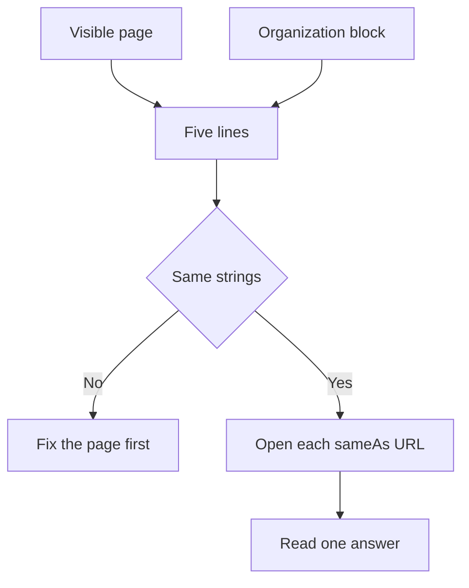

# How do I build entity authority for my brand in AI systems?

**You build entity authority for your brand in AI systems by making one organization easy to repeat: one public name, one site URL, and a short list of pages on other sites, written the same way on the page a person reads and in the Organization block on that page.** I call that record a disambiguation card. Five lines. If two of them disagree, you published two organizations.

I'm William Spurlock, AI Systems Architect and Fractional AI CTO at Spurlock Studios LLC. I've built 600+ automations, with 500+ live. I've spent 20,000+ hours architecting agentic systems, and that work has saved clients 35,000+ hours. I've been SEO-certified since 2021. The work now sits under AEO, AIO, and GEO. Those hours do not make two names look like one company.

This page sticks to the card. The schema-type list and the validator walk-through stay on [schema, structured data, and entity SEO](/blog/schema-structured-data-and-entity-seo-the-technical-core-of-ai-visibility). Whether a Wikipedia or Wikidata page should exist at all stays on [does Wikipedia or Wikidata presence affect AI citation](/blog/does-wikipedia-or-wikidata-presence-affect-ai-citation). How a knowledge panel gets created stays on [how structured data helps AI understand and cite your business](/blog/how-structured-data-helps-ai-understand-and-cite-your-business). Those three topics stay on their own pages, and this one does not come with a calendar.

## What does entity authority mean when an AI system has to tell two brands apart?

**Entity authority, on this card, means an AI system can repeat your organization without mixing it with another organization that shares a word in the name.** It is not a score Google publishes. It is not a Knowledge Panel you can order. It is not a block of markup with every property filled in.

Google's [Knowledge Panel help](https://support.google.com/knowledgepanel/answer/9787176), as I read it on 28 October 2026, calls the Knowledge Graph a database of billions of facts about people, places, and things. Facts come from public sources, from licensed data, and from content owners who suggest changes to panels they have claimed. Knowledge panels are created automatically when there is enough information on the open web. If a panel already depicts you, and you are the subject or an official representative, you can claim it and suggest changes. Businesses are told to use Business Profile for business panels. A panel can also stop displaying. Google says that happens automatically, and that it is not something they can or would influence.

The [Knowledge Graph Search API](https://developers.google.com/knowledge-graph), as I read it the same day, finds entities. The page says the API is read-only. It returns individual matching entities, not a graph of how they connect, and it points to Wikidata dumps if you need the graph. I will not quote the sample score on that page as a pass mark. The sample is a famous person. A missing row is not a failed card. The API does not add your brand.

<table>
  <thead>
    <tr>
      <th>What owners hope entity authority is</th>
      <th>What the pages I read on 28 October 2026 actually say</th>
    </tr>
  </thead>
  <tbody>
    <tr>
      <td>Organization markup creates a Knowledge Panel</td>
      <td>Panels are created automatically when there is enough information on the open web.</td>
    </tr>
    <tr>
      <td>The Knowledge Graph Search API adds the brand</td>
      <td>The API is read-only. It finds entities. It does not write them.</td>
    </tr>
    <tr>
      <td>A filled schema block is required for AI Overviews</td>
      <td>The AI features guide says there is no special schema for AI Overviews or AI Mode.</td>
    </tr>
    <tr>
      <td>Every Organization property should be filled</td>
      <td>The Organization guide says there are no required properties. Add the ones that apply.</td>
    </tr>
    <tr>
      <td>Two public names give two ways to be found</td>
      <td>Google says to use the same name and alternateName you use for the site name.</td>
    </tr>
  </tbody>
</table>

Here is what an answer needs to repeat the company correctly, without guessing:

- **One public name.** The name a buyer would type, not a slogan and not a city stuffed into the name.
- **One other name, only if you truly use it.** A registered name that differs, or a short name people already say.
- **One site URL.** The site that identifies the organization, not a social profile and not a folder.
- **One presence fact a person can see.** An address, a phone number, or a logo, already on the page.
- **Pages on other sites that are this organization.** Not pages that merely mention a similar word.

**My opinion:** if you cannot say which of two companies an answer should name, you do not have an authority problem. You have a naming problem. Fix the name before you touch a panel, an API key, or a Wikidata item.

## How do I build entity authority for my brand in AI systems?

**Build it by writing five lines on one page, then copying those same lines into one Organization block on that page.** [Google's Organization guide](https://developers.google.com/search/docs/appearance/structured-data/organization), as I read it on 28 October 2026, says adding this markup to your home page can help Google understand administrative details and disambiguate your organization in search results. Some properties, including `iso6523` and `naics`, are used behind the scenes to tell organizations apart. A logo can influence what shows in Search and on a knowledge panel. There are no required properties. The focus it names is `name` or `alternateName`, a real-world presence fact such as `address` or `telephone`, and an online presence fact such as `url` or `logo`.

Put the block on the home page, or on one page that describes the organization, such as the about page. Google says you do not need it on every page. Use the most specific subtype that fits. A store should look at `OnlineStore`. A shop with a door should use the LocalBusiness subtype and the local fields, not a generic Organization pretending to be a storefront. I am not re-teaching those local fields here.

<table>
  <thead>
    <tr>
      <th>Line</th>
      <th>Property</th>
      <th>What belongs on it</th>
      <th>Leave it blank when</th>
    </tr>
  </thead>
  <tbody>
    <tr>
      <td>1</td>
      <td><code>name</code></td>
      <td>The public name, the same string as the site name</td>
      <td>Never. A card with no public name is not a card.</td>
    </tr>
    <tr>
      <td>2</td>
      <td><code>alternateName</code> or <code>legalName</code></td>
      <td>A short name you go by, or the registered name if it differs</td>
      <td>The public name is already the only name.</td>
    </tr>
    <tr>
      <td>3</td>
      <td><code>url</code></td>
      <td>The website that identifies the organization</td>
      <td>You have no site. Then this card is the wrong job.</td>
    </tr>
    <tr>
      <td>4</td>
      <td><code>address</code>, <code>telephone</code>, or <code>logo</code></td>
      <td>One presence fact that is also visible on the page</td>
      <td>You would have to invent the fact to fill the field.</td>
    </tr>
    <tr>
      <td>5</td>
      <td><code>sameAs</code></td>
      <td>Pages on other websites about this organization</td>
      <td>The URL is your own site, a dead profile, or someone else.</td>
    </tr>
  </tbody>
</table>

The order I actually use:

1. Write the five lines from the page a stranger can read. Sentences, the header, the footer, and the logo. Not from memory of an old deck.
2. Put those lines into one JSON-LD Organization block on that same page. [General structured data guidelines](https://developers.google.com/search/docs/appearance/structured-data/sd-policies), as I read them on 28 October 2026, recommend JSON-LD over Microdata and RDFa, and they say not to mark up content the reader cannot see.
3. Match line 1 to the site name. [Google's site names guide](https://developers.google.com/search/docs/appearance/site-names) says site-name selection is automated from the home page and from references on the web. `WebSite` markup on the home page is how you state a preference. Required there: `name` and `url`. `alternateName` is optional, in the order you prefer.
4. Keep one site name per domain or subdomain. A folder such as `example.com/news` cannot have its own site name. Google says `www` and `m` are generally the same site. Duplicate home pages, including the www host and the bare host, should carry the same site-name markup.
5. Stop. Do not add a DUNS, an LEI, a NAICS code, an employee count, or a founding date unless that fact is on the page and you can point to it. Google lists those properties as ones you add when they apply. The ISO 6523 examples on the Organization page are `0060` for a DUNS, `0088` for a GS1 location number, and `0199` for a Legal Entity Identifier, with a colon between the code and the identifier.

Line 2 is where studios get cute. [schema.org legalName](https://schema.org/legalName), as I read it on 28 October 2026, is the official name of the organization, for example the registered company name. Google says to use `legalName` when it differs from `name`. My public name is Spurlock Studios. The registered name is Spurlock Studios LLC. Those are two strings on purpose. The public name goes in `name` and in the site name. The registered name goes in `legalName` only if the page also shows it. I do not put the LLC in the site name and hope a model will drop it.

Google's own site-name examples make the same cut. They use "Google" rather than "Google, Inc" as the concise name, and they say a generic name such as "Best Dentists In Iowa" is unlikely to be selected unless it is an extremely well-recognized brand. Pick the name buyers already use. Give an alternate only when you truly go by it.

**My opinion:** I would ship the five lines and stop. A block that adds a guessed identifier is closer to misrepresentation than to authority. The quality guidelines say not to impersonate an organization or misrepresent ownership, affiliation, or primary purpose. A logo, if you use one, has to be at least 112 by 112 pixels, on a crawlable and indexable URL, in a format Google Images supports, and it still has to look right on a white background. A phone, if you use one, includes the country code and the area code. A founding date, if you use one, is ISO 8601, and the date has to be visible. Empty beats invented.

## What happens when Organization markup and the visible page name two different brands?

**You taught two organizations.** The reader met one name. The script asserted another. [Google's quality guidelines](https://developers.google.com/search/docs/appearance/structured-data/sd-policies) say structured data has to represent the page, and they say not to mark up hidden or misleading content. A structured data manual action removes eligibility for rich results. The same page says that action does not change how the page ranks in ordinary web search. I still would not leave the conflict up. An answer that quotes the hidden name is quoting a brand the reader never saw.

Google also says it does not guarantee that a feature which consumes structured data will show, even when the Rich Results Test passes. The test can miss a conflict that is not a syntax error. Two true-looking blocks are still two brands if the strings disagree.

<table>
  <thead>
    <tr>
      <th>Conflict</th>
      <th>What an AI system is being taught</th>
    </tr>
  </thead>
  <tbody>
    <tr>
      <td>The page says the public name. The script says only the registered name.</td>
      <td>A reader and a crawler met different organizations.</td>
    </tr>
    <tr>
      <td><code>WebSite</code> name on the home page differs from Organization <code>name</code>.</td>
      <td>You ignored the instruction to use the same name for the site name and the organization.</td>
    </tr>
    <tr>
      <td><code>url</code> points at a social profile.</td>
      <td>The website field is being used as a profile field. The profile belongs on <code>sameAs</code>.</td>
    </tr>
    <tr>
      <td><code>sameAs</code> includes the homepage.</td>
      <td>Your own site is standing in as "another website."</td>
    </tr>
    <tr>
      <td>The logo exists only inside the script.</td>
      <td>Hidden markup. The file still has to meet the 112 by 112 rule if you keep it.</td>
    </tr>
    <tr>
      <td>Two Organization blocks, two phone numbers.</td>
      <td>Two presence facts. Keep the one the page shows.</td>
    </tr>
    <tr>
      <td>A retired name left in <code>alternateName</code> after a rebrand.</td>
      <td>A name you no longer go by, still asserted as a name you go by.</td>
    </tr>
  </tbody>
</table>

Fix the conflict in this order:

1. Read the page as a person. Write the five lines from what you can see.
2. If the page is wrong, change the page. Do not edit a true page so it matches a stale script.
3. Then change the JSON-LD so it copies the page.
4. Then check `WebSite` `name` on the home page against line 1.
5. Delete the extra Organization block. Do not keep both.
6. Do not call a recrawl the fix. The strings have to match before any clock matters.

The Organization guide says it may take several days after publishing for Google to find and crawl the page. The site-names guide gives a different clock: a few days to a few weeks after you publish, and several days to several weeks after you change a site name. I do not average those into one wait. I also do not borrow the AI-features clock. That page, on preview controls such as `nosnippet`, says crawling can take several days to several months. That sentence is about preview controls. It is not a deadline for this card.

A missing rich result after the strings match is still not proof the card failed. Google said the feature is not guaranteed. A missing AI Overview tells me nothing about this card either. I cover that in the FAQ. The failure mode on this page is two names, not a missing box in the search results.

## Which URLs belong in sameAs when I build entity authority?

**A sameAs URL belongs on the card when it is a page on another website about this same organization.** Google's Organization guide defines `sameAs` that way, with a social profile or a review profile as the example, and it says you can provide more than one. `url` is the separate field: the organization's website, which helps Google uniquely identify it.

[schema.org sameAs](https://schema.org/sameAs), as I read it on 28 October 2026, is the URL of a reference page that unambiguously indicates the item's identity. Its examples are a Wikipedia page, a Wikidata entry, or an official website. Those two definitions are not copies of each other. schema.org will accept the official website inside `sameAs`. Google puts the official website in `url` and describes `sameAs` as another website.

I follow Google's split on the card. The official site goes on line 3. Other sites go on line 5. Listing the homepage in both fields does not create a second source. It copies line 3.

<table>
  <thead>
    <tr>
      <th>URL you are tempted to add</th>
      <th>Where it goes</th>
    </tr>
  </thead>
  <tbody>
    <tr>
      <td>LinkedIn, YouTube, X, or a review profile that is this organization</td>
      <td><code>sameAs</code>, after you open the page and read the name</td>
    </tr>
    <tr>
      <td>A Wikidata item that is this organization</td>
      <td><code>sameAs</code>. Creating the item is a different decision.</td>
    </tr>
    <tr>
      <td>A Wikipedia article that is this organization and that you did not write</td>
      <td><code>sameAs</code>. I will not tell you to write the article.</td>
    </tr>
    <tr>
      <td>Your homepage</td>
      <td><code>url</code>. Not <code>sameAs</code>.</td>
    </tr>
    <tr>
      <td>A blog post on your own site</td>
      <td>Nowhere on this card. That page is your site.</td>
    </tr>
    <tr>
      <td>A profile that does not load, or a person with a similar name</td>
      <td>Nowhere. Take it off if it is already listed.</td>
    </tr>
    <tr>
      <td>A directory row for a different street or a different city</td>
      <td>Nowhere. That is a different door, not a second profile of this one.</td>
    </tr>
    <tr>
      <td>A partner page that lists your logo in a row of clients</td>
      <td>Nowhere, unless the page is unambiguously about this organization. A logo in a row is not.</td>
    </tr>
  </tbody>
</table>

Before a URL stays on line 5, I open it:

1. The page loads.
2. It names this organization, not a founder who happens to share the last name. This card is the organization. A person card is a different record.
3. It is another website, not a URL on the site in line 3.
4. I can explain, in one sentence, why a stranger would treat that page as this organization.
5. I stop when the next URL is a maybe. Google does not publish a count. I will not invent one.

Five URLs that pass those checks are enough. Twenty maybes make it easier to point at the wrong organization. If the only encyclopedia URL you have is one you wrote yourself, leave it off and deal with that choice on the Wikipedia page I already pointed at. A Wikidata URL does not replace the social profile, the `url` line, or the visible page.

## How do I check that an AI system has one organization, not two?

**Read the visible page, the Organization block on that page, each sameAs URL, and one answer that uses your public name.** The name and the URL either match the card or they do not. I do not need a vendor to run that check. This is not a full entity-SEO audit, and I am not assigning a week to it.

<table>
  <thead>
    <tr>
      <th>What I open</th>
      <th>Pass</th>
      <th>Fail</th>
    </tr>
  </thead>
  <tbody>
    <tr>
      <td>The one page, as a person</td>
      <td>The five lines are in text, the header, the footer, or the logo</td>
      <td>A line exists only in view-source</td>
    </tr>
    <tr>
      <td>The JSON-LD on that page</td>
      <td>One Organization block, JSON-LD, same five lines</td>
      <td>A second block, a hidden phone, or a logo under 112 by 112</td>
    </tr>
    <tr>
      <td>Home page <code>WebSite</code> block</td>
      <td><code>name</code> matches line 1. <code>url</code> is the home page.</td>
      <td>A different public name, or a folder treated as its own site</td>
    </tr>
    <tr>
      <td>Each <code>sameAs</code> URL</td>
      <td>Another site, and it is this organization</td>
      <td>Dead, the wrong person, or your own homepage</td>
    </tr>
    <tr>
      <td>One answer to "what is [public name]?"</td>
      <td>The name and URL in the answer match the card, or the answer names nobody</td>
      <td>The answer names a different site. Write that down.</td>
    </tr>
    <tr>
      <td>A knowledge panel, only if one is already on screen</td>
      <td>It depicts you, so a claim is even possible</td>
      <td>No panel. That is not a fail.</td>
    </tr>
  </tbody>
</table>

The pass, in order:

1. Read the page out loud and write the five lines.
2. Diff the script against those lines. If the page is the wrong one, fix the page first.
3. Open every sameAs URL. Remove the ones that fail the checks above.
4. Ask one plain question with the public name. Copy the name and the URL the answer uses. If they differ from the card, the card is not what got repeated. I do not have a published rate for how often that happens, and I will not invent one.
5. If a knowledge panel is already on the screen and it is you, claiming it is a separate Google flow. Business panels go through Business Profile. I am not walking that flow on this page.
6. Stop. Do not add a sixth surface so the check feels longer.

The Knowledge Graph Search API stays optional, and only if you already have a key. A hit means you read the name and the URL in the result and compare them to the card. A miss means nothing on this page. The API cannot insert you.

[Google's AI features guide](https://developers.google.com/search/docs/appearance/ai-features), as I read it on 28 October 2026, belongs in the same pass as a boundary, not as a prize. There are no additional requirements to appear in AI Overviews or AI Mode, and no special schema.org type you must add. You do not need a new machine-readable file or an AI text file. A supporting link still has to be indexed and eligible for a snippet. Indexing is not guaranteed. Overviews often do not trigger. AI Mode and AI Overviews may use different models, and both may fan a question out into related searches. The guide does say to keep structured data matched to the visible text. That is the card. Appearances, when they happen, are counted in Search Console under the Web search type. Clicks from results pages with AI Overviews are described as higher quality, meaning people are more likely to spend more time on the site. No percentage is given.

Three clocks, kept apart:

- **Organization page.** Several days for Google to find and crawl after you publish. That is the Organization guide.
- **Site name.** A few days to a few weeks after publishing, and several days to several weeks after you change the name. The Rich Results Test does not support site names. Use a schema validator for that block.
- **Preview controls on AI features.** Several days to several months. That clock is for controls such as `nosnippet`. It is not this card's deadline.

A matched card can still be absent from an Overview. I mark that as "not shown." I do not mark it as a broken organization.

## FAQ

### Does Organization structured data create a Google Knowledge Panel?

**No. Google says knowledge panels are created automatically when there is enough information on the open web.** You can claim a panel that already depicts you, if you are the subject or an official representative, and then suggest changes. Businesses are told to use Business Profile for those panels. A panel can stop showing, and Google says that choice is automatic and not something they would influence. This card does not create a panel.

### Does Google require any properties on Organization markup?

**No. The Organization guide says there are no required properties.** Add the ones that apply. The focus it names is `name` or `alternateName`, a real-world presence fact such as address or telephone, and an online presence fact such as `url` or `logo`. An empty optional field is cleaner than a guessed DUNS or a founding year the page does not show.

### Does Organization markup get a brand into Google AI Overviews?

**No. The AI features guide says there is no special schema.org type you must add for AI Overviews or AI Mode.** There are no additional requirements. A supporting page still has to be indexed and eligible for a snippet, and indexing is not guaranteed. Overviews often do not trigger. The guide does say to keep structured data matched to the visible text. That match is the card. It does not guarantee an appearance.

### Should legalName and the public brand name be the same string?

**Only when the registered name and the public name are already the same string.** schema.org defines `legalName` as the official name, for example the registered company name. Google says to use it when it differs from `name`. If buyers use one name, put that name in `name` and in the site name, and leave `legalName` off unless the page shows the registered name too. Do not hide the LLC only inside the script.

### Do I put Organization schema on every page of the site?

**No. Google says to put Organization markup on the home page or on one page that describes the organization, and that you do not need it on every page.** If two pages both carry a block, the five lines have to match. I would rather have one block. `WebSite` markup for the site name is a separate object, and that one belongs on the home page.

### Does a Wikidata item replace the sameAs list?

**No. A Wikidata URL can be one sameAs line when the item is this organization.** It does not replace a social profile, the `url` line, or the sentences on the page. schema.org's sameAs examples include a Wikidata entry. Creating the item, and the notability bar around Wikipedia, is a different page. I linked it above so I would not retell it here.

### Should my own website URL be a sameAs link?

**No. Put the website in `url`.** Google describes `sameAs` as a page on another website, such as a social or review profile, and describes `url` as the organization's website. schema.org's examples do include an official website inside `sameAs`. I still keep the official site on the `url` line so the two fields are not copies of each other.

### What logo size does Google want on Organization markup?

**At least 112 by 112 pixels, on a crawlable and indexable URL, in a format Google Images supports.** The Organization guide also says the logo should look right on a white background. A wordmark that exists only as CSS is not a logo URL. If the reader cannot see that image on the page, do not mark it up.

### How long might it take Google to recrawl Organization markup?

**The Organization guide says it may take several days after publishing for Google to find and crawl the page.** That is not the site-name clock, and it is not the AI-features clock. Site-name updates can take several days to several weeks. Preview-control changes on the AI features guide can take several days to several months. I do not average those into one number. None of them promises that an answer will name you.

## Get an AI-visibility-ready site built

**The card fails when the page and the Organization block disagree, or when sameAs lists a site that is not you.** I build AI-visibility-ready sites for that gap: one public name in the first screen, one `url`, Organization markup a person can check against the sentences, and no second brand left in a script. I'm William Spurlock, AI Systems Architect and Fractional AI CTO at Spurlock Studios LLC.

Bring the five lines, the live page, and the JSON-LD block. I want those three in front of me before a build conversation.

[Bring the disambiguation card](/contact).
