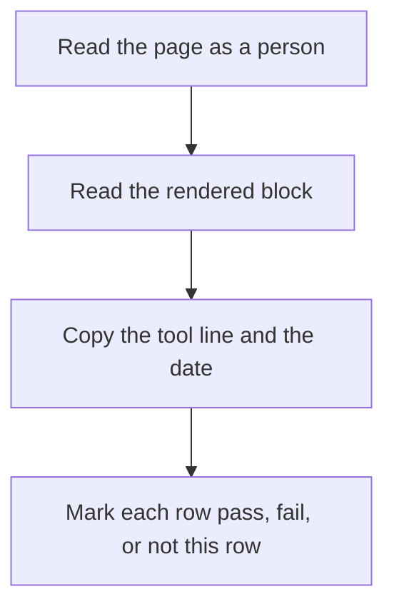

# How do I do an entity SEO audit for my website?

**An entity SEO audit for your website is one written sheet that compares three copies of the same organization: the page a person can read, the structured data in the rendered page, and the exact line a Google tool printed on the date you wrote.** My name for that record is the mismatch sheet. It has eight rows. Any disagreement among the three copies fails the row. A green badge for another schema type cannot clear the organization rows.

I'm William Spurlock, AI Systems Architect and Fractional AI CTO at Spurlock Studios LLC. My record includes 600+ automations built, with 500+ live. After 20,000+ hours architecting agentic systems, I have seen that work save clients 35,000+ hours. I've been SEO-certified since 2021. Today I put that work under AEO, AIO, and GEO. None of those hours changes what a green test badge says: the organization still has to be one organization.

The audit is on this page. For the five-line record of who the organization is, read [how I build entity authority for a brand in AI systems](/blog/how-do-i-build-entity-authority-for-my-brand-in-ai-systems). For the schema-type catalog, use [schema, structured data, and entity SEO](/blog/schema-structured-data-and-entity-seo-the-technical-core-of-ai-visibility). For the Knowledge Panel side, read [how structured data helps AI understand and cite your business](/blog/how-structured-data-helps-ai-understand-and-cite-your-business). There is no Monday, month, or page quota in this audit.

## What is an entity SEO audit for a website?

**An entity SEO audit is a check that your site describes one organization, in the sentences and in the markup, with the tool result copied onto the sheet.** Google does not publish a score for it. It does not order a Knowledge Panel. The Rich Results Test alone cannot finish it.

Google's [introduction to structured data](https://developers.google.com/search/docs/appearance/structured-data/intro-structured-data), last updated 10 December 2025, as I read it on 30 October 2026, calls structured data a standardized format for providing information about a page and classifying the page content. Its rules reject blank or empty pages created only to hold structured data, as well as structured data for information users cannot see, even when accurate. For Google Search behavior, I treat Google Search Central documentation as definitive rather than schema.org, as the page directs. Google can still make general use of the `sameAs` property and of other schema.org data.

The [Organization structured data guide](https://developers.google.com/search/docs/appearance/structured-data/organization), last updated 8 September 2026, says adding Organization structured data on your home page can help Google understand administrative details and disambiguate your organization in search results. There are no required properties. The guide says to add the properties that apply, with the focus on `name` or `alternateName`, a real-world presence fact such as address or telephone, and an online presence fact such as `url` or `logo`.

The [AI features guide](https://developers.google.com/search/docs/appearance/ai-features), last updated 10 December 2025, draws the boundary. There are no additional requirements to appear in AI Overviews or AI Mode, and no special schema.org type you must add. It does not require a new machine-readable file or an AI text file. A missing Overview does not fail the organization. That stays off my pass mark because the audit is a record, not a wish.

<table>
  <thead>
    <tr>
      <th>The sheet is</th>
      <th>The sheet is not</th>
    </tr>
  </thead>
  <tbody>
    <tr>
      <td>One sitting on the home page, or on one about page if that is where the Organization block lives</td>
      <td>A crawl of every URL on the site</td>
    </tr>
    <tr>
      <td>A diff between visible text, the rendered block, and a tool line with a date</td>
      <td>A score, a rank, or a promise that a feature will show</td>
    </tr>
    <tr>
      <td>A place to write pass, fail, or not this row</td>
      <td>A weekly ritual or a 30-day plan</td>
    </tr>
    <tr>
      <td>Allowed to pass while an AI Overview still does not name you</td>
      <td>Proof that a Knowledge Panel will appear</td>
    </tr>
  </tbody>
</table>

The three copies, in the order I write them:

1. **The page a person sees.** Header, footer, first screen, about copy. If a fact is only in view-source, it is not this copy.
2. **The rendered block.** Organization on the home page or one about page. `WebSite` on the home page. What Googlebot can see after scripts run, not a second biography stored somewhere else.
3. **The tool line.** The words the tool printed, plus the date. "Eligible" is a quote you copy. It is not a translation into "will show."

The name sends people in the wrong direction. Say "SEO audit" and people open a crawler. For the organization, I need one page, or two when the about page carries the block and the home page carries the site name. Everything else can wait.

## What fails an entity SEO audit when the Rich Results Test is green?

**A green Rich Results Test fails this audit when the green line is about a type the test supports, and the Organization block is missing, hidden, or about a different name.** I still run the test. I do not let it sign the other rows.

The [guide to generating structured data with JavaScript](https://developers.google.com/search/docs/appearance/structured-data/generate-structured-data-with-javascript), last updated 10 December 2025, says the success message is "Page is eligible for rich results" when the implementation is correct and the structured data type is supported in the tool. If you are testing a type the Rich Results Test does not support, check the rendered HTML. If that HTML contains the structured data, Google Search can process it. The Organization guide still tells you to validate with the Rich Results Test and to fix critical errors. Non-critical issues are not required for rich-result eligibility. I apply both instructions at once. A critical error is a fail on the tool row. Silence about Organization earns neither a fail nor a pass. When the report is silent about Organization, I read the rendered HTML.

The [URL Inspection tool help](https://support.google.com/webmasters/answer/9012289), as I read it on 30 October 2026, lists rich result types the tool reports. That list includes Breadcrumb, FAQ, Product snippet, Recipe, and Review snippet. Organization is not on it. `WebSite` is not on it. A page can be eligible for a breadcrumb and still have no organization block. I do not call that a passed entity SEO audit.

The [site names guide](https://developers.google.com/search/docs/appearance/site-names), last updated 10 December 2025, is stricter about its own object. Site names are not supported in the Rich Results Test. Validate that markup with a schema testing tool. Google's example is the Schema Markup Validator. A missing rich-result preview for the site name is the expected result, not a broken site.

The [general structured data guidelines](https://developers.google.com/search/docs/appearance/structured-data/sd-policies), last updated 10 July 2026, say Google does not guarantee that structured data will show in search results, even if the Rich Results Test says the markup is correct. Using structured data enables a feature. It does not guarantee the feature will be present. The reasons on that page include a result the algorithm would rather show as text, markup that is not the main content or is misleading, markup that is wrong in a way the test did not catch, content hidden from the user, and a page that misses the guidelines.

<table>
  <thead>
    <tr>
      <th>Tool</th>
      <th>What a pass sounds like</th>
      <th>What it cannot sign</th>
    </tr>
  </thead>
  <tbody>
    <tr>
      <td>Rich Results Test, URL input</td>
      <td>No critical error. "Page is eligible for rich results" only when the type is supported</td>
      <td>The organization rows. The site-name syntax. A promise the feature will show</td>
    </tr>
    <tr>
      <td>Schema Markup Validator</td>
      <td>The <code>WebSite</code> block has no syntax error</td>
      <td>Rich-result eligibility. Google does not send site names through the Rich Results Test</td>
    </tr>
    <tr>
      <td>URL Inspection</td>
      <td>You can see the HTML Google stored, or the HTML the live test just fetched</td>
      <td>Manual actions. The canonical Google will pick, if you only ran the live test</td>
    </tr>
  </tbody>
</table>

Three false passes I reject on sight:

1. **Eligible for a supported type.** FAQ, breadcrumb, product snippet, recipe, review. That line stays on the tool row. It does not check `name`.
2. **No errors, and also no Organization.** An empty report is not a clean organization. If the type is unsupported, the rendered HTML is the check.
3. **Code pasted into the test.** The JavaScript guide says to test the URL, not a pasted snippet, because the code input has JavaScript limits, including CORS. A snippet that passes on your laptop is not the page.

The Organization troubleshooting text says the Rich Results Test will not catch issues that are not syntax issues. Spammy content and spammy markup are in that bucket. A green syntax check can sit on a block that impersonates someone else. The general guidelines forbid impersonating any person or organization, and they forbid misrepresenting ownership, affiliation, or primary purpose. The sheet catches that by reading the page. The test does not.

## Which pages do I open during an entity SEO audit?

**I open the home page, and I open one about page only when that is the page that carries the Organization block.** I do not open the blog, the product grid, or a folder and call it a site.

The Organization guide says to put this information on your home page, or on a single page that describes the organization, for example an about page. Google does not require it on every page. The site names guide says `WebSite` structured data goes on the home page, meaning the domain or subdomain root. `https://example.com/news` is a subdirectory. It cannot have its own site name. Hosts that start with `www` or `m` are generally the same site. Each site gets one name. If a subdomain home page has no `WebSite` block, the domain-level name may be used as a fallback.

Both guides say the same thing about duplicates. If you have two home pages for the same content, HTTP and HTTPS, or www and non-www, put the same structured data on all of the duplicates, not only on the canonical. Checking only the canonical leaves the other host free to keep an old name. That other host is still a page.

URL Inspection, from the same 30 October 2026 read, keeps two copies apart. The indexed result is the most recently indexed version. It is not a live test. The live test fetches the URL now, and it can differ from the indexed URL. View crawled page shows the HTML that came back. A screenshot of the rendered page is available only on the live test. The live test does not check manual actions. It also cannot predict the Google-selected canonical. You read that canonical on the indexed result. There is a per-property daily limit on live inspections. The section I read does not print the number, so I will not invent one.

Do not block the page. The general guidelines say not to block structured data pages from Googlebot with robots.txt, `noindex`, or any other access control. A login wall fails this row. Google cannot audit a page it is not allowed to fetch.

<table>
  <thead>
    <tr>
      <th>URL I opened</th>
      <th>Block that belongs there</th>
      <th>Wrong URL</th>
    </tr>
  </thead>
  <tbody>
    <tr>
      <td>Domain or subdomain root</td>
      <td><code>WebSite</code> with <code>name</code> and <code>url</code>. Organization if this is the page you chose</td>
      <td>A folder, a post, a campaign URL</td>
    </tr>
    <tr>
      <td>One about page</td>
      <td>Organization, only if the home page does not already carry it</td>
      <td>A second about page with a second name</td>
    </tr>
    <tr>
      <td>The duplicate host</td>
      <td>The same blocks as the canonical</td>
      <td>Checking only the canonical and calling the audit done</td>
    </tr>
    <tr>
      <td>A blank URL that exists to hold JSON-LD</td>
      <td>Nothing. The intro guide says not to create empty pages for markup</td>
      <td>Treating that URL as the organization page</td>
    </tr>
  </tbody>
</table>

The windows, in order:

1. The URL in a browser, as a person, with no extension rewriting the text.
2. URL Inspection on the indexed version, so I know what Google last stored.
3. URL Inspection live test, when I changed the page and I need today's HTML. I write "indexed" or "live" on the sheet so I do not mix them later.
4. Rich Results Test on that same URL. Not a paste.
5. Schema Markup Validator for the `WebSite` block. Site names are outside the Rich Results Test.
6. The Manual Actions report in Search Console. One look. Then I stop opening reports.

A `WebSite` object and an Organization object on the home page are two items. The general guidelines say Google understands multiple items on a page, nested or as separate blocks. That is not two organizations. A second `WebSite` block is the one the site names guide tells you to avoid. Nest the site-name properties in the same `WebSite` node if you already have one. `alternateName` belongs there, in the order you prefer, most important first.

## How do I compare the visible page to the Organization block?

**Read the sentences first, then the JSON-LD, and fail any fact that exists only in the script.** The general guidelines say not to mark up content that is not visible to readers. Their example is direct. If the JSON-LD describes a performer, the HTML body must describe that same performer. The structured data has to be a true representation of the page content. Hidden text fails even when the hidden text is accurate. The intro guide says that in those words.

`name` is the public name. `alternateName` is another name the organization actually goes by. Google's Organization guide says to use the same `name` and `alternateName` you use for the site name. A keyword stuffed into `alternateName` is a second brand. I fail that row. The site names guide says a generic name such as a "best dentists in Iowa" style phrase is unlikely to be selected unless it is already a recognized brand. I do not put a category phrase in `name` and hope.

`legalName` is the registered name when it differs from `name`. schema.org's [legalName](https://schema.org/legalName), on the development version as I read it on 30 October 2026, calls it the official name of the organization, for example the registered company name. If the page never shows that registered name, I leave the property off. I do not hide the LLC in the script and show a shorter name to people.

`url` on Organization is the organization's website. Google says it helps uniquely identify the organization. `url` on `WebSite` is the canonical home page of the domain or subdomain. `sameAs` is a page on another website, for example a social profile or a review profile. You can list more than one. schema.org's [sameAs](https://schema.org/sameAs) calls it a reference page that unambiguously indicates the item's identity. The examples on that property are a Wikipedia page, a Wikidata entry, or an official website. Google's wording is "another website." schema.org's examples include the official website. I still keep the official site on `url`. I do not also paste that same homepage into `sameAs`. On this sheet, your own homepage inside `sameAs` fails that URL. Otherwise the two fields duplicate each other.

I inspect the logo only when the property is present. The Organization guide says at least 112 by 112 pixels, on a crawlable and indexable URL, in a format Google Images supports. It should look right on a white background. If you use `ImageObject`, it needs `contentUrl` or `url` under the same rules. Without a logo property, I write "not on the page." The absence itself does not fail. A wordmark that exists only as CSS is not a logo URL. If the reader cannot see the image, do not mark it up. Image URLs in structured data have to be crawlable. The general guidelines say to check access with URL Inspection.

Identifiers stay empty unless the page shows them. The Organization guide names ISO 6523 ICD examples `0060` for a Dun & Bradstreet DUNS, `0088` for a GS1 Global Location Number, and `0199` for a Legal Entity Identifier. It encourages `iso6523Code` with those prefixes instead of the older `duns` and `leiCode` fields. There are no required properties. I do not invent a DUNS, an LEI, a NAICS code, an employee count, or a founding date so the block looks finished. An empty optional field is cleaner than a number the sentences do not show.

If a script adds the block after load, the comparison is against the rendered DOM. The JavaScript guide says Google Search can process structured data that is in the DOM when it renders the page. Google Tag Manager raises the mismatch risk when you duplicate the facts in the tag instead of reading them from the page. I want the script to repeat the sentences. I do not want a second biography living in the tag.

JSON-LD is the format Google recommends. Microdata and RDFa are also supported for rich-result eligibility, and the intro guide says all three are fine when the markup is valid. I do not fail a page for using Microdata when the visible text and the properties match. I do fail a second Organization block that names a different organization. If two Organization blocks match, the row can pass, and I still want one block. Two copies drift. That preference is mine. Google did not publish a maximum count.

<table>
  <thead>
    <tr>
      <th>Field</th>
      <th>Visible page</th>
      <th>Fail</th>
    </tr>
  </thead>
  <tbody>
    <tr>
      <td><code>name</code></td>
      <td>The public name a person can read, same string as the site name</td>
      <td>A different brand, or a name that exists only in the script</td>
    </tr>
    <tr>
      <td><code>alternateName</code></td>
      <td>Another real name, or absent</td>
      <td>A keyword, a city list, or a second company</td>
    </tr>
    <tr>
      <td><code>legalName</code></td>
      <td>The registered name, only when the page shows it and it differs from <code>name</code></td>
      <td>An LLC stuffed into the script while the page hides it</td>
    </tr>
    <tr>
      <td><code>url</code></td>
      <td>The organization site, and the home page URL on the <code>WebSite</code> block</td>
      <td>A social profile, a folder, or a dead host</td>
    </tr>
    <tr>
      <td><code>sameAs</code></td>
      <td>Other websites that are this organization</td>
      <td>Your own homepage, a dead URL, or a different person</td>
    </tr>
    <tr>
      <td><code>logo</code></td>
      <td>An image the reader can see, at least 112 by 112 pixels, crawlable</td>
      <td>Under 112 by 112, blocked, or CSS with no file</td>
    </tr>
  </tbody>
</table>

Before a `sameAs` URL stays, I open it:

1. The page loads.
2. It is this organization, not a founder who shares a last name, and not a namesake in another city.
3. It is another website, not a URL on the site in `url`.
4. I can say, in one sentence, why a stranger would treat that page as this organization. schema.org's bar is a page that unambiguously indicates identity. If I cannot say that sentence, the URL comes off.
5. I stop when the next URL is a maybe. Google does not publish a count. I will not invent one.

I still check the most specific subtype without turning it into another project. The Organization guide says to use the most specific schema.org subtype that matches. An ecommerce site should look at `OnlineStore` rather than `OnlineBusiness`. A restaurant or a shop should look at the LocalBusiness subtypes and their own required fields, in addition to this guide. I do not run that local audit on this sheet. If the visible page is a shop and the block says a generic Organization, I mark the subtype row as "not this sheet" and I do not pretend the generic block finished the local rules. I handle those rules elsewhere.

## How do I do an entity SEO audit for my website?

**Write the eight rows, copy the tool line next to the date, and stop.** That is my whole method. I will not add a ninth row just to make the sheet look substantial.

The pass, in order:

1. Pick the URL. Home page, or one about page if that is the only Organization page. If both carry Organization, the names have to match or the extra page fails.
2. Read it out loud. Write the public name, the other name only if the page shows it, the site URL, and whether a logo, a phone, or an address is actually visible.
3. Open the rendered block. Indexed HTML if you are checking what Google stored. Live test if you changed the page today. Write which copy you opened.
4. Diff the script against the sentences. A fact that is only in the script fails. A blank page that exists to hold the script fails.
5. Open every `sameAs` URL. Remove the ones that fail the checks above.
6. Run the Rich Results Test on the URL. Copy the line. A critical error fails the tool row. "Page is eligible for rich results" does not pass the organization rows.
7. Run the Schema Markup Validator on the `WebSite` block. A syntax error fails the site-name row. Do not expect the Rich Results Test to cover that block.
8. Open the Manual Actions report. Then check whether the URL is indexed. Write the date. Stop.

<table>
  <thead>
    <tr>
      <th>Row</th>
      <th>Pass</th>
      <th>Fail</th>
      <th>Not this row</th>
    </tr>
  </thead>
  <tbody>
    <tr>
      <td>1. URL job</td>
      <td>Home page, or one about page, and duplicates carry the same blocks</td>
      <td>A folder treated as a site, a blocked page, or a blank markup URL</td>
      <td>A blog post you never claimed was the organization page</td>
    </tr>
    <tr>
      <td>2. Visible name</td>
      <td>The person-readable name matches <code>name</code>, and the site name matches it</td>
      <td>Two public names, or the name is only in the script</td>
      <td>No <code>alternateName</code>, when there is no second real name</td>
    </tr>
    <tr>
      <td>3. <code>url</code></td>
      <td>Organization <code>url</code> is the site. <code>WebSite</code> <code>url</code> is the canonical home page</td>
      <td>A profile, a folder, or two different hosts with two names</td>
      <td>Nothing. This row always applies if the block exists</td>
    </tr>
    <tr>
      <td>4. <code>sameAs</code></td>
      <td>Each URL is another site and it is this organization</td>
      <td>Dead, the wrong person, or your own homepage</td>
      <td>No <code>sameAs</code> yet. Absence is not a fail</td>
    </tr>
    <tr>
      <td>5. Logo</td>
      <td>At least 112 by 112 pixels, crawlable, visible, fine on white</td>
      <td>Too small, blocked, or not on the page the reader sees</td>
      <td>No logo property</td>
    </tr>
    <tr>
      <td>6. Rendered copy</td>
      <td>The block is in the rendered HTML of the copy you named, indexed or live</td>
      <td>The block is only in a tag manager draft, or only in a paste</td>
      <td>You have not changed the page, and you are reading the indexed HTML on purpose</td>
    </tr>
    <tr>
      <td>7. Tool line</td>
      <td>No critical error. Site-name syntax checked in the Schema Markup Validator. The line and the date are written down</td>
      <td>A critical error, a syntax error on <code>WebSite</code>, or a pasted snippet instead of the URL</td>
      <td>"Eligible" for a breadcrumb, FAQ, or other supported type. Quote it. Do not let it pass rows 1 through 6</td>
    </tr>
    <tr>
      <td>8. Manual action and index</td>
      <td>No structured data manual action. You know whether the URL is indexed</td>
      <td>A structured data manual action you did not write down</td>
      <td>A missing AI Overview, a missing Knowledge Panel, or a recrawl that has not happened yet</td>
    </tr>
  </tbody>
</table>

I keep the two manual-action sentences separate. The general guidelines say a structured data manual action means the page loses eligibility to appear as a rich result, and it does not affect how the page ranks in Google web search. Check that in the Manual Actions report. The Organization troubleshooting text says the structured data on that page will be ignored, although the page can still appear in Google Search results. Both go on the sheet. Neither becomes "the site is penalized," and neither becomes "nothing happened."

I cannot fail a recrawl row today because there is no recrawl row. The Organization guide says it may take several days after publishing for Google to find and crawl the page. The site names guide says finding and crawling can take a few days to a few weeks after publishing, and several days to several weeks after you change the name. The AI features guide says preview controls such as `nosnippet` can take several days to several months. The third clock applies to those controls. It is not this sheet's deadline. I do not average the three into one number. Even a matched sheet may be absent from the index you checked this morning. On the sheet, I write "not recrawled yet." I do not call the organization broken.

The AI features guide also says a supporting link has to be indexed and eligible for a snippet, and that indexing is not guaranteed. Overviews often do not trigger. AI Mode and AI Overviews may use different models, and both may fan a question out into related searches. Keep the structured data matched to the visible text. That match is the sheet. Appearances, when they happen, are counted in Search Console under the Web search type. Clicks from results pages with AI Overviews are described as higher quality, meaning people are more likely to spend more time on the site. No percentage is given. I do not invent one, and I do not put "cited in an Overview" on row 8.

You can ask Google to recrawl after the page looks right. The Organization guide says that, and it suggests a sitemap so later changes are visible. Asking is optional on this sheet. The pass does not wait for the crawl.

## FAQ

### Does the Rich Results Test finish an entity SEO audit?

**No. The Rich Results Test is the tool row, and only for types it supports.** The JavaScript guide, last updated 10 December 2025, says "Page is eligible for rich results" when the type is supported and the markup is correct. Organization is not on the rich-result type list in the URL Inspection help I read on 30 October 2026. Site names are explicitly outside the Rich Results Test. Copy the line, fix critical errors, and still diff the page against the block.

### Does the Schema Markup Validator replace the Rich Results Test?

**No. It checks schema syntax. It does not decide rich-result eligibility.** The site names guide names the Schema Markup Validator as the example tool because site names are not supported in the Rich Results Test. I use it on the `WebSite` block. I still run the Rich Results Test because the Organization guide says to fix critical errors that test reports. One tool does not retire the other.

### Can I run an entity SEO audit from Search Console alone?

**No. Search Console holds the indexed copy, the live test, and the Manual Actions report. It does not read the page the way a person does.** URL Inspection can show the HTML and, on a live test, a screenshot. The indexed result is not the live page. The live test does not check manual actions, and it cannot predict the Google-selected canonical. You still need the visible page and, for the site name, a schema syntax check.

### What does a structured data manual action do to my rankings?

**The general guidelines say it removes rich-result eligibility and does not affect how the page ranks in Google web search.** The Organization guide adds a second sentence: the structured data on that page is ignored, and the page can still appear in Search. I write both on row 8. I do not translate either sentence into a sitewide ranking penalty. The place to look is the Manual Actions report.

### Does JavaScript-added Organization markup fail an entity SEO audit?

**No, not by itself. It fails when the rendered DOM does not contain the same facts a person can read.** The JavaScript guide, last updated 10 December 2025, says Google Search can process structured data that is in the DOM when it renders the page. Test the URL, not a pasted snippet. If the block exists only in a tag-manager draft, or the tag repeats a different name than the page, the rendered-copy row fails.

### Does a missing Knowledge Panel fail an entity SEO audit?

**No. None of the eight rows is "a Knowledge Panel is on screen."** A logo property can fail on size, crawl, or visibility. A missing panel is outside this sheet. I am not repeating the panel rules here. They stay on [how structured data helps AI understand and cite your business](/blog/how-structured-data-helps-ai-understand-and-cite-your-business).

### Does a missing AI Overview fail an entity SEO audit?

**No. The AI features guide says there is no special schema.org type you must add for AI Overviews or AI Mode, and Overviews often do not trigger.** There are no additional requirements. A supporting page still has to be indexed and eligible for a snippet, and indexing is not guaranteed. The sheet records whether the URL is indexed. It does not record a missing Overview as a broken organization.

### Should Organization markup be on every page I audit?

**No. The Organization guide says to put it on the home page or on one page that describes the organization, and that you do not need it on every page.** `WebSite` markup for the site name belongs on the home page only, not on a subdirectory. If two pages carry Organization blocks, the names have to match. I would rather have one Organization block.

### Does my homepage belong in sameAs?

**No. Put the website in `url`.** Google describes `sameAs` as a page on another website, such as a social or review profile, and describes `url` as the organization's website. schema.org's examples do include an official website inside `sameAs`. I still keep the official site on `url` so the two fields are not copies. A homepage listed again in `sameAs` fails that URL on this sheet.

## Get an AI-visibility-ready site built

**The sheet fails when the page and the rendered block disagree, or when a green test on a different type is treated as the pass.** That mismatch is what I fix when I build AI-visibility-ready sites: one public name a person can read, Organization markup on the home page or one about page, a `WebSite` name on the home page, and the tool line written down with the date. I'm William Spurlock, AI Systems Architect and Fractional AI CTO at Spurlock Studios LLC.

Before a build conversation, bring the eight rows, the live URL, and the rendered block. I want all three in front of me.

[Bring the mismatch sheet](/contact)
