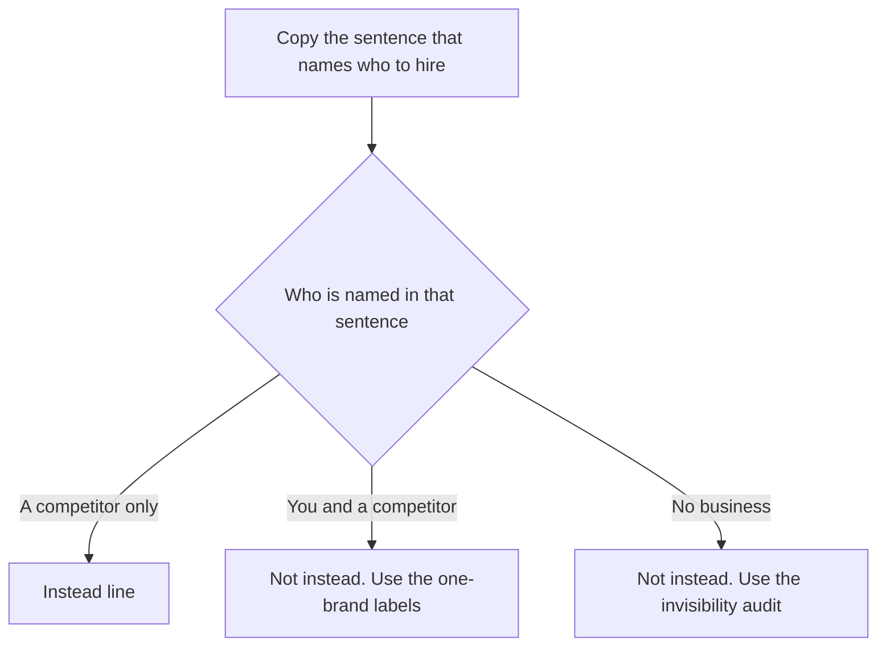

# How do I know if AI is recommending my competitors instead of me?

**You know when you copy the sentence that tells the buyer who to hire, and that sentence names a competitor and does not name you.** I call that the instead line. Search Console will not print their name. A click on your link will not either.

I'm William Spurlock, AI Systems Architect and Fractional AI CTO at Spurlock Studios LLC. I've built 600+ automations, with 500+ live. I've spent 20,000+ hours architecting agentic systems, and that work has saved clients 35,000+ hours. I've been SEO-certified since 2021. The work now sits under AEO, AIO, and GEO. None of those hours give me a private feed of the other company's name inside an answer. I copy the sentence.

This page shows how I record the result, not why it happened. Why ChatGPT picked them, including browse and a Wikipedia test, is [why ChatGPT recommends your competitor instead of you](/blog/why-chatgpt-recommends-your-competitor-instead-of-you). The label for first, later, or missing inside one ChatGPT answer is [why ChatGPT recommends one brand and ignores the rest](/blog/why-chatgpt-recommends-one-brand-and-ignores-the-rest). Whether any engine knows you exist at all is [the 15-minute AI visibility audit](/blog/is-your-business-invisible-to-ai-how-to-run-a-15-minute-ai-visibility-audit). I will not repeat those three pages here. I do not invent a client, a city, or a competitor in the blanks below.

## How do I know if AI is recommending my competitors instead of me?

**You know it from one copied sentence, logged the day you ran it: a competitor is named as the business to hire or buy, and your name is not in that sentence.** I run that sentence on ChatGPT with search, and on Google where an AI Overview or an AI Mode answer actually printed. Two surfaces are my check on this page. It is not a quota from Google or OpenAI.

The sheet has six blanks. Only the copied sentence is the instead line.

<table>
  <thead>
    <tr>
      <th>Blank</th>
      <th>What I write</th>
      <th>What I refuse to write</th>
    </tr>
  </thead>
  <tbody>
    <tr>
      <td>Date</td>
      <td>The day I ran the question</td>
      <td>A weekly plan. This sheet is one day.</td>
    </tr>
    <tr>
      <td>Buyer question</td>
      <td>The words a buyer types before they know your name</td>
      <td>A prompt that already contains your brand</td>
    </tr>
    <tr>
      <td>Surface</td>
      <td>ChatGPT search, Google AI Overview, or Google AI Mode</td>
      <td>"AI" with no product name on the row</td>
    </tr>
    <tr>
      <td>Sentence</td>
      <td>The sentence that names who to hire, copied</td>
      <td>My summary of the answer</td>
    </tr>
    <tr>
      <td>Name in the sentence</td>
      <td>The business the sentence told the buyer to use</td>
      <td>A name I found only after I opened a link</td>
    </tr>
    <tr>
      <td>Your name</td>
      <td>In that sentence, or not in that sentence</td>
      <td>A maybe, a vibe, or a citation count</td>
    </tr>
  </tbody>
</table>

I stop the sheet when the last blank is filled. Then I use one of these labels:

- The sentence names them and does not name you. That is the instead line. Keep it.
- The sentence names you and them. You were listed with them. Leave this sheet and use the one-brand labels.
- The sentence names no business. Nobody was recommended instead of you. That is the invisibility audit.
- The answer never printed, because Google showed no AI Overview and you did not open AI Mode. That row is unfinished. It is not a loss yet.
- A later day gets a new sheet. I am not publishing a calendar for the next run.

I think owners get stuck in the dashboard because the dashboard tracks their own URL. The buyer sees the sentence. I would fill this sheet by hand once before paying for a mention tool. Choosing a mention tool is a separate job, so this page is not a shopping list.

## What counts as AI recommending a competitor instead of me?

**A recommendation is the sentence that names who the buyer should call, hire, or buy. Instead means that sentence names a competitor and does not name you.** A competitor, on this sheet, is a business that sells the same job. A magazine, a directory, and your own URL are not that competitor unless the sentence tells the buyer to hire them.

The split I care about is on the screen, before anyone opens a tab.

<table>
  <thead>
    <tr>
      <th>What you saw</th>
      <th>Label</th>
      <th>Why</th>
    </tr>
  </thead>
  <tbody>
    <tr>
      <td>The sentence names a competitor and does not name you</td>
      <td>Instead</td>
      <td>The buyer was pointed at them.</td>
    </tr>
    <tr>
      <td>The sentence names you and a competitor</td>
      <td>Not instead</td>
      <td>Your name is in the sentence. You were not replaced.</td>
    </tr>
    <tr>
      <td>The sentence names no business</td>
      <td>Not instead</td>
      <td>Absence is the invisibility audit, not a swap.</td>
    </tr>
    <tr>
      <td>A directory is named, and a competitor appears only after you open it</td>
      <td>Not instead</td>
      <td>The answer did not print that competitor.</td>
    </tr>
    <tr>
      <td>Your URL sits under a sentence that names them</td>
      <td>Instead, plus a citation</td>
      <td>Those are two facts. The link does not erase the sentence.</td>
    </tr>
  </tbody>
</table>

What I will not count as the recommendation:

- The domain in a citation chip, when the sentence named someone else.
- A name I found by reading the cited page, if the answer never printed it.
- Your brand inside the question I typed. That is recall. The buyer did not ask for you.
- A classic blue link with no AI Overview and no AI Mode answer. That is ordinary Search, and this sheet is not a rank check.
- A photo search in Google Lens or Circle to Search. Search Console treats that as multimodal, and I keep it off this typed-question sheet.

When I read Google's impressions help on October 23, 2026, it said an [AI Overview](https://support.google.com/webmasters/answer/7042828?hl=en) shows an overview with links to web resources that support the information. That link supports the information in the overview. It is not the same string as the business the overview told someone to hire. OpenAI's help on [searching the web with ChatGPT](https://help.openai.com/en/articles/9237897-searching-the-web-with-chatgpt), which said it was updated three days earlier when I read it on October 23, 2026, says responses that use web search may include citations, and that you select a citation to open its source. I open the source to see whether the page supports the sentence. I do not paste a name from that page onto the line.

## Why doesn't Search Console show which competitor an AI answer named?

**Search Console's Performance report scores your site: clicks, impressions, CTR, and average position. None of those is the other company's name.** I read that metric list on October 23, 2026. The report can tell you a query sent an impression to your URL. It cannot tell you that the sentence above the link told the buyer to call someone else.

<table>
  <thead>
    <tr>
      <th>What the report gives you</th>
      <th>What I still copy by hand</th>
    </tr>
  </thead>
  <tbody>
    <tr>
      <td>Clicks, impressions, CTR, and average position. The default view is the past three months.</td>
      <td>The sentence that named who to hire</td>
    </tr>
    <tr>
      <td>Queries, Pages, Countries, Devices, Search appearance, and Dates</td>
      <td>The product name on the row: AI Overview or AI Mode</td>
    </tr>
    <tr>
      <td>Queries that showed your site. Case does not matter. Rerunning the query can look different, because results depend on time, place, device, and recent history.</td>
      <td>The buyer wording, saved, so the rerun is the same words</td>
    </tr>
    <tr>
      <td>Web text-based traffic, separate from multimodal traffic such as Google Lens, Circle to Search, uploaded images, and Chrome image search</td>
      <td>A typed question only. A photo search is a different sheet.</td>
    </tr>
    <tr>
      <td>AI Overviews and AI Mode rolled into the Web search type, not a brand report</td>
      <td>Whether your name was in the sentence</td>
    </tr>
  </tbody>
</table>

The limits I keep next to the chart:

- [Google's AI features guide](https://developers.google.com/search/docs/appearance/ai-features), last updated December 10, 2025, says sites that appear in AI Overviews and AI Mode are included in overall Search traffic in Search Console, in the Performance report, within the Web search type. Included means your URL can show up in those totals. It does not mean the report prints the competitor.
- The same impressions help says an AI Overview occupies a single position, and every link inside it gets that same position. A position number cannot tell you that you were the named business. You shared a position with every other link in that overview.
- On that page, a click means someone clicked through to an external page. A click proves the link was used. It does not prove the sentence named you.
- The guide says clicks from search results pages with AI Overviews are higher quality, meaning people are more likely to spend more time on the site. It states no percentage. A longer visit still does not put your name in the sentence.
- AI Mode, on the impressions page, groups a question into subtopics and searches them at the same time. A follow-up counts as a new query. I do not mix a follow-up into the first row.
- Search Console does not include Search Labs experiments. I do not use a Labs experiment as the Google row on this sheet.

An impression can rise while the sentence still names the other company. I do not call that a win. The Performance report is the traffic record. The instead line is the recommendation record. The two can disagree.

## How do I copy the recommendation sentence from ChatGPT and Google on the same day?

**Paste one buyer question into a new ChatGPT chat with search on, and paste the same question into Google on the same day. Copy the sentence that names who to hire.** If Google shows an AI Overview, that sentence is the Google row. If it does not, open AI Mode, copy that sentence, and label the row AI Mode. I keep one Google row. The products can disagree, so I keep their answers separate.

<table>
  <thead>
    <tr>
      <th>Surface</th>
      <th>What I set</th>
      <th>What I copy</th>
      <th>What I leave off the line</th>
    </tr>
  </thead>
  <tbody>
    <tr>
      <td>ChatGPT search</td>
      <td>A new chat. Search on. Device location left off, which is the default.</td>
      <td>The sentence that names who to hire</td>
      <td>The hidden partner query, which I do not get to see</td>
    </tr>
    <tr>
      <td>Google AI Overview</td>
      <td>The same buyer question, typed</td>
      <td>The sentence in the overview, if an overview printed</td>
      <td>A blue link from the classic results, used as a stand-in</td>
    </tr>
    <tr>
      <td>Google AI Mode</td>
      <td>Only if no Overview printed</td>
      <td>The sentence in that AI Mode answer</td>
      <td>A second Google row when an Overview already answered</td>
    </tr>
  </tbody>
</table>

The order I actually use:

1. Write the buyer question on the sheet. No brand name in it. If the business is local, put the city in the question. I do not pick the city for you.
2. Open a new ChatGPT conversation, turn search on, paste the question, and copy the recommendation sentence. The manual path on the help page is View all tools, then Search, or type / and select Search. ChatGPT may also search on its own.
3. Paste the same question into Google. If an AI Overview prints, copy its recommendation sentence and write AI Overview on the row.
4. If no Overview prints, open AI Mode with the same question, copy that sentence, and write AI Mode on the row.
5. Mark instead only when the sentence names a competitor and does not name you.
6. Stop. A second question is a second sheet.

The ChatGPT steps above follow the help page I read on October 23, 2026. Web search is available on Free, Go, Plus, Pro, Business, Enterprise, and Edu, and to people who are not signed in. Searches still sit under the plan's usage limits. The page says ChatGPT may rewrite your question into one or more targeted queries. Its own example turns a long CCR8 drug question into a shorter development query, then a conference query. A "restaurants near me" question can become a San Francisco query when the IP-area guess says San Francisco. ChatGPT does not share the IP address itself, or the ChatGPT account, with search providers. Device location sharing is off by default. If memory is on, saved memories can be added to the rewrite. The page's example is a vegan in San Francisco. A VPN can move the approximate location. I start a new chat so I am not dragging yesterday's thread into the buyer question. If that workspace still applies saved memories, I do not treat the answer as the buyer's wording. I write "memory on" in the margin and I still copy the sentence that printed.

Placement is not guaranteed. A site is eligible for inclusion when OAI-Searchbot may crawl it and the host allows OpenAI's published searchbot IP addresses. Eligibility is not the instead line. A blocked bot can help explain an absence, and that explanation lives on the competitor page I linked above. I am not re-teaching the bot file here.

The Google steps follow the December 10, 2025 guide. There are no additional requirements to appear in AI Overviews or AI Mode, and no special schema.org markup you need to add for those features. I am not going to tell you the instead line is a missing markup bug. AI Overviews often do not trigger. They show up when Google's systems decide an overview adds something beyond classic Search. AI Mode and AI Overviews may use different models and techniques, so the responses and the links can differ. That is why I will not label an Overview sentence as AI Mode. Both may use query fan-out, issuing multiple related searches across subtopics and data sources. The sentence can be built from more than one page. I still copy one sentence. A supporting link has to be indexed and eligible for a snippet, and indexing is not guaranteed. A missing link, by itself, is not the instead line.

If your buyers also ask Perplexity, paste the same question there on the same day and copy that sentence onto its own row. I am not quoting a Perplexity rulebook on this page. The sentence remains the test.

## How do I tell a citation of my page from a recommendation of a competitor?

**A citation is your URL attached to the answer. A recommendation is the sentence that names who to hire. You can hold the URL and still lose the sentence.** That split is why Search Console can look fine while the buyer was told to call someone else.

<table>
  <thead>
    <tr>
      <th>Artifact</th>
      <th>Citation</th>
      <th>Recommendation</th>
      <th>Instead?</th>
    </tr>
  </thead>
  <tbody>
    <tr>
      <td>ChatGPT citation on a sentence that names them</td>
      <td>Whoever the chip links</td>
      <td>The business in the sentence</td>
      <td>Yes, if the sentence does not name you</td>
    </tr>
    <tr>
      <td>Sources list that includes your URL</td>
      <td>Yes</td>
      <td>Still the sentence</td>
      <td>Yes, if the sentence names only them</td>
    </tr>
    <tr>
      <td>Your link inside an AI Overview</td>
      <td>Yes. It can become an impression.</td>
      <td>The overview's hire sentence</td>
      <td>Yes, if that sentence names only them</td>
    </tr>
    <tr>
      <td>Every link in that Overview sharing one position</td>
      <td>The position does not pick a winner</td>
      <td>Unchanged</td>
      <td>Read the sentence, not the position</td>
    </tr>
    <tr>
      <td>Your name and your URL</td>
      <td>Yes</td>
      <td>You</td>
      <td>No</td>
    </tr>
    <tr>
      <td>Their name and your name in one sentence</td>
      <td>Check the links separately</td>
      <td>Both of you</td>
      <td>No. Leave this sheet.</td>
    </tr>
  </tbody>
</table>

How I mark the row after the sentence is copied:

- Write the URL that is actually attached, including yours if it is there.
- Write the business the sentence named, spelled the way the answer spelled it.
- If those two point at different companies, keep both facts. Do not average them into "sort of recommended."
- Open the cited page only to see if it supports the sentence. OpenAI says search results and citations can be incomplete, outdated, or incorrect.
- If the cited page names a third business the answer never printed, leave that third name off the line.
- Do not turn today's citation into a promise about tomorrow. Placement is not guaranteed, and I am not handing you a recheck calendar on this page.

I trust the copied sentence over the impression count. The 600+ automations I have built do not change the check. I still use one sentence, on one day, with your name either in it or not.

## FAQ

### Does a source link under a competitor's name count as a recommendation of me?

**No. The link is a citation. The recommendation is the sentence that names who to hire.** OpenAI's help page, read October 23, 2026, says a citation can be incomplete, outdated, or incorrect, and that you should open the source to see if it supports the answer. Google's impressions help says the links in an AI Overview support the information. If the sentence names them and the link is yours, the instead line still stands, and you also have a citation.

### What if ChatGPT names both my business and a competitor in one sentence?

**That is not an instead line. Your name is in the sentence, so you were not replaced.** First, later, or missing is the job of [why ChatGPT recommends one brand and ignores the rest](/blog/why-chatgpt-recommends-one-brand-and-ignores-the-rest). I do not reprint that page's math here. Copy the sentence, write "both named," and stop this sheet.

### What if the AI answer names no business at all?

**Then nobody was recommended instead of you. You are in the invisible case, which is a different test.** The timed version is [the 15-minute AI visibility audit](/blog/is-your-business-invisible-to-ai-how-to-run-a-15-minute-ai-visibility-audit). Google's AI features guide, updated December 10, 2025, says AI Overviews often do not trigger. Log "no Overview," and open AI Mode, before you call the Google row blank.

### What buyer question should I paste into ChatGPT and Google?

**Use the wording a buyer types before they know your name. Leave your brand out of the question.** A question that already contains your name is a recall check, and this sheet is not measuring recall. If the business is local, put the city in the question. OpenAI's help page says a near-me prompt can be rewritten from an IP-area guess, and that including a city is how you correct a wrong area. I do not supply the city in this post.

### Can ChatGPT rewrite my question before it names a competitor?

**Yes. OpenAI says ChatGPT may turn your question into one or more targeted queries, then send a more specific query after the first results.** The page's CCR8 example shortens a long research question, and a near-me question can pick up a city from the IP-area guess. Memory and a VPN can change that rewrite too. I still copy the sentence on the screen. I do not invent the hidden partner query.

### What do I log when Google does not show an AI Overview?

**Log "no Overview," then open AI Mode with the same question and copy that sentence as the only Google row.** The AI features guide, updated December 10, 2025, says Overviews often do not trigger, and that AI Mode and AI Overviews may use different models, so the links can differ. I do not fill the row with a classic blue link and call it an AI recommendation. Search Labs experiments stay off the sheet. Google's impressions help says Search Console leaves those experiments out.

### Does a Search Console impression mean AI recommended me instead of a competitor?

**No. An impression means your link was shown. It does not name the other company.** The Performance report, as I read it on October 23, 2026, scores clicks, impressions, CTR, and average position for your site. An AI Overview assigns every link inside it the same position. Your URL can be one of those links under a sentence that names someone else.

### Is the instead line the same job as a seven-day ChatGPT shortlist audit?

**No. The instead line is one day, one buyer question, and the sentence that names who to hire.** The week-long log is [how to audit a ChatGPT shortlist in a week](/blog/how-to-audit-a-chatgpt-shortlist-in-a-week). I am not copying that calendar onto this page, and I am not reprinting a concentration study. If both names appear in the sentence, this sheet is finished and the one-brand page takes over.

### What should I do after the instead line names a competitor?

**Keep the sheet. Do not open a second project from this page, and do not invent a timeline.** The cause, including how ChatGPT browses and how a Wikipedia page fits, is [why ChatGPT recommends your competitor instead of you](/blog/why-chatgpt-recommends-your-competitor-instead-of-you). If the sentence named both of you, you are on the wrong sheet. I want the lost sentence in front of me before anyone talks about a new page.

## Bring the instead line to the build

**The sentence cannot name you if the page a model can quote never states the job in plain text.** I build AI-visibility-ready sites that close that gap with the answer in the first sentences, the business name in a sentence a buyer could repeat, visible text that matches any markup, and no block on the URL you want cited. I'm William Spurlock, AI Systems Architect and Fractional AI CTO at Spurlock Studios LLC.

Bring the buyer question, the ChatGPT sentence, and the Google sentence. I want those three lines on the table before a build conversation.

[Bring the instead line](/contact).
