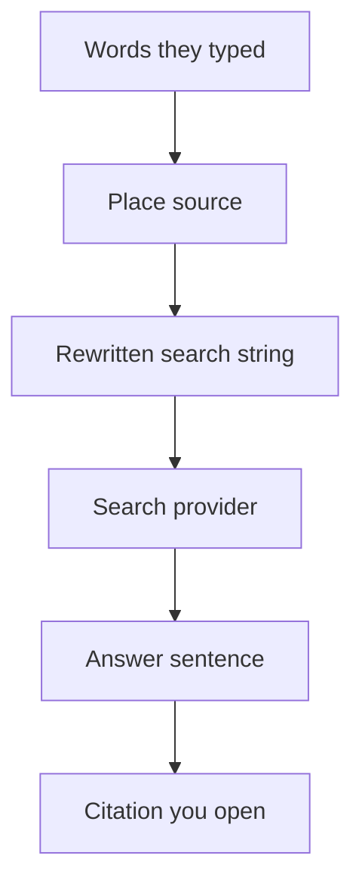

# How does ChatGPT recommend local businesses?

**ChatGPT recommends a local business by rewriting the question into a search string that contains a place, sending that string to a search provider, and then writing an answer that may cite a page.** ChatGPT often gets the place from a coarse IP-area guess because device location stays off until that person turns it on. Your shop counts as recommended only when its name appears in the sentence and a citation you open actually supports that sentence.

I call that record a **city line**. It has five lines: the words they typed, the rewritten search string, where the place came from, the business name in the answer, and the URL behind the citation. If line two names the wrong city, lines four and five are about another town.

I'm William Spurlock, AI Systems Architect and Fractional AI CTO at Spurlock Studios LLC. I've built 600+ automations, with 500+ live. I've spent 20,000+ hours architecting agentic systems, and that work has saved clients 35,000+ hours. I've been SEO-certified since 2021. That work now falls under AEO, AIO, and GEO. None of those hours put a pin on a customer's phone.

This page covers the rewrite. The street you staff lives on [the door line for a physical address](/blog/does-having-a-physical-address-listed-consistently-across-the-web-help-a). The city-level stack lives on [AI visibility for local businesses](/blog/ai-visibility-for-local-businesses-getting-recommended-in-your-city). The check for a competitor's name in the sentence lives on [how to tell when AI recommends someone else](/blog/how-do-i-know-if-ai-is-recommending-my-competitors-instead-of-me). I will not reprint those three, and I will not invent a client, a citation rate, or a weekly calendar.

## How does ChatGPT recommend local businesses?

**A local recommendation in ChatGPT is a rewritten search, a provider result, and a sentence you can trace to a page.** It is not a Google Maps pack, and it is not a reservation button. [Searching the web with ChatGPT](https://help.openai.com/en/articles/9237897-searching-the-web-with-chatgpt), as I read it on 29 October 2026, said it was updated 9 days earlier. Web search is on Free, Go, Plus, Pro, Business, Enterprise, and Edu, and people who are not signed in can use it too. Searches sit under the plan's usage limits. The page does not print a number for that cap.

ChatGPT may search on its own when the question would benefit from current information. A person can also force it: View all tools, then Search, or type `/` and choose Search. Sidebar search is a different tool. It finds chats, projects, and files in the account. I do not grade a local shop from a sidebar hit.

The city line I write down has five lines:

- **Words they typed.** "Near me," a neighborhood, or a city they spelled.
- **Rewritten search string.** The text ChatGPT may send, with a place name in it.
- **Place source.** IP-area guess, device location they turned on, or a saved memory.
- **Business name in the answer.** The name has to be in the sentence, not only on a map tile.
- **URL you opened.** The citation behind that sentence. If you did not open it, you do not have line five.

<table>
  <thead>
    <tr>
      <th>What owners hope ChatGPT does</th>
      <th>What the help page I read on 29 October 2026 actually says</th>
    </tr>
  </thead>
  <tbody>
    <tr>
      <td>It reads the Google Business Profile the way Maps does</td>
      <td>The search page does not name Google Business Profile. A map can appear on iOS and Android. That is not a profile win.</td>
    </tr>
    <tr>
      <td>Device location is already on</td>
      <td>Device location sharing is optional and off by default.</td>
    </tr>
    <tr>
      <td>The raw IP goes to the search company</td>
      <td>ChatGPT does not share the IP address itself, or the ChatGPT account, with third-party search providers to run the search.</td>
    </tr>
    <tr>
      <td>A citation proves the page is current</td>
      <td>Search results and citations can be incomplete, outdated, or incorrect.</td>
    </tr>
    <tr>
      <td>Allowing the crawler books the mention</td>
      <td>Placement is not guaranteed. Eligibility is OAI-Searchbot plus the published searchbot IP ranges at the host.</td>
    </tr>
  </tbody>
</table>

**My opinion:** I do not chase the customer's location toggle. I cannot flip it. I write the city in a sentence on the page, I allow the search crawler, and I open the citation. A map tile with no sentence and no URL is not a recommendation I will report.

The provider details differ by plan. I keep the pages separate.

<table>
  <thead>
    <tr>
      <th>Page I read on 29 October 2026</th>
      <th>Who it covers</th>
      <th>What it names</th>
    </tr>
  </thead>
  <tbody>
    <tr>
      <td><a href="https://help.openai.com/en/articles/9237897-searching-the-web-with-chatgpt">Searching the web with ChatGPT</a></td>
      <td>The general search article, updated 9 days before I read it</td>
      <td>Search providers, plural. It links a Microsoft privacy statement and a Shopify privacy policy. It does not name Bing in that section.</td>
    </tr>
    <tr>
      <td><a href="https://help.openai.com/en/articles/10093903-chatgpt-search-for-enterprise-and-edu">ChatGPT search for Enterprise and Edu</a></td>
      <td>Enterprise and Edu, updated 10 days before I read it</td>
      <td>Disassociated queries may go to the Bing search engine. The IP itself is not shared. An approximate location from the IP may be shared with Bing.</td>
    </tr>
    <tr>
      <td>Same Enterprise page, Healthcare sentence</td>
      <td>ChatGPT for Healthcare workspaces</td>
      <td>They do not use Bing for web search, and they do not use specialized data providers. The page does not name a replacement in that sentence.</td>
    </tr>
  </tbody>
</table>

If an admin turns web search off for a workspace or a role, ChatGPT will not search, even when the person asks it to. There is no city line to score. Deep research and the agent feature that need search may be off with it. I am not guessing what the model says from older training when the live search is blocked.

A Reserve button belongs to a second product, not line four of the city line. On that same search page, reservation search runs on eligible consumer plans, on web, mobile, and desktop, when the model is GPT-5.6 Sol or GPT-5.6 Luna. It is not in ChatGPT Work, and it is not on Business, Enterprise, or Edu. It is not in a voice conversation. OpenTable is global, Resy is the United States, and Yelp is the United States and Canada. Availability still depends on the restaurant. ChatGPT does not save, change, cancel, or show the booking after the fact. The confirmation comes from OpenTable, Resy, or Yelp. A plumber will not get that button. A restaurant can be named in a sentence and still have no Reserve control. I do not count the button as the recommendation.

Spoken questions can still search. The same page says a voice conversation can ask ChatGPT to search the web, under the plan's usage limits. How a spoken answer should name you is a different page: [showing up when someone asks ChatGPT out loud](/blog/can-your-business-show-up-when-someone-asks-chatgpt-out-loud). I am not re-teaching that mic here. Reservation search stays out of voice even when ordinary web search is allowed.

## What does ChatGPT rewrite when someone asks for a business near them?

**It rewrites "near me" into text that contains a place name, and it does not hand the search provider the raw IP.** The help page's own example: someone types "What are some good restaurants near me?" and the IP area is San Francisco, so the query may become "top restaurants San Francisco." The result is a search string. It is not a pin at a door.

The same section shows the shape with a non-local question, so I do not pretend the mechanism only exists for shops. A question about CCR8 cancer drugs may go out first as "CCR8 immunotherapy drug development 2025," then as something narrower, such as "CHS-114 conference 2025." One prompt can become more than one query. A local prompt can do the same. I still score the city that shows up in the answer I can read, because OpenAI does not give the owner a log of every string it sent.

The page names three place sources. I treat each one separately:

1. **IP-area guess.** ChatGPT may use the IP to estimate a country, a state, or a city. That approximate location can be shared. The IP itself is not shared with the search provider.
2. **Device location, only if they turn it on.** It is off by default. When it is on, ChatGPT can use more specific information for nearby businesses, local news, and weather. On iOS and Android, precise location can be off while an approximate device location stays on. The path is Settings, then Data controls, then Location. The phone or browser may offer allow once, allow while using ChatGPT, or deny. If the browser already denied chatgpt.com, they set Location to Allow and refresh.
3. **Saved memory, only if memory is on.** The example on the page: someone who said they are vegan and live in San Francisco may get "good vegan restaurants San Francisco" when they ask for nearby restaurants they might like. A signed-out session can still search. It does not have that saved memory.

<table>
  <thead>
    <tr>
      <th>What they typed</th>
      <th>What the help page says may be searched</th>
      <th>Place source in the example</th>
    </tr>
  </thead>
  <tbody>
    <tr>
      <td>Good restaurants near me</td>
      <td>top restaurants San Francisco</td>
      <td>IP area, when that area is San Francisco</td>
    </tr>
    <tr>
      <td>Nearby restaurants I might like</td>
      <td>good vegan restaurants San Francisco</td>
      <td>Memory: vegan, and lives in San Francisco</td>
    </tr>
    <tr>
      <td>Latest on CCR8 drugs</td>
      <td>CCR8 immunotherapy drug development 2025, then maybe a narrower follow-up</td>
      <td>No city. This row is the rewrite shape, not a shop.</td>
    </tr>
  </tbody>
</table>

Precise location is not required for web search. Without it, local results may be less specific. ChatGPT does not separately store that precise location outside the conversation and its context. Names of nearby places in the answer stay in the chat until someone deletes the chat. A map can stay in the thread, and the precise location is removed from the map. Parents who set parental controls can turn location sharing off for a teen. I am not telling a shop owner to instruct strangers to leave location on.

ChatGPT may also share location with trusted third parties that supply more local information, such as nearby business listings or weather, and it says it keeps that share small. The sentence does not name the listing company. I will not fill the blank with Google Business Profile. Profile work stays on [what still matters in the Google Business Profile](/blog/google-business-profile-in-the-ai-era-what-still-matters).

## What happens when ChatGPT guesses the wrong city?

**The search string is about the guessed city, so a shop in a different city is not in that query.** You can have a clean page and still be absent from an answer that went to the wrong town. That is a miss on line two, not a verdict on the business.

OpenAI gives the person asking a fix, not a ranking product the shop can buy. If the area is wrong, they should put a city, a neighborhood, or a postal code in the question, check the location permission if they chose to share the device, and ask again. A VPN or the network location can move the IP-area guess. A saved memory of an old city can move it too.

The shop cannot change any of these:

- Their device location. Default off. Enterprise workspaces do not offer precise location sharing at all, according to the [Privacy Center](https://help.openai.com/en/articles/20001488-privacy-center-in-chatgpt) page I read the same day. That page said it was updated 3 days earlier.
- Their VPN. If the exit city is not your city, "near me" is their tunnel, not your service area.
- Their memory. A saved "I live in" line can outrank the IP guess on that account. You do not edit it.
- A workspace admin who turned web search off. No live citation path, even if they demand a search.
- The plan's usage limit. The page says the limit exists and does not print the number. I will not invent one.

<table>
  <thead>
    <tr>
      <th>Why the city is wrong</th>
      <th>What the pages say</th>
      <th>What I change on the site</th>
    </tr>
  </thead>
  <tbody>
    <tr>
      <td>IP area is a different city</td>
      <td>The estimate can be country, state, or city. A VPN can move it.</td>
      <td>Nothing about their network. The page still has to say your city in prose for the queries that name it.</td>
    </tr>
    <tr>
      <td>Device location is off</td>
      <td>That is the default. Precise location is optional.</td>
      <td>I do not write "enable location" into the footer.</td>
    </tr>
    <tr>
      <td>Memory names another city</td>
      <td>A saved home city can be written into the query.</td>
      <td>Nothing. Memory is their account.</td>
    </tr>
    <tr>
      <td>Enterprise, no precise pin</td>
      <td>Precise location sharing is not available in Enterprise workspaces.</td>
      <td>Same page work. The test question should already include the city.</td>
    </tr>
    <tr>
      <td>Search is disabled</td>
      <td>Enterprise and Edu admins can turn web search off. The user cannot override that by asking.</td>
      <td>Nothing. That account is not a city-line test.</td>
    </tr>
  </tbody>
</table>

The street on the door is a different failure. Two street addresses are the door-line post. A wrong city in ChatGPT's rewrite can happen while the door is perfect. I do not "fix" a San Francisco guess by adding a second city to the footer. One city in the sentence, the city you actually serve. If you serve two, each city gets its own sentence and its own URL, which is the pillar's job, not a trick inside one paragraph.

Healthcare workspaces are the other split I refuse to blur. They do not use Bing, and they do not use the specialized data providers named on the Enterprise page. I do not know a public replacement from that sentence, so I do not describe one. A Healthcare login is not the test account for this check.

## How do I check the city ChatGPT searched and the page it cited?

**Type one question that already names the city, then open the citation. Use a single "near me" only to see which city that network guesses.** That takes two questions. I am not assigning a weekday, a sample size, or a score.

OpenAI does not show you the outbound query log. Line two is the place you can see in the answer, plus the place you put in the question on purpose. If you already typed the city and the answer still talks about a different one, write that down. Do not smooth it into a pass because a map looks local.

Do this once, on an account where web search is actually on:

1. Confirm Search is in the tools menu. If the workspace has web search off, stop. There is no citation to open.
2. Type one question that already names the trade and the city. Keep the wording ordinary. Do not add a stack of adjectives.
3. If the answer has no citation, line five is empty. OpenAI says citations may be missing, stale, or wrong. An empty line is still a result, not a prompt to keep rephrasing for an hour.
4. Open each citation that sits on the sentence with your name. Read the page. It has to support the sentence. A title that merely contains the city is not support.
5. Write the city the answer used. That is the city line for a question that did not need a guess.
6. From a network whose city you know, and not from a VPN unless that exit is the city you mean, type one near-me question. Record the city that comes back.
7. Stop. If the two cities disagree, the near-me row is a guess. It is not a grade of the shop.

<table>
  <thead>
    <tr>
      <th>City line</th>
      <th>Pass on this check</th>
      <th>Fail on this check</th>
    </tr>
  </thead>
  <tbody>
    <tr>
      <td>Words they typed</td>
      <td>One city-named question, then one near-me</td>
      <td>A pile of rewrites until the name appears</td>
    </tr>
    <tr>
      <td>Rewritten place</td>
      <td>The answer's city matches the city in question one</td>
      <td>Question one named your city and the answer used another</td>
    </tr>
    <tr>
      <td>Place source</td>
      <td>You know whether the near-me row was an IP guess</td>
      <td>You tested near-me from a VPN city and treated it as the shop's town</td>
    </tr>
    <tr>
      <td>Business name</td>
      <td>The name is in the sentence</td>
      <td>The name is only inside a map, or only in Sources as a loose link</td>
    </tr>
    <tr>
      <td>URL you opened</td>
      <td>The page supports the sentence</td>
      <td>You never opened it, or the page contradicts the sentence</td>
    </tr>
  </tbody>
</table>

Labels I actually use, and no others:

- **Supported.** Right city on the named question, your name in the sentence, citation opened, page agrees.
- **Wrong city.** The answer's place is not the place in the question, or the near-me guess is another town.
- **Bad citation.** Your name is there and the page you opened does not say that.
- **No citation.** Search ran, or you cannot tell, and there is no URL on the sentence.
- **No search.** The account cannot search. I do not convert that into "ChatGPT does not know us."

Competitors belong on the other sheet. If the sentence names them and not you, that is the instead line, and it has its own page. Both names in one sentence is not this sheet either. This sheet fails when the city is wrong or the citation does not carry the sentence. I will not invent a percentage of chats that do this.

On desktop web you can point at a citation to preview it. Sources, when it shows, lists cited sources and other relevant links. Other relevant links are not the same as the citation on the sentence. I open the one attached to the claim. On iOS and Android a map may show. I still want the URL. An image in the answer has its own source. I open that too if the image is doing the recommending.

## What has to be on the page ChatGPT cites for a local business?

**The page needs the city in a sentence a person can read, the business name, and a line the citation can support. OAI-SearchBot has to be allowed, and placement is still not guaranteed.** Hiding the city in a picture, or only in markup, gives the rewrite nothing to match. The rewrite is text, like "top restaurants San Francisco."

I put the following on the page and leave the rest to the other posts:

- **City in prose**, in the first screen of the page you want cited. The same city a stranger would type.
- **Business name** next to that city, in words, not only in a logo file.
- **The trade in words.** A plumber page that never says plumber will not match a query that says plumber.
- **One quotable sentence** that is true if someone opens the URL. OpenAI tells the reader to open the source and check it. I write the sentence as if they will.
- **OAI-SearchBot allowed**, and the host or CDN allowing OpenAI's published searchbot IP addresses. The list is the JSON file the crawler docs point at, [openai.com/searchbot.json](https://openai.com/searchbot.json). I am not pasting ranges into a blog post.
- **The street rules stay on the door-line page.** Suite, P.O. box, virtual office, and a hidden home address are not this check.

[OpenAI's crawler overview](https://platform.openai.com/docs/bots), as I read it on 29 October 2026, keeps three agents apart. I do not treat them as one switch.

<table>
  <thead>
    <tr>
      <th>Agent</th>
      <th>What the overview says it decides</th>
      <th>What I do</th>
    </tr>
  </thead>
  <tbody>
    <tr>
      <td>OAI-SearchBot</td>
      <td>Search. Opting out means the site is not shown in ChatGPT search answers. It can still appear as a navigational link. The example user-agent includes OAI-SearchBot/1.4, and the version may change.</td>
      <td>Allow it on the URL I want in an answer. A typed brand name that returns the homepage is a navigational link, not a local recommendation.</td>
    </tr>
    <tr>
      <td>GPTBot</td>
      <td>Training crawl. Independent of SearchBot. If both are allowed, OpenAI may use one crawl for both jobs.</td>
      <td>Allow or block training on purpose. Blocking GPTBot does not, by itself, block search.</td>
    </tr>
    <tr>
      <td>ChatGPT-User</td>
      <td>User-triggered visits and some app actions. Not used to decide Search inclusion. robots.txt may not apply.</td>
      <td>I do not use a ChatGPT-User block as the search opt-out.</td>
    </tr>
  </tbody>
</table>

A robots.txt change can take about 24 hours for their systems to adjust. That sentence is about the crawl rule updating. It is not a promise that a new paragraph gets cited tomorrow. I do not schedule a second test at hour 24 and call the gap a failure of the page.

The help page spells the crawler OAI-Searchbot. The overview spells the token OAI-SearchBot. They refer to the same crawler. I allow the token the overview shows.

Name and phone consistency, the part that is not the city string, stays on [how a local business gets into AI-generated recommendations](/blog/how-to-get-your-local-business-into-ai-generated-recommendations). I am not rebuilding that checklist here.

## FAQ

### Does ChatGPT share a customer's IP address with a search provider?

**No. The search help page says ChatGPT does not share the IP address itself, or the ChatGPT account, with third-party search providers to run the search.** It may share a general location taken from that IP, such as a country, state, or city. The consumer article I read on 29 October 2026 links a Microsoft privacy statement and a Shopify privacy policy in that provider section, and it does not name Bing there. The Enterprise and Edu article does name Bing, and it also says the IP itself is not shared.

### Is device location sharing on by default in ChatGPT?

**No. Device location sharing is optional and off by default.** Turning it on lets ChatGPT use more specific information for nearby businesses, local news, and weather. On iOS and Android, precise location can be switched off while an approximate device location stays on. The setting is Settings, then Data controls, then Location. Precise location is not required for web search. Local results may be less specific without it.

### Can a saved memory change the city ChatGPT searches?

**Yes, when memory is on.** The help page's example is a person who said they are vegan and live in San Francisco. A nearby-restaurant question may be searched as "good vegan restaurants San Francisco." Deleting a chat does not, by itself, delete a memory saved from it. The Privacy Center page points that out. A signed-out search has no such memory.

### Does a VPN change the city ChatGPT uses for local results?

**It can.** The search help page says a VPN or network location may affect the approximate location inferred from the IP address. I do not run the near-me half of the city line through a VPN exit in another city and then blame the shop. The question that already names the city is the half that should not depend on that tunnel.

### Does a map in ChatGPT mean my Google Business Profile was chosen?

**No. On iOS and Android, relevant results may include a map, and the search page never names Google Business Profile.** A map can remain in the chat after precise location is removed from it. I still require a sentence and a citation. Nearby business listings are mentioned only as an example of a third-party feed, with no vendor name. Profile fields stay on the Business Profile page I linked above.

### Is precise location sharing available in a ChatGPT Enterprise workspace?

**No. The Privacy Center page says precise location sharing is not available in ChatGPT Enterprise workspaces.** An Enterprise user asking "near me" is on the IP-area guess unless they type a city. Admins can also turn web search off for the workspace or for a role, and the user cannot force it back on by asking. I read that Enterprise search page on 29 October 2026. It said it was updated 10 days earlier.

### Can someone use ChatGPT web search without signing in?

**Yes. The search help page says people who are not signed in can use web search.** The same page lists Free, Go, Plus, Pro, Business, Enterprise, and Edu. A signed-out session can still be subject to a usage limit the page does not quantify. It will not apply a saved memory, because there is no memory on that session.

### Are ChatGPT search citations guaranteed to be current?

**No. OpenAI says search results and citations can be incomplete, outdated, or incorrect.** The reader is told to open the source, check when it was published or updated, and ask again with a specific source, date, or location if the result looks wrong. Placement in those results is not guaranteed either. I treat an unopened citation as an unfinished city line, not as proof.

### Does blocking OAI-SearchBot remove a business from every ChatGPT reply?

**It removes the site from ChatGPT search answers. It does not promise to remove every mention.** The crawler overview says an opted-out site will not be shown in search answers, and it can still appear as a navigational link. ChatGPT-User is not the switch for that. A robots.txt edit can take about 24 hours to be picked up. That is the crawl rule, not a citation deadline. The example agent token I saw was OAI-SearchBot/1.4, and the overview says the version number may change.

## Get an AI-visibility-ready site built

**The city has to be in a sentence on the page ChatGPT can cite, with OAI-SearchBot allowed, or the rewrite has nothing true to point at.** I build AI-visibility-ready sites for that gap: the city and the trade in the first screen, a sentence that survives a click, the search crawler allowed, and no second city stuffed into a footer to chase a bad guess. I'm William Spurlock, AI Systems Architect and Fractional AI CTO at Spurlock Studios LLC.

Bring the question you typed, the answer, and the URL you opened. I want those three on the table before a build conversation. The door, the profile, and the competitor sentence can come after, on their own pages.
