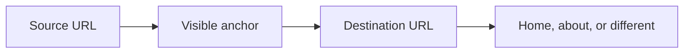

# How does internal linking affect entity relationships for AI?

**Internal linking affects entity relationships for AI when a crawlable link on your own site puts a readable name on the page it opens, and that page's visible name is the same entity.** I call that single link a hop. I grade it on four lines. When the anchor and the destination name disagree, the hop slips. That mismatch can sit there even while the menu, sitemap, and breadcrumb do their own jobs.

I'm William Spurlock, AI Systems Architect and Fractional AI CTO at Spurlock Studios LLC. My record includes 600+ automations built, with 500+ live. After 20,000+ hours architecting agentic systems, I have seen that work save clients 35,000+ hours. I've been SEO-certified since 2021. That is the work I now bring to AEO, AIO, and GEO. None of those hours makes a footer link named Home into a brand relationship.

I cover the who-is-this record in [how I build entity authority for a brand in AI systems](/blog/how-do-i-build-entity-authority-for-my-brand-in-ai-systems). I compare the visible page with its markup in [the entity SEO audit](/blog/how-do-i-do-an-entity-seo-audit-for-my-website). I keep the schema-type catalog in [schema, structured data, and entity SEO](/blog/schema-structured-data-and-entity-seo-the-technical-core-of-ai-visibility). Here, I am looking only at the hop between two URLs you already own. I use example.com below because Google's docs use it. It is not a client.

## What is an internal-link hop for an entity?

**An internal-link hop is one crawlable link from a page on your site to another page on your site, written as four lines: source URL, visible anchor, destination URL, and the role of that destination.** For line four, choose one of three roles: home of this entity, a page about this entity, or a different entity. If the page a person can read does not give you all four lines, you do not have a hop yet.

Google's [link best practices](https://developers.google.com/search/docs/crawling-indexing/links-crawlable), last updated 10 December 2025, as I read them on 31 October 2026, say Google uses links as a signal when determining the relevancy of pages and to find new pages to crawl. The same page says Google can generally crawl a link only when it is an HTML anchor with an href. Most other formats will not be extracted. JavaScript may insert the link, and it is still crawlable when the markup is that anchor. An onclick handler with no href is in the not-recommended set. Relative and absolute href values are both in the recommended set, as long as the URL resolves to an address a crawler can request.

Anchor text is the visible text of that link. Google says it tells people and Google something about the page you are linking to. If the anchor is empty, Google can fall back to the title attribute. For an image inside the link, Google uses the image alt text as the anchor. I will not grade a title attribute or a blank alt as a name a person saw.

<table>
  <thead>
    <tr>
      <th>Line</th>
      <th>What you copy</th>
      <th>A filled example</th>
    </tr>
  </thead>
  <tbody>
    <tr>
      <td>1. Source</td>
      <td>The URL of the page that contains the link</td>
      <td>https://example.com/pricing</td>
    </tr>
    <tr>
      <td>2. Anchor</td>
      <td>The words a person can read, or the image alt if the link is an image</td>
      <td>Example Studio</td>
    </tr>
    <tr>
      <td>3. Destination</td>
      <td>The href after it resolves</td>
      <td>https://example.com/about</td>
    </tr>
    <tr>
      <td>4. Role</td>
      <td>Home of this entity, a page about this entity, or a different entity</td>
      <td>Home of this entity, because the about page's visible title is Example Studio</td>
    </tr>
  </tbody>
</table>

These are not hops, even when a designer calls them links:

1. **A span or a button with only a script.** Google's link page puts an anchor that has no href in the not-recommended set.
2. **An empty anchor.** The title attribute is a fallback, not the words in the sentence.
3. **A row of naked links with no words between them.** Google says the words before and after the link matter, and chained links throw that context away.
4. **A sameAs URL.** That property points at another website. It is the subject of the authority page, not this one.

[schema.org](https://schema.org/significantLink) defines significantLink as one of the more significant URLs on the page, typically the non-navigation links people click most. It defines [about](https://schema.org/about) as the subject matter of an object, and [mentions](https://schema.org/mentions) as a reference that is not necessarily what the work is about. I read those three pages on 31 October 2026. I treat them as definitions, not a substitute for the link itself. Google's link guide grades the anchor and the href. I grade the same two things.

## What happens when the anchor text and the destination name a different entity?

**The hop slips: the sentence trains a crawler to attach one name to a page that visibly belongs to another name, or to no name at all.** Google's link page says the better the anchor text, the easier it is for people to navigate and for Google to understand what the linked page is about. A slip spends that sentence on the wrong page. I have no ranking percent to hang on it, and I will not invent one.

Google also says good anchor text is descriptive, reasonably concise, and relevant both to the page it sits on and to the page it opens. Keyword stuffing is a spam-policy violation. Their test is blunt: read only the anchor, out of context, and see if the destination is clear. "Click here" fails that test. "Home" fails it too. "Example Studio" passes it when the destination's visible title is Example Studio.

<table>
  <thead>
    <tr>
      <th>Slip</th>
      <th>Line 2, the anchor</th>
      <th>What the destination page actually shows</th>
    </tr>
  </thead>
  <tbody>
    <tr>
      <td>Wrong page</td>
      <td>Example Studio</td>
      <td>A blog post whose visible title is Office chairs, with no Example Studio heading</td>
    </tr>
    <tr>
      <td>Nameless anchor</td>
      <td>Home, or Learn more, or Click here</td>
      <td>The about page titled Example Studio. Discovery can still work. The name did not travel.</td>
    </tr>
    <tr>
      <td>Two entities, one URL</td>
      <td>North Desk Co</td>
      <td>The same about page titled Example Studio. One URL cannot be the home of both names in this hop.</td>
    </tr>
    <tr>
      <td>Image with a blank alt</td>
      <td>Nothing a person hears from a screen reader, and nothing Google can use as anchor text</td>
      <td>Whatever page you hoped the logo meant</td>
    </tr>
  </tbody>
</table>

What I do when I see a slip:

- **I change the anchor or I change the destination.** I do not add a second link beside it and hope the pair averages out. Google says not to chain links, because each one loses the surrounding words.
- **I keep the surrounding sentence.** "Pricing for Example Studio is on the about page" gives the anchor a noun on both sides. "Click Example Studio here" does not.
- **I leave the folder tree alone unless the site is actually large.** The [SEO starter guide](https://developers.google.com/search/docs/fundamentals/seo-starter-guide), last updated 10 December 2025, says a logical organization can help search engines and users understand how pages relate to the rest of the site. The same section says not to drop everything and reorganize, because search engines will likely understand the pages as they are. Directory grouping shows up when you have more than a few thousand URLs, and even then it is about how often those directories change, not about renaming the entity.

A slip is not a manual action, a lost Knowledge Panel, or a missing AI Overview. I check those outcomes elsewhere. This check fails only when line 2 and the destination's visible name are not the same entity.

## How does internal linking affect entity relationships for AI?

**Internal linking affects entity relationships for AI by making a page findable and by attaching a readable name to that path. Findable is not the same as named, and named is not a promise that an AI Overview will cite you.** Google's [AI features guide](https://developers.google.com/search/docs/appearance/ai-features), last updated 10 December 2025, lists "making your content easily findable through internal links" among the SEO practices that remain worthwhile for AI Overviews and AI Mode. The same guide says specific optimization is not required for those features, and that there is no special schema.org structured data to add. It also says you do not need a new machine-readable file or an AI text file.

To be eligible as a supporting link in AI Overviews or AI Mode, a page must be indexed and eligible to show in Google Search with a snippet. There are no additional technical requirements. Meeting them does not mean Google will crawl, index, or serve the page. Indexing and serving is not guaranteed. AI Overviews are only shown when Google's systems determine that an Overview is additive to classic Search, and they often do not trigger. Google says clicks from results pages that include AI Overviews are higher quality, which it explains as people being more likely to spend more time on the site. The page prints no percentage. I do not treat a clean hop as the reason those clicks happen.

The [sitemap overview](https://developers.google.com/search/docs/crawling-indexing/sitemaps/overview), last updated 10 December 2025, separates discovery from anything fancier. If your pages are properly linked, Google can usually discover most of the site. Proper linking means every page you deem important can be reached through some form of navigation, a menu or links you placed on pages. A sitemap can still help on a larger or more complex site, or for specialized files. A sitemap does not guarantee that every URL in it will be crawled and indexed. On a large site it is harder to make sure every page is linked from at least one other page. That is Google's rule for an orphan page. It is a discovery rule. It does not grade the anchor.

<table>
  <thead>
    <tr>
      <th>Object</th>
      <th>Job Google documents</th>
      <th>Job I refuse to assign it</th>
    </tr>
  </thead>
  <tbody>
    <tr>
      <td>Body hop</td>
      <td>A crawlable anchor that says what the destination is about</td>
      <td>A rank increase, a panel, or an Overview</td>
    </tr>
    <tr>
      <td>Menu or footer</td>
      <td>Navigation a crawler can follow. The sitemap guide counts a menu as proper linking.</td>
      <td>The entity name, unless the visible anchor is actually the name</td>
    </tr>
    <tr>
      <td>BreadcrumbList</td>
      <td>Position in the site hierarchy, on desktop</td>
      <td>A substitute for the sentence</td>
    </tr>
    <tr>
      <td>Sitemap</td>
      <td>A discovery hint. Not a crawl or index guarantee.</td>
      <td>The relationship between two names</td>
    </tr>
    <tr>
      <td>sameAs</td>
      <td>A page on another website that adds information about the organization</td>
      <td>An internal hop</td>
    </tr>
    <tr>
      <td>significantLink, about, mentions</td>
      <td>schema.org definitions, as linked above</td>
      <td>A Google feature the AI features guide says you must add. It says the opposite.</td>
    </tr>
  </tbody>
</table>

The homepage myth is the one I correct most often. Google's [crawling myths](https://developers.google.com/crawling/docs/myths-about-crawling) page, last updated 18 December 2025, calls this partly true: pages linked directly from the home page may be seen as more important and crawled more often. The same answer says that does not mean those pages will be ranked more highly than other pages on the site. I will not paste every service URL under the logo to "pass entity."

Three boundaries I keep:

- **No special schema for the hop.** If the Organization block is wrong, fix it on the audit page. Do not sprinkle a new type through the nav.
- **No percentage.** The AI features guide does not give one, so I do not borrow one from a vendor.
- **No reorganization as the first move.** The starter guide already told you the pages are probably understandable as they stand. Fix the slip. Leave the directories until you are in the "more than a few thousand URLs" case they named.

## What do I write on one hop before I call two pages the same entity?

**I write one sentence a person can read, with the entity name as the anchor and the entity's home or about page as the href, and I copy the four lines next to it.** I do not publish that sentence until line 4 matches the destination's visible title. Breadcrumb markup can sit on the page too. It does not replace the sentence.

Google's [breadcrumb guide](https://developers.google.com/search/docs/appearance/structured-data/breadcrumb), last updated 8 September 2026, says a breadcrumb trail indicates the page's position in the site hierarchy and may help users understand and explore the site. The feature is available on desktop, in all regions and languages where Google Search is available. Google recommends a typical user path, not a mirror of the URL structure. You do not have to include a list item for the host name, or for the page itself. A breadcrumb list needs at least two list items, plus the required properties, to be eligible for that display. On the last item, the item URL is not required. If you omit it, Google uses the URL of the containing page. The name property is the title shown to the user. If the item is a Thing with a name instead of a URL, name is not required. Position 1 is the start of the trail. None of that is the hop. A trail that reads Pricing, then Example Studio, is hierarchy. The hop is still the sentence.

Google's [Organization guide](https://developers.google.com/search/docs/appearance/structured-data/organization), last updated 8 September 2026, describes sameAs as the URL of a page on another website with more information about the organization, such as a social or review profile, and you may give more than one. There are no required properties. Put that block on the home page or on one page that describes the organization, not on every URL. An internal href does not go in sameAs. I handle that decision on the authority page and the audit page linked above.

<table>
  <thead>
    <tr>
      <th>Line</th>
      <th>Write this</th>
      <th>Stop and fix it when</th>
    </tr>
  </thead>
  <tbody>
    <tr>
      <td>Source</td>
      <td>A page that genuinely mentions the entity</td>
      <td>The only copy of the name is in a script a person never sees</td>
    </tr>
    <tr>
      <td>Anchor</td>
      <td>The public name, readable without the title attribute</td>
      <td>The anchor is Home, Learn more, Click here, or a stuffed string of city plus service plus brand</td>
    </tr>
    <tr>
      <td>Destination</td>
      <td>The home page or the single about page that carries that name in the visible title</td>
      <td>The href is a different brand, a dead URL, or a sameAs profile on another site</td>
    </tr>
    <tr>
      <td>Role</td>
      <td>Home of this entity, or a page about this entity</td>
      <td>You need a second role to make the sentence true</td>
    </tr>
  </tbody>
</table>

The order I actually write:

1. **Open the destination first.** Copy the visible title. Line 2 gets that name and no other. If the title is wrong, the audit page is the place to fix the organization, not this hop.
2. **Pick one source page that already talks about that name.** Pricing, a location page, an author page, a service page. One source is enough for this pass. Google's rule is that every page you care about has a link from at least one other page. It is not a quota of inbound anchors.
3. **Write the sentence, then the anchor, then the href.** Read the anchor alone. If you cannot tell the destination, it is not good anchor text under Google's own test.
4. **Stop.** Do not add significantLink, about, or mentions to "finish" the relationship. The AI features guide says no special schema is required. Do not nofollow the hop. The [qualify outbound links](https://developers.google.com/search/docs/crawling-indexing/qualify-outbound-links) page, last updated 10 December 2025, says sponsored, ugc, and nofollow links will generally not be followed. To stop Google fetching a URL on your own site, that page says to use a robots.txt disallow rule. I want this hop fetched, so I leave the rel off.

There is no magical number of links on a page. Google says if you think it is too many, it probably is. I would rather have one sentence that names Example Studio than twelve footer items that say Learn more.

## How do I check an internal-link hop without a ranking tool?

**I read line 2 out loud, open line 3, and write pass or slip. A rank report cannot grade this, because the fail is a name disagreement, not a position.** If JavaScript inserts the anchor, I add one tool: URL Inspection, and only to see whether the rendered HTML contains the href and the words.

Google's link page says to use the URL Inspection tool when JavaScript inserts the anchor text, so you can confirm it is in the rendered HTML. I do that when the sentence is not in the first HTML response. I do not run it on a plain anchor I can already see.

Sitelinks are the wrong scoreboard. Google's [sitelinks page](https://developers.google.com/search/docs/appearance/sitelinks), last updated 10 December 2025, says sitelinks are automatically generated shortcuts to internal pages, shown under a text result when Google thinks they will be useful. If the structure does not let the algorithms find good ones, or they are not relevant to the query, Google will not show them. They are automated. The improvement list is informative titles and headings, a logical structure, relevant internal links, concise anchor text, and less repetitive content. To remove one, consider taking the page off the site or using noindex. A missing sitelink on the afternoon you publish is not a failed hop.

The timing in the starter guide is the other trap. Some changes can show in a few hours. Others can take several months. Google says you likely want to wait a few weeks before you judge an effect in Search results. That is their range, read on 31 October 2026 from a page last updated 10 December 2025. I do not turn it into a recrawl day, a week plan, or a quota of pages. A hop either matches today or it does not. Search can take the range they published. I do not put my own calendar on top of it.

<table>
  <thead>
    <tr>
      <th>What you open</th>
      <th>Pass</th>
      <th>Not a pass</th>
    </tr>
  </thead>
  <tbody>
    <tr>
      <td>The source page, as a person</td>
      <td>The anchor is visible and is the entity name</td>
      <td>The name is only in a title attribute, or only in JSON you cannot see</td>
    </tr>
    <tr>
      <td>The destination page, as a person</td>
      <td>The visible title is that same name</td>
      <td>A different brand, or a topic title that never states the entity</td>
    </tr>
    <tr>
      <td>URL Inspection, rendered HTML</td>
      <td>Use it when a script inserts the anchor, and the rendered HTML shows the href and the words</td>
      <td>A green result for some other rich-result type</td>
    </tr>
    <tr>
      <td>Sitelinks on a query</td>
      <td>Ignore them for this grade</td>
      <td>Treating a missing shortcut as a failed relationship</td>
    </tr>
  </tbody>
</table>

Pass means all four of these are true on the day you look:

1. **The anchor is an href a crawler can request,** not a script-only control.
2. **Read alone, the anchor names the destination.**
3. **The destination's visible title is that entity,** and you wrote the role as home or about, not as a second brand.
4. **The link is not marked nofollow, sponsored, or ugc.** If some other page on the web links without nofollow, Google's myths page says the URL can still be crawled. That does not make a nofollowed hop a clean name. I still want this one unmarked.

Then I stop. I do not count inbound links. I do not export a graph. I do not ask a chat window whether it "understands the entity," because that answer is not line 2 and line 3.

## FAQ

**These are the edge cases I check before I call an internal-link hop clean.**

### Does a footer link to the homepage count as an entity relationship?

**A footer link can count as discovery and still fail the hop.** Google's sitemap guide treats a menu as proper linking when important pages are reachable. The anchor still has to name the destination, and Home does not name the organization. Keep the footer if people need it, then write a separate sentence whose anchor is the public name when you want the relationship.

### Does Google publish a maximum number of internal links per page?

**No. Google's link best practices say there is no magical ideal number, and that too many is a judgment you can already feel.** The old round number people repeat is not on that page, which was last updated 10 December 2025 when I read it on 31 October 2026. One clear sentence beats a footer stuffed with near-duplicate anchors.

### Does rel=nofollow on an internal link still pass the relationship?

**I do not pass a hop that is marked nofollow, sponsored, or ugc.** Google's qualify-outbound-links page says those links will generally not be followed, though the URL may still be found from a sitemap or from another link. For a URL on your own site that you do not want fetched, that page says to use robots.txt disallow. The myths page adds that one nofollow does not block crawling when another link leaves the rel off, so leave the rel off the hop you want read as a name.

### Does a sitemap replace internal links for entity relationships?

**A sitemap does not replace internal links: it is a discovery file, and Google says it does not guarantee that every listed URL will be crawled and indexed.** If the important pages are already linked, Google can usually discover most of the site without one. The sitemap still does not carry anchor text. The name relationship is the sentence on the page, not the URL list.

### Do breadcrumbs replace the sentence that links two pages?

**A breadcrumb trail does not replace the sentence: it marks position in the hierarchy.** Google's breadcrumb guide wants a typical user path, at least two list items, and the required properties if you want the desktop display. It does not say the trail replaces body anchor text. You can ship both, but the hop is still the sentence.

### Is sameAs an internal link?

**sameAs is not an internal link: it is a page on another website.** Google's Organization guide gives a social profile or a review profile as the example, and it allows more than one. Your about page stays an internal destination on the hop and does not move into sameAs. The authority page linked above is where I keep that list.

### Does a homepage link make a page rank higher?

**No. A link from the home page may get a URL crawled more often, and Google says that is not a higher rank.** The crawling myths page marks the "closer to the home page means more important" line as partly true, then draws that limit in the same answer. I do not dump every URL into the header to manufacture a relationship.

### Does internal linking put a page in Google AI Overviews?

**Internal links do not put a page in Google AI Overviews: they are one findability practice on Google's AI features list, not a switch that turns an Overview on.** The guide says Overviews often do not trigger, that they appear only when systems decide an Overview adds to classic Search, and that a page must be indexed and snippet-eligible to be a supporting link. Meeting the technical bar still does not mean Google will serve the page. A clean hop does not change that.

### Should anchor text match the Organization name exactly?

**The anchor should be the public name a person already sees on the destination, read alone and still clear.** Google wants that text descriptive and relevant to both pages, not a stuffed keyword chain. If the legal name and the public name differ, the visible public name is the anchor, and the audit page is where the Organization block has to agree with what people see. I do not hide the legal name inside every internal anchor.

### Does an orphan page fail an entity relationship?

**It fails discovery first.** Google's link page says every page you care about should have a link from at least one other page, and the sitemap guide repeats that large sites struggle when that link is missing. An orphan is a page you cannot start a hop from, because nothing points at it. Once one crawlable link exists, you still grade the anchor, because a single Home link makes it no longer an orphan and can still slip.

## Get an AI-visibility-ready site built

**I build AI-visibility-ready sites where the sentence, the destination title, and the organization people can see are the same name.** Bring the four lines from one hop that worries you. I will tell you if it slips, and I will leave the rest of the site alone until that name is honest.

[Bring the four lines](/contact)
