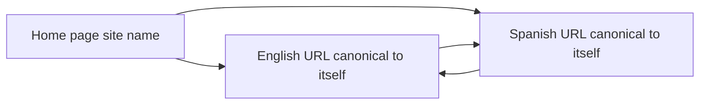

# One Brand, Many Languages: AI Visibility Without Rebuilding Your Site

**You improve AI visibility in more than one language by adding language URLs on the site you already run, each canonical to itself, under one site name.** A second domain is a second site. Google will not give a language folder its own name.

How do I improve AI visibility in multiple languages without rebuilding my whole website? I fill a brand card before anyone opens a redesign. Six lines: domain, site name, legal name, one logo URL, the language list, and the canonical rule. If a line needs a new host, a new template system, or a new company name, I stop.

I'm William Spurlock, founder of Spurlock Studios LLC. I work as an AI Systems Architect and Fractional AI CTO. The receipts I will stand on are 600+ automations built and 500+ live, 20,000+ hours architecting agentic systems, and 35,000+ hours saved for clients. I will not invent a second brand, a translation vendor, or a citation rate for a language I did not log.

I covered why an English page drops out of a Spanish prompt in [why an English-only site disappears in multilingual AI search](/blog/why-your-english-only-site-disappears-in-multilingual-ai-search). I track assistant availability by country and the URL that represents each country on the [market card for citations outside the United States](/blog/getting-cited-by-ai-assistants-in-markets-outside-the-united-states). This post is the brand object. One name. Many language URLs. No rebuild. I handle off-site name matching and NAP work in [how brand consistency and NAP schema build entity authority](/blog/how-brand-consistency-and-nap-schema-build-entity-authority-for-ai).

## How do I improve AI visibility in multiple languages without rebuilding my whole website?

**Keep the domain, keep the site name, and publish a real URL per language whose canonical tag points at that same URL.** A rebuild is a new host, a new design system, or a new brand. None of those are required to add a language.

The card I fill before a single template change:

<table>
  <thead>
    <tr>
      <th>Line</th>
      <th>What I write</th>
      <th>Stop if this is the plan</th>
    </tr>
  </thead>
  <tbody>
    <tr>
      <td>Domain</td>
      <td>The host you already rank on.</td>
      <td>A new domain per language.</td>
    </tr>
    <tr>
      <td>Site name</td>
      <td>One string, on the home page only.</td>
      <td>A second name living at <code>/es/</code> or <code>/de/</code>.</td>
    </tr>
    <tr>
      <td>Legal name</td>
      <td>The registered name, once.</td>
      <td>A translated legal name that reads like a new company.</td>
    </tr>
    <tr>
      <td>Logo</td>
      <td>One crawlable file, at least 112 by 112 pixels.</td>
      <td>A different mark in each language folder.</td>
    </tr>
    <tr>
      <td>Languages</td>
      <td>The languages you will actually publish.</td>
      <td>The word "global" with no URL list.</td>
    </tr>
    <tr>
      <td>Canonical rule</td>
      <td>Each language URL points at itself.</td>
      <td>The Spanish canonical points at the English URL.</td>
    </tr>
  </tbody>
</table>

I keep the order short on purpose:

1. **Write the six lines on one page.** If the domain line changes, you are not adding a language. You are launching a site.
2. **Add subdirectory URLs on that host.** <code>example.com/es/</code> and <code>example.com/de/</code> stay inside the site Google already names.
3. **Translate the main content of the pages you want cited.** A translated nav with an English body is still English. Which three pages to ship first is the August post, not this one.
4. **Set each language URL as its own canonical.** Absolute URL. Same language. No second tag that points home.
5. **Pick one hreflang method.** HTML, an HTTP header, or the sitemap. Not all three.
6. **Put one Organization block on the home page or the about page.** Same name as the site name. Do not paste a new company into every folder.
7. **Check the four objects in the proof section.** Site name, canonical, return link, indexable. Then stop.

I am opinionated about step 2. Owners ask for a fresh site because the current one "was not built for languages." Google's site-name rules do not ask for that. They ask you not to pretend a folder is a new site.



The home page owns the name. The language URLs own their own canonicals. The arrows between them are hreflang, not a second brand.

## What does one brand across many languages mean for AI visibility?

**One brand means one domain-level site name, one legal name, and language URLs that search can treat as versions of the same organization.** It does not mean one URL that swaps copy after the page loads.

Google's site-name guide, last updated December 10, 2025, is the constraint I actually use ([site names in Google Search](https://developers.google.com/search/docs/appearance/site-names)):

<table>
  <thead>
    <tr>
      <th>Rule</th>
      <th>What Google says</th>
      <th>What I do with it</th>
    </tr>
  </thead>
  <tbody>
    <tr>
      <td>One name per site</td>
      <td>A site is a domain or a subdomain. Google Search supports one site name there.</td>
      <td>I pick one string and repeat it.</td>
    </tr>
    <tr>
      <td>Folders are not sites</td>
      <td>A subdirectory such as <code>example.com/news</code> cannot have its own site name.</td>
      <td>Language folders inherit the domain name. I do not fight that.</td>
    </tr>
    <tr>
      <td>www and m</td>
      <td>Those host prefixes are generally treated as the same site.</td>
      <td>I do not mint a mobile brand.</td>
    </tr>
    <tr>
      <td>Real subdomains</td>
      <td><code>news.example.com</code> can have its own site name. If that home page has no WebSite markup, the domain name may be used as a fallback.</td>
      <td>I do not put a language on a subdomain unless a team already runs that host as its own product.</td>
    </tr>
    <tr>
      <td>Where the markup goes</td>
      <td>WebSite structured data belongs on the domain or subdomain home page. <code>example.com/de/index.html</code> is not that page.</td>
      <td>One block on <code>/</code>. Nothing on the language home.</td>
    </tr>
    <tr>
      <td>Where the name shows</td>
      <td>Site names can appear in every language where Google Search is available, on mobile and desktop.</td>
      <td>I do not translate the site name to chase a local result label.</td>
    </tr>
  </tbody>
</table>

Google also reads <code>og:site_name</code>, the title element, headings, and other text on the home page. WebSite structured data is the preference signal. If HTTP and HTTPS both resolve, both copies of the home page should carry the same block. A preferred name can take anywhere from a few days to a few weeks to show after a recrawl. I do not rebuild the site while I wait.

Organization markup is a different object, and it is still one brand. Google's Organization guide, last updated September 8, 2026, says there are no required properties ([Organization structured data](https://developers.google.com/search/docs/appearance/structured-data/organization)). The properties worth filling are <code>name</code>, <code>alternateName</code>, and a presence field such as <code>url</code>, <code>logo</code>, <code>telephone</code>, or <code>address</code>. Put that block on the home page or on one about page. Google says you do not need it on every page. <code>alternateName</code> is an alias. Schema.org 30.1, released September 16, 2026, defines it that way ([alternateName](https://schema.org/alternateName)). Use the same <code>name</code> and <code>alternateName</code> you use for the site name. A logo has to be at least 112 by 112 pixels, and the file has to be crawlable.

I keep this WebSite block on the home page. It is Google's example pattern, not a client:

```json
{
  "@context": "https://schema.org",
  "@type": "WebSite",
  "name": "Example Corporation",
  "alternateName": "Example",
  "url": "https://www.example.com/"
}
```

If a WebSite block is already on the home page, I add <code>name</code> and <code>alternateName</code> to that node. Google says not to drop a second WebSite block beside the first. Organization can live on that same home page or on the about page, with the same <code>name</code>.

I do not expect this markup to buy an AI Overview. Google's AI features guide, last updated December 10, 2025, says there are no additional requirements to appear in AI Overviews or AI Mode, and no special schema.org type you must add ([AI features and your website](https://developers.google.com/search/docs/appearance/ai-features)). The language URL still has to be indexed and eligible for a snippet. Indexing is not guaranteed.

I treat ChatGPT as a separate reader. OpenAI's search help, as I read it on October 14, 2026, says ChatGPT ranks with multiple factors and does not guarantee placement. A site that wants to be eligible allows OAI-Searchbot ([ChatGPT search](https://help.openai.com/en/articles/9237897-chatgpt-search)). That page does not say ChatGPT search reads hreflang, WebSite site-name markup, or Organization schema. I will not pretend it does. The page the bot can fetch is the page with the words in the language of the question. The help page itself was labeled as updated two months before I read it.

A language folder is still your brand when these stay true:

- The site name string on <code>/</code> matches the Organization <code>name</code>.
- The legal name, if you publish one, is the registered name, not a translation that looks like a sister company.
- <code>sameAs</code> points at profiles of that same organization, not at a new local shell you invented for the folder.
- The language URL's visible H1 can be translated. The company name in the sentence stays the name people already know.

## What breaks if each language gets its own website?

**A new domain is a new site, and Google can assign it a different site name.** You asked for another language and you shipped another brand.

<table>
  <thead>
    <tr>
      <th>Move</th>
      <th>What the docs allow</th>
      <th>What happens to the brand</th>
    </tr>
  </thead>
  <tbody>
    <tr>
      <td><code>example.com/es/</code></td>
      <td>A subdirectory cannot carry its own site name.</td>
      <td>One name. This is the move I want.</td>
    </tr>
    <tr>
      <td><code>es.example.com</code></td>
      <td>A subdomain can have its own site name. With no WebSite markup, the domain name may fall back.</td>
      <td>Easy to drift into a second name. I skip it unless that host is already a product.</td>
    </tr>
    <tr>
      <td><code>example.es</code></td>
      <td>hreflang alternate URLs do not have to share a domain. A different domain is still a different site for site names.</td>
      <td>A second brand, plus a second certificate, a second Search Console property, and a second home page to keep in sync.</td>
    </tr>
    <tr>
      <td>One URL, language chosen by IP or browser settings</td>
      <td>Google might not crawl, index, or rank every version. Default Googlebot IPs look US-based, and the request omits <code>Accept-Language</code>.</td>
      <td>The other language may never be fetched. Google's recommendation is separate locale URLs plus hreflang.</td>
    </tr>
  </tbody>
</table>

The locale-adaptive warning is from Google's crawl note, last updated December 10, 2025 ([how Google crawls locale-adaptive pages](https://developers.google.com/search/docs/specialty/international/locale-adaptive-pages)). The "alternate URLs may live on another domain" line is from the localized-versions guide, last updated September 21, 2026 ([localized versions](https://developers.google.com/search/docs/specialty/international/localized-versions)). Both can be true. You are allowed to split. I still will not.

I look for three signs of a split before I run a prompt test:

- The new host's home page title is a translated company name, and the old host still uses the English one.
- The logo file on the new host is a cropped or recolored mark, so image search and the knowledge panel have two files to choose from.
- hreflang points across the two hosts, but the new host's canonical points at itself and its Organization <code>name</code> does not match. Search may list both URLs. A person reading the answer sees two companies.

There is a quieter failure inside one host. Google's canonical guide, last updated July 10, 2026, says that for canonicalization it prefers URLs inside an hreflang cluster ([consolidate duplicate URLs](https://developers.google.com/search/docs/crawling-indexing/consolidate-duplicate-urls)). The example: <code>/de-de/cats</code> and <code>/de-ch/cats</code> point at each other, and <code>/de-at/cats</code> is left out. The clustered URLs are preferred. The language you forgot to pair is the one that loses, on the same website, with no redesign in sight.

I do not open a country-code domain to "feel local" when the job is a language. Currency, a street address, and a ccTLD are country signals. They belong on the market card. A German folder can be the German language without pretending you opened a Berlin office.

## Should a translated page canonicalize to itself or to the English URL?

**To itself, in that same language.** If the Spanish page's canonical is the English URL, you asked Google to treat the Spanish page as a duplicate of English. That deletes the language URL you just added.

Google's wording, from the canonical guide updated July 10, 2026: if you use hreflang, specify a canonical page in the same language, or the best substitute language if a same-language canonical does not exist. Also put a self-referential <code>rel="canonical"</code> on that page, and use an absolute URL. Google says it supports that link relation as described in RFC 6596, published April 2012 ([RFC 6596](https://www.rfc-editor.org/rfc/rfc6596)). RFC 6596 is about marking one IRI as preferred when other resources have duplicative content. A real translation is not that case.

The duplicate test is in the localized-versions guide, updated September 21, 2026: localized versions count as duplicates only when the main content stays untranslated. Translate the body. Then let each URL be canonical for itself. The August post covers the widget and the three-page cut. I will not repeat them here.

I separate these signals so I do not ask a sitemap to do a canonical's job:

<table>
  <thead>
    <tr>
      <th>Method</th>
      <th>Strength Google assigns</th>
      <th>Use it for languages?</th>
    </tr>
  </thead>
  <tbody>
    <tr>
      <td>Redirect</td>
      <td>Strongest. The target should become canonical.</td>
      <td>Only when you are retiring a duplicate URL. Do not redirect <code>/es/</code> to <code>/</code>.</td>
    </tr>
    <tr>
      <td><code>rel="canonical"</code></td>
      <td>Strong.</td>
      <td>Yes. One absolute link, pointing at the language URL itself.</td>
    </tr>
    <tr>
      <td>Sitemap inclusion</td>
      <td>Weak. Google still decides which URL is the duplicate.</td>
      <td>Yes, as a list of the URLs you care about. Not as a veto over a bad canonical tag.</td>
    </tr>
  </tbody>
</table>

Rules I will not bend:

- Do not put <code>hreflang</code>, <code>lang</code>, <code>media</code>, or <code>type</code> on the canonical link. Google ignores those canonical annotations. Language gets its own <code>rel="alternate"</code> tag.
- Do not use <code>noindex</code> to "keep the brand clean" while the translation is new. Google does not recommend noindex as a way to stop a page inside one site from being chosen as canonical, because noindex blocks that page from Search entirely.
- Do not run HTML tags, HTTP headers, and sitemap annotations together. The three methods are equivalent. Using all three has no Search benefit and makes drift likely.
- Do not use a country code as a language. Google's Belgium example: <code>de-BE</code>, <code>nl-BE</code>, and <code>fr-BE</code> are valid. <code>be</code> alone is not Belgium. It is Belarusian. The first code is the language.

When the theme is frozen, I use the sitemap. You do not rebuild the header to add link tags. Each <code>&lt;url&gt;</code> lists every variant, including itself. The child <code>xhtml:link</code> elements do not count toward the sitemap URL limit. The limit on the file is still real: 50,000 URLs or 50MB uncompressed, from Google's sitemap guide updated July 8, 2026 ([build and submit a sitemap](https://developers.google.com/search/docs/crawling-indexing/sitemaps/build-sitemap)). Three languages means three <code>&lt;loc&gt;</code> entries for that page, each with three children. I do not count the children toward that limit. The three locations count. A larger catalog gets split into more sitemap files. That is a file split, not a site split.

<code>x-default</code> is not a language. It is the fallback when the browser setting matches none of your codes. Google designed it for language selector pages. Point it at the selector, or at the default language URL if you have no selector. Do not point it at a third domain and call that a brand.

I do not rebuild just because the site runs on a CMS. The canonical guide says WordPress, Wix, or Blogger may expose a setting for the canonical URL instead of a raw HTML edit. Use the setting. Leave the theme alone.

hreflang still does not detect language. Google says it uses algorithms on the visible content, not the hreflang value and not the HTML <code>lang</code> attribute. The tag pairs URLs. The words on the URL decide the language. If you cannot get the words translated, you do not have a language page, and no canonical trick will invent one.

## How do I check that language pages still belong to one brand?

**I check four objects: the site name on the home page, the canonical on the language URL, the hreflang return, and whether that language URL is indexable.** I do not check a redesign mock.

<table>
  <thead>
    <tr>
      <th>Object</th>
      <th>Pass</th>
      <th>Fail</th>
    </tr>
  </thead>
  <tbody>
    <tr>
      <td>Site name</td>
      <td>One WebSite <code>name</code> on the domain home page. The language folder has no second name block.</td>
      <td>A WebSite block on <code>/es/</code> with a translated company name.</td>
    </tr>
    <tr>
      <td>Canonical</td>
      <td>One <code>rel="canonical"</code>, absolute, equal to the language URL, with no hreflang attribute on that tag.</td>
      <td>The Spanish URL canonicals to the English URL.</td>
    </tr>
    <tr>
      <td>Return link</td>
      <td>Both URLs list each other, and each lists itself. Or both sitemap entries do that.</td>
      <td>English points at Spanish. Spanish does not point back. Google may ignore the pair.</td>
    </tr>
    <tr>
      <td>Indexable</td>
      <td>No noindex. URL Inspection shows the language URL as the selected canonical, once Google has fetched it.</td>
      <td>noindex, a login wall, or a redirect to English.</td>
    </tr>
  </tbody>
</table>

The check, in order:

1. **Open the home page source.** Confirm one site name, the same string in the visible title area and in WebSite markup. Confirm you did not add that block to the language folder.
2. **Open the language URL source.** Confirm the canonical href equals that URL, character for character, including https.
3. **Open the sibling.** Confirm the return annotation. A one-way tag is a miss.
4. **Confirm the language URL is not noindex and does not redirect.** A redirect to English is a retirement, not a translation.
5. **Run URL Inspection on the language URL.** You want Google's selected canonical to be that URL. A site-name change can take a few days to a few weeks. A newly published page can take several days. I write the date I inspected. I do not call a same-day miss a failure of the language.
6. **Ask one buying question in that language.** If a citation appears, the URL should be the language URL. OpenAI does not guarantee placement, and Google does not guarantee an Overview. A miss stays a miss. It is not a brief to launch a second website.

I keep the log on the brand card. Domain, site name, languages, canonical rule, inspection date, and the cited URL if one showed up. Blank cited-URL cell is allowed. A fake pass is not.

What I refuse to count as proof:

- A browser translate bar over the English page.
- A screenshot of a language switcher with no second URL.
- A new logo presentation deck.
- A subdomain that "will share the brand later."

If step 2 fails, fix the canonical setting in the CMS. If step 1 fails, fix the home page name. Neither fix is a rebuild.

## FAQ

### Can a language folder have its own site name in Google Search?

**No. Google Search does not support site names at the subdirectory level.** A site, for this feature, is a domain or a subdomain. <code>example.com/news</code> is the documented non-example, and a language folder is the same shape. The name comes from the domain home page. Site names can still appear on the language URLs, in the languages where Google Search is available. The string does not change because the folder changed.

### Do I put Organization markup on every translated page?

**No. Google says to put Organization structured data on the home page or on one page that describes the organization.** There are no required properties. I fill <code>name</code>, <code>alternateName</code> when a real alias exists, <code>url</code>, and a logo of at least 112 by 112 pixels. Copying a new Organization into every language folder is how two names get into the graph. The language page can still translate its own H1.

### Can I annotate languages in a sitemap if I cannot edit the page template?

**Yes. Sitemap hreflang is equivalent to HTML link tags and to HTTP Link headers, and you only need one method.** Each URL entry lists every variant, including itself. The child links do not count toward the 50,000 URL cap. The cap still applies to <code>&lt;loc&gt;</code> entries, and the file must stay under 50MB uncompressed. A sitemap is a weak canonical signal. It will not override a canonical tag that points the Spanish page at English.

### Does noindex keep a translation from splitting the brand?

**No. noindex removes that URL from Search.** Google says not to use it as a substitute for a canonical inside one site, because the page is blocked outright. If the translation should not be public yet, do not publish the URL. Once it is public, give it a self-canonical and a return hreflang. Hiding it does not protect the English brand. It deletes the language page.

### Does x-default count as a translated page?

**No. x-default is the fallback for browser settings that match none of your language codes.** Google designed it for language selector pages. The language of that page is not the point. It does not create a Spanish document, and it does not replace a Spanish URL. Point it at the selector or at your default language page on the same host.

### Will a new subdomain keep the same Google site name?

**Not by default. A subdomain can have its own site name.** <code>news.example.com</code> is Google's example of a subdomain-level home page that qualifies. If you add no WebSite markup there, the domain-level name may be used as a fallback, which is a maybe, not a rule you should bet the brand on. <code>www</code> and <code>m</code> are the exceptions Google treats as the same site. <code>es.example.com</code> is not <code>www</code>. I keep languages in folders unless that subdomain is already its own product.

### Do answer engines publish a rule that they read hreflang?

**OpenAI's ChatGPT search help does not.** I read it on October 14, 2026. It says ranking uses multiple factors, placement is not guaranteed, and OAI-Searchbot has to be allowed. It does not mention hreflang, site names, or Organization schema. Google Search does document hreflang, and it also says hreflang is not how it detects language. For ChatGPT I still need a URL whose main content is in the question's language. I do not need a second website to get that URL.

### How many URLs can one sitemap hold when I add languages?

**50,000 URLs, or 50MB uncompressed, per sitemap file.** That limit is in Google's sitemap guide updated July 8, 2026. hreflang children inside a URL entry do not count toward it. Three language versions of one page are three locations, not nine. If the catalog outgrows one file, split the sitemap. Leave the domain alone.

### Does the logo file have to change for each language?

**No. One crawlable logo, at least 112 by 112 pixels, is the Organization guidance.** Google uses that file to understand which logo represents the organization, including in Search results and the knowledge panel. A recolored mark per folder gives the systems two files and no instruction about which one is the brand. Translate the offer. Keep the mark.

## Get an AI-visibility-ready site built

**I build the language URLs as part of an AI-visibility-ready site: one domain, one site name, a self-canonical page per language, and a home page that still names one organization.** The work is the brand card. It is not a second website with a translated logo.

If you want that site, [get an AI-visibility-ready site built](/contact). Bring the domain you already have, the site name you want kept, and the language list you will actually publish. I will name the missing piece: a URL, a canonical, or a name that wandered off the home page.
