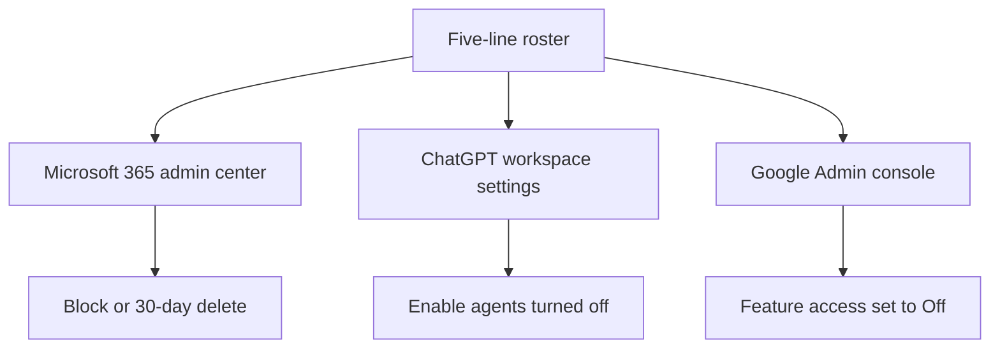

# One Control Panel for Every AI Agent Your Company Already Uses

**You manage every AI agent your company already uses from one control panel by keeping a five-line roster and using each vendor's own off switch.** There is no admin page that sees Microsoft, ChatGPT, and Gemini at once. I checked all three vendor pages on October 26, 2026. Each page can turn off that vendor's agents and nothing from the other two.

I'm William Spurlock, founder of Spurlock Studios LLC, an AI Systems Architect and Fractional AI CTO. I've built 600+ automations, with 500+ still live, spent 20,000+ hours architecting agentic systems, and helped clients save 35,000+ hours. Those hours did not produce a login that lists every agent the company already pays for. The panel I trust is a card.

Standing work in the inbox, calendar, and CRM already has a home in [what an agentic OS means for a normal Tuesday](/blog/what-an-agentic-os-means-for-running-your-business-day-to-day). Moving one pasted job out of a chatbot belongs in the [single operating layer](/blog/from-scattered-chatbots-to-a-single-operating-layer-for-agents). That page does not draw a panel because a wall of chats would only add another screen. This page starts after the job has left the chat and is running inside a product. The roster shows what is running and where to stop it.

I will not turn this into an automation build. A fixed path does not need a row, and this page does not need a coding-agent product. This is the agent-team sheet: which agents exist, who can block them, and the date you last looked.

---

## How do I manage every AI agent my company uses from one control panel?

**Keep one roster with five lines per agent, then do the block inside the product named on line one.** The control panel is the roster. Microsoft 365, ChatGPT, and Google Workspace each keep their own click. If a line is blank, that agent is not on the panel, even if it is still running.

I use the same five lines every time, in the same order. Put Product first so you can find the job. Put the date last so an old row cannot pass as current.

<table>
<thead>
<tr><th>Line</th><th>What you write</th><th>Fail when</th></tr>
</thead>
<tbody>
<tr><td>Product</td><td>The admin page, not the brand slogan. "Microsoft 365 admin center, Agents, All agents."</td><td>The name is "AI" or "our agent platform"</td></tr>
<tr><td>Job</td><td>One verb and one object. "File the vendor packet into the holding folder."</td><td>The sentence could cover two agents</td></tr>
<tr><td>Record</td><td>The field the agent may write. Ticket note, deal row, sheet cell.</td><td>The only copy of the facts is a chat</td></tr>
<tr><td>Blocker</td><td>A person's name, the role the vendor page requires, and the click.</td><td>The line says "IT" or "the team"</td></tr>
<tr><td>Last opened</td><td>The date you had that admin page open and saw this agent.</td><td>The date is blank, or it is from a month you did not check</td></tr>
</tbody>
</table>

My Monday check has four steps. This is my pass, not a quota from Microsoft or OpenAI.

1. **Read the roster out loud.** One row. If the job sentence fits a second row, split it before you open any admin page.
2. **Open only the product on line one.** Find the agent. If it is not on that page, the row fails. Do not go hunting through a second vendor to rescue it.
3. **Write today's date** on Last opened, and only if you are looking at the live page. A remembered date is a blank date.
4. **Leave the block alone** unless the row failed. A failed row gets the click named on the Blocker line, or it comes off the sheet.

Here is the same card filled in without a company attached. Copy the format, not a made-up customer.

<table>
<thead>
<tr><th>Line</th><th>Filled shape</th></tr>
</thead>
<tbody>
<tr><td>Product</td><td>Microsoft 365 admin center, Agents, then All agents</td></tr>
<tr><td>Job</td><td>Write the vendor-packet summary into the ticket's internal note</td></tr>
<tr><td>Record</td><td>That ticket, field "internal note"</td></tr>
<tr><td>Blocker</td><td>The named AI Administrator. Click Block in the agent details pane.</td></tr>
<tr><td>Last opened</td><td>2026-10-26, while the inventory page was open</td></tr>
</tbody>
</table>

A prompt I keep next to the card, so the check does not wander into a second job:

```text
You are checking one roster row. You do not send, spend, or promise.

Product: the admin page named on the row.
Job: one sentence. If the admin page describes a second job, say so and stop.
Record: the field the agent may write. If you cannot open it, say missing.
Blocker: the person and the click. If the click is not on the page, say missing.
Last opened: today, only if you are looking at the live page. Do not invent the date.
Output: the five lines, then pass or fail.
```

That prompt keeps the person doing the check on one row. It is not the panel. The panel is the card plus the click on the vendor page.

I open these three pages:

- **Microsoft 365 admin center**, Agents, then All agents, for agents that tenant can see.
- **ChatGPT workspace settings**, for workspace agents, and a separate Plugins screen when the thing is a plugin.
- **Google Admin console**, Generative AI, then Gemini for Workspace, then Feature access, for Gemini inside Workspace apps.

Everything else stays in the margin. It cannot become line one until you have clicked its off switch in a test tenant or found the switch on the vendor's own page.



The buyer's mistake is shopping for a product named "control panel." The roster is intentionally plain. A new screen that promises every agent will still miss the one a salesperson turned on last Thursday if it lives behind a login that screen does not have.

---

## What belongs on the roster if each vendor already has an admin page?

**The roster holds the job, the record, the person, and the date. The vendor page holds the off switch, and only for agents that page can see.** If you copy the vendor inventory onto the card and skip the job sentence, you have a screenshot, not a panel.

I put the three admin surfaces side by side to expose their gaps. "Sees" means I found it named on that page on October 26, 2026. "Does not see" means the page I read does not name it.

<table>
<thead>
<tr><th>Admin page</th><th>Where you click</th><th>What that page can see</th><th>What I will not pretend it sees</th></tr>
</thead>
<tbody>
<tr><td>Microsoft 365 admin center</td><td>Agents, then All agents. Map is Agents, then All Agents, then Map.</td><td>Agents in that tenant, grouped by the builder Microsoft lists</td><td>A ChatGPT workspace agent. Gemini inside Gmail.</td></tr>
<tr><td>ChatGPT workspace admin</td><td>Role controls for workspace agents. Plugins is a different screen.</td><td>Workspace agents in that ChatGPT workspace, plus plugins you manage there</td><td>A Copilot Studio agent. A Gemini side panel in Docs.</td></tr>
<tr><td>Google Admin console</td><td>Generative AI, Gemini for Workspace, Feature access</td><td>Gemini features in named Workspace services, per org unit or group</td><td>A Microsoft agent. A ChatGPT workspace agent.</td></tr>
</tbody>
</table>

Microsoft's [Agent Map](https://learn.microsoft.com/en-us/microsoft-365/admin/manage/agent-map?view=o365-worldwide), which I read that morning, groups agents by builder. The cluster table names Microsoft Copilot Agent Builder, Copilot Studio, Copilot Studio Legacy, Microsoft 365 Agents Toolkit, SharePoint, Azure AI Foundry, Amazon Bedrock, Google Vertex AI, Microsoft, External Partners, and Others. That list is not a company-wide panel.

- **Google Vertex AI on that map is not Gemini in Gmail.** It is a builder cluster for agents that show up in the Microsoft tenant. I will not write "Google" on a Microsoft row and call the Gemini side panel covered.
- **Amazon Bedrock on that map is not every AWS bot your team spun up.** It is the cluster Microsoft drew for agents it can place there.
- **ChatGPT is not in that cluster table.** A workspace agent stays on the OpenAI row.
- **Unmanaged agents**, on the same page, are agents created or managed outside Agent 365, without that product's risk protection and observability. Even inside Microsoft, the map admits a pile it does not fully watch.

The same page gives two different caps, so I am keeping them separate. The early note says usage is supported via Agent 365 observability data for tenants with below 4,000 agents. A later note says the Usage and Observability filters are currently available only for tenants with, according to that page, fewer than 4,000 users. One figure counts agents. The other counts users. I will not average them or call a tenant "under the limit" without naming the cap.

Single Agent Map is marked preview on that page. It shows, according to the same doc, the top 50 users and the top 50 tools for one agent. You can look at the last 7 days or the last 30 days. The default is the last 30 days. If a tool's exception rate is greater than 1 percent in the window you picked, the line to that tool is highlighted. That is a Microsoft window. My pass/fail is still the date on the roster. I use the map when the license is actually there: the page says Agent Map is available to Microsoft Copilot administrators with an E7 (Agent 365) license, and the role has to be Global Administrator or AI Administrator.

OpenAI also splits its controls across screens. The [workspace agents help page](https://help.openai.com/en/articles/20001143-chatgpt-workspace-agents-for-enterprise-and-business), read October 26, 2026 and marked updated three days earlier, says workspace agents are off by default at launch for ChatGPT Enterprise workspaces. Admins can enable them. The same page lists four role controls:

1. **Enable agents**, so members can browse and run agents.
2. **Enable agent building**, so members can create, edit, and duplicate agents.
3. **Enable agent publishing**, so members can publish into the workspace directory.
4. **Enable agent publishing with agent-owned connections**, which the page warns can let other people act through the creator's own app credentials.

Files on that same page are capped at 512 MB per file and 10 GB total per agent. That cap belongs on the row if the agent is hauling a folder. It is not a reason to call ChatGPT the panel for the Microsoft inventory.

Plugins sit behind a second OpenAI door. The [Enterprise and Edu release notes](https://help.openai.com/en/articles/10128477-chatgpt-enterprise-and-edu-release-notes), under the October 16, 2026 heading, say an admin can manage up to 25 plugins at a time: make them available, install them for the workspace, or disable them. Twenty-five is a batch size for that screen, not the number of agents you may run. A plugin row on the roster names Plugins. An agent row names the workspace-agent controls. They belong to the same company but require different clicks.

Google uses a third control scheme. The [Workspace Help page on Gemini feature access](https://knowledge.workspace.google.com/admin/generative-ai/workspace-with-gemini/manage-access-to-gemini-features-in-workspace-services), read October 26, 2026, says the default for Gemini features in Workspace services is on. The editions named there are Enterprise Standard, Enterprise Plus, the Teaching and Learning add-on, Education Plus, and Google AI Pro for Education. The path is Generative AI, then Gemini for Workspace, then Feature access, and it asks for the Gemini Settings administrator privilege. Group settings override organizational units. A department OU set to Off can still be On for a person in a group.

What does not belong on the roster:

- A vendor you cannot name an off switch for.
- A second row that repeats the same job sentence. That is two agents on one job, which the operating-layer page already told you to close.
- A "platform" row that points at a slide. Slides do not block anything.
- NIST. The identity paper is a standard argument, and I will get to it. It is not line one.

---

## What breaks when Gemini is off in one Google app and on in another?

**The off switch lies if you only flip one Google app.** [Google's own help page](https://knowledge.workspace.google.com/admin/generative-ai/workspace-with-gemini/manage-access-to-gemini-features-in-workspace-services) says that even when Gemini is off for a specific app, people can still reach that app's data from Gemini in another app. The example on the page is a person in Gmail asking Gemini about a Drive file while Gemini is turned off for Drive.

That is the failure I care about. Drive looked dark, but Gmail still read it. The roster's Blocker line said "Gemini is off," while the file remained available.

<table>
<thead>
<tr><th>Switch you flip</th><th>What that page says stops</th><th>What that page says can still run</th></tr>
</thead>
<tbody>
<tr><td>Gemini off for Drive only</td><td>Gemini features in Drive</td><td>A Gmail user asking Gemini about a Drive file</td></tr>
<tr><td>Gemini app at gemini.google.com turned off</td><td>Access to that app</td><td>Other AI features inside Google Workspace services. The page says this toggle has no effect on them.</td></tr>
<tr><td>Feature access Off for one service, On for the rest</td><td>The side panel in the service you edited</td><td>Gemini in every service you left at the default, which is On</td></tr>
<tr><td>Off on an org unit, On on a configuration group</td><td>People who only inherit the org unit</td><td>People in the group. Group settings override the org unit.</td></tr>
</tbody>
</table>

The services that page lets you edit are Gmail, Calendar, Drive (plus Docs, Sheets, Slides, Forms, Drawings, and Vids), Meet, Chat, and Google Workspace Studio. I would fail a roster row that says "Google" without naming the service. The record tells you which services matter. If the record is a Drive file, Drive has to be Off, along with every other service on that list that can still ask about the file. Google uses Gmail as its example. I would not assume Calendar is harmless if the agent can see the same file from Calendar.

I do not treat this as a puzzle to solve with a smarter prompt. The help page is describing product behavior. Prompt text will not close a door the admin console left open.

What I write on a Google row, or I do not keep the row:

1. **Every service that can see the record**, each marked On or Off, with the date I saved it.
2. **The Gemini app toggle**, separate, because it does not cover Workspace.
3. **The org unit and the group**, because the group wins.
4. **The person who holds Gemini Settings administrator**, by name. "Admin" is not a name.

I would not call Google's feature access a control panel. It is a dimmer that can leave the next room lit. Microsoft's Block and ChatGPT's Enable agents are closer to off switches because each click targets an agent or the whole agent feature. Google's click targets one app, while another app may still see the file. If the record lives in Drive, the Google row fails until you have checked the service list. That takes longer than a demo, but it matches the help page.

This is also why a "Gemini off" cell on a company spreadsheet is not a control. The cell hides which app, which group, and which person saved it. The roster refuses the short version.

---

## Who can actually block an agent in Microsoft 365, ChatGPT, and Google Workspace?

**Three different roles, and none of them is a department called IT.** The Blocker line names a person who holds the role required by that vendor page. If that person cannot sign in, the row fails before anyone argues about the job.

<table>
<thead>
<tr><th>Product</th><th>Who the page allows</th><th>The click</th><th>The limit I will not round off</th></tr>
</thead>
<tbody>
<tr><td>Microsoft 365</td><td>AI Administrator or Global Administrator, for approvals and owner assignment. Agent Map adds an E7 (Agent 365) license on top of those two roles.</td><td>Block in the agent details pane, or a 30-day delete</td><td>Other roles can watch governance gaps. The overview page says they cannot take those admin actions.</td></tr>
<tr><td>ChatGPT Enterprise</td><td>A workspace admin who can edit the agent role controls</td><td>Turn off Enable agents, or narrow building and publishing</td><td>Off by default at launch does not mean off in a workspace where someone already enabled them</td></tr>
<tr><td>Google Workspace</td><td>An admin with the Gemini Settings administrator privilege</td><td>Feature access, On or Off, then Save, per service</td><td>One service is not the whole suite. Groups override org units.</td></tr>
</tbody>
</table>

Microsoft's block has more than one blast radius. The [agent actions page](https://learn.microsoft.com/en-us/microsoft-365/admin/manage/agent-actions?view=o365-worldwide), read October 26, 2026, says blocking an agent built in Microsoft Copilot Agent Builder or Microsoft Copilot Studio hits Microsoft Copilot and other host products, including Outlook, Teams, and other Microsoft 365 apps. Blocking an agent built in SharePoint or Microsoft Foundry only changes availability in Microsoft Copilot Chat. I write the builder on the Product line so the Blocker person knows which rooms go dark.

Two Microsoft agents cannot be limited to a partial audience. The same page says the Edit users panel is disabled for Researcher and Analyst. Changing their availability means blocking them for the whole tenant. If someone asks for "just the finance group," the roster must say the page cannot do that. Block the tenant, or leave the row unmarked and record why.

Delete is not the same click as Block. A delete in that admin center is a soft delete, and properties and connected resources stay for 30 days. You can restore during that window or permanently delete before it ends. If you do neither, Microsoft 365 permanently deletes the agent when the window ends. Permanent delete is only offered after the soft delete. I do not write "deleted" on Last opened unless I know which state applies. A soft-deleted agent can come back. A blocked agent is blocked.

Ownership is another Microsoft trap. The [agent overview](https://learn.microsoft.com/en-us/microsoft-365/admin/manage/agent-365-overview?view=o365-worldwide) says approving a request or assigning an owner can only be done by an AI Administrator or a Global Administrator. The [agent actions page](https://learn.microsoft.com/en-us/microsoft-365/admin/manage/agent-actions?view=o365-worldwide) says you can reassign ownership for shared Agent Builder and Copilot Studio agents, not for first-party Microsoft agents. After a reassignment, the new owner gets edit, delete, and the files the previous owner uploaded. The previous owner loses all access, including read. Agent Builder owners are individual people. Groups are not owners. You cannot remove the last owner. The [agents admin guide](https://learn.microsoft.com/en-us/microsoft-365/copilot/agent-essentials/m365-agents-admin-guide) puts a Missing an owner filter on the inventory and says to consider removing agents that no longer have an owner. I make that mandatory for the roster. A row with no living blocker fails. Assign a person, or take the agent off the sheet.

One more Microsoft default, so a "we didn't enable it" story does not sneak through. The same admin guide says agents that touch shared tenant data, such as SharePoint or Graph Connector content, are billed on metered consumption, and those metered agents are off by default for users in Microsoft Copilot Chat. Off by default means you still check. Someone can turn the meter on. The roster records On or Off and the date. It does not record the hope that the default survived.

ChatGPT's dangerous click is not Block. It is a write setting. The workspace-agents help page says write actions for apps are set to Always ask during a run, by default. Depending on the app, a builder can set Never ask, or a custom approval for specific writes. The page tells you to be careful when the workflow can send, edit, post, or delete. I treat Never ask as a failed Blocker line unless a named person set it and the date is on the card. The approval toggle is the same family of break I wrote up on the [no-code break slip](/blog/where-no-code-agents-break-and-how-owners-fix-them-without-developers): if the gate is not what you think, stop rewriting the prompt.

I would leave the fourth OpenAI role control off unless the job truly needs a shared login. Publishing with personal or agent-owned connections can let anyone who can run the agent act as the creator. That is not a convenience setting. If the row needs it, the Blocker line names the creator account, not "shared connection." If you would not hand that person your password, do not hand the agent their connection.

Who I will accept on the Blocker line:

- A named person who can sign in as AI Administrator or Global Administrator, for a Microsoft row.
- A named workspace admin, for a ChatGPT row, with Enable agents and the write setting both written down.
- A named Gemini Settings administrator, for a Google row, with each relevant service marked On or Off.
- Nobody else. A contractor who "usually handles IT" fails the line until the role is on their account and you have watched them open the page.

---

## How do I prove an agent on the roster is still the one running?

**Open the vendor page and write today's date. A row with a blank date is a rumor.** The agent can still be running. The panel is the row you checked, not the row you remember from the quarter you bought the seats.

This pass has five checks, and every one must pass. I do not average them into a score.

<table>
<thead>
<tr><th>Check</th><th>Pass</th><th>Fail</th></tr>
</thead>
<tbody>
<tr><td>Find it</td><td>The agent is on the admin page named in Product</td><td>You only found it in a slide, a chat, or a different vendor</td></tr>
<tr><td>Same job</td><td>The job sentence still matches the description on that page</td><td>The page now describes a second job</td></tr>
<tr><td>Living blocker</td><td>The named person can still open the page in the required role</td><td>The role moved, or Microsoft shows no owner</td></tr>
<tr><td>Fresh date</td><td>Last opened is a date you typed while the page was open, and it is this month</td><td>The cell is blank, copied forward, or older than this month</td></tr>
<tr><td>Honest off switch</td><td>Microsoft block scope matches the builder. ChatGPT writes are Always ask, or Never ask is dated. Google lists every service that can see the record.</td><td>A single "off" with no scope</td></tr>
</tbody>
</table>

"This month" is my rule for this pass. It is not a line in the Microsoft doc or the OpenAI doc. Single Agent Map's 7-day and 30-day windows are Microsoft's, and only when you have the E7 (Agent 365) license. If you have the map, use it as a second look. If you do not, the date on the card is still the proof. Do not skip the roster because a preview screen is unavailable.

After the four steps in the first section, finish Monday with these checks:

1. **Count the rows you did not open.** Each one fails, even if the agent "always works."
2. **Count job sentences that appear twice.** Each pair fails until one agent is blocked or the jobs are actually different.
3. **Read Never ask and Gemini's single-app Off out loud.** Those are the two switches that feel like control and are not, unless the rest of the line is filled in.
4. **Stop.** Do not add a tool that promises one screen for every vendor. You already have the screen. It is the card.

A custom GPT is not a workspace agent, and it has its own clock. The Enterprise and Edu release notes, read October 26, 2026 and marked updated the day before, list planned dates for affected Enterprise workspaces: September 22, 2026 for migration availability, October 26, 2026 for ending new custom GPT creation, and December 11, 2026 for standard retirement. A qualified, approved deferral moves retirement to February 11, 2027. The notes say the dates may change. I am writing this on October 26, 2026, which is the planned day new GPT creation ends. I am not telling you the switch has already moved in your workspace. Put the GPT on its own roster row, open the admin page, and write what you see. When that row dies, do not paste the job into a workspace agent without a new Blocker line.

The proof should be boring. If you need a dashboard to make the panel feel real, you have skipped the date. The date is the instrument.

---

## Frequently Asked Questions

**The short answers below are the same roster, one click at a time.** If a sentence here grows a second job, it belongs on a new row, not in a longer answer.

### Does Microsoft's Agent Map include ChatGPT workspace agents?

**No. The cluster table I read on Microsoft's Agent Map page on October 26, 2026 does not name ChatGPT.** It names Google Vertex AI and Amazon Bedrock as builder groups inside the Microsoft tenant. Vertex on that map is not Gemini in Gmail, and a ChatGPT workspace agent still has to be checked in ChatGPT because this map covers one vendor's agents.

### Are ChatGPT workspace agents on for every Enterprise workspace?

**No. OpenAI's help page, read October 26, 2026 and marked updated three days earlier, says workspace agents are off by default at launch for ChatGPT Enterprise, and admins can enable them.** Off at launch is not a promise about your tenant today. If an admin already turned on Enable agents, the agents are available to people whose role allows them, so the roster must say On or Off plus the date you looked.

### What is the default for a ChatGPT workspace agent write?

**Always ask.** The same help page says write actions for apps start on Always ask during a run. A builder may move a given app to Never ask, or to a custom approval, and the page calls out workflows that send, edit, post, or delete. I fail a row that says Never ask unless the Blocker line names the person who set it and the date.

### When does OpenAI plan to stop new custom GPTs?

**The Enterprise and Edu release notes, read October 26, 2026, list October 26, 2026 as the planned day new custom GPT creation ends for affected Enterprise workspaces.** Migration availability is planned for September 22, 2026, standard retirement for December 11, 2026, and a qualified deferral for February 11, 2027. The notes say the dates may change, so confirm the date on your workspace instead of treating this sentence as the switch itself.

### Does turning off the Gemini app turn off Gemini in Gmail?

**No. Google's Workspace Help page says turning gemini.google.com on or off has no effect on other AI features in Workspace services.** Gmail is controlled on the Feature access panel, service by service, and turning Gemini off for Drive still leaves the page's own example intact: a person in Gmail can ask about a Drive file. Set each service, and write each one on the row.

### What does a missing owner mean in the Microsoft 365 agent inventory?

**The agents admin guide tells you to filter Missing an owner and consider removing those agents.** The agent actions page says an AI Administrator or a Global Administrator can assign a new owner for shared Agent Builder and Copilot Studio agents, not for first-party Microsoft agents. A missing owner on my roster is a failed Blocker line. Assign someone who can still open the page, or remove the agent from the sheet.

### Is the NIST agent identity paper a control panel?

**No. It is a concept paper, not a product you can log into.** The February 2026 NCCoE paper, with public comment from February 5, 2026 through April 2, 2026, says OAuth is integrated into the Model Context Protocol as the primary method for authorizing agentic access, following the draft OAuth 2.1 standard, and a later summary page I read on October 26, 2026 says over 600 responses came in. Use those papers to argue about how an agent should get rights, but do not put NIST on line one of the roster.

### Does this roster replace the operating layer for one job?

**No. The operating layer is the card for one job that used to be pasted into a chatbot: the record, the tools, and the person who stops the paste.** This roster starts after that job is already an agent inside a product. Keep both, and if the job sentence is still vague, go back to the operating-layer page before you add a second vendor row.

### Should I buy a fourth product so every agent shares one screen?

**No. I would not.** Microsoft's map, ChatGPT's role controls, and Google's feature access are already three screens, and each one misses the other two. A fourth login can only show agents it has a connector for, while the roster sees every row because you typed those rows from the pages you opened.

---

## Book a custom agent build

**Bring the roster, including the blank lines.** I am William Spurlock, and I do this work at Spurlock Studios LLC. On a [custom agent build](/contact), I will tell you which row has a real off switch, which Google service is still On, and which agent should not be on the sheet.

I will not invent a client to make the card feel finished. Across 600+ automations built and 500+ still live, the useful argument remains five lines: product, job, record, blocker, date. The 35,000+ hours saved for clients came after someone could name the person who turns the agent off. Much of my 20,000+ hours on agentic systems has gone into rejecting dashboards that cannot see another vendor. If your "control panel" is a tab you have not opened this month, say that. I will fill one row with you before anyone sells you a fourth screen.
