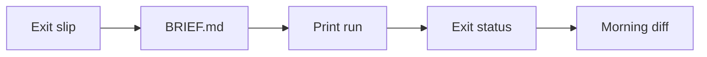

# The Pi Coding Agent Runs the Brief. You Read the Diff.

**What is the Pi coding agent? It is Mario Zechner's terminal agent, and a brief you will not watch should run once, write its last reply, and exit.** I do not sit in the terminal UI for that kind of job. I put four lines on a sheet, start print mode inside a fence, and read the diff in the morning.

I am William Spurlock, AI Systems Architect and Fractional AI CTO at Spurlock Studios LLC. I have spent 20,000+ hours architecting agentic systems. The studio count is 600+ automations built and 500+ live, and 35,000+ hours saved for clients. Those numbers are why I will not call a trust prompt a lock.

The npm page for [`@earendil-works/pi-coding-agent`](https://www.npmjs.com/package/@earendil-works/pi-coding-agent), read October 19, 2026, lists version 1.3.0, updated October 15, 2026, author Mario Zechner, license MIT, a package created time of May 7, 2026, and 2,612,036 weekly downloads. This page is the exit slip for that package. The [Hermes, OpenClaw, and Agent Zero showdown](/blog/hermes-openclaw-agent-zero-decision-framework) is where a runtime gets picked. I am not redoing that pick. The [Agent Zero Monday report](/blog/agent-zero-2026-update-putting-the-self-evolving-h%61rness-on-music-site-maintenan) is a different sheet, for a music site, read on Monday. This one is for a coding folder you leave tonight.

## What is the Pi coding agent?

**The Pi coding agent is a terminal program that works on files in a folder you choose, with read, bash, edit, and write turned on unless you change that list.** Version 1.3.0 is the release I am writing against. The [npm readme](https://www.npmjs.com/package/@earendil-works/pi-coding-agent) says Pi skips sub-agents and plan mode. You add behavior with skills, prompt templates, extensions, and packages, or you ask Pi to build the missing piece. The same readme points at OpenClaw as a real-world SDK integration. Embedding Pi inside another product is a different job from handing it a folder for the night.

The package record is the identity card. I do not treat a blog recap as the version.

<table>
<thead>
<tr><th>Fact</th><th>What the registry showed</th></tr>
</thead>
<tbody>
<tr><td>Package</td><td><code>@earendil-works/pi-coding-agent</code></td></tr>
<tr><td>Version</td><td>1.3.0, updated October 15, 2026</td></tr>
<tr><td>Author</td><td>Mario Zechner</td></tr>
<tr><td>License</td><td>MIT</td></tr>
<tr><td>Package created</td><td>May 7, 2026</td></tr>
<tr><td>Weekly downloads</td><td>2,612,036 on the October 19, 2026 read</td></tr>
<tr><td>Node.js for npm install</td><td>22.19 or newer, from the readme and the quickstart</td></tr>
<tr><td>Default tools</td><td><code>read</code>, <code>bash</code>, <code>edit</code>, <code>write</code></td></tr>
</tbody>
</table>

Pi runs in four modes. The [CLI integration page](https://pi.dev/docs/latest/cli-integration), read October 19, 2026, uses the same agent in each one. The mode only changes how text goes in, how text comes out, and whether the process stays up.

<table>
<thead>
<tr><th>Mode</th><th>Lifetime</th><th>I use it when</th></tr>
</thead>
<tbody>
<tr><td>Interactive</td><td>Until I exit</td><td>I am in the chair</td></tr>
<tr><td>Print</td><td>One run, then exit</td><td>The brief is a file and I will read the diff later</td></tr>
<tr><td>JSON</td><td>One run, events on stdout</td><td>Another process must see the steps, not only the last paragraph</td></tr>
<tr><td>RPC</td><td>Stays up for commands</td><td>A program needs to steer Pi, which is not this slip</td></tr>
</tbody>
</table>

The [quickstart](https://pi.dev/docs/latest/quickstart), read the same day, tells you to start with the smallest customization that does the job:

- Persistent rules for a folder start in `AGENTS.md`.
- A prompt you want on the slash menu is a prompt template.
- Task instructions plus supporting files are a skill.
- A new tool, command, or event handler is an extension.
- Several of those, shared through npm or git, are a Pi package.

I start with `AGENTS.md` and `BRIEF.md`. I do not install a third-party package on the first afternoon. The [security page](https://pi.dev/docs/latest/security) says extensions execute inside the Pi process, with the same account permissions, unless a container or a VM is in the way.

There are three install paths, and they do not update the same way. The quickstart says the shell installer pins dependencies and `pi update` updates that install. The npm command `npm install -g --ignore-scripts @earendil-works/pi-coding-agent` does not pin transitive dependencies, and Pi does not need dependency lifecycle scripts for a normal npm install. Nix users add `github:earendil-works/pi/stable`, and `pi update` cannot update a Nix install. The quickstart's tag-shaped pin example is an example of the shape, not a claim that 1.0.0 is the current release. The current release I read is 1.3.0.

`/login` picks a provider. `/model` picks a model. This page does not pick one for you. In a script, I pass the model argument on the command line to avoid the menu. I still want the exit slip filled before that flag matters.

## What happens if you leave Pi on a brief without watching it?

**Pi will read, change, and run commands as the operating-system user that started it, and it will not pause for approval between tool calls.** The [quickstart](https://pi.dev/docs/latest/quickstart) says that in one line, and it tells you to use a container or another sandbox for unattended work. The [security page](https://pi.dev/docs/latest/security) says the same thing and then draws the line I care about: watching the transcript, granting project trust, and reviewing changes do not create a security boundary.

The working folder is where Pi looks for instructions and where it groups sessions. It is not a jail. The security page says the folder does not stop commands from touching other paths that the Pi process can already reach.

<table>
<thead>
<tr><th>How you start Pi</th><th>What stays out of reach</th></tr>
</thead>
<tbody>
<tr><td>Your normal user, on the host</td><td>Only what that user cannot touch. The process still shares the machine and the network.</td></tr>
<tr><td>The whole Pi process inside a container, VM, or sandbox</td><td>Host files and processes you did not expose. Keys and network still count if you passed them in. The page calls this the strongest practical option.</td></tr>
<tr><td>Pi on the host, only built-in tools inside the isolator</td><td>Host files are safer from those tools. Pi itself and other extensions stay outside, so the fence is narrower.</td></tr>
</tbody>
</table>

Project trust is the startup switch for project files. It is not the fence. I keep these limits on the slip so I do not confuse them later:

- Trust does not limit what an enabled tool can read or run after startup.
- `AGENTS.md`, `AGENTS.override.md`, and `CLAUDE.md` still load when you decline trust, unless you turn context files off.
- Pi reads the project `sessionDir` setting while it is picking a session, before the trust decision. Declining trust does not undo that lookup.
- A bare `.pi` directory does not require a trust decision. Settings, extensions, skills, prompts, themes, `mcp.json`, and the system-prompt files inside it do.
- Saved answers live in `~/.pi/agent/trust.json`. The closest saved decision, on this directory or a parent, wins.
- `defaultProjectTrust` defaults to `ask`.

Print, JSON, and RPC cannot show the trust prompt. If nothing else decides, `ask` and `never` skip the protected project resources, and `always` loads them. `--approve` loads them for this process. `--no-approve` skips them for this process. I pass `--no-approve` unless I have read the project's `.pi` folder that day. A saved yes in `trust.json`, or a machine default of `always`, will load a stranger's extension while I am asleep. I do not want that.

Files, comments, command output, and the model's own replies can steer the next tool call. The security page calls that prompt injection and says it is expected local-agent behavior, not a bug report, unless a privilege boundary was actually crossed. I treat the folder as untrusted input even when I wrote the brief. Someone else can edit `AGENTS.md` after I leave.

My rule is blunt. If I cannot name a user or a container that is allowed to lose the files it can see, I am not leaving Pi on that brief. Interactive mode is for the hour I am watching. The exit slip is for the hour I am not.

## How do you hand the Pi coding agent a written brief?

**Write the job in `BRIEF.md`, run print mode, and treat a nonzero exit as a stop.** Print mode, on the [CLI integration page](https://pi.dev/docs/latest/cli-integration), runs the prompt, writes the final assistant text to stdout, and exits. An `error` or `aborted` stop is nonzero. A `length` stop still prints the partial text, warns on stderr, and is also nonzero. A paragraph on stdout is not a pass.

If stdin or stdout is not a terminal and you did not pick JSON or RPC, Pi selects print mode for you. I still pass `--print`. I do not want a redirect to be the thing that chose the mode.

JSON mode is the wrong exit check for this slip. The same page says a failed or aborted reply shows up in the event stream and does not, by itself, make the process exit nonzero. `agent_settled` is the mark that automatic work for that run ended. RPC is a third rule: a successful `prompt` response means the prompt was accepted, not that the run finished. I use print mode when the morning check is an exit code plus a diff.

<table>
<thead>
<tr><th>Line on the slip</th><th>What I write before I leave</th></tr>
</thead>
<tbody>
<tr><td>Done</td><td>One sentence that is true or false on disk. "Make it better" does not go on this line.</td></tr>
<tr><td>Folder</td><td>The only directory mounted into the fence. Home does not go here.</td></tr>
<tr><td>Exit</td><td>Print mode. Nonzero means I do not keep the files. Partial stdout still counts as nonzero when the stop reason is length.</td></tr>
<tr><td>Fence</td><td>Container, VM, or a user that cannot see the rest of the machine. Trust is not this line.</td></tr>
</tbody>
</table>

The brief I actually paste is a prompt, not a framework:

```text
Read BRIEF.md in this folder.
Change only files inside this folder.
The brief is done only when the Done line in BRIEF.md is true on disk.
Write what changed, and whether that line is true, to RESULT.md.
Do not read parent folders. Do not print credentials.
```

Pi does not have a built-in `RESULT.md`. That file is my convention, so the morning read has a place to start. The done line still has to be true in the files, not only in `RESULT.md`.



Before I start the process, I settle five details. Model choice is not one of them.

1. Print mode, not the terminal UI.
2. `--approve` or `--no-approve`, because this mode cannot ask.
3. `--no-session` when the diff is the whole record, or `--name` when I expect a second attempt.
4. `--no-mcp` unless I meant for servers to connect. A plain tool list does not mean "no MCP."
5. A snapshot or a commit before the run. The security page lists that as recovery, not as a boundary.

The [command-line page](https://pi.dev/docs/latest/cli), read October 19, 2026, says the default enabled tools are `read`, `bash`, `edit`, and `write`. `grep`, `find`, `ls`, and Windows `powershell` are built in and are not that default list. `codemode` and `tool_search` are off unless you add them. A `--tools` list of plain names replaces the default set that is declared to the model. The same page says that list does not strip MCP tools out of a `codemode` script, and that `--no-mcp` is what stops built-in MCP for the run: no servers connect, and there is no `/mcp`.

I drop `bash` when the brief is "edit these files and write `RESULT.md`." I name `read`, `edit`, and `write`, and I pass `--no-mcp`. Leaving `bash` on means the model can run a shell as the user inside the fence. Sometimes that is the job. It is not the default I want for a copy edit.

`--fork` cannot be combined with `--no-session`. If I think I will branch the attempt tomorrow, I keep the session and name it. If I only want the diff, I use `--no-session` and accept that there is nothing to resume.

I also refuse to put credential-printing auth commands in the brief. The command-line page says those commands write secrets to stdout. A brief that asks Pi to "show the key so you can debug" is how a key lands in `RESULT.md`.

The [MCP architecture guide](/blog/mcp-architecture-guide) is where I explain MCP itself. This page only needs the off switch. Pass `--no-mcp` when the brief names no server. A server configured on the machine can still connect if you leave that switch off.

## What belongs in AGENTS.md before Pi runs that brief?

**Put the standing rules for the folder in `AGENTS.md`, and remember that this file loads even when you decline project trust.** The [configuration page](https://pi.dev/docs/latest/configuration), read October 19, 2026, says context files are discovered from the agent directory, the working directory, and parent directories. Discovery does not wait for trust. `--no-context-files` is the off switch, and it also skips `CLAUDE.md`.

`AGENTS.override.md` replaces `AGENTS.md` or `CLAUDE.md` only in the same directory. It does not silence the copy in `~/.pi/agent` or a parent folder. I have caught myself assuming the closest file is the only file. It is not.

`.pi/SYSTEM.md` is a different mechanism. It replaces Pi's default system prompt. The trusted project file wins over the agent-directory file, and the two copies are not merged. That file sits behind project trust. `AGENTS.md` does not. I keep secrets out of both. A session export can contain file contents, and a context file full of keys is how a key gets into the transcript.

<table>
<thead>
<tr><th>File</th><th>Loads when</th><th>What I put there</th></tr>
</thead>
<tbody>
<tr><td><code>AGENTS.md</code></td><td>Even if trust is declined</td><td>Folder rules: which paths are in bounds, where the done line lives, no credential commands</td></tr>
<tr><td><code>AGENTS.override.md</code></td><td>Same, and only for that directory</td><td>A replacement for this folder, not a global mute</td></tr>
<tr><td><code>.pi/SYSTEM.md</code></td><td>After trust, or after the approve flag</td><td>A full prompt replacement, rare on a brief</td></tr>
<tr><td>Skill <code>SKILL.md</code></td><td>Name and description at startup. Full text when the model reads it. Project skills wait for trust.</td><td>One task with supporting files</td></tr>
<tr><td>Prompt template</td><td>When I invoke it</td><td>The exit-slip prompt, if I reuse it</td></tr>
</tbody>
</table>

People put too much into skills. The [skills page](https://pi.dev/docs/latest/skills), read October 19, 2026, says startup puts the name, the description, and the path into the system prompt. The full instructions stay out until the model reads `SKILL.md`. The model might not read it. `/skill:name` forces the load. Arguments after the command are appended as the user request.

I set `disable-model-invocation: true` when the skill must run only because I named it. A brief that should follow one procedure should not depend on the model noticing a description. Names can be at most 64 characters. Descriptions can be at most 1024. A skill with no description is not loaded. If two skills share a name, the first one discovered wins and Pi warns. Match the directory name to the `name` field if you want the file to travel to other Agent Skills tools. Pi itself does not require that match.

What I want in `AGENTS.md` for a night brief, and nothing else:

- The done sentence is the Done line in `BRIEF.md`.
- Writes stay inside this folder.
- `RESULT.md` must say whether the Done line is true.
- Do not print keys, tokens, or auth output.
- Do not install packages unless `BRIEF.md` names the package.

A long style guide in that file is how the done line gets crowded out. The quickstart's ladder says persistent folder rules go here. It does not say your whole wiki goes here.

## How do you check that a Pi brief actually finished?

**A Pi brief is finished when the done sentence is true in the folder, the diff matches that sentence, and you have read both.** Exit 0 means the print run did not end in `error`, `aborted`, or `length`. It does not mean the done sentence is true. I stole the shape of that check from [an outcome check that reads a done sentence](/blog/evaluating-ai-agents-by-outcome-the-eval-h%61rness-that-measures-business-impact-n). The sentence has to be checkable in the system you already have. Here, that system is the folder.

I make the same five checks every morning. One cheerful `RESULT.md` is how a bad diff survives breakfast.

1. Read the exit status before you read the prose. Nonzero stops the review. Fix the run, or throw it out.
2. Open `RESULT.md`. It should quote the Done line and say true or false. A summary with no verdict is not the line.
3. Read the diff. Every path should sit inside the folder on the slip.
4. Look for files outside that folder anyway. The working directory was never a jail.
5. If you kept a session, open it. If you passed `--no-session`, skip this look. There is nothing to resume.

<table>
<thead>
<tr><th>Signal</th><th>Pass</th><th>Fail</th></tr>
</thead>
<tbody>
<tr><td>Exit status</td><td>0 from print mode</td><td>Nonzero, including a length stop that still printed text</td></tr>
<tr><td>Done line</td><td>True on disk, not only in the reply</td><td><code>RESULT.md</code> says true and the files disagree</td></tr>
<tr><td>Diff scope</td><td>Only the mounted folder</td><td>A write in a parent directory or a home dotfile</td></tr>
<tr><td>Secrets</td><td>No key material in <code>RESULT.md</code> or stdout</td><td>An auth command's output in the transcript</td></tr>
<tr><td>Share</td><td>You have not uploaded the session</td><td>A <code>/share</code> link sent before you read the file</td></tr>
</tbody>
</table>

Sessions live under `~/.pi/agent/sessions/`, grouped by working directory, unless you set another directory. The [sessions page](https://pi.dev/docs/latest/sessions), read October 19, 2026, says `--continue` opens the most recent session for the current working directory. `--resume` opens the picker. `--no-session` is in-memory. When Pi exits, that run is gone.

Compaction is not a delete. When context gets tight, Pi adds a summary and keeps recent messages. The original entries stay in the session tree. You can run `/compact` yourself and tell it what the summary must keep. Compaction can fail if the provider is down. Fix the provider problem and run compaction again. Disabling automatic compaction does not disable the manual command. None of that matters on a `--no-session` brief, because there is no file to compact.

Sharing is a separate decision from finishing. `/export` writes HTML or JSONL. `/share` uploads a viewer link. The sessions page says the default is a Radius artifact when Radius authentication is configured, and a private GitHub gist otherwise. You can force `gist` or `radius` with `sessionShareDestination`. The [v1.3.0 release](https://github.com/earendil-works/pi/releases), dated October 15, 2026, adds that setting with `auto`, `gist`, or `radius`. I do not upload a brief session. The page says the upload can contain prompts, tool arguments, command output, and file contents. Read it first, and then decide you still want it public. I usually do not.

Uninstall is also not a wipe. The quickstart says removing the npm package, the installer, or the Nix profile leaves `~/.pi/agent/` in place. Credentials, sessions, and installed packages stay. If the brief is over and the machine is a laptop you will lend out, delete that directory on purpose. Do not assume `npm uninstall -g` did it.

I trust a boring morning. The exit code is 0. The Done line is true in the files. The diff is only the folder I mounted. Nothing on the slip was a vibe. A cleverer `RESULT.md` with a false done line is a failed brief, and I do not keep it because the prose was confident.

## FAQ

**These are the questions I want answered from the docs before anyone leaves Pi running.**

### Does Pi ask before every tool call?

**No. Pi does not ask before every tool call.** The [quickstart](https://pi.dev/docs/latest/quickstart) and the [security page](https://pi.dev/docs/latest/security), both read October 19, 2026, say the process uses the permissions of the account that started it. Extensions and child processes do too, unless a container or a VM is in the way. A trust prompt at startup is not an approval prompt on each command.

### What tools does the Pi coding agent start with?

**The default enabled tools are `read`, `bash`, `edit`, and `write`.** The [command-line page](https://pi.dev/docs/latest/cli) says that list holds unless `defaultTools` changes it. `grep`, `find`, `ls`, and Windows `powershell` exist and are not on by default. `codemode` and `tool_search` are off until you add them. A plain `--tools` list replaces the declared set and still does not, by itself, pull MCP tools out of a `codemode` script.

### Which Node.js version does the Pi coding agent require?

**Node.js 22.19 or newer, for the npm install.** The [quickstart](https://pi.dev/docs/latest/quickstart) and the 1.3.0 readme both say that. The macOS, Linux, and Windows installers can install Node if you need them to. Nix builds Pi from source through the flake and does not use `pi update` to move versions. Check `pi --version` after install and match it to 1.3.0 if you are following this page.

### How do I resume a Pi session for the same folder?

**Run `pi --continue` in that working directory.** The [sessions page](https://pi.dev/docs/latest/sessions) says this opens the most recent session for the current working directory. `/resume` or `--resume` opens the picker. A run started with `--no-session` cannot be resumed after exit, because it was never written under `~/.pi/agent/sessions/`.

### What is Pi print mode?

**Print mode runs the prompts you gave it, writes the final assistant text to stdout, and exits.** On the [CLI integration page](https://pi.dev/docs/latest/cli-integration), `error` and `aborted` are nonzero exits. A `length` stop prints partial text, warns on stderr, and is also nonzero. Redirected stdin or stdout selects print mode when you did not pick JSON or RPC. I still pass `--print` so the mode is on the slip.

### Does Pi include sub-agents or a plan mode?

**No. The 1.3.0 npm readme says Pi skips sub-agents and plan mode.** You add a workflow with a skill, an extension, or a package, or you ask Pi to build it. I do not install that package as part of an overnight brief. An extension runs inside the Pi process. Read it first, on a machine you are watching.

### What does Pi project trust actually protect?

**It decides whether project settings, project MCP servers, extensions, skills, prompts, themes, and `.pi` system-prompt files load at startup.** The [security page](https://pi.dev/docs/latest/security) says it does not limit tool access, and it does not stop `AGENTS.md` from loading. Print mode will not show the prompt. Pass `--approve` or `--no-approve` on purpose. The default `ask`, with no saved decision, skips those protected resources.

### Where does Pi save sessions?

**Under `~/.pi/agent/sessions/`, grouped by working directory, unless you override the directory.** `--session-dir` wins over the environment variable and the `sessionDir` setting. The security page notes that Pi reads a project `sessionDir` before trust is resolved. Declining trust does not rewind that read. `--no-session` keeps the run in memory and writes nothing.

### When should I turn off automatic loading for a Pi skill?

**When the brief should follow that skill only because you named it.** Set `disable-model-invocation: true` in the skill frontmatter. The [skills page](https://pi.dev/docs/latest/skills) says the model otherwise sees the name and description and might not open `SKILL.md` at all. `/skill:name` still forces it. Keep the description specific. A vague line will not point the model to the skill, and a missing description means the skill is not loaded.

## Book a custom agent build

**Bring the exit slip: the done sentence, the folder, the exit rule, and the fence.** I am William Spurlock. I do this work at Spurlock Studios LLC. On a [custom agent build](/contact) I will tell you whether Pi print mode is the right seat, or whether the brief still needs a person in the chair. If the done line cannot be true or false on disk, I will send the slip back before I talk about models.
