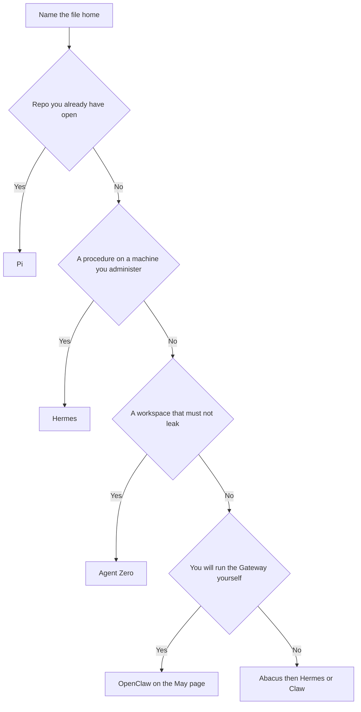

# How I Pick Pi, Hermes, Agent Zero, or Abacus for One Job

**One job gets one desk.** Pi keeps the repo you started it in. Hermes keeps a skill on a machine you administer. Agent Zero keeps one project that must not leak into the next chat. Abacus keeps a rented computer, and on that computer I still pick Hermes or Claw, not both.

I am William Spurlock, AI Systems Architect and Fractional AI CTO at Spurlock Studios LLC. I have built 600+ automations, with 500+ still live, and I have spent 20,000+ hours architecting agentic systems. That work has saved clients 35,000+ hours. I did not get there by installing four agents and hoping one of them noticed the job.

When someone asks me to pick Pi, Hermes, Agent Zero, or Abacus for one job, I reach for a four-line card. File home. Computer. The thing I will read. The one sentence the job is allowed to be. If a second product could fill the same file home, I leave it off.

The May page is the year-long bet among Hermes, self-hosted OpenClaw, and Agent Zero. Read [that decision framework](/blog/hermes-openclaw-agent-zero-decision-framework) when you are choosing a foundation. This page is the card for one job this week. The morning diff for a Pi brief is [the Pi brief page](/blog/pi-agent-field-guide-the-autonomous-h%61rness-that-runs-a-brief-without-babysittin). The Abacus credit shelf is [the Abacus setup page](/blog/abacus-s-built-in-hermes-openclaw-setup-the-two-agent-h%61rness-most-people-are-sl). A live music site on Agent Zero is [the Monday report](/blog/agent-zero-2026-update-putting-the-self-evolving-h%61rness-on-music-site-maintenan). Those pages already do their jobs, so I will not repeat them here.

I read the Pi 1.4.0 readme and changelog, the Hermes memory and configuration pages, the Agent Zero projects page and v2.14 notes, the OpenClaw docs, and the Abacus SuperComputer and billing pages on October 25, 2026. Prices and caps below are those pages.

## How do I pick Pi, Hermes, Agent Zero, or Abacus for one job?

**I start with where the file has to live, then I leave the other three desks off.** If I already have the repo open, I use Pi. If the procedure must be there next session, I use Hermes. If the workspace must stay out of every other chat, I use Agent Zero. If I will not run the computer, I use Abacus.

<table>
  <thead>
    <tr>
      <th>Desk</th>
      <th>File home</th>
      <th>Computer</th>
      <th>What I read before anything goes live</th>
    </tr>
  </thead>
  <tbody>
    <tr>
      <td>Pi</td>
      <td>The directory you start it in</td>
      <td>Your machine, Node.js 22.19 or newer</td>
      <td>The diff</td>
    </tr>
    <tr>
      <td>Hermes</td>
      <td><code>~/.hermes/skills/</code> and the memory files</td>
      <td>Your machine, one process per home</td>
      <td>The skill file on disk</td>
    </tr>
    <tr>
      <td>Agent Zero</td>
      <td>One project</td>
      <td>A host you run, including the Docker instances the v2.14 notes address</td>
      <td>The project files and the instructions</td>
    </tr>
    <tr>
      <td>Abacus</td>
      <td>The SuperComputer VM</td>
      <td>Abacus, Pro, 1 credit per 5 minutes while it runs</td>
      <td>The note or the channel message, then the VM is stopped or the job is named</td>
    </tr>
  </tbody>
</table>

I hear the same three objections whenever I show someone this card. None of them earns another row:

- Self-hosted OpenClaw belongs on the May page because you run the Gateway. Abacus Claw is the hosted copy of that idea on a different computer.
- I can save the Pi-versus-Agent-Zero duel for later. If both would write the same repo, the job sentence is still vague, so I stop at the card.
- I left the month-long Abacus credit math on the October 5 page. For this card, I only need the door and the rate.

Pi, on the [npm page for `@earendil-works/pi-coding-agent`](https://www.npmjs.com/package/@earendil-works/pi-coding-agent), is version 1.4.0 as of the registry update on October 21, 2026. Mario Zechner is the author. The license is MIT. The package description names read, bash, edit, and write. When I read the registry latest document on October 25, 2026, it showed 2,875,191 weekly downloads and 856 dependents. That count is a traffic figure for the package. It is not a reason to point Pi at a Telegram channel.

## What breaks when Pi, Hermes, Agent Zero, and Abacus share one job?

**The same file gets two writers, and you cannot tell which writer a customer would have seen.** The second failure is quieter. A secret lands in Hermes memory and in an Agent Zero project, and both sessions will repeat it next week.

I do not need a disaster story to know what happens. Each product keeps state in a different place. Give two of them the same sentence and you now have two copies with nobody clearly responsible for either one.

<table>
  <thead>
    <tr>
      <th>What you did</th>
      <th>What the files look like a week later</th>
      <th>Which desk should have owned it</th>
    </tr>
  </thead>
  <tbody>
    <tr>
      <td>Pi and Agent Zero both edit the repo</td>
      <td>Two diffs, and neither one is the Done line by itself</td>
      <td>Pi, if you already had the repo open. Agent Zero, if the repo had to be cloned into a project that other chats must not see</td>
    </tr>
    <tr>
      <td>Hermes and Claw both send the morning note</td>
      <td>Two messages, or one message with two memories of what "done" meant</td>
      <td>One of them. The October 5 page still splits skill work from channel work</td>
    </tr>
    <tr>
      <td>OpenClaw on your hardware and Claw in Abacus</td>
      <td>Two Gateways answering the same chat</td>
      <td>OpenClaw if you will run it. Claw if you will not</td>
    </tr>
    <tr>
      <td>A client fact saved in Hermes memory and in an Agent Zero secret</td>
      <td>Two stores, and a backup of one of them may not include the secret</td>
      <td>The project, if the fact belongs to that workspace. The skill, if every session on that machine needs the procedure</td>
    </tr>
  </tbody>
</table>

The breaks I actually refuse:

1. A job sentence that says "help with the AI." All four desks can claim that sentence, so none of them owns it.
2. A working directory used as a junk drawer. The Pi brief page already says the directory you start in is not a jail. A second client's keys do not go there.
3. A SuperComputer left running because the toggle felt like a bonus. The billing page says it auto-shuts down when nothing is running. If it is still up, something is running, and that something needs a name.
4. Two processes pointed at one Hermes home. The memory page says the writes compound, leaving state that neither process authored.

I do not fix this with a fifth product. I remove the second writer before the week starts.

## How do I fill the desk card before I install a second agent?

**Four lines, in this order: file home, computer, the artifact I will read, and one job sentence that can be true or false.** I install after the card is full. I do not install in order to discover the sentence.

I start with the file home because it rules out three desks before price matters. The Abacus billing FAQ is tempting because it gives you a dollar figure. That figure still cannot tell you where the file belongs.

<table>
  <thead>
    <tr>
      <th>Job sentence</th>
      <th>Desk</th>
      <th>Why the other desks lose</th>
    </tr>
  </thead>
  <tbody>
    <tr>
      <td>The Done line in BRIEF.md is true in this repo</td>
      <td>Pi</td>
      <td>The proof is a diff in a directory you already have. Docker is extra machinery</td>
    </tr>
    <tr>
      <td>The deploy procedure exists as a skill and loads next session</td>
      <td>Hermes</td>
      <td>The proof is a file under <code>~/.hermes/skills/</code>, not a chat reply that claimed it remembered</td>
    </tr>
    <tr>
      <td>The weekly notes stay in this project and out of the other chat</td>
      <td>Agent Zero</td>
      <td>The proof is the project name in the top bar, plus the files inside that project</td>
    </tr>
    <tr>
      <td>The morning Telegram note arrives, and I did not install a Gateway</td>
      <td>Claw on Abacus</td>
      <td>Self-hosted OpenClaw would mean you did install a Gateway. Hermes on the same VM does not also send that note</td>
    </tr>
  </tbody>
</table>

I fill the card like this:

1. I write the job in one sentence that a person can mark true or false on a file, a message, or a stopped VM.
2. I name one file home: a path, a project title, or the VM. Never two.
3. I name the computer and who pays the uptime: my laptop, my Docker host, or Abacus credits.
4. I name the artifact I will read before a customer can see the result: a diff, a skill file, a project folder, or the channel message.
5. If a second product could satisfy step 2, I stop. I do not install it "as a backup."

Here is a sentence I send back: "Keep an eye on the business." Here is one I will run: "RESULT.md quotes the Done line and says true or false, and the diff stays inside this folder." The second sentence is the Pi brief page's check. The first is how four desks end up installed over a weekend.

## Which desk owns a repo brief, a saved skill, a project, or a rented computer?

**A repo brief is Pi. A procedure that must load next session is Hermes. A workspace that must not leak is Agent Zero. A computer I will not administer is Abacus.** Self-hosted OpenClaw is the leftover: you will administer the Gateway, so you are on the May page, not on this rented row.

<table>
  <thead>
    <tr>
      <th>If the proof lives here</th>
      <th>Desk</th>
      <th>Leave these off</th>
    </tr>
  </thead>
  <tbody>
    <tr>
      <td>A diff in a repo you already have open</td>
      <td>Pi 1.4.0</td>
      <td>Agent Zero's clone, Claw's channel, a second Hermes home</td>
    </tr>
    <tr>
      <td>A skill file that must be there next session</td>
      <td>Hermes</td>
      <td>A Pi working directory used as the procedure store</td>
    </tr>
    <tr>
      <td>Instructions, files, and secrets scoped to one chat</td>
      <td>Agent Zero v2.14</td>
      <td>The default Hermes home, which every session on that profile can see</td>
    </tr>
    <tr>
      <td>A message on a channel, and no Gateway process of yours</td>
      <td>Abacus Claw</td>
      <td>Self-hosted OpenClaw, and Hermes on that same VM for the same note</td>
    </tr>
  </tbody>
</table>

Rules I do not bend on a first install:

- One file home.
- One computer payer.
- One artifact I read.
- One sentence.

### When the file is a repo, I use Pi

The [v1.4.0 readme](https://github.com/earendil-works/pi/blob/v1.4.0/packages/coding-agent/README.md) says to start Pi in the directory where you want it to work, and it says Pi skips sub-agents and plan mode. It also requires Node.js 22.19 or newer. The npm install line on that page includes the ignore-scripts switch. Print mode, JSON mode, RPC, and the TypeScript SDK are the ways it names for running without a person sitting in the prompt. For the morning read, I still go back to the Pi brief page. An exit status is not the Done line.

The [1.4.0 changelog](https://github.com/earendil-works/pi/blob/v1.4.0/packages/coding-agent/CHANGELOG.md) includes one detail I would circle. Codemode waits for a free worker. Parallel scripts, including what the notes call in-process subagents, queue instead of failing, and `PI_CODEMODE_MAX_WORKERS` raises the cap. I do not mistake that queue for Agent Zero's child chat. The readme's default is still a single agent in the directory you opened. If I need a child I can stop from a sidebar, I picked the wrong desk when I picked Pi.

What I want on the card for Pi:

- File home: the repo path, and no parent folder.
- Computer: the machine that already has the checkout, on Node.js 22.19 or newer.
- Read: the diff, plus the file that says the Done line is true or false.
- Job: one sentence that is false when the diff wanders.

I do not install Agent Zero beside that checkout "so it can learn the repo." The projects page will clone a Git URL into a project workspace. Now I have a second copy. I pick the copy I am actually going to read.

### When the file is a procedure, I use Hermes

Hermes Agent, from Nous Research, keeps two different stores, and the [memory page](https://hermes-agent.nousresearch.com/docs/user-guide/features/memory) is blunt about both. `MEMORY.md` caps at 2,200 characters. `USER.md` caps at 1,375. Both live in `~/.hermes/memories/` and are injected as a frozen snapshot when the session starts. A write during the session hits disk immediately and does not show up in that prompt until the next session. The memory tool returns an error if a write would pass the cap. It does not drop your old lines for you.

The same page says not to point two agent processes at one Hermes home because the writes compound. A work profile is a different directory: `~/.hermes/profiles/work/memories/`, not the default folder. On a messaging session, shutting the machine off overnight does not end the session. The next message continues it. For me, `/new` or a fresh CLI run is when that memory actually pays off.

Skills are the other store. The [configuration page](https://hermes-agent.nousresearch.com/docs/user-guide/configuration), read the same day, puts them in `~/.hermes/skills/`. `skill_manage` can create, edit, and delete them. `skills.write_approval` defaults to false, so those writes land unless you turn the gate on. When the gate is on, they stage under `~/.hermes/pending/skills/` until you approve them. `memory.write_approval` defaults to false as well.

Here is my rule for a Hermes desk: if the skill can change what tomorrow's session does, I turn the write gate on before the first real job. That is my choice. The default on the page is the opposite. If the agent needs a fact on every run of a procedure, I put it in the skill instead of spending the 2,200-character memory budget. The memory page makes the same call.

Hermes on your own machine is this row. Hermes pre-baked on Abacus is the rented row below. Same agent family, different computer, and I do not run both for one procedure.

### When the file is a workspace that must not leak, I use Agent Zero

The [projects page](https://www.agent-zero.ai/p/docs/projects/), as I read it on October 25, 2026, says a project tells Agent Zero what world it is working in. The project can hold purpose, instructions, files, memory, secrets, and model choices. Each chat can use a different project. I look for the project name in the top bar. If it is missing, that chat is not in the project. A pasted Git URL clones into the workspace. For a private repository I enter the token where the UI asks for one, and I do not paste it into the chat. I also keep my own copy of important secrets because the page warns that backups may not include every one of them. Edits I mean to keep go under `/a0/usr`, so an update can refresh the root install without erasing them.

[v2.14](https://github.com/agent0ai/agent-zero/releases/tag/v2.14) was published October 13, 2026. The notes name LiteLLM 1.104.0, OpenAI SDK 2.54.0, and an automatic startup migration for existing Docker instances. They also say direct subordinate delegation runs through the child's own context, so that child chat can be stopped on its own. Pi's readme still declines to ship that feature as a default. Even with it, I would not pick Agent Zero for a three-file edit in a repo I already have open.

What belongs on this desk:

- One client, one codebase, or one recurring report. The projects page says to split a project that got too broad.
- Instructions short enough that you will reread them when they go stale.
- Secrets scoped to that project, with your own copy outside it.
- A read of the project files, not a trust fall into the chat's summary.

The Monday music report is the shape of that read for a live site. This page only decides that the work is a project. It does not pick the songs.

### When I will not run the computer, I use Abacus

Abacus.AI SuperComputer is the rented desk. The [SuperComputer guide](https://abacus.ai/help/chatllm-ai-super-assistant/supercomputer), read October 25, 2026, says it requires Pro at $20 per month with 30,000 credits, and that it is not on the Basic tier. Hermes and Claw are the pre-baked apps. The [Claw how-to](https://abacus.ai/help/chatllm-ai-super-assistant/abacus-claw) calls Claw the hosted, managed version of OpenClaw, and it says you can start at claw.abacus.ai with no local setup.

The [billing FAQ](https://abacus.ai/help/chatllm-ai-super-assistant/faqs/billing) on the same day has the prices I am willing to repeat:

<table>
  <thead>
    <tr>
      <th>Line on the FAQ</th>
      <th>Figure on that page</th>
      <th>What it means for this card</th>
    </tr>
  </thead>
  <tbody>
    <tr>
      <td>Basic</td>
      <td>$10 per user per month, 20K credits, agent access limited to 3 tasks</td>
      <td>Not the VM. Do not look for Hermes or Claw here</td>
    </tr>
    <tr>
      <td>Pro</td>
      <td>$20 total per month, 30K credits</td>
      <td>The door the SuperComputer guide names</td>
    </tr>
    <tr>
      <td>SuperComputer runtime</td>
      <td>1 credit per 5 minutes while it is running</td>
      <td>Twelve credits for an hour, because 60 divided by 5 is 12. Agent or CLI use inside the VM is billed separately</td>
    </tr>
    <tr>
      <td>Idle</td>
      <td>Auto-shuts down when nothing is running</td>
      <td>If it is up, name the job or stop it</td>
    </tr>
  </tbody>
</table>

I left the "do not arm both" split and the longer meter on the October 5 page, and I have not changed my mind. Hermes on that VM owns work that should become a skill. Claw owns the channel. One morning note does not need both.

OpenClaw's own docs, read October 25, 2026, describe the thing Claw is hosting. [OpenClaw](https://docs.openclaw.ai/) is a self-hosted gateway. The page says there is no hosted service in the middle. You run the Gateway. Config lives at `~/.openclaw/openclaw.json`. The project is MIT licensed, from the OpenClaw Foundation, a 501(c)(3). The runtime it names is Node 26 as the recommendation, or Node 24.16+ or Node 26.1+. That is not Pi's Node.js 22.19 bar. I do not treat one install as the other.

If I am willing to run that Gateway, I leave Abacus off and go to the May framework. If I am not, Claw is the desk, Pro is the door, and the hour is 12 credits before the separate agent bill. I still read the channel message before I call the job done. A running VM is not a result.

## How do I tell a week later that I picked the wrong desk?

**The pick is wrong when a second product touched the same file, or the rented computer is still on with no named job.** A cheerful reply is not a pass. The artifact on the card is the pass.

<table>
  <thead>
    <tr>
      <th>Check</th>
      <th>Pass</th>
      <th>Fail</th>
    </tr>
  </thead>
  <tbody>
    <tr>
      <td>File home</td>
      <td>Only the path, project, or VM on the card changed</td>
      <td>A second product has a diff, a skill, or a message for the same sentence</td>
    </tr>
    <tr>
      <td>Hermes memory</td>
      <td>The entry is in the file, under the cap, in the profile you think you used</td>
      <td>The chat said it remembered, and <code>MEMORY.md</code> has no such line</td>
    </tr>
    <tr>
      <td>Agent Zero project</td>
      <td>The project name is on the chat that did the work, and the secret is not pasted in the transcript</td>
      <td>The picker says no project, or the token is in the chat</td>
    </tr>
    <tr>
      <td>Abacus VM</td>
      <td>It is stopped, or the credit log matches one named job</td>
      <td>It is running and nobody can say what the job sentence was</td>
    </tr>
    <tr>
      <td>OpenClaw</td>
      <td>Either your Gateway or Claw, not both, answered the channel</td>
      <td>Two replies, or a reply from a Gateway you forgot was installed</td>
    </tr>
  </tbody>
</table>

The week-later pass I actually run:

1. Open the file home on the card before you open the chat log.
2. Mark the job sentence true or false from that file, message, or stopped VM.
3. Search the other three desks for the same sentence. One hit is a second writer. Remove it.
4. If the computer was Abacus, read the credit line for that hour. Twelve credits is the runtime floor for an hour that stayed up. It is not a success metric. The separate agent bill can sit on top, which the billing FAQ already says.

A wrong pick looks cheap on day one. By day eight, the second writer has stored a copy. I would rather throw out the card on the night I wrote it.

## FAQ

**These are the checks I want answered from the docs before a second agent gets installed.**

### Does Pi 1.4.0 still skip sub-agents and plan mode?

**Yes. The v1.4.0 readme still says Pi skips sub-agents and plan mode.** The changelog for that release says codemode queues parallel scripts, including in-process subagents, when workers are busy. I do not call that queue a second desk. A package can add a workflow without giving me a reason to install one so that Pi can imitate Agent Zero's child chat.

### Which Node.js version does the Pi coding agent 1.4.0 require?

**Node.js 22.19 or newer, for the install the v1.4.0 readme describes.** The macOS, Linux, and Windows installers can install Node if you need them to. OpenClaw's docs, read October 25, 2026, name a different bar: Node 26 recommended, or Node 24.16+ or Node 26.1+. I do not treat those as one runtime.

### Where does Hermes Agent store memory and skills?

**Memory lives in `~/.hermes/memories/`, and skills live in `~/.hermes/skills/`.** The memory page says a second process on that same home compounds writes you did not author. A work profile reads `~/.hermes/profiles/work/memories/` instead. I give a second job a second profile, or I do not start it.

### What are the character caps on Hermes MEMORY.md and USER.md?

**MEMORY.md caps at 2,200 characters, and USER.md caps at 1,375.** The memory tool returns an error when a write would pass the cap. It does not drop the old line for you. A fact you need on every run of a procedure belongs in a skill, because a skill does not spend that 2,200-character budget.

### What does an Agent Zero project keep out of other chats?

**Instructions, files, memory, secrets, and model choices stay with the project you activated.** The projects page says the project name has to be visible in the top bar, or the chat is not in it. A Git URL clones into that workspace. For a private repository, enter the token where the UI asks for one, not in the chat. Keep your own copy of important secrets, because backups may not include every secret.

### What should I know about Agent Zero v2.14 before I pick it?

**v2.14 was published October 13, 2026, and it is the release I would install if Agent Zero is the desk.** The notes name LiteLLM 1.104.0, OpenAI SDK 2.54.0, a startup migration for existing Docker instances, and subordinate delegation that runs in the child chat so you can stop that child alone. None of that makes it the right desk for a three-file edit in a repo you already have open. That edit is still Pi.

### Is Abacus Claw the same product as self-hosted OpenClaw?

**No. Claw is Abacus's hosted, managed OpenClaw, and OpenClaw's docs say there is no hosted service in the middle when you run it yourself.** Config for that Gateway is `~/.openclaw/openclaw.json`, while Claw starts at claw.abacus.ai. If I will run the Gateway, I use the May framework. If I will not, Claw is the desk, and it still does not share a job with Hermes.

### Does the ChatLLM Basic plan include SuperComputer?

**No. SuperComputer is a Pro feature.** The billing FAQ, read October 25, 2026, prices Basic at $10 per user per month with 20K credits and agent access limited to 3 tasks. Pro is $20 total per month with 30K credits, and that is the tier the SuperComputer guide names. I left the longer shelf on the October 5 setup page because this answer only needs the door.

### How many credits does one hour of SuperComputer runtime cost?

**Twelve credits, because the billing FAQ prices the VM at 1 credit per 5 minutes while it is running.** Sixty divided by five is twelve. That hour does not include the separate bill for the agent or CLI inside the VM, and the same page says the computer auto-shuts down when nothing is running. I left the month-long meter on the October 5 page.

## Book a custom agent build

**Bring the desk card: file home, computer, the artifact you will read, and one sentence that can be false.** I am William Spurlock. I do this work at Spurlock Studios LLC. On a [custom agent build](/contact) I will tell you which of Pi, Hermes, Agent Zero, or Abacus gets that sentence, and I will tell you to leave the other three off. If the sentence cannot be true or false on a file, a message, or a stopped VM, I send the card back before I talk about models.
