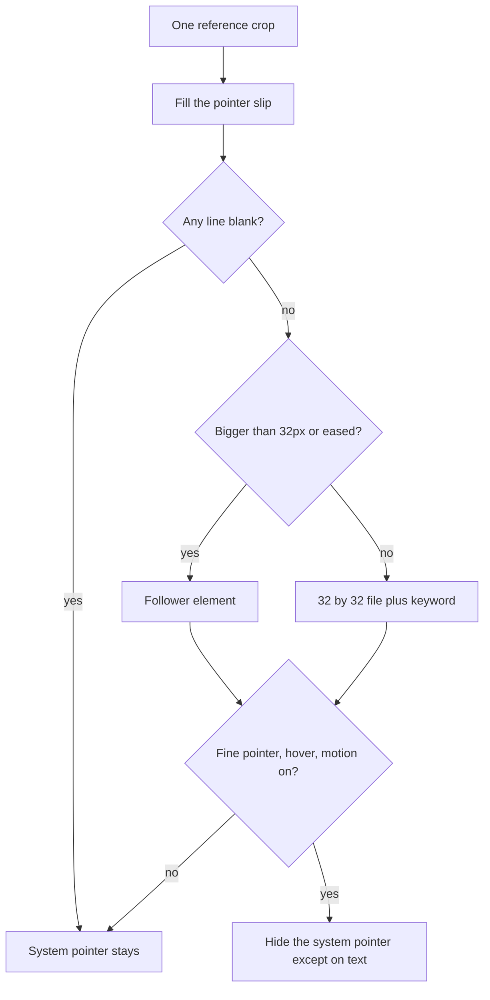

# Premium Polish on a Music Site in 10 Minutes: Prompting Custom Cursors + Magnetic Interactions From a Reference

A pointer slip on a music site is four lines: file or follower, hotspot, magnet list, and off switch. I take those four answers from one reference crop, give Cursor the crop plus the slip, and stop at 10 minutes. The crop has no numbers. The slip does. When they disagree, the slip wins.

I am William Spurlock, AI Systems Architect and Fractional AI CTO at Spurlock Studios LLC. This pass assumes the page already has a layout. The sleeves, when the hero is a cover wall, stay the job in [the album-cover wall prompt](/blog/how-i-prompted-cursor-to-turn-a-spotify-discography-into-an-album-cover-wall-her). A cinematic scene stays in [the immersive WebGL manual](/blog/immersive-web-design-manual). I do not reopen either one to get a ring.

## What is a pointer slip on a music site?

**A pointer slip is the four-line sheet I fill before I prompt a custom cursor or a magnetic control.** A blank line ends the pass. The system pointer stays, and the reference crop goes back in the folder.

I keep the slip next to one crop of the pointer, not a full homepage. The crop shows me the mark, but it cannot tell me the pixel size, the hotspot, or which controls may move. I write those down myself. Cursor's agent can see a picture. It still needs the numbers in words.

<table>
  <thead>
    <tr>
      <th>Line</th>
      <th>What I write</th>
      <th>What a blank means</th>
    </tr>
  </thead>
  <tbody>
    <tr>
      <td>File or follower</td>
      <td>Cursor file at 32 by 32, or a follower element</td>
      <td>I do not guess from the crop</td>
    </tr>
    <tr>
      <td>Hotspot</td>
      <td>Two image-pixel numbers, or center on a follower</td>
      <td>The tip is the corner, which is wrong for a circle</td>
    </tr>
    <tr>
      <td>Magnet list</td>
      <td>Control names and a max shift I chose</td>
      <td>No control moves</td>
    </tr>
    <tr>
      <td>Off switch</td>
      <td>Fine pointer, real hover, motion allowed</td>
      <td>System pointer on every device</td>
    </tr>
  </tbody>
</table>

Three things never count as a filled line:

- A sentence like "make it feel premium."
- A second crop from a different site.
- A note that says "same as the reference" with no numbers beside it.

I set a 10-minute timer when the slip is still blank and the crop is on the desk. The timer is my limit for this pass. It is not a promise that an agent finishes a whole site in 10 minutes. If the timer rings and a line is empty, I close the chat. The page ships with the browser's pointer.

On 20 October 2026, the [CSS cursor property](https://developer.mozilla.org/en-US/docs/Web/CSS/Reference/Properties/cursor) page said the property sets the mouse cursor over an element, a URL list must end in a keyword fallback, and the optional hotspot is a pair of image pixels from the top-left corner. Those numbers clamp to the image. If I omit them, they can be read from the file, and otherwise they default to the top-left. That default is why a circle with no hotspot feels like it points from the rim. I write the center down. On a 32 by 32 file, half the width and half the height is 16 and 16. That arithmetic is mine. The page did not publish 16.

The same page says `none` means no cursor is rendered, and that the property is inherited. If I set `none` on the page, lyrics and form fields inherit it unless I set `cursor: text` on them. A music site that hides the I-beam on the bio has failed this pass even when the ring looks right on the hero.

## Why does a reference cursor fail on a phone?

**A reference cursor fails on a phone because the primary pointer is a finger, hover is inconvenient, and a decorative ring is not required to tap play.** I ship the system pointer there. I do not paste the desktop crop onto the small screen and hope.

The [pointer media feature](https://developer.mozilla.org/en-US/docs/Web/CSS/@media/pointer) has been baseline since December 2018. It describes the primary pointing device: `none`, `coarse` for something like a finger, or `fine` for something like a mouse. The page says to use `any-pointer` when I need any pointing device, not the primary one. I key this pass off the primary pointer. If the finger is primary, the slip's off switch is already tripped.

The [hover media feature](https://developer.mozilla.org/en-US/docs/Web/CSS/@media/hover), also baseline since December 2018, asks whether that primary input can hover conveniently. `none` covers devices that cannot hover conveniently, including phones that only emulate hover with an inconvenient long tap. `hover` means the primary input can hover conveniently. A magnet that runs on a long-press fake is the reference leaking onto a thumb.

<table>
  <thead>
    <tr>
      <th>Primary input</th>
      <th>What I ship</th>
      <th>What I refuse</th>
    </tr>
  </thead>
  <tbody>
    <tr>
      <td>Coarse, or hover is none</td>
      <td>System pointer, no follower, no magnet</td>
      <td>`cursor: none` on the page</td>
    </tr>
    <tr>
      <td>Fine, hover works, motion allowed</td>
      <td>Follower or 32 by 32 file, magnets on the named controls</td>
      <td>A trail, or a magnet on every link</td>
    </tr>
    <tr>
      <td>iPadOS pointer</td>
      <td>The system circle, `cursor: text` on lyrics and fields</td>
      <td>A second ring on top of the circle</td>
    </tr>
    <tr>
      <td>Reduced motion</td>
      <td>System pointer, controls stay put</td>
      <td>An eased follower or a sliding play button</td>
    </tr>
  </tbody>
</table>

A desktop crop can mislead me about iPadOS. The cursor page I read on 20 October 2026 says the iPad pointer is a circle by default, and the only supported value that changes its appearance is `text`. I do not promise `cursor: none` will remove that circle. A follower drawn on top of it is two marks. My rule is no follower on iPadOS. Lyrics and inputs still get `cursor: text`, because that is the value the page says will change the circle.

The same page says cursor changes that intersect toolbar areas are commonly blocked, to avoid spoofing. A CSS cursor image cannot cover the browser chrome. A follower is only a box in the page. I do not tell the artist the ring will sit on the toolbar. It will not.

Three failures show up when I skip the slip and prompt from the crop alone:

- The page sets `cursor: none` for everyone, including a coarse pointer, so a touch laptop loses the pointer the OS was still drawing.
- The cursor file is larger than the browser allows, the image is ignored, and `none` has already hidden the fallback.
- The play control slides on a phone because the magnet listened to every pointer, not to the primary fine pointer.

[prefers-reduced-motion](https://developer.mozilla.org/en-US/docs/Web/CSS/@media/prefers-reduced-motion) has been baseline since January 2020. `reduce` means the person enabled a setting to cut non-essential motion. The bare query matches `reduce`. The page names scaling and panning of large objects as vestibular triggers. A ring that eases across the hero is that kind of motion. It is not required to hear a song.

## How do I prompt Cursor for a custom cursor and magnetic buttons from one reference?

**I attach one crop and the filled slip, and I tell Cursor that the slip wins.** On 20 October 2026, [Cursor's prompting page](https://cursor.com/docs/agent/prompting) said I can attach an image by dragging it into the chat or by pasting from the clipboard with Cmd+V, including screenshots. The picture gives Cursor visual context, not a measurement.

I still want the picture. A sentence cannot show whether the mark is a dot, a ring, or a small arrow. The slip then says which of those I am willing to build. If the crop shows a 120 pixel ring and the slip says follower, the agent builds a follower. If the agent "improves" the hero type while it is in there, I revert the pass. That work was not on the slip.

<table>
  <thead>
    <tr>
      <th>The prompt may say</th>
      <th>The prompt may not say</th>
    </tr>
  </thead>
  <tbody>
    <tr>
      <td>One crop, four slip lines, GSAP 3.10.0 or later for a follower</td>
      <td>Match the feel of the reference</td>
    </tr>
    <tr>
      <td>Fixed follower, clientX and clientY, pointer-events none</td>
      <td>A trail, a blend mode, or a second shape on links</td>
    </tr>
    <tr>
      <td>`cursor: none` only inside the off switch, and only with the follower in the same edit</td>
      <td>`cursor: none` on the root with no media query</td>
    </tr>
    <tr>
      <td>`cursor: text` on lyrics, inputs, and textareas</td>
      <td>A cursor file larger than 32 by 32</td>
    </tr>
    <tr>
      <td>Magnet only the names on the slip, capped at the max shift</td>
      <td>Magnet every anchor, or restyle the hero</td>
    </tr>
  </tbody>
</table>

I send the prompt in this order:

1. Name the files the agent may edit. Point at the hero only if the follower markup has to live there. Do not invite a new layout.
2. Paste the four slip lines in text, above the crop, so the numbers are not trapped inside the picture.
3. State the off switch as three conditions that must all be true: primary pointer `fine`, primary hover `hover`, and `prefers-reduced-motion: no-preference`.
4. Require `cursor: text` wherever the person selects lyrics or types an email.
5. Stop. If the reply starts changing color, type, or the cover grid, that reply is discarded.

W3C's [C39 technique](https://www.w3.org/WAI/WCAG22/Techniques/css/C39) for animation from interaction shows two orders. One puts the motion in the base CSS and turns it off under `reduce`. The other keeps the static styles as the base and puts the motion inside `prefers-reduced-motion: no-preference`. I use the second. The system pointer stays in the base styles, and the custom pointer is the extra. If the query never matches, nothing decorative has to be undone.

I do not ask for a JavaScript tutorial in the chat. I ask for one follower, two quickTo calls, and a magnet only where the slip lists a name. The agent writes the code. I read the diff against the slip.

## What stays off a ten-minute magnetic pass?

**A trail, a magnet on every link, and any shift I did not write on the slip stay off this pass.** One follower. The play control, the ticket link, and the mailing-list submit are the only magnets I put on a music homepage unless the artist names a replacement on the slip. Nav items do not move. Album titles do not move.

[gsap.quickTo()](https://gsap.com/docs/v3/GSAP/gsap.quickTo()/) is the function I name in the prompt when the mark has to ease behind the pointer. I read that page on 20 October 2026. It says a quickTo is one function tied to one numeric property. Each new number restarts that tween toward the new value. It skips unit conversion, relative values, function-based values, and alias conversion. `x` works for a transform. `translateX` does not. The returned function exposes the tween, and the page says `delay()` is excluded. I do not invent a delayed entrance. The ring shows up on the first real move, or it stays hidden.

<table>
  <thead>
    <tr>
      <th>On the slip</th>
      <th>Off the slip</th>
    </tr>
  </thead>
  <tbody>
    <tr>
      <td>One follower, or one 32 by 32 PNG</td>
      <td>A trail of copies behind the pointer</td>
    </tr>
    <tr>
      <td>quickTo on x and on y</td>
      <td>A fresh gsap.to on every mousemove</td>
    </tr>
    <tr>
      <td>Named controls and a max shift</td>
      <td>Every link, button, and heading</td>
    </tr>
    <tr>
      <td>Duration written down, often the demo's 0.6 seconds</td>
      <td>A duration the model picked because the crop felt slow</td>
    </tr>
    <tr>
      <td>System pointer when the off switch trips</td>
      <td>A magnet that still runs under reduced motion</td>
    </tr>
  </tbody>
</table>

The page's first snippet uses a duration of 0.4 seconds, ease `power3`, and `pageX` / `pageY`. The mouse-follower demo on that same page says it requires GSAP 3.10.0 or later. Its box is `position: fixed`, 100 by 100 pixels, with `pointer-events: none`, and it centers with `xPercent: -50` and `yPercent: -50`. That demo uses duration 0.6 seconds, ease `power3`, and `clientX` / `clientY`. It also passes the current client coordinate as a start value so the ring does not glide in from the last spot, and it fades out when the pointer leaves `documentElement`.

I copy those demo choices onto the slip when I want that follower. I do not treat 100 pixels, 0.6 seconds, or `power3` as a law for every artist. They are the numbers in the demo I am willing to start from. If I want a shorter ease, I write the new duration on the slip before the prompt. A 100 by 100 ring is a follower, not a cursor file. The cursor page recommends 32 by 32, and Firefox and Chromium ignore a cursor image above 128 by 128. A 100 pixel file can sit under that 128 cap and still be a bad cursor file, because the ease, the centering, and `pointer-events: none` belong to the follower.

[pointer-events](https://developer.mozilla.org/en-US/docs/Web/CSS/pointer-events) has been baseline since July 2015. `none` means the element is generally not the target, and the event goes through to whatever is underneath. The property is inherited. I put no links inside the follower. The click has to land on the play control, not on the ring.

[clientX](https://developer.mozilla.org/en-US/docs/Web/API/MouseEvent/clientX) has been baseline since July 2015. It is the horizontal coordinate inside the viewport. The left edge is 0 even when the page is scrolled sideways. That is the coordinate a `position: fixed` follower needs. The quickTo page's earlier snippet feeds `pageX` instead. I do not mix them. Fixed box, client coordinates. If someone later switches the follower to a positioned ancestor and page coordinates, that is a different slip, and it is not this 10-minute pass.

The [CSS Transforms](https://www.w3.org/TR/css-transforms-1/#transform-rendering) Candidate Recommendation of 14 February 2019 says a transform does not change the flow of the content around the element. It does change the visual rendering, and `getBoundingClientRect()` takes the transform into account. A play button can ease a few pixels toward the pointer without pushing the title down the hero. I still write a max shift on the slip so the button cannot travel into the control beside it. If I cannot name that distance, the magnet stays off. There is no GSAP-published magnet radius. The distance is mine, or it is zero.

I keep the prompt to these pieces:

- One quickTo for the follower's x, one for its y.
- A separate pair only for a control named on the slip.
- A reset when the pointer leaves that control, so the button returns.
- No trail element, no blend, no second cursor file hiding under the follower.

## How do I check the pointer before a music site ships?

**I check the off switch, the I-beam, the play target, the window exit, and iPadOS, in that order.** A ring that looks right on my desktop mouse is not a pass. I check the built page in the browser against the slip.

[WCAG 2.2](https://www.w3.org/TR/WCAG22/), the W3C Recommendation of 12 December 2024, sets success criterion 2.5.8 Target Size (Minimum) at Level AA. The target for a pointer is at least 24 by 24 CSS pixels, with listed exceptions, including a spacing exception for smaller targets. The play control has to meet that on its hit area, not on the glyph inside it. A 16 pixel triangle inside a 24 pixel target can pass the size test. A 16 pixel triangle that is the whole target fails unless a listed exception applies. I do not use the magnet as a way to dodge a small target. The button is big enough before it moves.

Criterion 2.3.3 Animation from Interactions is Level AAA in that same Recommendation. Motion started by interaction can be turned off unless the motion is essential to the function or the information. A follower and a magnet are not how the song plays. [The understanding page](https://www.w3.org/WAI/WCAG22/Understanding/animation-from-interactions) says people can get dizziness, nausea, and headaches from motion, and that one sufficient path is the reduce-motion setting. I treat the off switch as mandatory on this pass even though 2.3.3 is AAA. The play button does not need to travel.

<table>
  <thead>
    <tr>
      <th>Check</th>
      <th>Pass</th>
      <th>Fail</th>
    </tr>
  </thead>
  <tbody>
    <tr>
      <td>Off switch</td>
      <td>Follower only when fine, hover, and no-preference are all true</td>
      <td>Ring or magnet on a phone</td>
    </tr>
    <tr>
      <td>Lyrics and email field</td>
      <td>`cursor: text` and a visible I-beam</td>
      <td>Inherited `none` with no I-beam</td>
    </tr>
    <tr>
      <td>Play control</td>
      <td>Target at least 24 by 24 CSS pixels, shift stops before the neighbor</td>
      <td>The glyph is the whole hit area</td>
    </tr>
    <tr>
      <td>Pointer leaves the window</td>
      <td>Follower fades, matching the quickTo demo's mouseleave</td>
      <td>Ring stuck at the last point</td>
    </tr>
    <tr>
      <td>iPadOS</td>
      <td>System circle only</td>
      <td>Circle plus a follower</td>
    </tr>
    <tr>
      <td>Timer and diff</td>
      <td>Slip was full, and the diff is only the pointer</td>
      <td>A blank line, or the hero type moved</td>
    </tr>
  </tbody>
</table>

I run that list on the built page, not on the crop:

1. Turn on the OS reduced-motion setting. The follower and the magnet must be gone. Turn it off again before the next check.
2. Narrow the window and use a touch device, or a browser mode whose primary pointer is coarse. `cursor: none` must not be the page style there.
3. Select a line of lyrics. The I-beam has to show. Tab to the email field. Same I-beam.
4. Measure the play control's target against 24 by 24 CSS pixels. Then move the pointer near it and confirm the shift cannot cover the ticket link.
5. Leave the window. The ring fades. Come back. It must not glide in from the corner. The demo's start value is what prevents that glide.
6. Open the page on iPadOS. I expect the circle, and `text` on the lyrics. I do not expect my ring.

If you want this pass on a custom artist site, start with [the discovery call I use for a custom site](/blog/discovery-call-template-5-figure-web). Bring the reference crop and a slip with four filled lines. If a line is blank, the call is about filling it, not about prompting Cursor. I am William Spurlock. I direct this pass in Cursor. I do not redraw the page to get a ring.

## FAQ

### What is the difference between a CSS cursor image and a follower?

**A CSS cursor image replaces the OS pointer with a file. A follower is a page element that moves with the pointer.** The [cursor property](https://developer.mozilla.org/en-US/docs/Web/CSS/Reference/Properties/cursor) page I read on 20 October 2026 requires a keyword fallback after any URL, and it recommends a 32 by 32 file. The [quickTo mouse-follower demo](https://gsap.com/docs/v3/GSAP/gsap.quickTo()/) is a fixed box with `pointer-events: none`, which a cursor file cannot do. If the mark is bigger than 32 pixels, or it eases, I build the follower.

### What size should a CSS cursor image be?

**32 by 32 pixels, with the hotspot written in image pixels.** That cursor page says the specification does not cap the size, Firefox and Chromium restrict images to 128 by 128 by default, and images past the browser maximum are generally ignored. PNG support is required. An SVG cursor is only in the required set when it is SVG 1.1 in secure static mode and it has a natural size. I ship PNG at 32 by 32 and skip the SVG experiment on this pass.

### Does cursor: none remove the pointer on a touch screen?

**I do not set it on a coarse primary pointer or when hover is inconvenient.** `none` means no cursor is rendered, and the property is inherited. The pointer and hover media features, both baseline since December 2018, are how I tell a finger from a mouse. The custom pointer lives inside `@media (pointer: fine) and (hover: hover) and (prefers-reduced-motion: no-preference)`. Outside that query, the system pointer stays.

### What does gsap.quickTo change about a mouse follower?

**It reuses one tween per numeric property instead of starting a new `gsap.to()` on every move.** The quickTo page says each new number restarts that tween, and that `x` works where `translateX` does not. The follower demo requires GSAP 3.10.0 or later, uses a 0.6 second `power3` ease, and snaps to the current point before it fades in. I copy those onto the slip or I write a different duration before I prompt. I do not leave the duration to the model.

### Should a fixed follower use clientX or pageX?

**A fixed follower uses clientX and clientY.** [clientX](https://developer.mozilla.org/en-US/docs/Web/API/MouseEvent/clientX) is the viewport coordinate, and the left edge stays 0 when the page scrolls sideways. The quickTo demo feeds clientX and clientY to a `position: fixed` box. An earlier snippet on that page feeds pageX and pageY instead. I do not mix the two on this pass.

### Which controls get a magnet on a music homepage?

**The play control, the ticket link, and the mailing-list submit, unless the artist replaces those names on the slip.** Nav, footer, and album titles stay still. The max shift is a distance I write before the prompt. GSAP does not publish one. If that box is blank, nothing moves. The [transforms specification](https://www.w3.org/TR/css-transforms-1/#transform-rendering) of 14 February 2019 says the move does not reflow the neighbors. It can still overlap them, which is why the cap exists.

### Does prefers-reduced-motion turn the magnet off?

**Yes. Reduced motion trips the off switch, and both the follower and the magnet stay off.** The media feature has been baseline since January 2020, and `reduce` means non-essential motion should be cut. WCAG 2.2 criterion 2.3.3, Level AAA in the 12 December 2024 Recommendation, says interaction motion can be disabled when it is not essential. Pressing play does not depend on the button sliding. [C39](https://www.w3.org/WAI/WCAG22/Techniques/css/C39) is the CSS pattern I follow, with the motion gated on `no-preference`.

### What is the minimum pointer target size in WCAG 2.2?

**24 by 24 CSS pixels for the target, at Level AA, with listed exceptions.** That is success criterion 2.5.8 in the 12 December 2024 Recommendation. The play glyph can be smaller than the target. The hit area cannot, unless a listed exception such as the spacing rule applies. I measure the control before I add a magnet. The magnet is not a patch for a tiny button.

### Does iPadOS show a custom cursor image?

**No. The cursor page says the iPad pointer is a circle, and only `text` changes its appearance.** I do not put a follower on iPadOS, because the circle would remain beside my ring. I still set `cursor: text` on lyrics and fields. Toolbar areas are a separate limit on desktop: the same page says cursor changes that meet the toolbar are commonly blocked so a page cannot fake the browser chrome.
