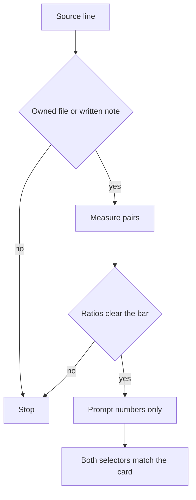

# Prompting a Music-Artist Design System in shadcn/ui: Tokens, Type, and Cover-Art Color Pulls

A cover-art color pull is a four-line swatch card. The colors come from a file the artist owns, or from numbers they already wrote down. Cursor gets those numbers. It does not get the picture.

I am William Spurlock, AI Systems Architect and Fractional AI CTO at Spurlock Studios LLC. I prompt the theme in Cursor, the AI-first code editor from Anysphere. I do not ask it to invent a mood. The [album-cover wall](/blog/how-i-prompted-cursor-to-turn-a-spotify-discography-into-an-album-cover-wall-her) is a different first screen. That page shows official sleeves and leaves them alone. This page is the token layer under the rest of the site. The [WebGL manual](/blog/immersive-web-design-manual) is a third first screen. Do not mix the three prompts.

shadcn/ui themes through CSS variables. Tailwind CSS turns those variables into utilities. I read the [theming page](https://ui.shadcn.com/docs/theming) on 27 October 2026. It says CSS variables are the method it recommends, and `cssVariables` set to true is the default.

## What is a cover-art color pull for a music-artist design system?

**A cover-art color pull is four lines on one card: a source you own, the token pairs with a contrast ratio that was not rounded up, one type family with one radius, and a stop line that says pass or names the first failure.** If the source line is a Spotify URL, the other lines stay blank.

I fill the card before I open Cursor. The prompt is a copy of the card. A blank line means I do not prompt.

<table>
  <thead>
    <tr>
      <th>Line</th>
      <th>What I write</th>
      <th>What fails it</th>
    </tr>
  </thead>
  <tbody>
    <tr>
      <td>Source</td>
      <td>Own master, plus the filename, or the words written note</td>
      <td>A Spotify URL, a CDN link, or a screenshot of the Spotify app</td>
    </tr>
    <tr>
      <td>Pairs</td>
      <td>Background, primary, and accent, each with its foreground color and a ratio</td>
      <td>A mood word, a hex I did not measure, or a ratio I rounded up</td>
    </tr>
    <tr>
      <td>Type and radius</td>
      <td>One family for the whole page, one length for the radius token</td>
      <td>A second display face, or a different radius on every component</td>
    </tr>
    <tr>
      <td>Stop</td>
      <td>The word pass, or the name of the first pair that missed</td>
      <td>A blank stop line, or a source line that already failed</td>
    </tr>
  </tbody>
</table>

I keep the lines in that order:

1. Source first. A bad source makes the colors stolen, even when the ratios look fine.
2. Pairs second. Each color is an `oklch()` value with spaces, not commas. Each pair has the ratio beside it.
3. Type and radius third. One family. One length. The scale and the headings are derived from those two.
4. Stop last. If it does not say pass, the prompt does not run.

The source line matters most on the card. The [Spotify Developer Policy](https://developer.spotify.com/policy), effective 15 May 2025, says in III.14 not to use the Spotify Platform or any Spotify Content to train a machine learning or AI model, and not to ingest Spotify Content into one. III.13 says not to analyze Spotify Content or the Spotify Service for any purpose. [Version 10 of the Developer Terms](https://developer.spotify.com/terms), also effective 15 May 2025, defines Spotify Content to include cover art. Section IV prohibits derivative works and allows a size change of metadata or cover art. A palette is not a size change. I do not sample bytes that came from Spotify.

A file the artist made, that never came through the Spotify Platform, is a valid source. I sample that file on my machine. I take flat areas they point at: the field, the ink, and the one accent. I do not average the whole sleeve. An average is a color nobody printed. The prompt receives the numbers. The file stays out of the chat.

A written note is the other valid source. "Navy and gold" is not a pair yet. It becomes a pair when both colors are `oklch()` values and the ratio is on the card. If the only art they can hand me is a download from Spotify, the source line fails and I ask for the master or the note.

[CSS Color Module Level 4](https://www.w3.org/TR/css-color-4/), a Candidate Recommendation Draft dated 27 October 2026, defines `oklch()` as lightness, then chroma, then hue. Commas inside the function are an error. Lightness runs from 0 to 1, or from 0% to 100%. Chroma's useful minimum is 0, and in practice it does not exceed 0.5. Hue at 0 degrees points toward purplish red, 90 toward mustard yellow, 180 toward greenish cyan, and 270 toward sky blue. If chroma is 0, the hue is powerless. If lightness is 0 or 1, the color displays as black or white because of gamut mapping.

The theming page's own example is `oklch(0.205 0 0)` for primary and `oklch(0.985 0 0)` for primary-foreground. Chroma is 0, so the hue does no work. Those values show the grammar. They are not an artist's pull. A black-and-white master can still be a real pull. The lightness values have to be the ones I measured, not a copy of the docs, unless the card says I kept the scaffold on purpose after measuring it.

## Why does a guessed shadcn palette fail a music site?

**A guessed palette fails because the neutral scaffold is a starting file, and a model will leave it there or paint over it from a mood word.** The site then looks like the documentation, or it looks like a poster whose body text misses the bar.

I would rather ship the scaffold on purpose than ship a "pulled" theme I cannot measure. The miss I see is the second one. The prompt says the page should feel like the record. The file comes back with colors nobody wrote a ratio next to.

<table>
  <thead>
    <tr>
      <th>What the prompt did</th>
      <th>What the site shows</th>
      <th>Why I reject it</th>
    </tr>
  </thead>
  <tbody>
    <tr>
      <td>Left the scaffold</td>
      <td>Neutral background and neutral primary</td>
      <td>The artist is missing. The docs are not a brand.</td>
    </tr>
    <tr>
      <td>Followed a mood word</td>
      <td>New colors with no ratio on the card</td>
      <td>I cannot tell a pass from a miss.</td>
    </tr>
    <tr>
      <td>Sampled a Spotify URL</td>
      <td>A palette taken from Spotify Content</td>
      <td>That is analysis and a derivative, not a size change.</td>
    </tr>
    <tr>
      <td>Rewrote init fields</td>
      <td>A new style, base color, or variable flag</td>
      <td>Those fields are locked after initialization.</td>
    </tr>
    <tr>
      <td>Filled every token</td>
      <td>Chart and sidebar colors on a page with neither</td>
      <td>Those colors were never measured.</td>
    </tr>
  </tbody>
</table>

The theming page lists seven base colors: Neutral, Stone, Zinc, Mauve, Olive, Mist, and Taupe. `baseColor` picks which scaffold init writes. The [components.json page](https://ui.shadcn.com/docs/components-json), which I also read on 27 October 2026, says `baseColor` cannot be changed after initialization. Overriding a variable in CSS is not an edit to that field. Re-running init to chase a different base name is a different project. This pass does not do it.

Those two pages do not agree about `style`. The theming example I read sets `style` to `base-nova`. The components.json page says `style` cannot be changed after initialization, shows `new-york`, and says the `default` style has been deprecated in favor of `new-york`. I do not "fix" that disagreement from a blog post. The prompt reads the value already in the file and leaves it.

`cssVariables` is the same kind of lock. The components.json page says it cannot be changed after initialization. Turning it off means deleting the components and installing them again. The theming page shows what that install looks like: color utilities baked into the class string. With that install, a color pull has no variables to write to. If the file says false, I stop. I do not reinstall on this pass.

For Tailwind CSS v4, the components.json page says to leave the `tailwind.config` path blank. The prompt must not invent a config file to hold the palette. The values live in the CSS file that `tailwind.css` already names.

The guesses I refuse, in order:

1. A mood sentence with no numbers.
2. A Spotify URL on the source line.
3. A ratio that was rounded up to clear the bar.
4. A rewrite of `style`, `baseColor`, or `cssVariables`.
5. Chart colors and sidebar colors added so the file looks finished.

## How do I prompt shadcn/ui tokens from a swatch card?

**I paste the finished card into Cursor and tell it to replace only the listed token values in the CSS file named by `tailwind.css`, in both the root selector and the dark selector, when this site has no theme toggle.** The picture stays out of the chat. The class names on the components stay as they are.

The theming page says the tokens live under the root selector and the dark selector, and that dark mode overrides the same names inside the dark selector. A music page I ship on this pass has no toggle. If I write the pull only into the root, the dark selector still shows the scaffold. If I write it only into the dark selector, a missing class shows the light scaffold. I write the same measured values into both. A later toggle would need a second set of ratios. This card has one set, so this pass has one mode.

I run the pass in this order:

1. Confirm `cssVariables` is true and copy the path from `tailwind.css`.
2. Confirm the source line is an owned file or a written note.
3. Measure each pair. Write the ratio you computed. Do not round it up.
4. Paste the card. Attach nothing.
5. Read the diff. If any token outside the list changed, revert that hunk.

The prompt I paste under the card:

> Edit only the CSS file named in components.json under tailwind.css. Do not change style, baseColor, or cssVariables. Do not open an image. Set the background, foreground, primary, primary-foreground, accent, and accent-foreground tokens in both the root selector and the dark selector to the values on the card. Set the radius token in the root selector to the single length on the card. Leave the radius scale in the theme block as it is. Set the sans font token to the one family on the card. If that token references another variable, use the inline theme option the way the Tailwind docs show. Do not add a second family. Do not change chart tokens or sidebar tokens. Do not invent a color that is not written on the card.

Tailwind's [theme variables page](https://tailwindcss.com/docs/theme), which I read the same day, says theme variables are defined with the `@theme` directive and that they map to utility classes. When one variable references another, use `@theme inline`. Their example points the sans font token at another variable, and the generated rule uses that referenced value in `font-family`. Without `inline`, `var()` resolves where the variable is defined, not where it is used. I do not move the radius token into `@theme inline`. The theming scaffold keeps the length in the root selector and points the scale at it. Moving it would be a second project. The font token is the one I point with `inline`, because that is the pattern the Tailwind page documents for a referenced family.

<table>
  <thead>
    <tr>
      <th>The prompt may</th>
      <th>The prompt may not</th>
    </tr>
  </thead>
  <tbody>
    <tr>
      <td>Write the three pairs into both selectors</td>
      <td>Attach the master, or ask the model to match a sleeve</td>
    </tr>
    <tr>
      <td>Set one radius length in the root selector</td>
      <td>Rewrite the multipliers, or paste a radius onto each component</td>
    </tr>
    <tr>
      <td>Point the sans token at one family</td>
      <td>Add a display face, a mono face, or a fallback I did not write</td>
    </tr>
    <tr>
      <td>Leave chart and sidebar tokens on the scaffold</td>
      <td>Change style, baseColor, or cssVariables</td>
    </tr>
  </tbody>
</table>

After the diff, I read the file myself. The model is good at "also updating" a neighbor token so the page feels consistent. That neighbor was not on the card. Consistency comes from the measurements on the card, not from a second guess.

## How do type and radius stay on one shadcn card?

**Type stays on the card as one family name, and radius stays as one length, because the scale and the headings are derived from those two values.** A second face, or a hand-set radius on every component, means the card is no longer the source.

The neutral scaffold sets the radius token to `0.625rem`. I treat that as the docs' default, not as the artist's corner. The scale beside it multiplies that value by 0.6, 0.8, 1, 1.4, 1.8, 2.2, and 2.6. The theming page says changing the base updates the whole scale. The card records one length. The prompt must not also write the small and large steps. If it does, the next edit to the base will not move them.

I do not convert `0.625rem` into pixels on the card. The page published a rem value. A root font size is a separate decision, and the docs did not name one in that scaffold. The [album-cover wall](/blog/how-i-prompted-cursor-to-turn-a-spotify-discography-into-an-album-cover-wall-her) has its own corner rule for sleeves. That rule is about the art Spotify sent. It is not this token. Do not copy a sleeve radius onto the button radius to make them "match."

Large type is a contrast question, not a second family. [WCAG 2.2](https://www.w3.org/TR/WCAG22/), the W3C Recommendation of 12 December 2024, defines large-scale text as at least 18 point or 14 point bold. The note says that for many mainstream body fonts, 14 and 18 point is roughly 1.2 and 1.5 em, and that authors still have to check the font in use. I do not assume a hero class is large-scale because it looks big. If I have not checked the used size, the pair stays on the 4.5:1 bar.

This pass uses one family for headings and body. A display face on the titles is a later pass. The card would need another line, and this card does not have one.

<table>
  <thead>
    <tr>
      <th>Line</th>
      <th>What I write</th>
      <th>What I leave alone</th>
    </tr>
  </thead>
  <tbody>
    <tr>
      <td>Family</td>
      <td>One name, used by the sans token</td>
      <td>A heading face, a mono face, a fallback stack I did not write</td>
    </tr>
    <tr>
      <td>Radius</td>
      <td>One length on the base token</td>
      <td>The multipliers in the theme block</td>
    </tr>
    <tr>
      <td>Body size</td>
      <td>The size I will measure against 4.5:1</td>
      <td>A guess that the hero is large text</td>
    </tr>
  </tbody>
</table>

The type checks I actually run:

1. The family name on the card matches the sans token in the CSS file.
2. Headings use that same family.
3. No second family name landed in the diff.
4. The radius token matches the card, and the multiplier lines still reference it.
5. I can point at the computed body size before I pick 4.5:1 or the large-text 3:1.

## How do I check shadcn token pairs before a music site ships?

**A pair ships only when the ratio on the card meets the bar for the text that will sit on it, and the built page uses those same values.** The bar for body text is 4.5:1. The bar for a non-text boundary I need in order to see the control is 3:1. I do not round either one.

WCAG 2.2 criterion 1.4.3, Level AA, requires at least 4.5:1 for text and at least 3:1 for large-scale text. Logotypes are exempt. The artist wordmark can sit lower. A button label cannot. Criterion 1.4.6, Level AAA, raises the bars to 7:1 and 4.5:1 for large-scale text. I do not require AAA on this pass. I also do not let a 4.4 through because I called the pass AA. AA still means at least 4.5:1.

Criterion 1.4.11, Level AA, requires at least 3:1 against adjacent colors for user interface components and for graphical objects people need in order to understand the content. The [understanding page for that criterion](https://www.w3.org/WAI/WCAG22/Understanding/non-text-contrast.html), which I read on 27 October 2026, says 3:1 is a threshold and that you should not round. It uses 2.999:1 as a miss. I keep that habit on the text bar too. A computed 4.499 does not become 4.5 on my card. That habit is mine. The published example is about the 3:1 line.

Text does not sit on the sleeve. The wall post already refuses overlays on Spotify art. These pairs are flat surfaces: the page background, the primary button, the accent row. If a sentence is on a photograph, it is not this card.

<table>
  <thead>
    <tr>
      <th>Pair</th>
      <th>Bar on this pass</th>
      <th>Fail</th>
    </tr>
  </thead>
  <tbody>
    <tr>
      <td>Foreground on background</td>
      <td>4.5:1, unless I have confirmed large-scale text</td>
      <td>Any body sentence under 4.5:1</td>
    </tr>
    <tr>
      <td>Primary foreground on primary</td>
      <td>4.5:1 for the button label</td>
      <td>A label that only passes if I round</td>
    </tr>
    <tr>
      <td>Accent foreground on accent</td>
      <td>4.5:1 when that row holds a sentence</td>
      <td>Helper text I did not measure</td>
    </tr>
    <tr>
      <td>Border or ring against the adjacent surface</td>
      <td>3:1 when that edge is how you see the control</td>
      <td>A focus ring I cannot see</td>
    </tr>
    <tr>
      <td>Wordmark</td>
      <td>No 1.4.3 requirement</td>
      <td>Using that exemption for a sentence</td>
    </tr>
  </tbody>
</table>

Before I call the page done, I run this list:

1. Read the stop line. If it is not the word pass, the prompt should not have run.
2. Compare the built CSS with the card. Both selectors. Same values.
3. Check the three text pairs at the size they actually render.
4. Tab to a button and a field. The focus ring has to clear 3:1 against the surface next to it.
5. Confirm the diff did not touch `style`, chart tokens, or sidebar tokens.
6. Confirm the chat never received an image file.

Muted text is the pair people forget. The theming page says the muted foreground token is for descriptions, placeholders, empty states, and helper text. If a bio sentence uses that token, it is a body pair and it needs 4.5:1. I add it to the pairs line when the page uses it. Three pairs is the minimum on a page that only renders those three. It is not a cap.

If you want this theme on a custom artist site, start with [the discovery call I use for a custom site](/blog/discovery-call-template-5-figure-web). Bring the card with four filled lines. If the source line is a Spotify URL, the call is about getting a file they own or a written note, not about prompting. I am William Spurlock. I direct the pass in Cursor. I do not sample a sleeve to get a mood.

## FAQ

### What shadcn tokens does a music site actually set?

**On this pass I set background, foreground, primary, primary-foreground, accent, accent-foreground, the radius token, and one sans family.** The [theming page](https://ui.shadcn.com/docs/theming) I read on 27 October 2026 lists more, including card, popover, secondary, muted, destructive, border, input, ring, five chart tokens, and the sidebar set. I add card and muted when the page actually renders them. I do not fill the rest from a cover.

### Can I sample a Spotify album cover for the palette?

**No. A Spotify URL fails the source line.** The [Developer Policy](https://developer.spotify.com/policy), effective 15 May 2025, forbids ingesting Spotify Content into a model and forbids analyzing that content. [Version 10 of the Developer Terms](https://developer.spotify.com/terms) includes cover art in Spotify Content, forbids derivative works, and allows a size change, which a palette is not. Use a file the artist owns, or colors they wrote down, and keep the file out of Cursor.

### What contrast ratio stops a shadcn token pair?

**Body text stops below 4.5:1, and a control edge people need in order to see the control stops below 3:1.** [WCAG 2.2](https://www.w3.org/TR/WCAG22/), dated 12 December 2024, sets those AA bars. Large-scale text, at least 18 point or 14 point bold, can use 3:1 only after I confirm the used size. The non-text understanding page says not to round 2.999:1 up to 3:1, and I do not round 4.499 up to 4.5 either.

### Does the neutral base color already count as the artist's palette?

**No. Neutral, Stone, Zinc, Mauve, Olive, Mist, and Taupe are scaffolds init can write, and the theming page lists those seven.** Shipping Neutral because it was the example is the docs, not the record. Override the pairs on the card, and leave the `baseColor` field alone, because the components.json page says it cannot be changed after initialization.

### Where does the shadcn radius token live?

**In the root selector, as one length. The neutral scaffold uses 0.625rem.** The scale multiplies that length by 0.6, 0.8, 1, 1.4, 1.8, 2.2, and 2.6. The theming page says changing the base updates the whole scale. Do not also paste seven separate radii.

### Do I set a different palette for dark mode?

**Not on this pass. There is no toggle, so the root selector and the dark selector get the same measured values.** The theming page says dark mode overrides the same token names inside the dark selector. One block left on the scaffold will show the scaffold whenever that block is the one on screen.

### Can I change baseColor after shadcn init?

**No. The components.json page, which I read on 27 October 2026, says baseColor cannot be changed after initialization, and style and cssVariables are locked the same way.** It shows new-york and says the default style is deprecated, while the theming page's example shows base-nova. Leave whichever value is already in the file. A color pull edits CSS variables and does not re-run init.

### Should chart and sidebar tokens follow the cover?

**No, unless the page has a chart or a sidebar.** The theming table includes chart-1 through chart-5 and a sidebar set. A music homepage usually has neither. Pulling five chart colors from a cover makes a second palette the card did not measure.

### Does the album-cover wall replace the design system?

**No. The wall is the sleeve grid. This card is the token layer under the rest of the page.** The [wall post](/blog/how-i-prompted-cursor-to-turn-a-spotify-discography-into-an-album-cover-wall-her) keeps official art whole and refuses a sampled palette from those files. Use both contracts when the site has both a grid and a theme. Do not collapse them into one prompt.
