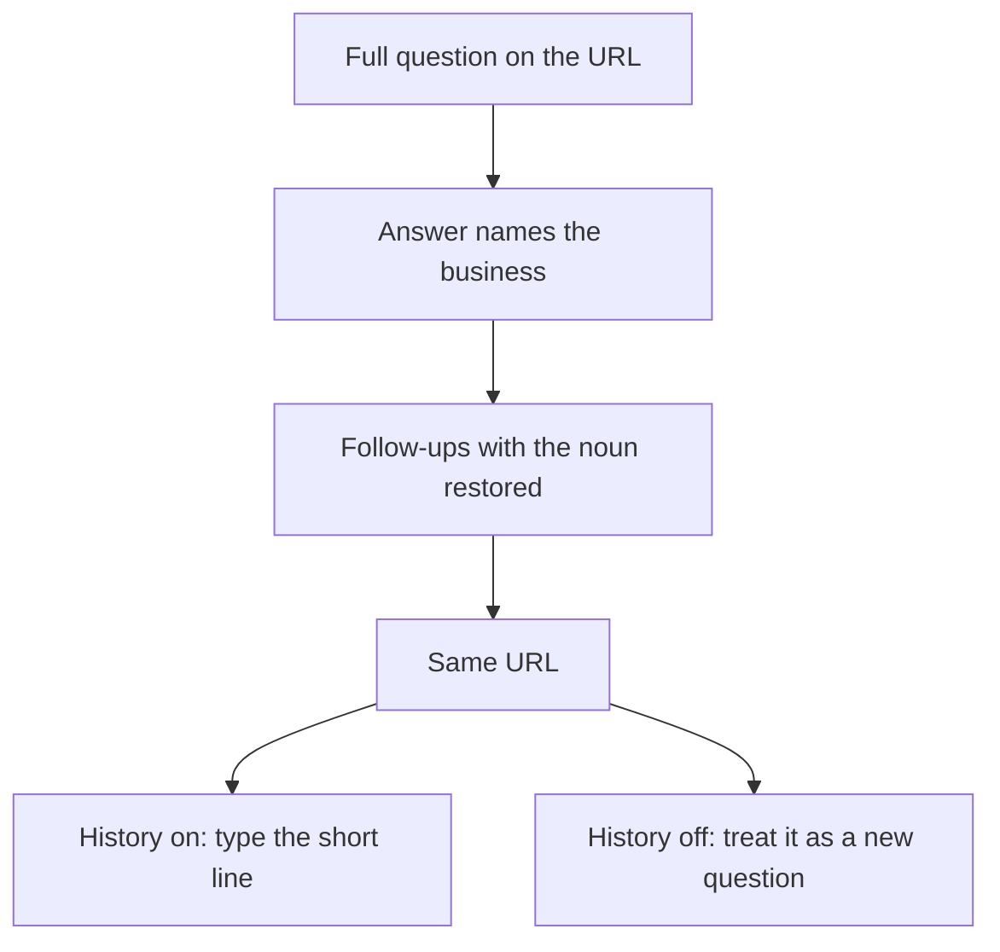

# What is conversational search optimization and how does it fit with AEO?

**Conversational search optimization is the second turn: the short follow-up that drops the noun. Answer engine optimization (AEO) is the job of being the sentence an answer engine can quote. They fit on one URL, when that sentence and the follow-ups under it each still name the business.**

I'm William Spurlock, AI Systems Architect and Fractional AI CTO at Spurlock Studios LLC. I've built 600+ automations, with 500+ live. I've spent 20,000+ hours architecting agentic systems, and that work has saved clients 35,000+ hours. I've been SEO-certified since 2021. The work now sits under AEO, AIO, and GEO. I do not invent a client, and I do not print a citation rate for a page I have not logged.

A buyer who already heard an answer does not retype the whole question. They say "what about the warranty" or "how long does that take." Google AI Mode, Google's conversational search experience inside Google Search, is built for that second ask. ChatGPT, OpenAI's chat product, often rewrites the words before a search provider ever sees them. If your page only answers the long form, the short follow-up may end up citing a page that repeated the noun.

The wider map of AI Mode, fan-out, and the conversation surface is in [how to rank when search becomes a conversation](/blog/google-ai-mode-explained-how-to-rank-when-search-becomes-a-conversation). The definition of AEO, and the sequence for becoming the quoted source, is in [how to become the answer AI gives](/blog/answer-engine-optimization-how-to-become-the-answer-ai-gives). This page is the card I use between those two. I am not opening a second program, and I am not giving every follow-up its own URL.

## What is conversational search optimization and how does it fit with AEO?

**Conversational search optimization means writing the follow-up so it can be quoted alone. AEO is the first quotable sentence. The fit is mechanical: same business name, same URL, first question and follow-ups on one page.**

I keep four jobs apart, because owners keep merging them into one slogan.

<table>
<thead>
<tr>
<th>Job</th>
<th>Who starts it</th>
<th>What has to be true on the page</th>
<th>What it is not</th>
</tr>
</thead>
<tbody>
<tr>
<td>AEO</td>
<td>You, before anyone asks</td>
<td>One full question and one sentence that names the business</td>
<td>A schema product</td>
</tr>
<tr>
<td>Conversational search optimization</td>
<td>The person, on the next line</td>
<td>Each follow-up still contains the noun, on that same URL</td>
<td>A new site, or a new URL per reply</td>
</tr>
<tr>
<td>Query fan-out</td>
<td>Google, inside one question</td>
<td>Passages that can answer the subtopics Google searches on its own</td>
<td>The follow-up the person types next</td>
</tr>
<tr>
<td>A typed or spoken follow-up</td>
<td>The person, after an answer</td>
<td>A sentence that still makes sense if the first question is gone</td>
<td>Proof that you won the first turn</td>
</tr>
</tbody>
</table>

Google's [AI features guide](https://developers.google.com/search/docs/appearance/ai-features), last updated December 10, 2025, says there are no additional requirements to appear in AI Overviews or AI Mode, and no special schema.org structured data you need to add. The same page says you do not need new machine-readable files, AI text files, or markup. That sets the boundary for me. Conversational search optimization remains a writing job, not a file you upload.

The same guide says AI Overviews and AI Mode may use a query fan-out technique: multiple related searches across subtopics and data sources, then a wider set of supporting links than a classic web search. AI Mode and AI Overviews may use different models and techniques, so the links they show can vary. AI Overviews often do not trigger, because they show up only when Google decides they add something classic Search did not already give. A supporting link still has to be indexed and eligible to show with a snippet. Indexing is not guaranteed.

I do not sell "rank in the conversation" as a switch. I sell a page that can survive the second turn if Google or ChatGPT decides to look.

What I want on the page before I talk about either product:

- The buyer's first question, written in full, with the service and the place still in it.
- One answer sentence that names the business once, in words a stranger can repeat.
- Follow-ups written as full questions, not as "what about the warranty."
- The same URL for all of those lines. A second URL is a different page, and a different test.
- Visible text. If the only clear sentence is inside an image, the guide's "textual form" line is already lost.

I think the mistake is treating conversational search optimization as a rename of AEO. A page can finish the AEO job by answering one question well. The conversation starts when the next line deletes the subject. If you stop at the first sentence, you did AEO. You did not do the second turn.

## What breaks when a follow-up drops the subject of the first answer?

**The break is a missing noun. The first answer can name you, and the follow-up can still cite someone else, because "what about the warranty" does not say who or what.**

Google's [AI Mode help](https://support.google.com/websearch/answer/16011537), as I read it on October 22, 2026, says you can ask follow-up questions on a topic, and you can ask with text, voice, images, or files. The same page says AI Mode uses query fan-out, dividing your question into subtopics and searching each one at the same time. It also says AI Mode may misinterpret web content or miss context. A dropped noun is an easy miss. The model is not required to glue your first question back on.

Here is the blank card I use in a draft. The names in brackets are slots, not a client.

<table>
<thead>
<tr>
<th>What the person types next</th>
<th>What the page must already say</th>
<th>Why the short line fails alone</th>
</tr>
</thead>
<tbody>
<tr>
<td>what about the warranty</td>
<td>What warranty does [Business] put on a roof replacement in [city]?</td>
<td>Warranty of what, from whom</td>
</tr>
<tr>
<td>how long does that take</td>
<td>How long does a [Business] roof replacement in [city] take?</td>
<td>"That" can be a patch, a full tear-off, or a competitor</td>
</tr>
<tr>
<td>do they pull the permit</td>
<td>Does [Business] pull the permit for a roof replacement in [city]?</td>
<td>"They" is whoever the last answer mentioned</td>
</tr>
</tbody>
</table>

The first column is how people actually talk. The second column is what I publish. I do not publish the first column as a heading and hope the model remembers the paragraph above it.

That short line can shrink again in three ways before anyone cites you:

1. **History is off in AI Mode.** The help page says that for the best experience you enable history and personalized recommendations. Without that setting you can still open AI Mode, but you cannot pick up where you left off with previous searches. I treat a history-off session as a new question, not as a second turn. For Workspace accounts with Search and Assistant turned off, that same page says Search history is unavailable unless an administrator turns it on.
2. **ChatGPT rewrites the line.** OpenAI's help page on [searching the web with ChatGPT](https://help.openai.com/en/articles/9237897-searching-the-web-with-chatgpt), which said it was updated two days earlier when I read it on October 22, 2026, says ChatGPT may rewrite a question into one or more targeted queries, then send a more specific query after the first results. Their example turns a long drug-research question into "CCR8 immunotherapy drug development 2025," then a conference query. The string you typed is not the string the partner search receives.
3. **Memory and the IP add words you did not type.** The same OpenAI page says that if memory is on, a saved note (their example is vegan, living in San Francisco) can change the query. An approximate location from the IP can turn "restaurants near me" into "top restaurants San Francisco." The IP itself is not shared. Device location is off by default. A follow-up that felt specific in the chat can arrive at search as a city plus a preference the page never mentioned.

I do not get to see those rewritten queries in Google Search Console. Google's AI features guide says appearances in AI Overviews and AI Mode are included in the Performance report under the Web search type. That report is not a transcript of the second turn. If I need the second turn, I ask it, and I log the name that comes back.

## Why does a FAQ block fail the second turn of a search conversation?

**A FAQ block repeats questions you already wrote in full. A follow-up is the short form the person types after an answer. Markup can label the pairs you published. It does not put the noun back into "what about the warranty."**

In June I wrote that FAQ schema was the main technical move for this exact question. The schema rules on that page still matter when you choose to mark up a real FAQ, and they live in [the June note on FAQ schema and citation](/blog/faq-schema-and-aeo-the-highest-l%65verage-move-for-ai-citation). I do not use that note as the second-turn plan anymore. On December 10, 2025, Google's AI features guide said there is no special schema you need to add for AI Overviews or AI Mode, and that structured data should match the visible text. Schema that copies a heading is fine. Schema that pretends a short follow-up was answered is a lie the page does not support.

<table>
<thead>
<tr>
<th>Piece</th>
<th>FAQ block</th>
<th>Second-turn card</th>
</tr>
</thead>
<tbody>
<tr>
<td>The question</td>
<td>Already complete, because you wrote it</td>
<td>Has to be rewritten, because the person deleted the subject</td>
</tr>
<tr>
<td>What schema does</td>
<td>Labels pairs that are already on the page</td>
<td>Nothing, unless those full questions are also visible</td>
</tr>
<tr>
<td>Failure</td>
<td>The pairs are real, and the short follow-up still has no noun</td>
<td>You spawned a new URL and split the test</td>
</tr>
<tr>
<td>When I still want it</td>
<td>The visible FAQ is real and the markup matches it</td>
<td>Always, on the URL that holds the first answer</td>
</tr>
</tbody>
</table>

What I stopped doing after that December guide:

- Adding a FAQ block and calling the conversation finished.
- Writing headings in the short form the person types, then hiding the noun in the previous paragraph.
- Minting a new page for "warranty," "timeline," and "permit" when they are the same buyer and the same job.
- Telling an owner that a schema type is how you enter AI Mode. The guide says there is no such requirement.
- Counting a FAQ rich result, if one even shows, as proof the follow-up named you.

A FAQ still earns its place when the questions are ones a stranger would ask with the noun included. Eight or more of those, each answered in a few sentences, is how I write the bottom of a page. That block is for extraction. The second-turn card is for the line that assumes you already know who we are talking about. They can sit on the same URL. They are not the same lines.

## How do I write a second-turn card on the same URL?

**Write four lines on the page that already answers the first question. Line one is the full question. Line two names the business. Lines three and after are follow-ups with the noun put back. Do not open a new URL for those lines.**

I use three follow-ups. Three is my cap so the noun gets repeated without turning the page into a second article. It is not a number Google published. If a fourth follow-up is really a different buyer, it gets its own page and its own card. "Does procurement accept this?" is often that split. "What about the warranty?" is not.

<table>
<thead>
<tr>
<th>Line</th>
<th>Write this</th>
<th>Leave this off</th>
</tr>
</thead>
<tbody>
<tr>
<td>1. First question</td>
<td>Service, place, and the decision, in one sentence</td>
<td>A keyword stub with no verb</td>
</tr>
<tr>
<td>2. Answer</td>
<td>The business name once, then the fact</td>
<td>A slogan that could fit any company</td>
</tr>
<tr>
<td>3. Follow-ups</td>
<td>Three full questions, noun included, each with a one or two sentence answer</td>
<td>The short line the person will actually type</td>
</tr>
<tr>
<td>4. URL</td>
<td>The same address as line 1</td>
<td>A /warranty page that never mentions the first job</td>
</tr>
</tbody>
</table>

The order I actually edit in:

1. Paste the buyer's first question at the top. If it does not include the service and the place, I add them. I do not invent a city to make the sentence feel local.
2. Write the answer in one sentence a stranger can read out loud. The business name is in that sentence. If I need a second sentence, it is a limit, not a second claim.
3. List the three short lines people say next. Then rewrite each one so it still makes sense with the chat window covered.
4. Answer those three in place. Same heading level, same page, no new slug.
5. Read line 3 with line 1 covered. If I cannot tell what is being sold, the noun is still missing.

```text
Second-turn edit. One URL. Do not add a page.
First question: [full question with service and place]
Answer sentence: [business name plus one fact]
Short lines people type next:
- [short line]
- [short line]
- [short line]
Rewrite each short line into a full question that still names the business, the service, and the place.
Answer each in one or two sentences.
If a line needs a different buyer, say split, and stop.
```



I keep the card in the first screen of the page, above the long explanation. A model that only pulls the top passage should still see the name. Burying the noun under a brand story is how the first turn looks fine in a meeting and the second turn cites a directory.

Do not point the follow-ups at a PDF, a chat widget, or an image of a price sheet. The AI features guide says important content needs to be available as text. A card that only exists in a screenshot is a card I cannot defend.

## How do I check whether a follow-up still names my business?

**Ask the full question, then ask the short follow-up, and write down the name and the URL that come back. A pass is your name on the second turn and this URL under it. A first-turn citation does not count.**

I log five columns. I do not log a vibe.

<table>
<thead>
<tr>
<th>Column</th>
<th>What I write</th>
<th>Pass</th>
<th>Fail</th>
</tr>
</thead>
<tbody>
<tr>
<td>Date</td>
<td>The day I asked</td>
<td>A real date</td>
<td>Blank</td>
</tr>
<tr>
<td>Surface</td>
<td>AI Mode with history, AI Mode without history, or ChatGPT</td>
<td>Named, so the tests stay separate</td>
<td>"AI" with no product</td>
</tr>
<tr>
<td>Short line</td>
<td>The follow-up with the noun dropped</td>
<td>The words I actually typed</td>
<td>The polished question from the page</td>
</tr>
<tr>
<td>Name</td>
<td>Who the answer names</td>
<td>Your business</td>
<td>A competitor, or nobody</td>
</tr>
<tr>
<td>URL</td>
<td>The link under that answer, if one is shown</td>
<td>The card's URL</td>
<td>A different host, or no link</td>
</tr>
</tbody>
</table>

How I run it:

- **History on, AI Mode.** Ask the full question. Then type the short line. Google's help page says you can pick up where you left off through AI Mode history, and that history plus personalized recommendations is what makes that possible. This is the only AI Mode row I call a second turn.
- **History off, AI Mode.** Ask only the short line in a fresh session. The help page says you cannot resume previous searches without that setting. I log this row as a new question. If the page still gets named, the noun on the page was enough. If it does not, I do not blame the first turn.
- **ChatGPT, signed in, with search available.** OpenAI's help page says web search is on Free, Go, Plus, Pro, Business, Enterprise, and Edu, and for people who are not signed in, subject to plan limits. I still look for a citation I can open. The same page says citations can be incomplete, outdated, or incorrect, and that placement is not guaranteed.
- **Eligibility before the test.** For ChatGPT, the page says a site is eligible when OAI-Searchbot, OpenAI's search crawler, can crawl it and the host or CDN allows OpenAI's published searchbot IP addresses. I do not run the ChatGPT row until that is true. For Google, the AI features guide says the page has to be indexed and snippet-eligible. A noindex page is not in this test.
- **One URL per row.** If the cited link is a different page on my site, the card failed even if the brand was right. The second turn was supposed to land on the card.

Two clocks I do not mix up. The AI features guide says a preview-control change can take anywhere from several days to several months to be recrawled. Separately, Search Console's [Search generative AI control](https://support.google.com/webmasters/answer/16908024?hl=en), which I read on October 22, 2026, says that as of August 31, 2026 the control is rolled out to all websites worldwide. Include is the default. Exclude stops your links and your content from AI Overviews, AI Mode, and generative AI features in Google Discover, and you get no traffic or impressions from those features. The page says a change generally takes a few days, content is excluded within 1-2 days after the control goes live, and some URLs take longer because of caching. That control is not a ranking signal for the rest of Search. It does not change AI training. Google-Extended is the training opt-out. noindex is what blocks the site from Google Search as a whole.

I will not flip Exclude because a follow-up named a competitor. The help page says other sites can still appear in those features, and their content may look like yours. You leave the conversation. They stay. The fix is the noun on the card, then another dated row in the log.

The same control page says to use the Generative AI performance report if you want a sense of traffic from those features. I do not treat that sentence as the same thing as the December 10, 2025 note that AI features are counted inside the Web search type. Two pages, two reports. I write down which one I opened. I do not invent a citation count the report does not show. Google also says clicks from results pages that include AI Overviews tend to be higher quality, in the sense that people are more likely to spend more time on the site. There is no percentage on that sentence. I do not add one.

When the log says "not named," I change the card, not the slogan. The usual edit is putting the business name into a follow-up that said "the warranty" and nothing else. Then I wait for the recrawl window before I call the test failed twice.

## FAQ

### Is conversational search optimization a different job from AEO?

**Yes. AEO is the quotable first answer. Conversational search optimization is the follow-up that drops the noun, answered on that same URL.** You can finish AEO on a page that never mentions a second question. You have not done the conversational job until a short line still points at your name. I keep both on one page because splitting them makes the test muddy. The definition of the wider AEO practice stays in [how to become the answer AI gives](/blog/answer-engine-optimization-how-to-become-the-answer-ai-gives).

### Does Google require special schema for conversational search?

**No. Google's AI features guide, last updated December 10, 2025, says there is no special schema.org structured data you need to add for AI Overviews or AI Mode.** The same page says you do not need a new AI text file or extra markup. If you do mark up a FAQ, it has to match the visible text. Schema does not restore a noun the follow-up deleted. I said more about when FAQ markup is worth it in [the June note on FAQ schema and citation](/blog/faq-schema-and-aeo-the-highest-l%65verage-move-for-ai-citation).

### What is a follow-up question in Google AI Mode?

**A follow-up is the next question you ask on that topic after an answer, in the same AI Mode session.** Google's AI Mode help, as I read it on October 22, 2026, says you can ask follow-ups, including with text, voice, images, or files, and you can resume through AI Mode history. The page also says AI Mode may miss context. I do not assume the second question still contains the subject of the first. Ways in, on that page, are google.com/ai, the AI Mode control on google.com, and AI Mode on the Google app home screen. The page also warns that Search settings are being updated, so the buttons may not match your screen.

### Should each follow-up question get its own page?

**No, not when it is the same buyer and the same job.** I keep the warranty, the timeline, and the permit on the URL that answered the first question, with the noun written back in. A new page is for a different buyer, such as procurement, or a different service. A pile of thin URLs gives you more things to recrawl and no single place to test. Google's guide says indexing is not guaranteed, so I would rather have one eligible URL than five maybes.

### How is query fan-out different from a follow-up a person types?

**Fan-out is Google splitting one question into subtopics and searching them. A follow-up is a new line the person types after an answer.** The AI features guide, updated December 10, 2025, describes fan-out as multiple related searches across subtopics and data sources. The AI Mode help page uses the same idea: the question is divided into subtopics and searched at the same time. Neither sentence is permission to ignore the short line the person types next. I write for both, and I log them as different tests.

### Can ChatGPT rewrite a short follow-up into a new search?

**Yes. OpenAI's help page says ChatGPT may turn your question into one or more targeted queries, then send a more specific query after the first results.** The page's own example rewrites a long research question into a shorter drug-development query, then a conference query. Memory and an approximate IP location can add words you did not type. Citations can be incomplete, outdated, or incorrect, and placement is not guaranteed. I write the passage so it still names the business if the rewrite is shorter than the chat.

### What does excluding a site from Search generative AI features do?

**Exclude removes your links and your content from AI Overviews, AI Mode, and generative AI features in Google Discover, and you get no impressions or traffic from those features.** Search Console Help, as I read it on October 22, 2026, says the control reached all websites worldwide as of August 31, 2026, and that Include is the default. Exclusion is not a ranking signal for the rest of Search, and other sites can still answer. I do not use Exclude to punish a bad follow-up. I use it only when the owner wants out of those features on purpose.

### Does Google AI Mode keep the first question when history is off?

**Do not count on it. Google's AI Mode help says that without history and personalized recommendations, you can still open AI Mode, but you cannot pick up where you left off.** I log that session as a fresh question. Workspace accounts with Search and Assistant turned off may not have Search history at all unless an admin enables it. If the only test you ran was history-off, you did not test a second turn. You tested whether the short line, alone, was enough.

### How many follow-ups should I answer on the same page?

**I answer three, on the same URL as the first question.** Three is my cap so each follow-up can carry the business name without a second article. Google has not published that number, and I do not want it treated as one. A fourth line that is really a different buyer gets its own card. Fewer than three is fine when you only have one real next question. Padding the list with questions nobody asks makes the page worse.

### What should I log when a follow-up names a competitor?

**Log the date, the surface, the short line you typed, the competitor's name, and the URL cited.** Then change the card so the follow-up section names your business without needing the paragraph above it. Do not flip the Search generative AI control to Exclude over one bad row. That control takes you out of the features while other sites stay, and the help page says their content may look similar to yours. Re-test after the recrawl window, which Google's AI features guide puts at several days to several months for preview changes, and which the control page puts at about 1-2 days for an exclusion, with some URLs slower because of caching. Those are different clocks.

## Put the second turn on a page that can be quoted

The card cannot work on a URL that cannot be indexed or cited. I build AI-visibility-ready sites for that gap: the answer in the first sentences, the business name inside each follow-up, visible text that matches any markup, and no block on the page you want quoted. I'm William Spurlock, AI Systems Architect and Fractional AI CTO at Spurlock Studios LLC.

Bring the first question and the three short lines people actually type next. I want those on the table before a build conversation.

[Bring the first question](/contact).
