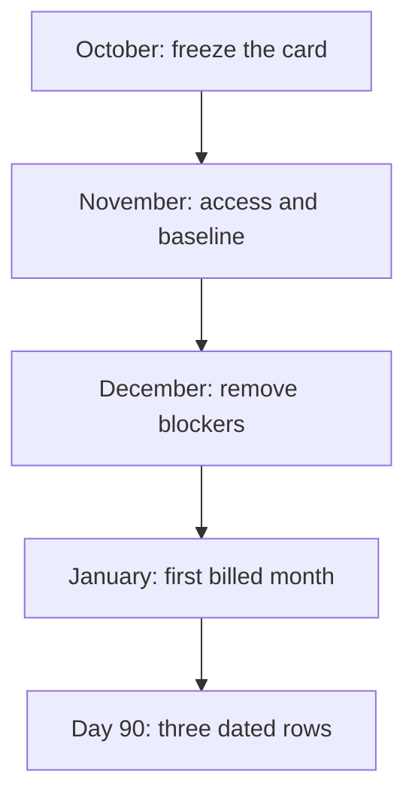

# What to Include in an AI Visibility Monthly Retainer

**An AI visibility monthly retainer is five named lines on one card: the question, the URL, the person who signs the page, the citation log, and the monthly report.** Write that card in October. Bill it from January. On day 90, grade the same five lines, including the rows that say not named.

I'm **William Spurlock**, AI Systems Architect and Fractional AI CTO at Spurlock Studios LLC. I've built **600+ automations**, with **500+ live**. I've spent **20,000+ hours** architecting agentic systems, and that work has saved clients **35,000+ hours**. I've been SEO-certified since 2021. The work now sits under AEO, AIO, and GEO. I do not invent client names, and I do not print a return multiple on a retainer.

When an owner asks what belongs in an AI visibility monthly retainer, I put the card on the table before I talk acronyms or rates. Packaging, and the price ranges I have actually seen, live in [how to sell AI visibility services](/blog/how-to-sell-ai-visibility-services-packaging-pricing-and-positioning). I want this operating list on the desk before anyone argues about the fee.

## What should I include in an AI visibility monthly retainer?

**Include five lines, each with an owner, and leave off anything you cannot point at on day 90.** A line without a name is a wish. A line you cannot show in the report is not part of the retainer.

These are five fields, not an order for five new articles. I pair one frozen question with one URL. A month without a placement still counts when the log has a date. [How often to publish for AI visibility](/blog/how-often-to-publish-for-ai-visibility-and-what-to-publish) already sets the publishing load I use: one page a buyer would ask for, and one refresh where a fact changed. This retainer does not add a third quota.

<table>
<thead>
<tr>
<th>Line</th>
<th>What shipped means</th>
<th>Who signs</th>
<th>What this line is not</th>
</tr>
</thead>
<tbody>
<tr>
<td>Question</td>
<td>The buyer wording is frozen. Wording changes get a new row, not a silent edit.</td>
<td>Account lead</td>
<td>A topic cluster with no sentence a buyer would say</td>
</tr>
<tr>
<td>URL</td>
<td>One indexable page that can show a snippet, mapped to that question</td>
<td>Technical owner</td>
<td>A PDF, a slide, or a page set to nosnippet</td>
</tr>
<tr>
<td>Reviewer</td>
<td>A named person read the page before it went live</td>
<td>That person</td>
<td>A model left to publish itself</td>
</tr>
<tr>
<td>Log</td>
<td>A dated row: surface, named or not named</td>
<td>Analyst</td>
<td>One lucky screenshot with no date</td>
</tr>
<tr>
<td>Report</td>
<td>The same card, with those dates filled in</td>
<td>Account lead</td>
<td>A new dashboard and a new KPI</td>
</tr>
</tbody>
</table>

### What each line has to survive

1. **Question.** Write the sentence the buyer would type or say. Freeze it. If sales wants a new angle in February, add a row. Do not overwrite January's wording and pretend the log is continuous.
2. **URL.** The page has to be indexed and eligible for a snippet. Google's [AI features guide](https://developers.google.com/search/docs/appearance/ai-features), updated December 10, 2025, says there are no extra technical requirements for AI Overviews or AI Mode, and no special schema to add. It also says a supporting link still has to meet the normal snippet rules. A `nosnippet` page is the wrong URL for this card.
3. **Reviewer.** On the [helpful-content page](https://developers.google.com/search/docs/fundamentals/creating-helpful-content), updated October 5, 2026, Google describes large amounts of generative text with no manual oversight as little to no effort. The reviewer line is that oversight. A model may draft. A person signs.
4. **Log.** Every frozen question gets a row every month. "Not named" is a complete row. A blank cell is a missed month.
5. **Report.** The report repeats the card. It does not introduce a metric the card did not name in October.

### What I leave off the card

I leave these off on purpose. They sound like work. They are not a retainer.

- A promise that the page will appear in an AI Overview. The same December 10, 2025 guide says AI Overviews often do not trigger, and that indexing is not guaranteed.
- A new machine-readable file or a special schema type. That guide says you do not need either.
- A word-count target. The October 5, 2026 helpful-content page says Google does not have a preferred word count.
- A price. This card is the work. The fee is a separate conversation, after the questions are real.
- A pile of new URLs. Publishing volume is the cadence post above, not a second scoreboard.

Agencies lose this offer when the card grows a sixth line called "strategy." The frozen list is the strategy. If you cannot read it in one sitting, you do not have a retainer yet.

## What should the October AI visibility proposal include so a retainer can start in January?

**October freezes the card, the Search Console role, and the January start date. January is month one of the bill, not the month you invent the list.** If the questions are still blank in December, you do not have a January retainer. You have a research project.

Before day 90, I check four gates. Price and placement promises belong nowhere on this schedule.

<table>
<thead>
<tr>
<th>When</th>
<th>Job</th>
<th>You are late if</th>
</tr>
</thead>
<tbody>
<tr>
<td>October</td>
<td>Freeze questions, URLs, reviewer names, the done sentence, and the January date</td>
<td>Any question still says to be decided</td>
</tr>
<tr>
<td>November</td>
<td>Owner grants the Google account. You write the baseline row: named or not named</td>
<td>You ship new pages before that baseline exists</td>
</tr>
<tr>
<td>December</td>
<td>Remove blockers only: nosnippet, noindex, missing reviewer, wrong property</td>
<td>You count a date bump as a fix</td>
</tr>
<tr>
<td>January</td>
<td>First billed month. First real edit on a frozen URL</td>
<td>The report shows a KPI the card did not name</td>
</tr>
</tbody>
</table>

### What the October page has to list

I keep the proposal to one page and put these items on it in this order.

1. The five line names, copied as they will appear on the January report.
2. The frozen questions, in buyer language, with one URL each or the words "no URL yet."
3. The named reviewer for each URL, and what they are qualified to sign.
4. The Search Console property, the Google account email, and the role. A group inbox does not count.
5. The January start date and the day-90 date you will actually open the log.
6. The done sentence, written now. Mine is: each frozen question has one URL, one reviewer, and three dated log rows, and a row may say not named.
7. The old SEO invoice, and a yes or no on whether these five lines are already hiding inside it.

November is for access and a baseline, not for a content push. December is for blockers. The [GEO checklist](/blog/the-geo-checklist-12-things-to-do-this-month-to-get-cited-by-ai) is the chore list I hand a writer once the questions are frozen. It is not a substitute for the October page.

### Which Search Console role October has to name

Read this against [Google's permissions help](https://support.google.com/webmasters/answer/7687615), as I read it on October 16, 2026. The roles are not interchangeable, and only an owner can add someone.

- **Owner** sees all data and can add users. A property with no verified owner is a property nobody can enter. There are two owner types, verified and delegated, and both can add people.
- **Full** can view all data and take some actions. Full can submit a sitemap and share a report link. Restricted cannot.
- **Restricted** can view Performance. URL Inspection for a restricted user is fetch only. That is enough to read the log. It is not enough if January's job includes submitting a sitemap.
- The person needs their own Google account. An email group cannot be added as a user.
- Caps on that same page: a property can have a maximum of **100 non-owners**, and delegated owners stop at **500** combined verified and delegated owners. Verified owners have no per-property maximum.

I ask for Full when the agency will submit a sitemap or share the Performance view as a link. I ask for Restricted when I only need to read. I do not ask the client to make me a verified owner so I can park a token on their site. That is more access than a monthly log needs.

If the only verified owner is about to leave the company, fix that in October. Google's same help page says that if the only verified owner leaves, you verify again or you lose the login. A January retainer with a dead property is not a measurement plan.

## What does done look like on an AI visibility engagement after 90 days?

**Done means each frozen question has three dated rows inside the window, one URL, and one named reviewer, even when the row says not named.** A new chart in month three is not done. A single AI Overview screenshot is not done.

I start the clock in January, not when the proposal goes out in October. Three monthly reports fit before the grade. "About 90 days" is not a law of Google's. It is the date written down in October so nobody can move the finish line.

<table>
<thead>
<tr>
<th>Line</th>
<th>Pass on day 90</th>
<th>Fail on day 90</th>
</tr>
</thead>
<tbody>
<tr>
<td>Question</td>
<td>The wording matches the October list</td>
<td>The list was rewritten and the old rows were deleted</td>
</tr>
<tr>
<td>URL</td>
<td>Still the same URL, or a documented replacement with a reason</td>
<td>The page is noindex or nosnippet and nobody noticed</td>
</tr>
<tr>
<td>Reviewer</td>
<td>The name is on the page history for each edit</td>
<td>The byline is a profile nobody on the team has met</td>
</tr>
<tr>
<td>Log</td>
<td>Three dates, including not named</td>
<td>One screenshot and two empty months</td>
</tr>
<tr>
<td>Report</td>
<td>A reader can see those three dates without a second appendix</td>
<td>The appendix is the product and the card is a cover slide</td>
</tr>
</tbody>
</table>

### What I refuse to call done

When the log is thin in month three, these excuses come out. I do not count any of them as a pass.

- You requested a recrawl. The AI features guide says crawling can take anywhere from several days to several months. A request is not a result.
- An AI Overview appeared once. That guide also says they often do not trigger, and that AI Mode and AI Overviews may use different models, so the links vary. One sighting is a note in the log, not the grade.
- You hit a word count. Google says it has no preferred word count.
- You changed the visible date and the paragraph did not change. The helpful-content page calls that out as a warning sign.
- You reran the buyer's query on your own phone and did not see the client, so you marked the month as failed. [Search Console's Performance report](https://support.google.com/webmasters/answer/7576553), as I read it on October 16, 2026, says you might not see your site for a query that still appears in the report, because results depend on time, place, device, and recent history.

I would rather put three months of "not named" on the table than bring one lucky screenshot. That honest log gives the client something to decide in month four. Dress up a miss and the client learns to ignore you.

### The done sentence, written in October

Write it in October in one sentence the client can read without you in the room. Here is the shape I use.

1. Name the date you will grade.
2. Name the count of frozen questions.
3. Require one URL and one reviewer per question.
4. Require three dated log rows per question.
5. Say that "not named" counts.
6. Say what you will not add on that day: a new KPI, a new question list, a guarantee.

If you cannot write that sentence in October, you are not ready to bill in January. Day 90 then becomes a negotiation. Negotiations are how retainers die.

## How does an agency stop folding GEO into an old SEO retainer for free?

**Give the five lines their own name on the invoice, or amend the SEO statement of work so those lines have an owner.** If "monthly content" quietly becomes answer pages aimed at AI citations, you are doing the work inside a fee that never mentioned it.

The split between the two jobs is already mapped in [where SEO and AI visibility overlap](/blog/the-overlap-between-seo-and-ai-visibility-and-where-they-split). I am not redrawing it here. I am talking about the invoice. A combined label looks tidy to a buyer, then the new work disappears inside the old fee.

<table>
<thead>
<tr>
<th>Where the work sits</th>
<th>What the buyer thinks they bought</th>
<th>What happens by month two</th>
</tr>
</thead>
<tbody>
<tr>
<td>Old SEO line, no amendment</td>
<td>Rankings, pages, the usual report</td>
<td>The team starts logging AI answers and never bills it</td>
</tr>
<tr>
<td>Old line, amended in writing</td>
<td>The old KPIs plus the five lines</td>
<td>You can point at the amendment when scope argues</td>
</tr>
<tr>
<td>Second card, own name</td>
<td>A retainer with a January start and a day-90 grade</td>
<td>The SEO report stays the SEO report</td>
</tr>
<tr>
<td>Verbal "throw it in"</td>
<td>A favor</td>
<td>The favor becomes the job, and the job has no owner</td>
</tr>
</tbody>
</table>

### Signs the work is already free

I look for these before I agree to "just add AI" to a current account.

- The invoice description did not change, and the Slack channel did.
- There is no frozen question list. People paste prompts when a buyer complains.
- The monthly report is still rankings and sessions. The AI notes live in a footnote.
- The writer has no named reviewer. Drafts go out because the calendar said so.
- Someone promised an AI Overview inside the old fee. You now owe a placement Google says often does not trigger.
- The same person owns the SEO report and the new log, and both are late.

Google's [spam policies](https://developers.google.com/search/docs/essentials/spam-policies), updated August 28, 2026, include attempts to manipulate generative AI responses in Search. Scaled content abuse, on that same page, includes using generative tools to produce many pages that do not help anyone. Hide a quiet content mill inside an old SEO retainer and you get both problems at once: unpaid work, and pages you should not have shipped.

### What I do on a live account

I do not rip up the SEO retainer to make a point. I write the five lines on a second card and I ask the buyer to mark them in or out of the current fee.

If they are in, I amend the statement of work and cut something else. The old deliverable count cannot absorb a log, a reviewer, and a baseline. If they are out, January is a new start and October still has to happen. "Begin Monday" without a frozen list is the free version with a kickoff meeting.

The agencies that stay paid can put the old report beside the new card and say which hours went where. If you cannot, you are discounting. Call it that, or stop doing it.

## How do I create an AI visibility report that impresses clients?

**The report is the October card with dates in it. Search Console is one column, not the whole page.** The client should see what shipped and what you still missed without needing you to narrate the page.

[How to measure AI visibility](/blog/how-to-measure-ai-visibility-the-metrics-that-actually-matter-in-2026) is where I keep the metric definitions. [Building an AI visibility dashboard](/blog/building-an-ai-visibility-dashboard-for-your-business) covers a different job. Keep that build out of the monthly note. If the client wants a dashboard, sell the dashboard. The retainer report stays one page.

<table>
<thead>
<tr>
<th>Column</th>
<th>Where it comes from</th>
<th>What it must not pretend to be</th>
</tr>
</thead>
<tbody>
<tr>
<td>Question and URL</td>
<td>The October card</td>
<td>A new keyword export</td>
</tr>
<tr>
<td>Named or not named</td>
<td>Your dated log, one surface per row</td>
<td>A guarantee, or a single phone test</td>
</tr>
<tr>
<td>Clicks, impressions, CTR, average position</td>
<td>Performance report for that URL, date filter set to the billed month</td>
<td>Proof that an AI Overview showed</td>
</tr>
<tr>
<td>Reviewer</td>
<td>The name on the edit</td>
<td>A stock byline</td>
</tr>
<tr>
<td>Blocker</td>
<td>nosnippet, noindex, missing access, fact you could not verify</td>
<td>A vague note that "AI changed"</td>
</tr>
</tbody>
</table>

### How I read Search Console on this page

The AI features guide, updated December 10, 2025, says appearances in AI Overviews and AI Mode are included in the Performance report under the **Web** search type. It does not give those features a separate filter. On October 16, 2026, the Performance report itself also splits Web into text-based queries and multimodal queries. Multimodal, on that page, means searches with images, including Google Lens, Circle to Search, uploaded images, and Chrome image search. I do not tell a client those two facts are the same switch. I show Web, I show the date range, and I do not relabel a multimodal row as an AI Overview.

A few rules from that Performance page, as I read it the same day:

- The default view is the **past three months**. A monthly note should change the date filter to the month you billed. The three-month default is the day-90 cross-check, not the January page.
- The newest points can be **preliminary**, shown with a dotted line, and can still change. I do not grade yesterday's dotted segment as final.
- Chart totals and table totals can disagree, because the chart aggregates by property and some tables aggregate by page. If the numbers differ, I say which view I used.
- Metrics on the report are clicks, impressions, CTR, and average position. I do not add a fifth "AI score" beside them.

Google also says, in the AI features guide, that clicks from results pages that include AI Overviews tend to be higher quality, in the sense that the person is more likely to spend more time on the site. There is no percentage on that sentence. I do not invent one, and I do not put a lift in the report unless the client's own analytics shows it for that URL.

### The order that fits on one page

1. The five lines, unchanged from October.
2. What actually shipped: URL, date, reviewer.
3. The log: named or not named, with the surface.
4. Performance for those URLs only, with the date filter visible.
5. What you need from the client next month. One ask, not a list of twelve.
6. The same card again, ready for the next date.

Snippets are a separate honesty check. Google's [snippet controls](https://developers.google.com/search/docs/appearance/snippet), updated April 20, 2026, say the snippet comes primarily from the page content, that different searches can show different snippets, and that `nosnippet`, `data-nosnippet`, and `max-snippet` are how you limit them. If a money URL is set to nosnippet, the report should say so in the blocker column. Do not spend the month "optimizing" a page that cannot be quoted.

The short report gets renewed. The long one usually means the log is empty.

## FAQ

### How do I build a repeatable AI visibility service offering?

**Use the same five-line card for every client and change only the frozen questions.** The offer is the card, the October lock, the January start, and the day-90 grade. Price ranges I have seen, and the audit-sprint-retainer sequence, stay in the [packaging pillar](/blog/how-to-sell-ai-visibility-services-packaging-pricing-and-positioning). Build a fresh slide system for every logo and the offer stops being repeatable. If the questions are not real yet, sell the October page, not twelve months.

### What tools does an AI visibility agency need in their stack?

**You need Search Console at the role the owner actually granted, a page you can edit, and a log that can hold a date.** Restricted access can view Performance. Full access is what you need when the work includes submitting a sitemap or sharing a report link. The longer monitor list is in [the agency tools stack](/blog/ai-visibility-tools-stack-for-agencies-2026). I would not buy a tracker before the October card has questions on it. A spreadsheet with five columns is enough to run month one.

### How do I differentiate my agency by specializing in AI search?

**Show the card and the day-90 pass-fail, and refuse a guarantee that a page will show in an AI Overview.** Google's guide, updated December 10, 2025, says those overviews often do not trigger and that indexing is not guaranteed. Specializing is being able to say that and still describe the monthly job. A new acronym on the homepage is not a specialty. The agencies I trust can put last month's log on the table without narrating it.

### What's the best way to prospect for AI visibility clients?

**Ask for five buyer questions and the URL that should answer each one before you talk about a fee.** If they cannot name the questions, they are not a January start. I do not have a sourced ranking of outreach channels, so I will not pretend one channel beats another. The October card is the thing you bring to the second meeting. A prospect who wants a guarantee on the first call is telling you how the engagement will feel in month three.

### How do I educate a skeptical client about why AI visibility matters?

**Start with the limits Google published: no special schema, snippet eligibility, and no promise an Overview will show.** A skeptic who heard a guarantee is right to flinch. The [AI features guide](https://developers.google.com/search/docs/appearance/ai-features), updated December 10, 2025, says there are no additional requirements and that AI Overviews often do not trigger. Query fan-out, on that page, means one question can turn into several related lookups, which is why the frozen wording and the on-page facts have to match. The card is the lesson. The fee is for running it every month.

### What are the most common AI visibility mistakes agencies make?

**The failure I keep seeing is unpaid scope: AI logging stuffed into an old SEO line, then a screenshot where a log should be.** Shipping many model-written pages with no added value matches an example of scaled content abuse in Google's spam policies, updated August 28, 2026. Changing a date without a real edit is a warning on the helpful-content page updated October 5, 2026. Showing up with a Restricted login when you needed to submit a sitemap is an access mistake. None of these is fixed by a longer deck.

### How do I train my team to deliver AI visibility services?

**Train people to fill the card, and do not let a draft go live without the named reviewer.** One person owns the question list. One person signs each URL. The [GEO checklist](/blog/the-geo-checklist-12-things-to-do-this-month-to-get-cited-by-ai) is the chore list after the questions are frozen. A training session that never opens Search Console, and never checks nosnippet, is a tour of vocabulary. I would rather a new hire botch a practice log than publish a page they cannot defend.

### What niches are the biggest opportunity for AI visibility agency services?

**I do not have a sourced ranking of niches, so I will not crown one.** Google's helpful-content page, updated October 5, 2026, says topics that can affect health, money, or safety carry more weight on experience, expertise, authoritativeness, and trust. Those pages need a slower reviewer, which is a cost, not a trophy. Take the work where you can name the person who signs. If you cannot name them, the niche is a bad retainer even when the search demand looks large.

## Get an AI-visibility-ready site, then run the card

The retainer is wasted on a URL that cannot be indexed or quoted. I build **AI-visibility-ready sites** for that gap: the answer in the first sentences, a real byline, visible text that matches any structured data, and no nosnippet on the page you are asking Google to cite. I'm William Spurlock. I use the operating card to keep the monthly work from becoming a slide habit.

Bring the five lines. I want the frozen questions and the Search Console role before a fee conversation.

[Bring the five lines](/contact).
