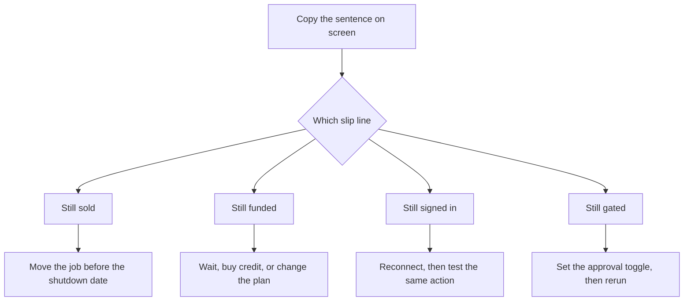

# Where No-Code Agents Break, and How Owners Fix Them Without Developers

**A no-code AI agent that worked last week usually breaks on a screen you can read: the product is leaving, the balance hit zero, the login died, or the approval toggle is not what you think.** I will not rewrite the prompt until those four lines are filled in.

I'm William Spurlock, founder of Spurlock Studios LLC, an AI Systems Architect and Fractional AI CTO. I've built 600+ automations, with 500+ still live, spent 20,000+ hours architecting agentic systems, and helped clients save 35,000+ hours. I wrote this for the week after the agent already ran. The shopping list and the first afternoon on a canvas belong somewhere else.

The drag-and-click loop, including empty field maps, lives in [no-code AI agents: drag, click, add the variables](/blog/no-code-ai-agents-drag-click-add-the-variables-run-until-it-works). Which hosted product to buy lives in [the best AI agent tool for a non-technical owner](/blog/best-ai-agent-platform-for-a-non-technical-team-in-2026). If the thing you call an agent is still five separate chat windows, start with [one operating layer for the agents you already have](/blog/from-scattered-chatbots-to-a-single-operating-layer-for-agents).

I keep a blank card next to the laptop. Four lines. No fifth line for "maybe the model is moody."

## Where do no-code AI agents usually break?

**No-code AI agents usually break in four owner-visible places: a shutdown date, a spent balance or task cap, a dead app connection, or an approval setting that flipped.** The prompt is the fifth place I look, and only after the first four are clean.

My name for the card is a break slip. Copy the sentence on the screen before you turn it into a theory.

<table>
<thead>
<tr><th>Slip line</th><th>What you write down</th><th>What it rules out</th></tr>
</thead>
<tbody>
<tr><td>Still sold</td><td>Product name and the shutdown or plan-change date</td><td>A prompt rewrite for a product that is leaving</td></tr>
<tr><td>Still funded</td><td>Balance, task count, or the exact limit sentence</td><td>A prompt rewrite for a pause</td></tr>
<tr><td>Still signed in</td><td>App name, and whether Reconnect is showing</td><td>A prompt rewrite for a dead login</td></tr>
<tr><td>Still gated</td><td>Approval is off, Always ask, or Never ask</td><td>A prompt rewrite for a send you did not mean</td></tr>
</tbody>
</table>

These are the four screens I trust, based on the pages I read on October 18, 2026:

- **OpenAI Agent Builder has a calendar.** The [deprecations page](https://developers.openai.com/api/docs/deprecations) says developers were notified on June 3, 2026, and Agent Builder is scheduled to shut down on November 30, 2026. ChatKit remains available. A workflow that "suddenly" dies on December 1 did not forget its instructions.
- **Hyperagent pauses new runs when the period's credit is gone.** The [credits page](https://www.hyperagent.com/docs/billing/credits) says nothing extra is billed unless you opt in, and new runs wait for the next period. That pause looks like a broken agent if you only watch the thread.
- **Zapier names a dead connection in the Activity tab.** The [connection-errors article](https://help.zapier.com/hc/en-us/articles/45697369623693-Zapier-Agents-app-connection-errors), updated October 1, 2026, lists expiry, a revoked grant, a password change, inactivity, a missing permission, and a connection someone unshared.
- **Copilot Studio prints a usage sentence, not a writing critique.** Microsoft's [throttling article](https://learn.microsoft.com/en-us/troubleshoot/power-platform/copilot-studio/licensing/throttling-errors-agents), updated October 14, 2026, quotes: "This agent is currently unavailable. It has reached its usage limit. Please try again later."

My rule is simple. If the slip's first line is a date in the future, stop editing instructions. You are on a product with a closing time. If the first line is blank because you never looked, you do not have a bug yet. You are missing the note that would tell you.

The August canvas post already owns the first-day breaks: an empty mapped field, a tool the agent should not have, a sample payload still pinned. I am not repeating that card. This card is for the agent that returned a good result last Tuesday and returned nothing, or the wrong send, this Tuesday.



## What happens when an owner treats a paused no-code agent like a bad prompt?

**You spend the week rewriting instructions while the run is paused for credit, a task cap, or a usage limit, and the new prompt never gets a chance to run.** The agent is not ignoring you. The meter stopped the turn.

I have watched owners add a longer prompt, then a second tool, then a "try harder" line. None of those clicks puts a paused balance back into a run. They can make the next successful run more expensive, because Hyperagent's credits page says a longer thread costs more: every message includes the earlier conversation.

<table>
<thead>
<tr><th>Sentence on the screen</th><th>What actually stopped</th><th>Wrong next click</th></tr>
</thead>
<tbody>
<tr><td>Hyperagent run will not start</td><td>Period credit is spent. New runs pause until the next period unless you opt in</td><td>Rewrite the instructions inside a thread that cannot spend</td></tr>
<tr><td>Abacus agent will not take another task on Basic</td><td>Basic includes 3 agent tasks of limited complexity</td><td>Add tools so the fourth task "counts as research"</td></tr>
<tr><td>This agent is currently unavailable. It has reached its usage limit.</td><td>Copilot Studio overage or a generative rate limit</td><td>Edit topics while the environment is out of room</td></tr>
<tr><td>The usage limit for generative orchestration has been reached.</td><td>Same family of Copilot quota, different sentence</td><td>Assume the knowledge file is corrupt</td></tr>
<tr><td>Zap step shows Delayed, or the task limit was hit</td><td>Approval is waiting, or the step hit its task cap</td><td>Publish a second copy of the Zap</td></tr>
</tbody>
</table>

Copy these details onto the slip, word for word:

1. **Hyperagent, credits page, read October 18, 2026.** When the credit for the period is spent, new runs pause until the next period begins. A credit block or auto-recharge is opt-in, under Settings, then Billing. A block is any whole-dollar amount from $10 to $25,000. One dollar buys one dollar of credit, the block lasts 90 days, and it does not earn the plan bonus. Plan credit, including the bonus, expires at the end of the period.
2. **Hyperagent, if auto-recharge is already on.** The same page says a misbehaving agent can keep buying credit until you intervene. Pair auto-recharge with Budget limit per query on an expensive agent. The [plans page](https://www.hyperagent.com/docs/billing/plans) says there is no separate cost cap. The credit you hold is the bound. Budget limit per query is how you cap one run.
3. **Hyperagent Pay As You Go, if you never picked a monthly plan.** The [pricing-changes page](https://www.hyperagent.com/docs/billing/pricing-changes) says the change was announced August 25, 2026, and moves began August 26, 2026. If you do nothing, agents stop when the current monthly period ends. There is no automatic plan assignment. The plans page dates the Pay As You Go and Annual cutoff at August 26, 2026.
4. **Abacus ChatLLM Basic.** The [billing FAQ](https://abacus.ai/help/chatllm-ai-super-assistant/faqs/billing), read the same day, prices Basic at $10 per user per month, 20K credits, and 3 agent tasks of limited complexity. Pro is an additional $10, so $20 total, with 30K credits and agent access while credits last. A $7 promotion example on that FAQ is 14k credits, not 20K. The price ladder and the buy choice are already in the October 12 post. Here, task number 4 on Basic is a plan fact.
5. **Copilot credits versus a rate sentence.** The October 14 article also quotes "The environment does not have sufficient Copilot Credits to run workflows." A chat answer that does not need the flow can still appear. That split fools people. The bot talked. The action did not run. Those are different lines on the slip.

Shared Billing is the quiet version of the same pause. Hyperagent says members of a Shared Billing organization cannot buy credit or turn on auto-recharge. The organization Owner does. If you are not that owner, a stronger prompt still cannot pay the invoice.

I do not want a percentage of "agents that fail." I want the sentence. Paste it. If you cannot paste it, you are not ready to edit the instructions.

## How can an owner fix a no-code agent without a developer?

**Match one slip line to one setting, change that setting, and rerun the same input on the same screen.** One change. Then the test. A second change before the test hides which click mattered.

On a call, I take the clicks in this order:

1. **Still sold.** Write the date. If the date is November 30, 2026, go to the developer section below before you touch the prompt. A shutdown is not a setting you toggle back on.
2. **Still funded, Hyperagent.** Open Settings, then Billing. If the balance is spent and the job can wait, leave it paused until the period renews. If the job cannot wait, buy a credit block or turn auto-recharge on, on purpose. If auto-recharge is on and the last runs were wrong, turn auto-recharge off before you buy anything else, and set Budget limit per query.
3. **Still funded, Abacus Basic.** Stop at the third agent task. Upgrade to Pro if the agent is the job, or leave the extra work in chat. Do not argue the fourth task into existence.
4. **Still funded, Copilot Studio.** Hand the exact sentence to the person who can open the Power Platform admin center. Microsoft's article says an admin allocates Copilot Credits, or chooses to draw from tenant capacity, then you wait up to 15 minutes and retry the channel that failed. Limits you set under Manage Agents do not stop or unblock those flow runs.
5. **Still signed in, Zapier.** Open Zapier connections, find the app, click Reconnect, sign in, return to the agent, and test that action. The October 1 article lists that path. If a shared connection was unshared, you connect a new account or you ask the owner to share it again. Asking the agent "can you check my connections?" is optional. The Reconnect button is the fix.
6. **Still gated, Zapier.** On each tool that creates, updates, or deletes, turn on Require approval before running. Zapier's [add-tools article](https://help.zapier.com/hc/en-us/articles/45863491098893-Add-tools-to-your-AI-by-Zapier-step), updated October 1, 2026, says that toggle is off by default, and that a turned-on toggle pauses the run no matter how the prompt is worded. The step shows Delayed. You get an email. Activity says 1 action needs your approval. You Approve or Reject after you expand the fields.
7. **Still gated, and the Zap only paused because it worked too long.** The same article says the step displays a maximum, 75 tasks by default, and you can raise it up to 500. Hitting the cap pauses the live run so you can continue or stop. I would not raise it on the same afternoon I discovered a loop. Reject the run. Remove a tool. Then decide.

<table>
<thead>
<tr><th>Product</th><th>Owner click</th><th>Leave this alone on the first pass</th></tr>
</thead>
<tbody>
<tr><td>Hyperagent</td><td>Billing balance, credit block, auto-recharge, Budget limit per query</td><td>A new tool on an agent that cannot spend</td></tr>
<tr><td>Abacus Basic</td><td>Accept the 3-task cap or move to Pro</td><td>A longer prompt meant to sneak in task 4</td></tr>
<tr><td>Zapier connection</td><td>Connections, Reconnect, test the action</td><td>A duplicate Zap "just in case"</td></tr>
<tr><td>Zapier write tool</td><td>Require approval before running</td><td>Raising the 75-task cap before you know why it was hit</td></tr>
<tr><td>ChatGPT workspace agent</td><td>Write actions back to Always ask</td><td>Never ask, unless you have watched a week of drafts</td></tr>
<tr><td>Copilot Studio</td><td>Admin adds credits, you wait, you retry the failed channel</td><td>A topic rewrite while the error still says usage limit</td></tr>
</tbody>
</table>

The two products start with opposite approval defaults. That difference is the whole gate line.

Zapier's toggle ships **off**. A new tool runs unless you turn approval on. OpenAI's workspace-agent help, which I read October 18, 2026, when the page showed an update from earlier that day, says write actions for apps and connectors default to **Always ask**. You can set Never ask, or a Custom approval setting for specific writes. Same English word. Opposite factory setting. I check the product I am in. I do not copy a Zapier habit into ChatGPT, or the reverse.

On that same help page, files on a workspace agent are limited to 512 MB per file and 10 GB total per agent. OpenAI says performance may drop as the pile grows, and a very large collection may prevent the agent from running. The owner fix is to remove files, split a huge document, and keep the folder the job actually needs. A developer is not required to delete a dump of the whole drive.

Enterprise workspace agents are off by default at launch. An admin enables them. If teammates cannot see the agent, the slip line is still sold, still gated by an admin switch, not "the builder ate the prompt."

I keep these changes out of the same hour:

- Add a tool because the last answer was wrong. Zapier says adding a tool lets the step decide when to call it and how many times. That is how a 75-task pause shows up.
- Start a fresh thread and call that a test of the old thread. Hyperagent bills the history you keep. Clear the case on purpose, and write down that you did.
- Treat a Free-plan Zapier account as if it had tools. The add-tools article says Free defaults to Standard, and Advanced and Premium show as locked. Tools and knowledge sources need Advanced or Premium. Premium is the default on new steps that have it, at 5x tasks. Advanced is 3x. Bring Your Own Key is 1x, and tools on that path still need an Advanced or Premium model connected. If the picker is locked, the fix is the plan, not the prompt.
- Ask a Shared Billing member to "just add $20." They cannot. The billing Owner can.

Only Advanced and Premium model tiers can use tools, on that Zapier article. A Standard step that "stopped using Slack" may never have been allowed to. Read the tier in the Activity tab after a run. The tab shows the tier and each tool that succeeded or failed.

## Which no-code agent failures still need a developer?

**You need a developer when the repair is code you have to run, a server you have to host, or a workflow the vendor says will not come across as a prompt.** An owner can still do the export and the preview. The owner should not pretend the SDK is a setting.

OpenAI's June 3, 2026 update on the [AgentKit post](https://openai.com/index/introducing-agentkit/) says that from November 30, 2026 onward, Agent Builder and Evals will no longer be available. The code path it names is the Agents SDK. The natural-language path it names is Workspace Agents in ChatGPT. The [deprecations table](https://developers.openai.com/api/docs/deprecations) matches those two dates: notice on June 3, shutdown on November 30.

The [migration guide](https://developers.openai.com/api/docs/guides/agent-builder/migrate-from-agent-builder) I read October 18, 2026 is stricter than the blog update. The export does not convert your workflow graph. It does not guarantee that every behavior transfers. Workspace Agents require a ChatGPT Business, Enterprise, or Edu workspace, plus permission to create agents. Workflows with strong determinism at their core may not migrate faithfully. Connected apps, authentication, and permissions need a separate review in ChatGPT.

<table>
<thead>
<tr><th>Failure</th><th>Owner, this week</th><th>Developer, or do not start</th></tr>
</thead>
<tbody>
<tr><td>Agent Builder shuts down November 30, 2026</td><td>Export, then preview a workspace agent if the job is a prompt and the workspace is eligible</td><td>Agents SDK inside an app you deploy</td></tr>
<tr><td>ChatKit pointed at a hosted Agent Builder workflow</td><td>Know the date. Hosted workflows are a transition window</td><td>ChatKit on your own server, which OpenAI now points to for new work</td></tr>
<tr><td>Workspace agent send went out</td><td>Set write actions back to Always ask. Add a connector constraint in Safety</td><td>A custom MCP you would have to host</td></tr>
<tr><td>Copilot flow works in test chat and fails for customers</td><td>Retry the real channel after credits exist. Wait up to 15 minutes</td><td>A rate-limit increase from Microsoft, which the article says is not guaranteed</td></tr>
<tr><td>FlowActionForbidden without a credits sentence</td><td>Read the error details. It can be a permission denial</td><td>A permission model across environments, if Reconnect is not the button in front of you</td></tr>
<tr><td>Empty mapped field on a canvas</td><td>That repair is the August click-loop post, still no repo</td><td>Stop. Do not hire anyone to retype a mapping</td></tr>
</tbody>
</table>

If you are the owner and the job really is a prompt, OpenAI's owner path is short. Open the workflow, choose Code, choose Agents SDK, copy the export, then in ChatGPT create a workspace agent and paste this, which is their prompt, not mine:

```text
Please help me convert this workflow into an agent:

<paste your exported code here>
```

Then do their review list before you press Create. Read the instructions it drafted. Connect the apps again. Select Preview. Use inputs you already trust from the old workflow. Compare the preview to the old behavior. Create only after that. The guide says some behavior may need to be rebuilt by hand. I believe that sentence. A preview that "felt close" is not a migration.

ChatKit is the trap in the word "remains." The [ChatKit guide](https://developers.openai.com/api/docs/guides/chatkit), read the same day, says an existing hosted workflow can keep running during the transition. For new work, and for migration planning, it tells you to run ChatKit with your own server-side agent. ChatKit the product stays. The hosted brain behind an old embed does not get a free extension past November 30, 2026. If your site embed depends on that hosted workflow, you are in the developer row. Book the build before the date, not on the morning the embed goes dark.

A connector constraint is still an owner click, so I will not smuggle it into the developer row. On a workspace agent, Safety, then Add constraint, then a plain-language rule, then Generate, then you review it and Update. OpenAI's example is an email action allowed to send only to one domain. The constraint limits what the agent may ask the connector to do. It does not filter data the connector already returned. Useful, and not a repo.

What I will not call a developer job:

- Reconnecting Zapier after a password change.
- Turning Require approval on.
- Buying a Hyperagent credit block, or refusing to.
- Deleting extra files so a workspace agent is under 10 GB.
- Telling an admin the Copilot sentence, then waiting 15 minutes.

What I will call a developer job, without apology:

- Running the Agents SDK yourself.
- Hosting ChatKit.
- Keeping a deterministic multi-step graph alive after OpenAI told you a workspace agent may not carry it.
- A Copilot permission model that is not the credits sentence and not a single reconnect button.

Microsoft also says you can ask support for a higher rate limit. That request is an admin task, and the article says an increase is not guaranteed. I would not hire a developer to write that ticket. I also would not promise the business that the limit moves.

## How does an owner tell a no-code agent is fixed?

**The same input, on the same screen that failed, comes back with the tool you allowed, and it waits before any send, write, or delete.** A greener chat in a different window is not the test.

I run five checks, every time. One happy reply is how a false fix survives the weekend.

<table>
<thead>
<tr><th>Check</th><th>Pass</th><th>Fail</th></tr>
</thead>
<tbody>
<tr><td>Same input</td><td>The payload or question from the broken run</td><td>A friendlier question you wrote during the repair</td></tr>
<tr><td>Same screen</td><td>The channel that failed: Teams, the site, the live Zap, the scheduled run</td><td>Test chat, if customers never use test chat</td></tr>
<tr><td>Tool log</td><td>Activity, or the thread usage card, shows the tool you meant</td><td>A fluent answer with no tool line</td></tr>
<tr><td>Gate</td><td>The write pauses for Approve, or Always ask</td><td>A send that already left</td></tr>
<tr><td>Next day</td><td>One more run on the following morning</td><td>Ten reruns tonight and a victory speech</td></tr>
</tbody>
</table>

I make people read Copilot's table twice. The October 14 article says a flow that works in the test chat can still be blocked in Teams, on a website, or when the agent runs on its own. A flow blocked for a signed-in Microsoft Entra ID user can depend on that user's license. A flow for an anonymous visitor, a phone caller, or someone on a different identity provider is blocked when the environment has no credits. Test chat and the flow designer are not blocked in that no-credit case. So "it works on my test" can be the bug report, not the fix.

The morning-after list:

1. Leave the slip on the desk with the date of the failed run and the date of the passed run.
2. Confirm auto-recharge is still off, unless you chose it after the runs looked boring.
3. Confirm the old Zapier agent, if you were migrating, is actually off. A second published copy is how two emails go out. The canvas post already said that. It is still true on a Tuesday in October.
4. If you raised a task cap, write the old number and the new number on the slip. 75 to 500 is a decision, not a vibe.
5. If the product's shutdown date is still in the future, put that date on the same card. Fixed today is not fixed on December 1.

I trust a boring pass. The fields match. The tool log matches. Nothing left the building without a click. That is the repair. A cleverer answer is a different project.

## FAQ

**I want these questions answered from the screen before anyone opens a new prompt.**

### Why did my no-code agent stop after it worked last week?

**Something in the account changed, or a meter filled, more often than the instructions rotting overnight.** Hyperagent pauses new runs when period credit is gone. Zapier's October 1, 2026 article says a password change, an inactivity revoke, or an unshared connection stops the action, while Copilot prints a usage-limit sentence when the environment is out of room. Copy that sentence before you touch the prompt.

### What happens when Hyperagent credit runs out?

**New runs pause until the next period begins, unless you buy a credit block or turn on auto-recharge.** Both live under Settings, then Billing, and both are opt-in. A block from $10 to $25,000 lasts 90 days at one dollar of credit per dollar with no plan bonus, while plan credit expires at the end of the period. If auto-recharge stays on while the agent is wrong, Hyperagent says it can keep buying credit until you intervene.

### Why does Abacus ChatLLM Basic stop after three agent tasks?

**Basic includes 3 Abacus AI Agent tasks of limited complexity, on the billing FAQ read October 18, 2026.** The plan is $10 per user per month and 20K credits, while Pro is $20 total and removes that task cap while credits remain. A fourth task is the plan speaking, not the instructions failing. The buy choice between Hyperagent and Abacus is the October 12 post, not a reason to stuff task 4 into Basic.

### What does a Zapier Agents app connection error mean?

**The agent cannot complete the action because the app connection expired, was revoked, lost a password, was dropped for inactivity, lacks permission, or was unshared.** Zapier's article, updated October 1, 2026, says the Activity tab may tell you to reconnect. Open Zapier connections, click Reconnect, sign in, and test the action. A new prompt does not renew an OAuth grant.

### Why did an agent act on its own after a move to AI by Zapier?

**Require approval before running is off by default, so a write tool runs unless you turn the toggle on.** The October 1, 2026 tools article says the pause ignores the prompt wording once the toggle is on. Turn it on for anything that creates, updates, or deletes, and leave reads off if you want the Zap to finish. Then watch for Delayed, the email, and the Activity line that says 1 action needs your approval.

### When does OpenAI Agent Builder shut down?

**November 30, 2026.** OpenAI's deprecations page says the notice went out on June 3, 2026, and the [AgentKit update](https://openai.com/index/introducing-agentkit/) from that same day says Agent Builder and Evals will not be available from that date forward. ChatKit remains, but a hosted workflow behind ChatKit is a transition window, not a promise past the shutdown. Workspace Agents are the no-code path OpenAI names, and only inside an eligible Business, Enterprise, or Edu workspace.

### What does the Copilot Studio message this agent is currently unavailable mean?

**It means the agent hit a usage limit, not that the topic text is badly written.** Microsoft's article, updated October 14, 2026, quotes the full line: "This agent is currently unavailable. It has reached its usage limit. Please try again later." A different sentence, about Copilot Credits, means the environment could not start the workflow, so an admin adds credits, you wait up to 15 minutes, and you retry the channel that failed. Editing topics first does not refill the meter.

### Should I add another tool when a no-code agent gives a wrong answer?

**No: adding a tool gives the agent another action it can call, and on Zapier it can call that tool more than once in the same run.** Check the slip first because a wrong answer with a dead connection, a spent balance, or approval left off is not a missing-tool problem. Remove a tool you cannot explain before you add one you hope will help. The August canvas post is where a bad field map gets fixed, while this page is where the account screen gets fixed.

### How do I fill out a break slip before I ask for help?

**Write four lines: still sold, still funded, still signed in, still gated, each with the sentence or date you saw.** Include the product name, the time of the failed run, and the channel. Leave the prompt alone until those lines are filled. If you bring me a blank card and a request to "make it smarter," I will send it back because the slip is the ticket.

### Can a no-code agent work in test chat and fail for real customers?

**Yes. Microsoft says a Copilot flow can succeed in test chat and in the flow designer while the same flow is blocked in Teams, on a website, or on an autonomous run when the environment has no credits.** Anonymous visitors and callers are in the blocked column in that article. Retry the screen the customer used, after credits are available, and wait up to 15 minutes before you call the test a failure of the instructions.

## Book a custom agent build

**Bring the break slip: one job, the sentence on the screen, the channel that failed, and the name of the person who can approve a send.** I am William Spurlock. I do this work at Spurlock Studios LLC. On a [custom agent build](/contact) I will tell you if the repair is a reconnect, a credit decision, a November 30 migration, or a workflow that should never have been a prompt.

I will not start that call by rewriting instructions. I will not add a tool to a paused balance. If the slip says the Agents SDK or a self-hosted ChatKit embed, that is the build. If the slip says Reconnect, you can finish before we talk, and you should.
