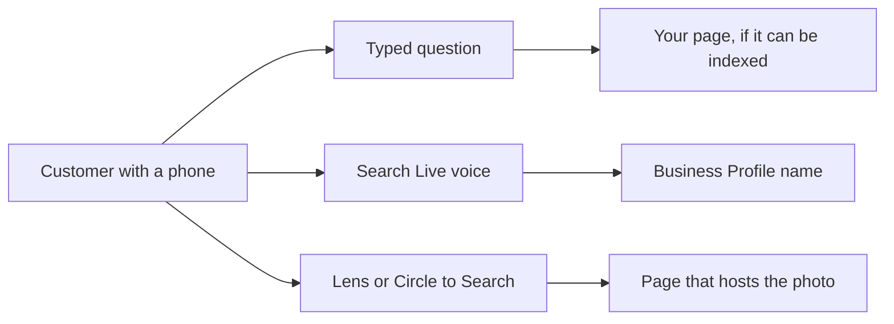
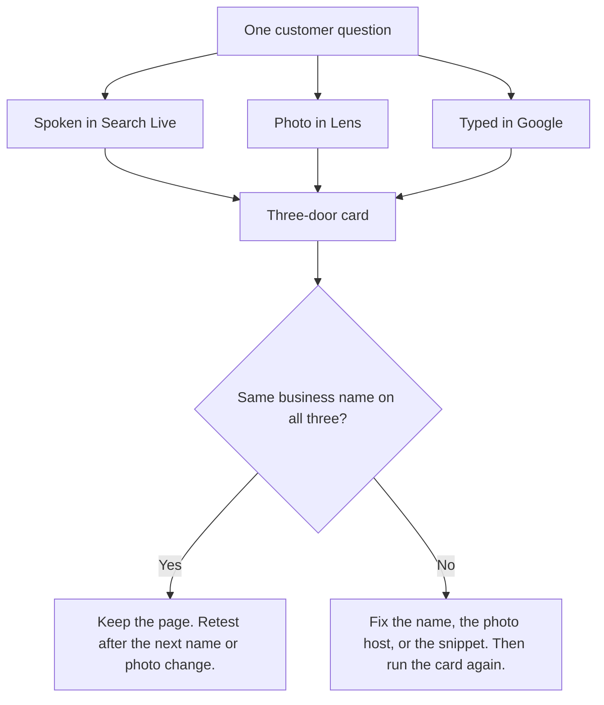

# Why Voice Search and Multimodal AI Change How Customers Find You

**Voice search and multimodal AI change how customers find local and online businesses because one person can type a question, say it in the Google app, or point a camera, and each door can name a different business.** A local shop loses the spoken door when the name Google can say is not the name on the sign. An online store loses the photo door when the image result names a marketplace listing instead of the brand.

I'm **William Spurlock**, AI Systems Architect and Fractional AI CTO at Spurlock Studios LLC. I've built **600+ automations**, with **500+ live**. I've spent **20,000+ hours** architecting agentic systems, and that work has saved clients **35,000+ hours**. I've been SEO-certified since 2021. The work now sits under AEO, AIO, and GEO. I do not invent client names or citation lifts. I do tell owners when they are grading the one door that is easy to screenshot.

This post is the pillar. I already gave two spokes the narrower jobs. [Making your brand findable in image, video, and voice AI search](/blog/making-your-brand-findable-in-image-video-and-voice-ai-search) is the file work: pixels, captions, and pages a camera can retrieve. [Can your business show up when someone asks ChatGPT out loud](/blog/can-your-business-show-up-when-someone-asks-chatgpt-out-loud) is the ChatGPT Voice test. I am not rewriting either post. Here, I am looking at the customer-side shift, and the split between a neighborhood business and a store that ships a product.

The card I keep is one question, three inputs, and the name that comes back. If the three names disagree, another article will not fix the afternoon.

## How are voice search and multimodal AI changing how customers find local and online businesses?

**Voice search and multimodal AI are changing discovery because Google Search now accepts a spoken turn and a camera frame inside the same app that used to be a text box, and the answer is a short name plus a link.** Typed search still matters. It is no longer the only way a customer arrives.

On [May 20, 2025](https://blog.google/products-and-platforms/products/search/google-search-ai-mode-update/), Google said people were asking more complex, longer, and multimodal questions, and it rolled AI Mode out in the U.S. with no Labs sign-up. The same post said **more than 1.5 billion people** use Google Lens every month to search what they see. On [May 19, 2026](https://blog.google/products-and-platforms/products/search/ai-mode-us-insights/), Google said AI Mode had passed **a billion monthly active users** globally, that AI Mode queries had **more than doubled every quarter** since launch, and that **more than one in six searches in the U.S. now use voice or images**, with image searches growing **over 40% month-over-month**. The average AI Mode search, in that same note, is **triple the length** of a traditional Search query.

Local and online businesses feel that mix through different doors.

<table>
<thead>
<tr>
<th>Door</th>
<th>What the customer does</th>
<th>Who usually feels it first</th>
<th>What "found" means</th>
</tr>
</thead>
<tbody>
<tr>
<td>Typed</td>
<td>Types a question into Google</td>
<td>Both, if the page can be indexed and quoted</td>
<td>A link or an AI answer that names you</td>
</tr>
<tr>
<td>Spoken</td>
<td>Opens the Google app and talks in Search Live</td>
<td>Local shops, "where should I" questions</td>
<td>A name they can repeat after one sentence</td>
</tr>
<tr>
<td>Photo</td>
<td>Points Lens or Circle to Search at a thing</td>
<td>Online stores, and any shop with a physical object</td>
<td>A product or place result that names you, not only the category</td>
</tr>
</tbody>
</table>

I do not staff a separate voice site for this. The spoken door and the photo door retrieve pages you already control, plus your Google Business Profile. If I only paste questions into a desktop chat and screenshot the reply, I am scoring the typed door and calling it the whole board.

### What actually shipped

The old "optimize for voice" checklist feels stale because the products moved on. Voice and camera did not arrive as a blog trick. They arrived as Search features with dates.

<table>
<thead>
<tr>
<th>Date</th>
<th>What Google shipped</th>
<th>What I take from it</th>
</tr>
</thead>
<tbody>
<tr>
<td>May 20, 2025</td>
<td>AI Mode in the U.S., no Labs sign-up. Lens cited at more than 1.5 billion monthly users.</td>
<td>Multimodal questions are a Search surface.</td>
</tr>
<tr>
<td>Sep 24, 2025</td>
<td>Search Live in English in the U.S. Voice plus the phone camera. No Labs opt-in.</td>
<td>A customer can talk, and show the camera, inside the Google app.</td>
</tr>
<tr>
<td>Jan 27, 2026</td>
<td>Gemini 3 becomes the default model for AI Overviews globally. A mobile follow-up can continue in AI Mode.</td>
<td>A typed overview can turn into a conversation.</td>
</tr>
<tr>
<td>Feb 25, 2026</td>
<td>Circle to Search can search several objects in one picture, on specific phones first.</td>
<td>One photo can become several product searches.</td>
</tr>
<tr>
<td>Mar 26, 2026</td>
<td>Search Live expands to more than 200 countries and territories where AI Mode exists.</td>
<td>The spoken door is not a U.S.-only lab.</td>
</tr>
<tr>
<td>May 19, 2026</td>
<td>AI Mode past a billion monthly users. One in six U.S. searches use voice or images.</td>
<td>The mix is already in the query log Google published.</td>
</tr>
</tbody>
</table>

Sources for that table, in order: the [May 20, 2025 I/O note](https://blog.google/products-and-platforms/products/search/google-search-ai-mode-update/), the [September 24, 2025 Search Live launch](https://blog.google/products-and-platforms/products/search/search-live-tips/), the [January 27, 2026 overview update](https://blog.google/products-and-platforms/products/search/ai-mode-ai-overviews-updates/), the [February 25, 2026 Circle to Search note](https://blog.google/products-and-platforms/products/search/circle-to-search-february-2026/), the [March 26, 2026 expansion](https://blog.google/products-and-platforms/products/search/search-live-global-expansion/), and the [May 19, 2026 usage note](https://blog.google/products-and-platforms/products/search/ai-mode-us-insights/).

### Local miss versus online miss

A local miss and an online miss do not look the same in the log you wish you had.

- **Local.** The customer says "where should I get this done near me." On May 19, 2026, Google said searches starting with **"where to," "where should I," and "ideas for"** are growing. The spoken answer has room for one name. If your public name is a tagline, the sayable name is someone else's.
- **Online.** The customer points a camera at a product, or circles a photo on their phone. The result is a shopping card: who makes it, what it costs, where to buy it. If the words beside the image belong to a marketplace seller, that seller gets the tap.
- **Both.** The typed page can still rank while the other two doors name a competitor. That is the failure I care about. Rank on the text box is not a pass for the afternoon.

The opinion I will defend: do not buy a voice microsite, a second domain, or a stack of 29-word "answers" and call it multimodal. Fix the name a person can say, and the page that hosts the photo. Then run the three doors again.

## What is multimodal AI search?

**Multimodal AI search is a query that mixes words with a picture, a camera frame, or a spoken turn, and comes back as an answer with links.** It is not a separate search engine you submit a site to. It is Google Search accepting more than a typed sentence, then still pointing at the web.

Google's own [Lens page](https://lens.google/howlensworks/), as I read it on October 15, 2026, tells a person to search with a camera, an image, or a screenshot. The shopping job on that page is specific: look up **who makes it, what it costs, and where to buy it**, then refine with text for pattern, color, or size. The same page says Lens can translate text in **over 100 languages**, and that Lens shopping results are published for a country list that **includes the United States**.

Search Live is the spoken-and-camera session. On [March 26, 2026](https://blog.google/products-and-platforms/products/search/search-live-global-expansion/), Google expanded it to every language and location where AI Mode is available: **more than 200 countries and territories**, voice and camera, on the model that post names **Gemini 3.1 Flash Live**. You open the Google app on Android or iOS and tap Live, or you start Live from Google Lens. The [September 24, 2025 U.S. launch](https://blog.google/products-and-platforms/products/search/search-live-tips/) already turned camera sharing on by default when you enter from Lens.

AI Mode is the conversation layer under that. On [May 20, 2025](https://blog.google/products-and-platforms/products/search/google-search-ai-mode-update/), Google described query fan-out: the question is broken into subtopics and many queries run at once. On [January 27, 2026](https://blog.google/products-and-platforms/products/search/ai-mode-ai-overviews-updates/), **Gemini 3** became the default model for AI Overviews globally, and a follow-up from an AI Overview can continue in AI Mode on mobile, globally. A typed glance can become a back-and-forth. The spoken door is Search Live inside that same app.

### What each surface actually accepts

<table>
<thead>
<tr>
<th>Surface</th>
<th>Input</th>
<th>Where it runs</th>
<th>What you do not control</th>
</tr>
</thead>
<tbody>
<tr>
<td>Google Search, typed</td>
<td>Words</td>
<td>Browser and app</td>
<td>Which sub-questions fan-out adds</td>
</tr>
<tr>
<td>AI Overviews</td>
<td>The query, when Google decides to show one</td>
<td>Search results</td>
<td>They often do not trigger</td>
</tr>
<tr>
<td>AI Mode</td>
<td>Longer questions, follow-ups</td>
<td>Search, and a jump from an overview on mobile</td>
<td>The model picks supporting links</td>
</tr>
<tr>
<td>Search Live</td>
<td>Voice, optional camera</td>
<td>Google app on Android and iOS only</td>
<td>You cannot share the camera from a background session</td>
</tr>
<tr>
<td>Google Lens</td>
<td>Camera, image, screenshot, plus text to refine</td>
<td>Google app, and Lens in Chrome desktop</td>
<td>Shopping results follow the country list</td>
</tr>
<tr>
<td>Circle to Search</td>
<td>Circle, scribble, or highlight on an Android screen</td>
<td>Select Android phones</td>
<td>Multi-object started on two phone lines, then more devices</td>
</tr>
</tbody>
</table>

The Search Live limits are from Google's [help page](https://support.google.com/websearch/answer/16329036?hl=en), as I read it on October 15, 2026. The experience is **only in the Google app on Android and iOS**, and only where AI Mode is available. The camera turns off if you leave the app or lock the screen. It does not turn itself back on. You cannot share the camera while Search Live is in the background.

### What I do not call multimodal

I see a few labels waste a week:

1. **A voice blog on a second URL.** The customer is not visiting your voice site. They are talking to the Google app.
2. **A schema trick that replaces the page.** Google's [site-owner guide to AI features](https://developers.google.com/search/docs/appearance/ai-features), as I read it on October 15, 2026, says there are **no additional technical requirements** and **no special schema** to appear in AI Overviews or AI Mode. The page still has to be indexed and eligible for a snippet. Indexing is not guaranteed.
3. **A desktop-only test.** If the spoken test never leaves the laptop, you did not open Search Live.
4. **ChatGPT Voice.** That is a real door, and it is a different product. The spoke linked above owns that test. Do not log it as a Google pass.

AI Overviews and AI Mode may use different models, so the links can differ. The guide also says AI Overviews often do not trigger, and that both features may fan a question out into related searches. Your job is to be the page those sub-questions can cite, with text, and with images or video when the thing is visual. Structured data, if you add it, has to match the visible text. Merchant Center and Business Profile details have to be current. None of that is a new file format. It is the same site, readable in more than one input.

## Why does a spoken answer change which local business gets the call?

**A spoken answer changes the call because the customer hears one name, and they have to keep it without a screen full of ten blue links.** Search Live is built for the moment typing is a bad idea. Google said that plainly on [March 26, 2026](https://blog.google/products-and-platforms/products/search/search-live-global-expansion/): real-time help, when typing the query will not do.

The name it can say has to be a name a person already uses. Google's [Business Profile name guidelines](https://support.google.com/business/answer/3038177?hl=en), as I read them on October 15, 2026, say the profile name should match the real-world name on the **storefront, website, stationery, and as customers know it**. Taglines, store codes, phone numbers, URLs, hours, and service keywords do not belong in the name. Stuffing the name can suspend the profile. Legal terms such as LLC need real-world proof on the sign, the card, or the invoice. Hours, category, and address belong in their own fields. Google's published example is **Shelly's Coffee**, not a sentence about downtown, late hours, and the best latte.

That example is Google's, not a client of mine. It is still the right test. If customers say "Shelly's" and the profile says "Shelly's Coffee Open Late Downtown," you have taught the profile a name nobody says. The spoken door has to pick something it can finish in one breath. A stuffed name loses to a cleaner one.

The full local build, including how AI Mode cites a neighborhood business, is already in [can local businesses show up in Google AI Mode](/blog/can-local-businesses-show-up-in-google-ai-mode-yes-here-s-how). I am not redoing NAP, reviews, or service-area pages here. I am owning the spoken constraint those pages still have to pass.

### Names the guidelines will not say for you

<table>
<thead>
<tr>
<th>What got stuffed into the name</th>
<th>Guideline problem</th>
<th>What to publish instead</th>
</tr>
</thead>
<tbody>
<tr>
<td>A marketing tagline</td>
<td>Not the real-world name</td>
<td>The name on the sign</td>
</tr>
<tr>
<td>"Open 24 hours" or "near downtown"</td>
<td>Hours and location have their own fields</td>
<td>Hours in hours, city in the address</td>
</tr>
<tr>
<td>A phone number or a URL</td>
<td>Explicitly not allowed in the name</td>
<td>Phone and site in their fields</td>
</tr>
<tr>
<td>The service keyword you wish you ranked for</td>
<td>Service information does not go in the name</td>
<td>Category field, plus a page that answers the job</td>
</tr>
<tr>
<td>The same name twice, two languages</td>
<td>Repeated bilingual names are not allowed, even if the sign shows both</td>
<td>One name customers say</td>
</tr>
<tr>
<td>LLC, unless the sign actually shows it</td>
<td>Legal suffix needs real-world proof</td>
<td>The name on the glass</td>
</tr>
</tbody>
</table>

On May 19, 2026, Google also said AI Mode queries about **planning** had grown faster than AI Mode queries overall by **80%** in the prior six months, and **brainstorming** queries had grown **30%** faster than queries overall since launch. "Where should I" is that kind of question. It is longer than a keyword. The [May 19, 2026 note](https://blog.google/products-and-platforms/products/search/ai-mode-us-insights/) says the average AI Mode search is triple a traditional query. A spoken version of that question is even less patient. It will not read your tagline back.

### How I run the spoken door

Do this on a phone. The help page is clear that Search Live is not a desktop browser feature.

1. Open the **Google app** on Android or iOS. Tap **Live**. Allow the microphone.
2. Ask the question a customer would actually say, including the neighborhood or the job. One example shape: "Who can do this near me this week?"
3. Let it finish one answer. Write down the **business name** you heard. Then look at the links on the screen.
4. Open the link. Confirm it is your site or your profile, not a directory that happens to mention your city.
5. If you turn the camera on, keep the Google app in front. Leaving the app or locking the screen drops the camera, and a background session cannot share it.

Pass is one name, and it is yours, and the link opens something you control. A category with no business name is a fail. A map pin for a similar shop is a fail. A correct name that the customer cannot repeat is a weak pass. I would still shorten the public name before I wrote another page.

I think most local teams over-invest in new copy and under-invest in the name field. The guidelines already tell you where the sayable name lives. Put the hours in the hours field so "are they open" can resolve. Put the job on a page so fan-out can quote it. Keep the profile name boring and true.

## Why does a photo query change which online store gets the sale?

**A photo query changes the sale because the customer starts from an object, and the result is a shopping answer: maker, price, and where to buy.** Your essay can be excellent and still lose if the image result points at a listing you do not own.

[Lens](https://lens.google/howlensworks/) states that shopping job on its own page, as of my read on October 15, 2026. Circle to Search is the Android gesture on top of the same habit. On [February 25, 2026](https://blog.google/products-and-platforms/products/search/circle-to-search-february-2026/), Google said people had already run **billions of Circle to Search queries per month**, and that **shopping-related searches are among the top uses**. The same post says more visual results from a single search create new chances for merchants to be discovered. That sentence cuts both ways. The merchant who gets discovered might be the marketplace, not you.

The February 25 update is multi-object search, powered by **Gemini 3**. The model identifies parts of a picture, runs several searches at once, and compiles a response. It started that day on the **Samsung Galaxy S26 series** and **Pixel 10**, with more Android devices to follow. Virtual try-on from Circle to Search, on those phones, only where try-on from product listings already exists. If your buyer is on an iPhone, they still have Lens and Search Live in the Google app. They do not have Circle to Search. Test the photo door on the phone your customer actually holds.

The file work for this door, captions and images a crawler can retrieve, is the spoke [making your brand findable in image, video, and voice AI search](/blog/making-your-brand-findable-in-image-video-and-voice-ai-search). I am not repeating the alt-text lesson. I am naming the business outcome: the host page of the photo is the page that can win the tap.

### What a photo can return

<table>
<thead>
<tr>
<th>What they point at</th>
<th>What the product is built to return</th>
<th>Who gets the tap if your page is thin</th>
</tr>
</thead>
<tbody>
<tr>
<td>A product on a table</td>
<td>Maker, price, where to buy, then text refinements for color or size</td>
<td>The listing that already has those three facts next to a similar image</td>
</tr>
<tr>
<td>A full outfit or a room</td>
<td>Several objects at once, via multi-object Circle to Search on supported phones</td>
<td>Each item can name a different seller</td>
</tr>
<tr>
<td>A storefront sign or a menu</td>
<td>A place result, plus words Lens can read</td>
<td>The profile whose name matches the sign</td>
</tr>
<tr>
<td>A screenshot of your own product page</td>
<td>The words and images on that page, if they are real files</td>
<td>Nothing useful, if the picture is only a background</td>
</tr>
</tbody>
</table>

Google's [AI features guide](https://developers.google.com/search/docs/appearance/ai-features) tells site owners to keep important content in **textual form** and to support that text with images and video when the subject is visual. It also says to keep Merchant Center and Business Profile information current. A photo with no words beside it gives Lens an object and gives the answer engine almost no brand. A photo on a marketplace page gives it a seller name, a price, and a buy link. Your page can only compete when it has the same facts.

### Three photo tests I actually run

Use your own product or your own storefront. Do not test a stock photo that ten other sites also host.

1. **Object on a table.** Open Lens in the Google app. Photograph the product. Write down the brand name on the first shopping result. Refine with one word a buyer would add, such as the color.
2. **Screenshot of your product page.** Run Lens on that screenshot. If the result cannot find your product name, the name is not in text the page actually shows.
3. **A public photo you do not control.** A reseller image, a social still, a retailer grid. Circle it on Android if you have Circle to Search, or open it in Lens. If that frame names the reseller and your page never appears, the photo door is theirs until your images and words travel together.

Pass is your brand on the result, with a link to a page you control. A lookalike product with a different seller is a fail even if the pixels are close. I would rather see one honest product page with the name, the price, and a real image file than a gallery of untitled heroes.

On May 19, 2026, image searches were the fast-growing half of that "one in six" line: **over 40% month-over-month**. I do not treat that as a promise that your photos will be cited. I treat it as a reason to stop assuming the typed article is the only retrieval path. The [May 19, 2026 post](https://blog.google/products-and-platforms/products/search/ai-mode-us-insights/) is Google's number, for U.S. searches, in a note about how AI Mode changed the mix. Quote it that way. Do not turn it into a forecast for your category.

## How do I audit voice and multimodal search in one afternoon?

**Audit voice and multimodal search by running one question through three doors on a phone and writing down the business name each door returns.** You pass when the spoken answer, the photo answer, and the typed answer name the same business, and each one offers a link you can open.

Do it in one sitting. I am looking for disagreement, not a month of screenshots.

<table>
<thead>
<tr>
<th>Door</th>
<th>Input this afternoon</th>
<th>Write this down</th>
<th>Pass</th>
</tr>
</thead>
<tbody>
<tr>
<td>Spoken</td>
<td>Google app, Live, the customer's sentence</td>
<td>The name you heard, then the link</td>
<td>Your name, your URL or profile</td>
</tr>
<tr>
<td>Photo</td>
<td>Lens on the object or the sign. Circle to Search only if the phone has it</td>
<td>The seller or place name on the first result</td>
<td>Your brand, not only the category</td>
</tr>
<tr>
<td>Typed</td>
<td>The same question in Google, then AI Mode if it is offered</td>
<td>The name in the result or the overview</td>
<td>The same name as the other two doors</td>
</tr>
</tbody>
</table>

Search Console will not score this card for you. The [AI features guide](https://developers.google.com/search/docs/appearance/ai-features) says appearances in AI Overviews and AI Mode are included in the **Web** search type. There is no voice column and no Lens column in that instruction. Use the phone for the spoken door and the photo door. Use Search Console for whether the supporting page gets clicks at all.

### The afternoon, in order

1. Pick **one question** a real customer asks. Local: the job plus the neighborhood. Online: the product plus one constraint, such as size or color.
2. Run **spoken** first, before you look at the typed results and bias what you expect to hear.
3. Run **photo** with the camera on and the Google app in the foreground. Open links after, so you do not drop the camera mid-test.
4. Run **typed** last, in Google, and open AI Mode only if the product offers it on that phone. On January 27, 2026, a mobile follow-up from an AI Overview can continue in AI Mode. If you see that handoff, log it as the same typed door, not as a fourth brand.
5. Fill the card. If any door names a different business, stop writing new pages and fix the mismatch: profile name, words next to the image, or a page that is not eligible for a snippet.

What I do not count as a pass:

- Your city is mentioned and your name is not.
- A directory lists you under a different brand string than your site.
- The photo result is a similar object sold by someone else.
- You tested Search Live on a laptop browser. That is not the product.
- You tested Circle to Search on an iPhone. That gesture is Android.

Retest after you change the public name, the primary product photo, or the Business Profile. Also retest when Google ships a surface change you can date, the way Search Live's country list changed on March 26, 2026. A weekly ritual of random prompts will mix product changes with page changes and teach you nothing.

Query fan-out means one spoken question can still look up hours, service, and place as separate searches. That is why the boring fields matter. The [May 20, 2025 explanation](https://blog.google/products-and-platforms/products/search/google-search-ai-mode-update/) and the current AI features guide agree on the mechanism, even though the model names moved. I do not need a private fan-out log to know the name, the hours, and the product facts have to agree.

I think the teams who win this are the ones who can say the name out loud without wincing, and who can point a camera at the product and still see that name. Everything else is support. The spoke posts tell you how to build the files and how to test ChatGPT. This card tells you whether the customer-facing doors agree.

## FAQ

### Does voice search still matter for a business in 2026?

**Yes. On May 19, 2026, Google said more than one in six searches in the U.S. now use voice or images.** Search Live is the spoken product inside the Google app, expanded on March 26, 2026 to more than 200 countries and territories where AI Mode is available. Voice search here means that live conversation, not a separate voice website. If your buyers ask "where should I" questions, the spoken door is already in the behavior Google published.

### Is Google Lens the same product as multimodal AI search?

**No. Lens is the visual search product. Multimodal AI search is the broader behavior: words plus a photo, a camera, or a voice turn.** Lens, as described on [its own page](https://lens.google/howlensworks/) on October 15, 2026, handles the camera, the screenshot, and the shopping lookup. Search Live adds the spoken turn and can start from Lens with the camera already on. Circle to Search is an Android gesture that can feed the same kind of visual query. Treat them as doors, not as one switch.

### Can I test Search Live from a desktop browser?

**No. Google's Search Live help, as read on October 15, 2026, says the experience is only in the Google app on Android and iOS.** A desktop Google tab can still run the typed door, and Lens exists in Chrome desktop for images on the web. The spoken test, and the live camera test, belong on the phone. If the microphone test never leaves the laptop, you did not test Search Live.

### What name should a local business publish if customers use a short form?

**Publish the real-world name customers already say, and keep taglines out of the Business Profile name.** Google's guidelines, read October 15, 2026, use Shelly's Coffee as the acceptable name and tell you to put hours, category, and location in their own fields. If people say a short form, that short form has to be the name on the sign, the site, and the profile. A legal suffix stays off the name unless the sign actually shows it.

### Can a marketplace photo beat the brand site in a camera search?

**Yes. Lens is built to answer who makes it, what it costs, and where to buy it, and a marketplace page often has those three facts beside the image.** Circle to Search makes this sharper on supported Android phones: one picture can split into several product searches, and shopping queries are among its top uses, per Google's February 25, 2026 note. Your brand site wins the photo door when the same facts sit in text next to an image you host. The file details live in the image, video, and voice spoke linked above.

### Does Google require special schema to show up in AI Mode or AI Overviews?

**No. Google's site-owner guide, as read on October 15, 2026, says there is no special schema and no extra technical requirement beyond being indexed and eligible for a snippet.** Structured data you choose to add must match the visible text. Important content should be text, with images and video when the subject needs them. AI Overviews often do not show. Appearing is not guaranteed. I would not spend the afternoon on a markup type while the three-door card still returns three different names.

### How is Circle to Search different from typing a product name?

**Circle to Search starts from something already on an Android screen, then searches that selection without a typed product name.** Since February 25, 2026, on the Galaxy S26 series and Pixel 10 first, it can pull several objects out of one picture and search them together, using Gemini 3. Typing still works, and it is the third door on the card. The circle is how a customer skips the name they do not know yet. iPhone customers use Lens in the Google app for that job.

### How often should a small team rerun the three-door test?

**Rerun it the day you change the public name, the main product photo, or the Business Profile, and again when a dated Search Live or Lens change ships.** A standing random prompt list will mix those edits with product changes. One question, three doors, one card is enough for a small team. Search Console's Web report can tell you the page received traffic. It will not tell you which name the phone said.

### Where does ChatGPT Voice fit next to a Google Search Live test?

**ChatGPT Voice is a separate spoken door in a different app, so a Google pass does not imply a ChatGPT pass.** Log them on different rows. The test for whether your business is named when someone asks ChatGPT out loud is the spoke [can your business show up when someone asks ChatGPT out loud](/blog/can-your-business-show-up-when-someone-asks-chatgpt-out-loud). This pillar's spoken door is Search Live in the Google app. Run both if your buyers use both. Do not average them into one score.

## Get an AI-visibility-ready site that can pass all three doors

If the spoken answer names one business, the photo names a seller, and the typed result names you, you do not have a content-volume problem. You have a name problem, a photo-host problem, or a page that cannot be quoted. I build **AI-visibility-ready sites** for that gap: one public name, pages that answer the question in the first sentences, images with the facts beside them, and a Business Profile that matches the sign.

The file work is in [making your brand findable in image, video, and voice AI search](/blog/making-your-brand-findable-in-image-video-and-voice-ai-search). The local AI Mode build is in [can local businesses show up in Google AI Mode](/blog/can-local-businesses-show-up-in-google-ai-mode-yes-here-s-how). Bring the three-door card to the conversation. I want the three names before anyone sells you a voice microsite.

[Start with the three names](/contact).
