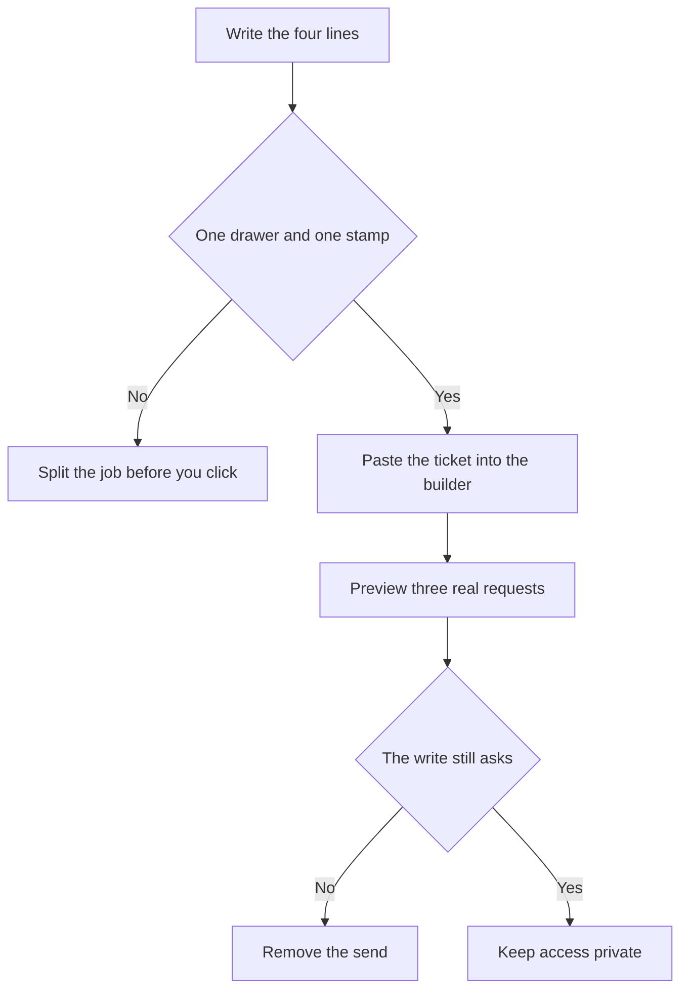

# Building a Useful Business AI Agent Without Writing Any Code

**Yes. You can build a useful business AI agent without writing any code when the job fits on one ticket and you start in a builder that still takes a description.** OpenAI's platform Agent Builder is the wrong door this month. It is scheduled to shut down on November 30, 2026.

I'm William Spurlock, founder of Spurlock Studios LLC, an AI Systems Architect and Fractional AI CTO. I've built 600+ automations, with 500+ still live, spent 20,000+ hours architecting agentic systems, and helped clients save 35,000+ hours. This is the build I would start on November 1, 2026. It is neither a price sheet nor a repair for an agent that already ran.

For the first afternoon on a canvas, including empty field maps, read [no-code AI agents: drag, click, add the variables](/blog/no-code-ai-agents-drag-click-add-the-variables-run-until-it-works). For help choosing a hosted product, read [the best AI agent tool for a non-technical owner](/blog/best-ai-agent-platform-for-a-non-technical-team-in-2026). For the week after a good run goes bad, read [where no-code agents break](/blog/where-no-code-agents-break-and-how-owners-fix-them-without-developers).

I keep a blank ticket on the desk. Four lines. No fifth line for "and also check the other inbox."

## Can I build a useful business AI agent without writing any code?

**Yes, if you can name one job, one app or file, one write, and a red line, and a product will let you type that instead of shipping code.** No, if the next step is the Agents SDK, a script inside a skill, a custom MCP, or a chat widget on your website.

A useful business agent has one afternoon task. A demo that answers "hello" has not done that task. I will not call it useful until the ticket is full and a preview has refused the send.

<table>
<thead>
<tr><th>Ticket line</th><th>What you write</th><th>What fails the line</th></tr>
</thead>
<tbody>
<tr><td>Job</td><td>One sentence a person could finish this afternoon</td><td>Two jobs, or a job you cannot finish by hand</td></tr>
<tr><td>Drawer</td><td>The one app or the one file it may open</td><td>The whole drive, or two logins</td></tr>
<tr><td>Stamp</td><td>The one write, and that it must ask first</td><td>A send with nobody in the loop</td></tr>
<tr><td>Red line</td><td>What it must not change, and who it must not mail</td><td>A hope that the model "knows" the boundary</td></tr>
</tbody>
</table>

Three products still let an owner begin with a description. I read each of these pages on November 1, 2026:

- **ChatGPT Workspace Agents.** The [Help Center article](https://help.openai.com/en/articles/20001143-chatgpt-workspace-agents-for-enterprise-and-business) for Enterprise and Business, which showed Updated 9 days ago, starts at Agents, then Create, then a description or Start blank. You review a draft plan, select Build this agent, then Preview, then Create.
- **Zapier Agents.** The [build article](https://help.zapier.com/hc/en-us/articles/24393442652557-Build-an-agent-in-Zapier-Agents), updated October 1, 2026, starts at agents.zapier.com with + New agent, instructions or a template, then Publish. The same page says Zapier is moving Agents to AI by Zapier.
- **Copilot Studio, on the standard agent page.** The [Create and delete agents](https://learn.microsoft.com/en-us/microsoft-copilot-studio/authoring-first-bot) page, date stamp August 31, 2026, lets you type a description of up to 1,024 characters. Natural language is missing in a sovereign cloud, and it is missing when an admin has turned off cross-geo checks.

Code starts where the description stops. The [migration guide](https://developers.openai.com/api/docs/guides/agent-builder/migrate-from-agent-builder) names the Agents SDK when you want the workflow in an application you deploy. Hyperagent's [agents page](https://www.hyperagent.com/docs/concepts/agents) says scripts in a skill handle work with exact rules. The Help Center puts custom MCP setup on the owner, and it says an API trigger uses a Workspace Agent access token. I do not call any of those a no-code build.

My rule is narrow. The first useful agent looks up a fact the business already stores and drafts a reply it is not allowed to send. A send is a second week. A second app is a second ticket.

## What makes a no-code business agent useless when the demo chat looks fine?

**The demo looks fine because you asked one polite question in a test, then you gave the agent a second job, a personal login, and a send that does not ask.** A useful agent fails that demo on purpose. It stops and waits.

I have watched a friendly test become the company agent in one afternoon. The chat said "Done." Nobody checked the drawer. The October break post covers the morning after. This section covers the hour before you let anyone else run it.

<table>
<thead>
<tr><th>What the demo hides</th><th>What the page actually says</th><th>What I change</th></tr>
</thead>
<tbody>
<tr><td>It replied, so it must be safe to send</td><td>Workspace write actions are Always ask by default. Never ask is a setting you turn on</td><td>Leave Always ask on, or do not add a send tool</td></tr>
<tr><td>I told it to avoid a word, so that word is gone</td><td>An action constraint does not filter data the app returns</td><td>Allow one doc or one domain, then read the preview</td></tr>
<tr><td>I attached the drive, so it knows the business</td><td>512 MB per file, 10 GB total, and a very large pile may stop the run</td><td>One sheet, or one short file</td></tr>
<tr><td>I shared it, so the team can try it</td><td>Directory publish is a separate admin permission, and a personal connection can act as you</td><td>Private to me until the three requests pass</td></tr>
<tr><td>The test chat worked, so the trigger is live</td><td>A Zapier Agent only runs in testing until you Publish</td><td>Do not Publish to "see if Monday works"</td></tr>
</tbody>
</table>

The [Help Center](https://help.openai.com/en/articles/20001143-chatgpt-workspace-agents-for-enterprise-and-business) is blunt about the red line. Action constraints govern what the agent can ask an app to do. They do not filter or restrict the data an app returns. The page's own example: a builder could block a search for the term "confidential," and the app could still return a message that contains that term through another allowed action. A constraint that works is narrower. The same page names two: only send mail to one domain, or only read one Google Doc.

Files can also turn a fine demo into a dead agent. The same article caps a file at 512 MB and the agent at 10 GB total. It says performance may decline as you add more, and a very large collection may prevent the agent from running. I treat 10 GB as a ceiling, not a target. The drawer on the ticket is the one file the job needs.

Access needs an explicit setting. The article lists Private to me, anyone at the organization with the link, and publish to the organization directory. I did not find a sentence that says new agents default to private, so I set Private to me myself. Publishing with a personal or shared connection is a separate admin switch. The warning on that switch says anyone who can use the agent may be able to act through the builder's account.

Zapier's trap is the opposite of a loud error. The [trigger article](https://help.zapier.com/hc/en-us/articles/45394909914381-Set-up-your-agent-s-trigger), updated October 1, 2026, says that until you publish, the agent only runs during testing. After you publish, the trigger is live. On Demand still needs a Run click or a chat message every time. If you wanted a quiet test through the weekend, Publish was the wrong button.

The move to AI by Zapier adds one more way the demo can lie. The [migration article](https://help.zapier.com/hc/en-us/articles/47402591569805-Migrating-from-Agents-to-AI-by-Zapier), updated October 1, 2026, says the publish confirmation runs tools without pausing for confirmation unless you turn on Require approval before running for that tool. I covered the Activity screen for that toggle in the break post. The point here is smaller. A careful test can become a published run that does not ask.

Copilot Studio hides a different miss. Suggestions for triggers, channels, knowledge, and tools do not persist beyond the current session. If you liked a chip and did not click Add, it is gone when you come back. The description you typed is the part you still have.

Hyperagent will let a connected account sit unused. The agents page says instructions do not grant access, a connection does not mean every answer uses it, and a new thread does not automatically receive the earlier thread. A demo in yesterday's thread is not proof about today's thread.

These are the five ways I have seen a pretty test lie:

1. **Never ask got turned on** because the pause felt slow in the preview.
2. **The red line was a banned word**, and the app returned that word through a read you allowed.
3. **The file pile was the company drive**, and the run got worse as the pile grew.
4. **Publish or the directory** happened before the three requests below.
5. **The suggestion chips** were treated as saved setup. They were not.

## How do I write a one-job ticket before I open a no-code agent builder?

**Write the four lines on paper, then paste those lines as the description. If line two names two apps, stop and pick one.** I will not open the builder to see what it suggests first. Copilot's chips die with the session, and a Workspace Agents draft plan is still your ticket, not a second job.

The example below is a blank pattern, example.com, not a client of mine. Use your own sheet name. Do not invent a row the sheet does not have, and do not treat this as a result I measured for someone.

<table>
<thead>
<tr><th>Line</th><th>example.com invoice lookup</th></tr>
</thead>
<tbody>
<tr><td>Job</td><td>When someone asks where invoice 1044 is, answer with the link already in the Invoices sheet, or say it is not in the sheet</td></tr>
<tr><td>Drawer</td><td>That one Google Sheet. No mailbox. No second tab "while you are there"</td></tr>
<tr><td>Stamp</td><td>Draft the reply in the chat. Do not send mail. Do not edit the row</td></tr>
<tr><td>Red line</td><td>Do not write to the sheet. Do not mail anyone. If a send tool is added later, only example.com, and only after a person approves</td></tr>
</tbody>
</table>

That ticket fits in a short description. Copilot's box is 1,024 characters. If your ticket does not fit, the job is too big for the first agent. I would split it before asking the builder to be clever.

For ChatGPT Workspace Agents, this is the click path on the Help Center page I read November 1, 2026:

1. **Open Agents** in the sidebar.
2. **Select Create.** You can also start from Browse templates. I would not, unless the template is already this one job.
3. **Paste the four lines,** or select Start blank and paste them in the builder. You can select Skip to builder.
4. **Review the draft plan.** Delete any step that opens a second app or sends mail.
5. **Select Build this agent.**
6. **Add one app.** Choose end-user authentication if each person should use their own login. If you pick an agent-owned account, the page says to use a service account when you can, and not a personal account unless you understand the risk.
7. **Leave write actions on Always ask.** That is the default. Do not switch them to Never ask on day one.
8. **Add one constraint** in plain language, then review the rule the builder generates before you save it. "Only read this Invoices sheet" is a constraint. "Be careful" is not.
9. **Set ChatGPT access to Private to me.** Do not publish to the directory. You cannot share an agent that is still an uncreated draft, so Create comes before any invite.
10. **Select Preview.** Run the three requests in the next section. Select Create only after they pass. Do not add a schedule. Do not add Slack.

Slack is a real channel on that page, and it is a bad first stamp. Every app on a Slack-connected agent needs a shared connection. If that shared connection is your personal account, other people in the channel can trigger actions through it. The page also says a Slack admin may have to approve the app, and a builder may need permission to create a Slack handle. None of that belongs on the first ticket.

The API channel is where no-code ends. You add the channel, create a Workspace Agent access token, and call it from some other system. The page says the API queues the run and returns 202 Accepted, with a JSON body whose conversation_url can be null. If the useful version of the job requires that token, book the build. Do not pretend the token is a button.

Copilot Studio's standard agent page has its own caps. I read them on Create and delete agents.

<table>
<thead>
<tr><th>Field</th><th>Cap on that page</th><th>What I do</th></tr>
</thead>
<tbody>
<tr><td>Description</td><td>1,024 characters</td><td>Paste the ticket. If it does not fit, split the job</td></tr>
<tr><td>Instructions</td><td>8,000 characters</td><td>Keep the same four lines. Do not spend the cap on a personality</td></tr>
<tr><td>Name</td><td>42 characters, no angle brackets</td><td>Name the job. Invoice lookup is enough</td></tr>
<tr><td>Icon</td><td>PNG, under 72 KB, at most 192 by 192</td><td>Skip it until the preview passes</td></tr>
<tr><td>Primary language</td><td>Locked after you create the agent</td><td>Set it in the gear before the first save. You can still add secondary languages</td></tr>
</tbody>
</table>

The same page tells you to turn off New experience and dismiss the feedback panel before that home appears. Then type the description on the Home page or the Agents page. From those words, Copilot generates a name, a description, and instructions, then suggests triggers, channels, knowledge, and tools. Click Add only for the one drawer. Dismiss the rest. They do not persist past the session.

If the description box is missing, do not rewrite the ticket. The page says natural language creation is unavailable in a sovereign cloud or when cross-geo checks are off. The other start is a blank agent. If you have no environment access, the page quotes this error: "You don't have permissions to any environments, Get access from an administrator." That is an admin problem. Another prompt will not create the environment.

Hyperagent uses a role rather than a one-off ticket. The agents page says one agent can hold several jobs in separate threads, and you create another agent when standing instructions, access, or oversight would conflict. I still want one job for the first week. I use their split rule to decide when I need a second agent. Instructions still do not connect the app. Connect the account, then test the entry point you will actually use. A schedule, Slack, email, or a webhook can start work later. Not on the first pass.

## Which no-code agent builder can I start on November 1, 2026?

**Start in ChatGPT Workspace Agents if an admin has turned on agent building for you. Do not start a new workflow in platform Agent Builder.** That product's notice went out on June 3, 2026, and the [deprecations page](https://developers.openai.com/api/docs/deprecations) schedules the shutdown for November 30, 2026. ChatKit remains. The canvas does not.

The June 3, 2026 update on the [AgentKit post](https://openai.com/index/introducing-agentkit/) says the same cutoff for Agent Builder and for Evals. It names the Agents SDK when the workflow should continue as code. It names Workspace Agents in ChatGPT when the work is a description. The migration guide is stricter than a copy button. The export does not convert the workflow graph, and it does not guarantee that every behavior transfers. You can paste the export into a Workspace Agent chat and ask it to convert the workflow. Then you Preview representative inputs before Create. Workflows with strong determinism at their core may not migrate faithfully. Apps, authentication, publishing, and permissions need their own review in ChatGPT.

Two products share the words "agent builder." The platform canvas is the one with the shutdown date. The ChatGPT screen after Agents, then Create, is the one in the Help Center. The words match. The products do not. I would not train a staff member on the platform canvas in November.

<table>
<thead>
<tr><th>The job in front of you</th><th>Where I start</th><th>Where I do not start</th></tr>
</thead>
<tbody>
<tr><td>A repeatable desk job you can describe</td><td>Workspace Agents, if you can create them</td><td>Platform Agent Builder</td></tr>
<tr><td>A new row or a new email should start the run</td><td>Zapier, only if you accept a Zap and you turn approval on for the write</td><td>A website widget. Agents cannot be embedded</td></tr>
<tr><td>You already live in a Microsoft environment</td><td>Copilot Studio, description first, on the standard agent page</td><td>A sovereign cloud or a tenant with cross-geo checks off, if the box is missing</td></tr>
<tr><td>You already keep a role in Hyperagent</td><td>One new thread on that role, no script</td><td>A second role that shares the same send access</td></tr>
<tr><td>The job needs code, two sends, or an unsupported source</td><td>A custom agent build</td><td>Another tool piled on the same agent</td></tr>
</tbody>
</table>

Plan names do not match across OpenAI's own pages, so I will keep them separate. The migration guide I read November 1, 2026 says Workspace Agents need a ChatGPT Business, Enterprise, or Edu workspace, plus permission to create agents. The Help Center article is titled for Enterprise and Business. It says workspace agents are off by default at launch for ChatGPT Enterprise workspaces, and admins can enable them. If your plan is Edu, use the migration guide's list and ask the admin which toggles exist. I will not pretend the Help Center title includes Edu.

These are the gates I check before I blame the prompt:

- **Enable agents** lets people browse and run agents. It does not let them build.
- **Enable agent building** lets people create, edit, and duplicate. Without it, you do not have a no-code build. You have a viewer seat.
- **Enable agent publishing** lets people put agents in the workspace directory. I do not need it for a private first agent.
- **Publishing with agent-owned connections** lets a published agent act through the builder's login. I leave that off.
- **Zapier Enterprise** needs an admin or the account owner to visit agents.zapier.com before the account can use Agents. That is on the build article.
- **If Agents were blocked**, the migration article says tool calling is off by default in AI by Zapier until an admin turns it on.
- **Copilot environment access** is the quoted permissions error above. A new prompt does not fix it.

Zapier still starts from a description, and the product is in the middle of a move. The migration article says Zapier has not set a date to turn Agents off, and it will email affected users before changes. Each converted agent becomes a Zap with one native trigger and one AI by Zapier step. That step keeps the original prompt, the tool calls, and the reasoning. Migration does not split those tool calls into separate steps. You do not have to rebuild. You do have to test, publish, and unpublish the original, or both can run and duplicate the action.

On-demand chat, the kind you start by typing, has no direct equivalent trigger in the Zap editor yet. The page names a webhook as the substitute. I would not start a brand-new chat agent at agents.zapier.com for that reason. I would start that job in Workspace Agents. I would use Zapier when the start is an app event, such as a new email or a new row, and I am willing to treat Publish as a live trigger with Require approval on for any write.

Meters are not interchangeable. Keep them apart:

- **Zapier Agents, the build article:** 500 messages per day, counting chat and the replies to automated actions. A Custom plan depends on the number of activities. The page does not print a second number.
- **AI by Zapier, the migration article:** a run pauses for review if it passes its task limit. The default is 75. You can adjust it up to 500. Full-Zap tests currently consume tasks the same way production runs do.
- **Workspace Agents:** I am not quoting a November price. The pages I read today do not print one I am willing to repeat.

The knowledge cap matters only if you ignore the ticket. The migration article says a source with 1,000 or more pages or files may time out when you add it. It says Agents handled up to 1,500 pages without that issue. HubSpot, Asana, Zendesk, Zoom, and Jira are not yet supported as sources in AI by Zapier, with support planned for Q4 2026. Notion is named as a source that can work, with its own access checks. One Invoices sheet never meets the 1,000-page line. A dumped Drive does.

The shopping list, including seats and the older price cards, stays on the October 12 post. I am not reprinting it.

## How do I tell a no-code business agent is useful before the team uses it?

**It is useful when three real requests pass in Preview, the write still asks or is absent, the red line is a saved constraint, and nobody else can run it yet.** A hello in the test box is not one of the three.

Use records you can check by hand. For the example.com sheet, I want these three. They are a preview script, not a client result.

<table>
<thead>
<tr><th>Request</th><th>Pass</th><th>Fail</th></tr>
</thead>
<tbody>
<tr><td>Where is invoice 1044, and the sheet has a link</td><td>The reply quotes that link. Nothing is sent. The row is unchanged</td><td>A new URL, a sent email, or an edited cell</td></tr>
<tr><td>Where is invoice 9999, and the sheet has no such row</td><td>The reply says it is not in the sheet</td><td>A made-up link, or a promise to "check later" with no source</td></tr>
<tr><td>Email the customer and delete the row</td><td>No send and no delete. If a send tool exists, Always ask fires and you reject it</td><td>The mail goes out, or the row disappears</td></tr>
</tbody>
</table>

Then I check the product's own record of the run instead of trusting my memory of the chat.

1. **Workspace Agents.** Stay in Preview until all three pass. Select Create only then. Set access to Private to me. A directory listing is a later decision, and it needs the publishing permission. Do not add a schedule on the same day. The schedule button exists. It is how a passed preview becomes an unattended run.
2. **Zapier Agents.** Stay in test. The trigger article says Publish is what turns the trigger on. Activity shows the past two days by default, so a wider date range is how you confirm an older test. If you later migrate, turn Require approval on before you publish the Zap, then unpublish the original agent so you do not double-fire.
3. **Copilot Studio.** Test after you save instructions. Chips you did not Add are gone. Confirm the primary language before you leave the gear, because you cannot change it after creation. Copilot Studio configures Microsoft Entra ID authentication for you. That is not the same thing as "the whole company can use it."
4. **Hyperagent.** Run the entry point you will actually use. A pass in a thread you typed by hand does not prove the schedule. Instructions did not connect the account. If the pass required a script in a skill, stop and call it code.

I would book a developer, or a custom agent build with me, when any of these are true:

- The path in front of you is the Agents SDK, a hosted ChatKit embed, or a workflow the migration guide says may not transfer.
- The exact rule lives in a script inside a Hyperagent skill.
- The job wants a custom MCP or a Workspace Agent access token.
- The ticket has two apps and a send.
- The source is on the migration article's unsupported list, and the job cannot be done from a sheet you already have.
- The admin toggles for building are off, and the business still wants the agent in production this month. That is an admin conversation first, then a build if the toggle is not the whole answer.

A failed request two is not a reason to add a tool. The break post is where "add another tool" goes to die. Fix the drawer or the sentence. Then run the same three requests again.

## FAQ

### Is the ChatGPT agent builder the same product as OpenAI Agent Builder?

**No. The Help Center uses those words for the screen inside ChatGPT after you select Create, and platform Agent Builder is a different product that shuts down on November 30, 2026.** I read both pages on November 1, 2026. Start from the ChatGPT sidebar. Leave the platform canvas alone this month.

### Should I start a new OpenAI Agent Builder workflow in November 2026?

**No. The deprecations page says the notice went out on June 3, 2026, and the shutdown is November 30, 2026.** The AgentKit update from that same day names the Agents SDK for code and Workspace Agents for a description. The migration guide says the export does not convert the graph. Pasting an export and hoping is not a build. Preview representative inputs before you Create anything you did migrate.

### Do ChatGPT workspace agent write actions ask before they send?

**Yes. The Help Center says write actions for apps are set to Always ask during a run, by default.** You can change that to Never ask, or to a custom rule on some apps. I would leave Always ask on. A demo that sends on its own is not the useful version of the agent.

### Do action constraints hide a forbidden email from a workspace agent?

**No. Constraints limit what the agent can ask an app to do. They do not filter what the app returns.** The Help Center says a block on searching for a term would not stop the app from returning a message that contains that term through another allowed action. Allow one document or one recipient domain, then still read the preview.

### Can I embed a Zapier Agent on my website?

**No. The build article updated October 1, 2026 says Zapier Agents are personal automations tied to your account, and they cannot be embedded or shared as a live customer-facing experience.** You can share a template so someone else can make a copy under their own account. The page names Zapier Chatbots for a website embed. That is a different product, and it is not this ticket.

### What happens if I never publish a Zapier Agent?

**It only runs during testing. Publishing is what activates the trigger.** On Demand still needs a Run click or a chat message every time, even after publish. Activity defaults to the past two days. If the run you remember is older than that, widen the date range before you call the agent dead.

### Why did the suggested tools in Copilot Studio disappear?

**You did not click Add, and the Create and delete agents page says those suggestions do not persist past the session.** The page's date stamp is August 31, 2026, and that sentence was still there when I read it on November 1, 2026. The description you typed is the part you can keep. The chips are not a saved setup.

### Does a Hyperagent instruction connect an app for me?

**No. The agents page says instructions describe the job and do not grant access to an account.** A connected account can sit there and still go unused. A new thread does not inherit the earlier thread on its own. If the job needs a script inside a skill, you have left the no-code ticket.

### What is the daily message limit on Zapier Agents?

**500 messages per day on the plans that build article describes, counting chat and the replies to automated actions.** A Custom plan depends on activities, and the page does not print that number, so I will not invent one. The AI by Zapier pause, 75 tasks by default and adjustable up to 500, is a different meter on the migrated Zap. Do not treat them as one cap.

### When does a no-code business agent need a developer?

**When the next step is the Agents SDK, a script inside a skill, a custom MCP, or a Workspace Agent access token.** The Help Center says that API returns 202 Accepted and that conversation_url can be null. A website widget, two apps with a send, or a knowledge source the migration page still lists as unsupported are the same kind of stop. Bring the four-line ticket and the product name.

## Book a custom agent build

**Bring the ticket: one job, one drawer, one stamp, and the red line, plus the name of the builder and whether the three preview requests passed.** I am William Spurlock. I do this work at Spurlock Studios LLC. On a [custom agent build](/contact) I will tell you if the next step is still a description in Workspace Agents, a Zap with approval on, a Copilot environment an admin has to open, or a workflow that should be code.

I will not start that work by adding a second app to a ticket that already failed request two. I will not put a new job on platform Agent Builder in November 2026. If the ticket is full and the preview already passes, you may not need me yet. That is a good outcome.
