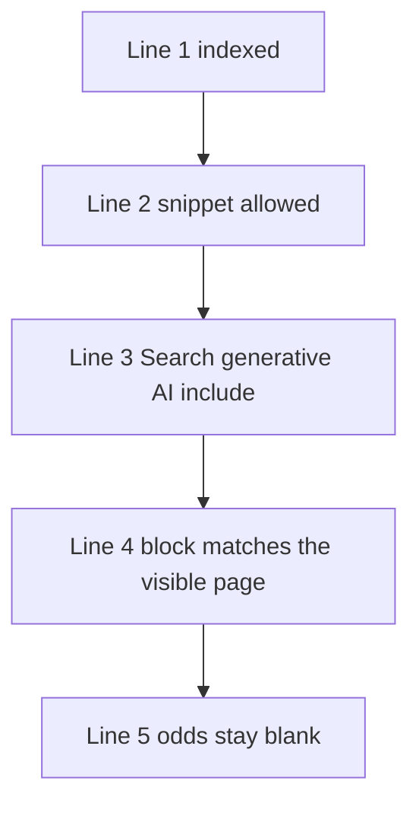

# Does having schema markup increase your chances of appearing in AI Overviews?

**No. Google publishes no lift, no odds, and no special schema.org type that turns an AI Overview on.** I keep the answer on a chance card with four yes-or-no lines. I leave the fifth line, the odds, blank on purpose.

I'm William Spurlock, AI Systems Architect and Fractional AI CTO at Spurlock Studios LLC. I've built 600+ automations, and 500+ are live. I've spent 20,000+ hours architecting agentic systems, and that work has saved clients 35,000+ hours. I've been SEO-certified since 2021. I now bring the same work to AEO, AIO, and GEO. None of those hours puts a percentage on a script tag.

The type catalog lives in [schema, structured data, and entity SEO](/blog/schema-structured-data-and-entity-seo-the-technical-core-of-ai-visibility). I compare a visible page with its Organization block in [the entity SEO audit](/blog/how-do-i-do-an-entity-seo-audit-for-my-website). I grade one internal link in [how internal linking affects entity relationships for AI](/blog/how-does-internal-linking-affect-entity-relationships-for-ai). Here, I am answering only the odds question. The example.com references below come from Google's Search Console help. Example.com is not a client.

## Does having schema markup increase your chances of appearing in AI Overviews?

**Schema markup does not increase a chance Google has published for an AI Overview, because the guides below do not print one.** I read the [AI features guide](https://developers.google.com/search/docs/appearance/ai-features) on 4 November 2026. Last updated 10 December 2025, it says AI Overviews and AI Mode have no additional requirements and need no other special optimizations. It also rules out the need for new machine-readable files, AI text files, markup, or special schema.org structured data.

I read the [optimization guide](https://developers.google.com/search/docs/fundamentals/ai-optimization-guide) the same day. Last updated 10 July 2026, it puts the limit in plainer shop language. Generative AI search does not require structured data or a special schema.org addition. Keep structured data when you want a rich result. Google still assigns it that job.

<table>
  <thead>
    <tr>
      <th>What a proposal often promises</th>
      <th>What Google's pages actually say</th>
      <th>What I write on the card</th>
    </tr>
  </thead>
  <tbody>
    <tr>
      <td>Schema raises your AI Overview chances</td>
      <td>No additional requirements, and no special schema.org type, on the 10 December 2025 guide and the 10 July 2026 guide</td>
      <td>Line 5 stays blank</td>
    </tr>
    <tr>
      <td>A new markup file built for AI</td>
      <td>No new machine-readable file, AI text file, or markup is required</td>
      <td>I do not add a second file to chase an Overview</td>
    </tr>
    <tr>
      <td>A guaranteed citation once the test is green</td>
      <td>Indexing and serving are not guaranteed, and Overviews often do not trigger</td>
      <td>A missing Overview is not a failed script</td>
    </tr>
  </tbody>
</table>

Three promises do not belong in a scope:

1. **A lift percentage.** Neither guide prints one for schema and AI Overviews.
2. **A guarantee.** The 10 December 2025 page says indexing and serving are not guaranteed even when the technical bar is met.
3. **A special type.** "AIOverview" is not a type those pages tell you to add. I will not invent one.

My opinion is blunt. When a vendor leads with a percent beside a JSON-LD block, that vendor is selling a number Google did not publish. I ask to see the four lines above the blank instead.

## What has to be true before schema markup can change an AI Overview chance?

**Before I look at a script tag, I check three gates: the URL is indexed, the page can show a snippet, and the Search Console property is included in Search generative AI features.** A closed gate means schema markup is not the reason an AI Overview is missing. Even with all three open, the odds line stays blank. These checks keep me from blaming the wrong object.

The 10 December 2025 AI features guide says a supporting link in AI Overviews or AI Mode must come from a page that is indexed and eligible to appear in Google Search with a snippet. It lists no additional technical requirements. Meeting those requirements still does not mean Google will crawl, index, or serve the page.

The 10 July 2026 optimization guide keeps the indexed-and-snippet rule but adds a site-level condition missing from the older page. To be eligible for display in generative AI features, a site must be included in Search generative AI features in Search Console. I keep the two pages separate and date each one.

I read Search Console's [Search generative AI control](https://support.google.com/webmasters/answer/16908024?hl=en) on 4 November 2026. It says the control had rolled out to all websites worldwide as of 31 August 2026. It covers AI Overviews, AI Mode, and generative AI features in Google Discover. You find it under Settings, then Search generative AI.

<table>
  <thead>
    <tr>
      <th>Control choice</th>
      <th>What the help page says it does</th>
      <th>Default</th>
    </tr>
  </thead>
  <tbody>
    <tr>
      <td>Include</td>
      <td>Links and content can appear, including as grounding for responses, and the site can get impressions and traffic from those features</td>
      <td>Default for all properties</td>
    </tr>
    <tr>
      <td>Exclude</td>
      <td>Links and content are kept out of those features, including grounding, and you get no traffic or impressions from them</td>
      <td>A choice, not the default</td>
    </tr>
    <tr>
      <td>Inherit</td>
      <td>The property follows the closest parent that stopped inheriting</td>
      <td>Default when the property has a parent</td>
    </tr>
  </tbody>
</table>

Exclude turns those features off for the property. It does not act as a ranking signal for the rest of Search. The help page also separates this control from AI training and names Google-Extended for training of the models used in Search generative AI features. Merchant Center and Google Ads are not overridden. To block the whole site from Google Search, the same page points to noindex.

Inheritance invites mistakes. In the help page's example, the URL-prefix child `https://example.com/business/cats` inherits the domain property `example.com` unless someone set a closer parent by hand. `example.co.uk` is not a child of `example.com`. I open and verify the property itself. A folder property does not automatically match the domain property.

Two clocks stay apart:

- **The control-change wording.** Once you change the control, exclusion generally takes a few days. The same section says content will be excluded within 1-2 days after the control goes live, and some content may take longer because of caching and propagation. I quote both phrases. I do not collapse them into one SLA.
- **The preview-control wording.** On the 10 December 2025 AI features page, a nosnippet-style change can take anywhere from several days to several months to be recrawled. That is not the Search generative AI control clock.

One closed gate ends the check. Three open gates still do not fill line 5.

## Where does Google say schema markup fits for AI Overviews?

**For AI Overviews, schema has two relevant jobs: match the words a person can read and support eligibility for a rich result. Raising AI Overview odds is not one of them.** The 10 December 2025 guide includes "making sure your structured data matches the visible text" among ordinary SEO practices. In the same section, it says AI Overviews and AI Mode require no specific optimization.

I read John Mueller's [21 May 2025 post](https://developers.google.com/search/blog/2025/05/succeeding-in-ai-search) on 4 November 2026. He says systems can consider structured data and that it can make pages eligible for certain search features and rich results. The markup must match content visible on the page, and you should validate it. "Consider" does not mean "raise the odds by a stated amount."

The [general structured data guidelines](https://developers.google.com/search/docs/appearance/structured-data/sd-policies), last updated 10 July 2026, deal with rich results. They tell you not to mark up content a reader cannot see. Google recommends JSON-LD and also supports Microdata and RDFa. Leave out a required property, and the item is not eligible for that rich result. Recommended properties can make the result more useful, and Google takes that added information into account when ranking rich results. The block belongs on the page it describes. Not one of those rules supplies an AI Overview percentage.

<table>
  <thead>
    <tr>
      <th>Thing people add</th>
      <th>What the 10 July 2026 guide says Google Search does with it</th>
    </tr>
  </thead>
  <tbody>
    <tr>
      <td>schema.org structured data that matches the page</td>
      <td>Not required for generative AI search. No special type to add. Still useful for rich-result eligibility</td>
    </tr>
    <tr>
      <td>An llms.txt file, an AI text file, or Markdown kept for other tools</td>
      <td>Google Search ignores llms.txt. Keeping the file neither harms nor helps Search visibility or rankings</td>
    </tr>
    <tr>
      <td>A pile of short pages, one per fan-out query</td>
      <td>No chunking requirement and no ideal page length. Pages built mainly to manipulate rankings or generative AI responses are called out under the scaled content abuse spam policy</td>
    </tr>
  </tbody>
</table>

That same guide defines query fan-out as related queries the system runs alongside the query a person typed. Google starts with "how to fix a lawn that's full of weeds" and gives "best herbicides for lawns," "remove weeds without chemicals," and "how to prevent weeds in lawn" as related queries. I do not turn those examples into three new URLs. Google also says it still considers work aimed at generative AI search to be SEO.

If I already have a block, I check three things and then I stop adding types:

1. **The words in the block are on the page.** Hidden markup fails the 10 July 2026 quality rule.
2. **The format is one Google lists.** JSON-LD, Microdata, or RDFa.
3. **The rich-result type I care about has its required properties.** Missing required properties means that rich result is not eligible. That sentence is about the rich result, not about line 5.

I am not grading FAQPage, HowTo, or Speakable on this card. Those are different questions. I am not grading Organization sameAs here either. The audit page owns the mismatch between the visible name and the block.

## How do I tell a rich result apart from an AI Overview?

**Structured data can make a page eligible for a rich result. An AI Overview is a generated response with links that appears only when Google decides it adds something beyond classic results, so it often does not show.** Both can sit on the same SERP, but they are different boxes. A green test applies to one of them, not both.

The 10 July 2026 structured-data guidelines say a correct [Rich Results Test](https://search.google.com/test/rich-results) still does not guarantee a rich result. Structured data enables eligibility, not display. A plain result can still win because of search history, location, device, markup that misses the main content, an issue the test missed, hidden content, or a text result that fits better. A structured-data manual action removes rich-result eligibility. On that page, it does not change the page's web-search ranking. I use the Rich Results Test and URL Inspection for the technical rules, never as AI Overview switches.

The 10 December 2025 AI features page explains the other box. AI Overviews give the gist of a hard question when Google's systems decide an Overview adds something. They often do not trigger. AI Mode handles questions that need more exploration. Because the two can use different models, their links can differ. Both may use query fan-out, defined in the 10 July 2026 guide as concurrent related searches. In that guide, retrieval means pulling pages from the Search index through Google's ranking systems and then showing links. It does not name schema as the retrieval key.

<table>
  <thead>
    <tr>
      <th></th>
      <th>Rich result</th>
      <th>AI Overview</th>
    </tr>
  </thead>
  <tbody>
    <tr>
      <td>What schema is for</td>
      <td>Eligibility, when the type is supported, required properties are present, and the block matches visible text</td>
      <td>No special schema.org type on the 10 December 2025 or 10 July 2026 pages</td>
    </tr>
    <tr>
      <td>What a green test means</td>
      <td>The test found eligible markup. Display is still not guaranteed</td>
      <td>Nothing on line 5. The AI pages do not call the Rich Results Test an Overview exam</td>
    </tr>
    <tr>
      <td>What "missing" means</td>
      <td>Could be a policy miss, a hidden block, a missing property, or Google choosing a text result</td>
      <td>Often the normal case. Overviews often do not trigger. Indexing is not guaranteed</td>
    </tr>
  </tbody>
</table>

The measurement answer lives in two dated places, so I keep both.

- The 10 December 2025 AI features page says appearances in AI features are included in the Search Console Performance report, inside the Web search type.
- The [3 June 2026 announcement](https://developers.google.com/search/blog/2026/06/gen-ai-performance-reports) launched a separate Generative AI performance view, first for a subset of sites. A note on that post, which I read on 4 November 2026, says that as of 31 August 2026 the insights are rolled out worldwide. The data stays in the overall performance report. The announcement lists impressions, pages, countries, devices, and dates, with hourly, daily, weekly, and monthly granularity.

I read the [report help page](https://support.google.com/webmasters/answer/16984139?hl=en) on 4 November 2026. It says the Search report includes impressions for AI Overviews and AI Mode, while Discover gets its own report. Search Labs experiments stay out of the data. If the report is missing, the usual reason is too few impressions, and one note says exclusion can cause that. One impression means a link to your site appeared in a generative AI feature. On the chart, two results from the same site inside one feature still count as one impression. Add a URL filter, and the chart aggregates by URL. The pages tab uses the final URL after redirects, with most rows tied to the canonical. Dates use Pacific Time. Devices are desktop, tablet, or mobile. The report separates Web text queries from Web multimodal queries, defined there as Google Lens, Circle to Search on Android, uploaded images, and Chrome image search. The familiar 1,000-row performance-report cap applies here too. A dotted line marks the newest point when it is preliminary. The help page also says this data sits inside the Web search type of the Performance report. That is how the June view and the December sentence fit together.

The click claim is separate from schema. Both the 10 December 2025 page and the 21 May 2025 post call clicks from results pages with AI Overviews higher quality, meaning people are more likely to spend more time on the site. Neither source gives a percentage, so I do not supply one. I do not credit the schema block for the visit either.

## How do I fill a chance card when Google publishes no percentage?

**I fill four lines with evidence from tools I can open, then leave the odds line blank.** The blank is the grade, not a forgotten task.

<table>
  <thead>
    <tr>
      <th>Line</th>
      <th>Pass looks like</th>
      <th>Fail looks like</th>
    </tr>
  </thead>
  <tbody>
    <tr>
      <td>1. Indexed</td>
      <td>URL Inspection shows the URL indexed</td>
      <td>Not indexed. I stop. I do not invent a recrawl date</td>
    </tr>
    <tr>
      <td>2. Snippet allowed</td>
      <td>The page can show a snippet in Google Search</td>
      <td>nosnippet, data-nosnippet, max-snippet, or noindex is limiting what Search can show</td>
    </tr>
    <tr>
      <td>3. Included</td>
      <td>Settings, then Search generative AI, is Include, or Inherit from a parent that is Include</td>
      <td>Exclude, or Inherit from a parent that is Exclude</td>
    </tr>
    <tr>
      <td>4. Visible match</td>
      <td>If a block exists, a person can read the same facts, in a listed format, with required properties for the rich result I want</td>
      <td>Hidden facts, a missing required property, or a type that describes a different page</td>
    </tr>
    <tr>
      <td>5. Odds</td>
      <td>Blank</td>
      <td>Any percentage, guarantee, or "special AI schema" written in this cell</td>
    </tr>
  </tbody>
</table>

The method depends on doing these checks in order:

1. **Open URL Inspection before I open the script.** If the URL is not indexed, the 10 December 2025 page already says a supporting link is off the table. Indexing is not guaranteed. I do not promise a week or a month.
2. **Read the snippet controls.** The AI features page names nosnippet, data-nosnippet, max-snippet, and noindex as the ways to limit what Search shows. The 21 May 2025 post says tighter permissions limit how content is featured in AI experiences. Technical access on that post is Googlebot allowed, an HTTP 200, and indexable content. The recrawl window for a preview control is several days to several months. I do not tell a founder it matches the 1-2 day phrase on the other help page.
3. **Open Settings, then Search generative AI, on the property that owns the URL.** Include is the default. Exclude blocks AI Overviews, AI Mode, and the Discover generative features named on that page, even if the JSON-LD is perfect. Check the parent if the row says Inherit. A folder property can disagree with the domain.
4. **Only then read the block against the page.** This is the audit's job when the type is Organization. On this card, line 4 is simply "the block does not lie." A green Rich Results Test can pass line 4's technical check and still leave line 5 blank.
5. **Stop.** I do not add a second type to push an Overview. I do not write a percent. If lines 1 through 3 are open and no Overview shows, that is allowed by the sentence "often don't trigger."

Internal links still matter, but they do not belong on line 5. The 10 December 2025 best-practice list says important pages should be findable through internal links. That gives Google a path to the page. It does not switch a citation on.

I keep one warning from the optimization guide next to the card: no third-party tool has access to Google's internal ranking systems or AI systems. When a dashboard prints an "AI Overview chance" that Google does not, the figure belongs to the vendor. It stays off my card.

## FAQ

**I answer these questions before anyone treats a script tag like an AI Overview dial.**

### Does Google require special schema for AI Overviews?

**No. Google says there is no special schema.org structured data you need to add for AI Overviews or AI Mode.** The [AI features guide](https://developers.google.com/search/docs/appearance/ai-features), last updated 10 December 2025, says you also do not need a new machine-readable file, an AI text file, or extra markup. The [10 July 2026 optimization guide](https://developers.google.com/search/docs/fundamentals/ai-optimization-guide) says structured data is not required for generative AI search. I read both on 4 November 2026.

### Does a green Rich Results Test mean an AI Overview will show?

**No. A green Rich Results Test means the tool found markup that can enable a rich result, and Google still does not guarantee that rich result.** The [structured data guidelines](https://developers.google.com/search/docs/appearance/structured-data/sd-policies), last updated 10 July 2026, say a correct test can still end in a text result. Those guidelines do not score AI Overviews. The AI features page says Overviews often do not trigger.

### Does the Search generative AI control block AI Overviews even when schema is valid?

**Yes. Exclude keeps your links and content out of AI Overviews, AI Mode, and the Discover generative features named on the help page, including grounding.** Valid schema does not override that. [Search Console help](https://support.google.com/webmasters/answer/16908024?hl=en), as I read it on 4 November 2026, says Include is the default, the control is not a ranking signal for the rest of Search, and the rollout note is 31 August 2026 for all websites. Inherit means you have to read the parent.

### Does an llms.txt file raise my chances of appearing in AI Overviews?

**No. The 10 July 2026 optimization guide says Google Search ignores llms.txt, so the file neither harms nor helps Search visibility or rankings.** The same section says you do not need an AI text file, extra markup, or Markdown for Google Search, including generative AI features. Keeping a file for some other product is fine. It does not fill the odds line.

### How long does a Search generative AI exclusion take?

**The help page gives two phrases, and I do not merge them into one promise.** After you change the control, exclusion generally takes a few days. The same section says content will be excluded within 1-2 days after the control goes live, with some URLs taking longer because of caching. That clock is not the preview-control clock of several days to several months on the 10 December 2025 AI features page.

### Do nosnippet and noindex limit AI Overviews?

**Yes. nosnippet, data-nosnippet, max-snippet, and noindex are the controls Google names for limiting what Search shows from a page, and tighter settings limit AI experiences too.** The 10 December 2025 AI features page lists those four. The 21 May 2025 post says more restrictive preview permissions limit how content is featured in AI experiences. noindex, on the Search generative AI control page, is the control that blocks the page from Google Search as a whole. Google-Extended is a different switch, aimed at training, not at this card's line 3.

### Does Google publish a percentage for schema markup and AI Overviews?

**No. I did not find a lift percentage for schema markup and AI Overviews on the 10 December 2025 guide, the 10 July 2026 guide, or the 21 May 2025 post.** Those pages also describe clicks from AI Overview results as higher quality, meaning people are more likely to spend more time, and they still print no percentage. I will not invent either number.

### Where do AI Overview impressions show in Search Console?

**In the Generative AI performance report for Search, which counts AI Overviews and AI Mode impressions, and also inside the Web search type of the overall Performance report.** The [report help](https://support.google.com/webmasters/answer/16984139?hl=en), as I read it on 4 November 2026, says the worldwide note is 31 August 2026. A missing report usually means too few impressions, or that the site is excluded. Chart totals can count two links from one site in one feature as a single impression. Dates are Pacific Time. Search Labs data is not included.

### Does a missing AI Overview mean my schema markup failed?

**No. A missing AI Overview is the ordinary case on Google's own page, which says Overviews often do not trigger.** Failure modes I will actually call failures are a URL that is not indexed, a snippet control that blocks the preview, an Exclude setting, or a block that does not match the visible page. The blank odds line is not one of those failures.

### Should I keep structured data if it does not raise AI Overview odds?

**Yes, when you want the rich result that type is documented for, and the block matches what a person can read.** The 10 July 2026 optimization guide says structured data still helps eligibility for rich results. The structured-data guidelines say missing required properties make that rich result ineligible, and a manual action drops rich-result eligibility without, on that page, changing web ranking. I keep the block for the rich result. I do not keep it as an Overview bet.

## Get an AI-visibility-ready site built

**I build AI-visibility-ready sites, and I fill the chance card before anyone adds a script tag.** Bring me the property, the URL, and the four lines. I will show you the closed gate and leave line 5 blank.

[Bring the four lines](/contact)
