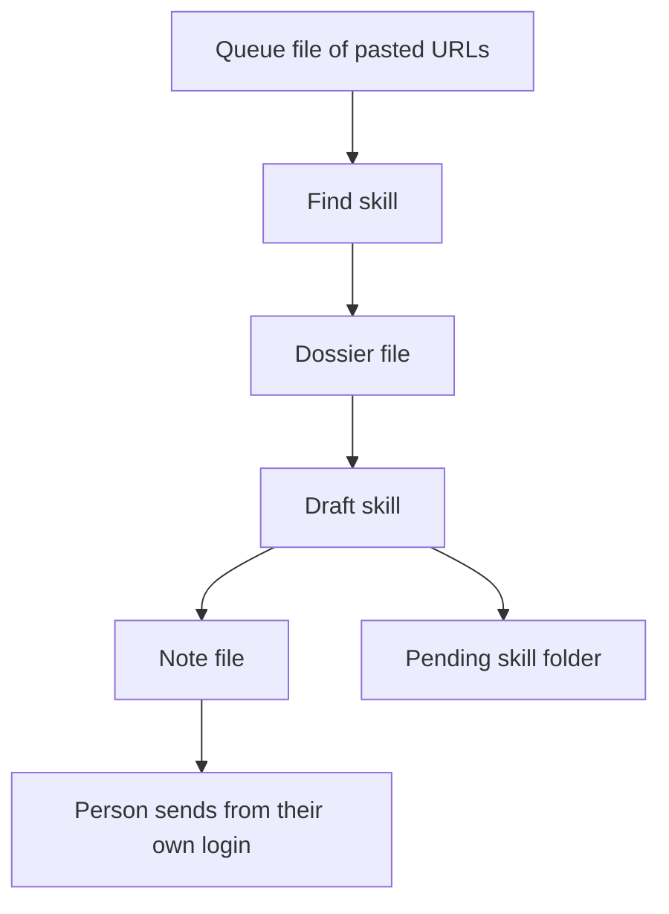

# How I Route Music Artist Outreach Through Hermes Agent

**I route music artist outreach through Hermes Agent by putting the note in a file for a person to send.** I keep find and draft on one profile. I keep the send outside that profile. I will not give a scheduled job room to learn a new step and use it on someone else's inbox.

I am William Spurlock, an AI Systems Architect and Fractional AI CTO at Spurlock Studios LLC. I have built 600+ automations, 500+ of which are still live, across 20,000+ hours spent architecting agentic systems. The work has saved clients 35,000+ hours. Those hours say nothing about the reply rate for this route. I will not invent one.

This page covers the route once you know which desk owns the job. I compare the options on [Hermes Agent versus OpenClaw versus Agent Zero](/blog/hermes-openclaw-agent-zero-decision-framework). I make the one-job pick in [how I pick Pi, Hermes, Agent Zero, or Abacus for one job](/blog/pi-vs-hermes-vs-agent-zero-vs-abacus-hermes-openclaw-the-autonomous-h%61rness-deci). If you will not run the computer, stop here and follow [the Abacus Hermes and OpenClaw setup](/blog/abacus-s-built-in-hermes-openclaw-setup-the-two-agent-h%61rness-most-people-are-sl). This route requires you to administer the machine because you must own the skill files.

## How do I route music artist outreach through Hermes Agent?

**I put two skills and an outbox folder on one Hermes Agent profile, then keep the send on a login that profile never opens.** The find skill reads only URLs a person has pasted. The draft skill produces one note file. A person either sends that note or deletes it.

Hermes Agent is Nous Research's self-improving agent. According to the [skills page](https://hermes-agent.nousresearch.com/docs/user-guide/features/skills), read November 2, 2026, skills are procedures stored in `~/.hermes/skills/`. The skills follow the agentskills.io open standard. That page also says memory carries short facts into every session, while a skill contains the longer procedure loaded only when relevant. I build the entire route around that split.

<table>
  <thead>
    <tr>
      <th>Stop</th>
      <th>What it is allowed to write</th>
      <th>Who sends</th>
    </tr>
  </thead>
  <tbody>
    <tr>
      <td>Find</td>
      <td>A dossier file, one block per pasted URL</td>
      <td>Nobody</td>
    </tr>
    <tr>
      <td>Draft</td>
      <td>One note file for that dossier</td>
      <td>Nobody</td>
    </tr>
    <tr>
      <td>Send</td>
      <td>Nothing inside the profile</td>
      <td>A person, from a login the profile does not have</td>
    </tr>
  </tbody>
</table>

This is the folder I want on disk:

- `queue.txt` holds public URLs a person chose, one per line. `https://example.com/artists/north-room` is the shape. It is an example, not a client.
- `dossier.md` is the find skill's output. If a page is not public, the line says not public, and the skill stops on that URL.
- `note.md` is the draft. Three sentences is my cap, not a Hermes limit. The first line names the platform. The URL from the queue is in the note.
- The day's folder sits outside `~/.hermes/skills/`. A skill rewrite must not be able to mix yesterday's names into the procedure.

I leave out four additions commonly mistaken for "the rest of the pipeline":

1. A Spotify URL as the start. This page does not scrape a catalog, and it does not log into a distributor.
2. A logged-in browser on the cron job. The [cron page](https://hermes-agent.nousresearch.com/docs/user-guide/features/cron), read November 2, 2026, says a scheduled tick has nobody sitting there to answer a login prompt. I do not put the outreach profile in that situation.
3. A second Hermes process on the same profile. The [profiles page](https://hermes-agent.nousresearch.com/docs/user-guide/profiles), read the same day, says two processes on one home compound memory until it is no longer what you configured.
4. A reply-rate target. I do not have one to publish, and a skill file is the wrong place to store a wish.

The pending folder is the point of the last arrow. A correction becomes a staged skill write. It does not become a sent message.

## What breaks if Hermes Agent can rewrite the outreach skill and also send the note?

**The next session can grow a send step you did not read, because skill writes are free unless you turn the gate on.** The [skills page](https://hermes-agent.nousresearch.com/docs/user-guide/features/skills) says `skills.write_approval` defaults to false. False means the agent writes skills freely, including from the background review that runs after a turn. True stages every skill write under `~/.hermes/pending/skills/`.

That default works when the skill is a checklist for files I already own. It becomes unsafe when the same profile can reach a send tool. A correction such as "shorter, and do not mention the last single" belongs as a rule in the draft skill. With the gate off, the background review can write that rule along with anything else it believes it learned. I do not see the result until the next run.

<table>
  <thead>
    <tr>
      <th>Setting</th>
      <th>Default on November 2, 2026</th>
      <th>What I set on the outreach profile</th>
    </tr>
  </thead>
  <tbody>
    <tr>
      <td>Skill writes</td>
      <td>Free, including the background review</td>
      <td>Approval on. Staged files, then I approve or reject</td>
    </tr>
    <tr>
      <td>Memory writes</td>
      <td>Free, same background review</td>
      <td>Approval on. A wrong guess about my voice should wait</td>
    </tr>
    <tr>
      <td>Cron dangerous commands</td>
      <td>Deny</td>
      <td>Leave it on deny. Do not flip it so the job can "just finish"</td>
    </tr>
    <tr>
      <td>Content scanner on new skills</td>
      <td>Off</td>
      <td>Optional. It is not the approval gate</td>
    </tr>
  </tbody>
</table>

The breaks I actually care about:

1. The draft skill learns a send command because a chat once said "go ahead and send it." The [skills page](https://hermes-agent.nousresearch.com/docs/user-guide/features/skills) says the agent records a workflow when you correct it. "Go ahead" is a correction. It should not be a tool.
2. Artist names pile into memory until the send ban no longer fits. The [memory page](https://hermes-agent.nousresearch.com/docs/user-guide/features/memory) caps MEMORY.md at 2,200 characters, about 800 tokens, and USER.md at 1,375 characters, about 500 tokens. Memory does not auto-compact. A write that would pass the cap returns an error instead of dropping a line for you.
3. Two writers share the profile. The memory page says not to point two agent processes at the same Hermes home. The writes compound into state neither process authored.
4. You treat the content scanner as a substitute for reading the diff. The [configuration page](https://hermes-agent.nousresearch.com/docs/user-guide/configuration), read November 2, 2026, says `skills.guard_agent_created` defaults to false, and the skills page says that scanner is independent of the write-approval gate.

The frozen snapshot makes this sharper. Both memory files are injected at session start and stay fixed for that session, on purpose, so the prefix cache holds. A save during the session hits disk immediately and shows up in the next session, not in this one. If I tighten the send ban and then trust the chat that is already open, I am reading the old ban.

I want the gate on before the first real queue. Turning it on after the skill has already grown a send step means I am reviewing history, not preventing it.

## How do I split find, draft, and the send on one Hermes Agent profile?

**Find writes the dossier, draft writes the note, and the send is a person at a keyboard the profile cannot reach.** I create one profile for this job. The [profiles page](https://hermes-agent.nousresearch.com/docs/user-guide/profiles) says `hermes profile create` plus a name gives that profile its own config, memory, skills, sessions, and cron jobs. I use the name `outreach` on my desk. Yours can differ. What cannot differ is the count: one profile for this route, and no second process pointed at it.

<table>
  <thead>
    <tr>
      <th>Store</th>
      <th>What belongs there</th>
      <th>What I keep out</th>
    </tr>
  </thead>
  <tbody>
    <tr>
      <td>MEMORY.md</td>
      <td>The send ban, in one or two sentences, so every fresh session sees it</td>
      <td>Artist names, dates, and the text of a note I already sent</td>
    </tr>
    <tr>
      <td>USER.md</td>
      <td>How I want a note to sound. Short. No hype words. No fake familiarity</td>
      <td>A list of people. That list is the queue file</td>
    </tr>
    <tr>
      <td>Find skill</td>
      <td>Read the queue. Write the dossier. Stop when a URL is not public</td>
      <td>A search for an email address. A compose window</td>
    </tr>
    <tr>
      <td>Draft skill</td>
      <td>Read the dossier. Write `note.md`. Stop</td>
      <td>Any instruction that posts, emails, or replies</td>
    </tr>
    <tr>
      <td>Day folder</td>
      <td>Today's queue, dossier, and note</td>
      <td>The skill text itself</td>
    </tr>
  </tbody>
</table>

The order I use:

1. Create the profile and leave the default home alone. A work profile reads `~/.hermes/profiles/work/memories/`, not the default `~/.hermes/memories/`. The outreach profile follows that same pattern under its own name.
2. Write the send ban into memory with the approval gate already on. The [memory page](https://hermes-agent.nousresearch.com/docs/user-guide/features/memory) says `memory.write_approval` defaults to false. Interactive CLI prompts inline when it is true. Messaging sessions and the background review stage writes for `/memory pending`, then `/memory approve` or `/memory reject`.
3. Start a new session after that save. The snapshot you are in will not show the ban until you do.
4. Add the find skill and the draft skill with `skills.write_approval` true. Review with `/skills pending` and `/skills diff`. Approve one skill at a time. The diff on a messaging platform is truncated. I read the full diff in the CLI, or in the pending JSON under `~/.hermes/pending/skills/`.
5. Put the day's folder path in the draft skill, not in a pile of memory lines. The memory page says a fact you need on every run of a procedure often belongs in the skill, because the skill does not spend the 2,200-character budget.
6. After the procedure has survived a few real corrections, lock the draft skill. `hermes curator lock` plus the skill name keeps it readable. The skills page says `skill_manage`, `write_file`, `patch`, and `terminal` then refuse to change it. My own edits still work. Lock is per skill. A brand-new skill can still appear, which is why the gate stays on.

A skill is a rule, not a diary. The skills page says a pitfall is a generalizable rule plus why, stated once. Incident narration, dates, and quoted chat are not skill content. "North Room liked the second sentence on Tuesday" does not belong in the skill. "Do not open with a compliment about a song you have not named" does.

`/learn` will author a skill for you, and the same page says the house standard is a description of 60 characters or fewer. The linter warns, and does not block, when a SKILL.md body passes about 24,000 characters, or when reference files pass 60. I still do not let `/learn` invent the send boundary. I write that boundary myself, then let later corrections stage against it.

The dossier block I want for each URL is short:

- The URL, copied from the queue, not guessed.
- Public page, or not public.
- The name as printed on that page.
- One sentence on what the page actually says they do.
- Nothing about how likely they are to answer. I do not know that, and the file should not pretend.

The note file then has the platform, the URL, and the three sentences. If I cannot say the middle sentence without inventing a personal detail, the note is not ready, and the skill's job is to leave a blank, not to fill it.

## How do I schedule a Hermes Agent draft without posting it?

**I attach the draft skill, deliver the run to local files, limit the job to the file toolset, and leave cron dangerous-command handling on deny.** The [cron page](https://hermes-agent.nousresearch.com/docs/user-guide/features/cron) says a job can attach zero, one, or more skills, and each run is a fresh session. Fresh matters. The job loads the memory snapshot from disk at the start of that session. It does not inherit the chat I happen to have open.

<table>
  <thead>
    <tr>
      <th>Job field</th>
      <th>What I set</th>
      <th>Why</th>
    </tr>
  </thead>
  <tbody>
    <tr>
      <td>Skills</td>
      <td>The draft skill, and the find skill only if this run is allowed to read the queue</td>
      <td>The prompt stays the task. The procedure stays in the skill</td>
    </tr>
    <tr>
      <td>Delivery</td>
      <td>`local`</td>
      <td>Output goes to files on the machine. It does not go to an artist</td>
    </tr>
    <tr>
      <td>Toolsets</td>
      <td>File on the draft job. File and web on a find job, with the queue as the only URL list</td>
      <td>The cron page's own tight example is web plus file, with terminal and browser left off</td>
    </tr>
    <tr>
      <td>Dangerous commands</td>
      <td>Deny, the default</td>
      <td>A headless run must not approve itself</td>
    </tr>
  </tbody>
</table>

Delivery is where people get loose. On the cron page, read November 2, 2026:

- `origin` sends the output back to the chat where the job was created. That is the default on messaging platforms. It is my chat, if I created it there. It is still not the artist's inbox, and I do not want the draft sitting in a months-long thread.
- `local` saves under `~/.hermes/cron/output/`. That is the default on the CLI. I use this. The note I actually read is still `note.md` in the day folder. The cron output is the run record.
- A platform name, or `all`, fans out to a connected channel. I do not use those for this job. A home channel is still a send, even when the channel is mine. I want a file.

The [security page](https://hermes-agent.nousresearch.com/docs/user-guide/security) says `approvals.mode` defaults to smart, the approval timeout defaults to 300 seconds, and `cron_mode`, `single_query_mode`, and `unattended_mode` default to deny. Deny means a dangerous command in that context is blocked, and the agent has to find another path. Approve means those commands are auto-approved in that context. I leave `cron_mode` on deny. Flipping it to approve so a nightly draft can run shell commands is how a file-only job stops being file-only.

Toolsets are a separate switch, and I set them on the job. The cron page says the job's `enabled_toolsets` wins when it is set. Otherwise the cron platform's toolset from `hermes tools` wins. The documented tight example is web and file, explicitly without terminal or browser. My draft job is tighter than that example: file only. The find job may include web, and the skill text says a URL that is not in `queue.txt` is a failed run, not a research lead. The toolset will not enforce that sentence. The week-later check does.

A few storage facts I do not want to rediscover at midnight:

- Jobs are stored in `~/.hermes/cron/jobs.json` under the active home. Run output goes to `~/.hermes/cron/output/{job_id}/{timestamp}.md`.
- The cron page says not to patch `jobs.json` by hand. Direct edits can fail silently when write safety blocks the path. I use `hermes cron edit`, `/cron`, or the cron tool.
- A job that was mid-run when the machine restarted is marked unknown in the execution ledger. It is not automatically retried. The next scheduled tick still fires. For this route that means a missed file, not a second send I did not ask for.
- Cron doctor reports a `next_run_at` that is missing, or parked in the past beyond a 15-minute ticker grace window. That is the "it quietly stopped" signal. I read it before I assume the outbox is current.

The prompt on the job is one task sentence: read today's queue, write the dossier if this is the find run, write the note, stop. I do not paste the skill body into the prompt. The cron page says the attached skill loads the way it does in a chat. Duplicating it in the prompt gives me two copies, and the next edit will update one of them.

## How do I check a week later that Hermes Agent still only drafts outreach?

**I open the note file, the pending folder, and cron doctor. A send tool on the job is a fail even when no note went out.** The absence of a sent message is not the test. The test is whether the profile could have sent one without me.

<table>
  <thead>
    <tr>
      <th>What I open</th>
      <th>Pass</th>
      <th>Fail</th>
    </tr>
  </thead>
  <tbody>
    <tr>
      <td>`note.md`</td>
      <td>Platform, URL from the queue, three sentences, no send instruction</td>
      <td>A line that says sent, posted, or replied</td>
    </tr>
    <tr>
      <td>Dossier versus queue</td>
      <td>Every URL in the dossier is a line in `queue.txt`</td>
      <td>A URL the queue does not contain</td>
    </tr>
    <tr>
      <td>`~/.hermes/pending/skills/`</td>
      <td>Empty, or a diff I have read</td>
      <td>A staged write I approved without reading, or a send step in the gist</td>
    </tr>
    <tr>
      <td>The draft skill on disk</td>
      <td>Still ends at the note file. Locked, if I already locked it</td>
      <td>A new step that reaches a browser, a mailbox, or a chat API</td>
    </tr>
    <tr>
      <td>Job toolsets and `cron_mode`</td>
      <td>Draft job is file only. `cron_mode` is still deny</td>
      <td>Browser, terminal, or approve-on-cron "just for this week"</td>
    </tr>
    <tr>
      <td>Cron doctor</td>
      <td>The job is firing, or it is honestly paused</td>
      <td>A next run parked past the 15-minute grace, and an outbox I thought was fresh</td>
    </tr>
  </tbody>
</table>

The week-later pass I actually run:

1. Read `note.md` before I read the chat log. The file is the artifact. The chat is how it got there.
2. Diff the dossier URLs against `queue.txt`. One extra URL means the find skill went browsing.
3. Open `/skills pending` and `/memory pending`. Reject anything that names a person, a date, or a send.
4. Read the draft skill's last step out loud. If I cannot say it without a verb that delivers a message, the skill is wrong.
5. Confirm I still have one process on that profile. A gateway ticking cron is the scheduler. A second chat on the same home is the second writer the profiles page warns about.
6. If the computer was never mine to run, this check is the wrong page. The Abacus setup is the other door, and it still does not get a send tool "because the VM is temporary."

I also look at memory size. The memory page shows the cap in the prompt block, and the tool errors when a write would pass it. If MEMORY.md is full of names, the next save of the send ban can fail until I remove those names. That is a fail even when the note file looks clean.

A paused job is a pass. A job that "succeeded" by writing a note I would not say out loud is a fail. I would rather delete the note on night one than discover on night eight that the skill now believes the send is part of done.

## FAQ

**These are the checks I want answered from the Hermes Agent docs before the first queue file exists.**

### Where does a Hermes Agent outreach profile store skills and memory?

**Skills live in `~/.hermes/skills/` under that profile's home, and memory lives in that home's `memories` directory.** The default profile uses `~/.hermes/memories/`. A named profile does not share it. The [profiles page](https://hermes-agent.nousresearch.com/docs/user-guide/profiles), read November 2, 2026, gives each profile its own skills, memory, and cron jobs. I keep the outreach route on one of those homes and I do not also write the same skills into the default home.

### What happens when a Hermes Agent memory write would pass 2,200 characters?

**The memory tool returns an error. It does not drop an older line to make room.** The [memory page](https://hermes-agent.nousresearch.com/docs/user-guide/features/memory) caps MEMORY.md at 2,200 characters and USER.md at 1,375, and it says memory does not auto-compact. A patch that makes an entry longer can overflow too. For this route, artist names do not get a seat in that budget. The send ban does.

### Does Hermes Agent approve its own skill writes by default?

**No. The default is the opposite of approval. `skills.write_approval` is false, and false means the agent writes skills freely, including from the background review.** The [skills page](https://hermes-agent.nousresearch.com/docs/user-guide/features/skills), read November 2, 2026, says true is what stages every create, edit, patch, delete, and supporting-file write. I turn that on for the outreach profile before the first real note. The content scanner is a different switch, and it defaults to off.

### Where does Hermes Agent stage a skill write when write approval is on?

**Staged skill writes sit in `~/.hermes/pending/skills/` and survive a restart.** I list them with `/skills pending`, read `/skills diff` in the CLI, then `/skills approve` or `/skills reject`. The skills page says a messaging client shows a one-line gist and a truncated diff, so the full text is the pending file or the CLI. I do not approve a gist that I have not opened.

### What does locking a Hermes Agent skill refuse to change?

**`hermes curator lock` leaves the skill readable, and `skill_manage`, `write_file`, `patch`, and `terminal` refuse to change it.** The [skills page](https://hermes-agent.nousresearch.com/docs/user-guide/features/skills) says my own edits still work, and the lock holds in every kind of session. I lock the draft skill after the send boundary has stayed put through real corrections. Lock does not cover a different skill the agent creates tomorrow, so the approval gate stays on.

### What does Hermes Agent do when a cron job hits a dangerous command?

**With the default `cron_mode` of deny, it blocks the command, and the agent has to find another path.** The [security page](https://hermes-agent.nousresearch.com/docs/user-guide/security), read November 2, 2026, says `approve` auto-approves dangerous commands in cron context. The same page sets the approval timeout default at 300 seconds, and it sets `single_query_mode` and `unattended_mode` to deny as well. I do not switch the outreach job to approve so a draft can shell out.

### Which tools should a Hermes Agent outreach cron job be allowed to use?

**The draft job gets the file toolset only. A find job may add web, and only for URLs already in the queue file.** The [cron page](https://hermes-agent.nousresearch.com/docs/user-guide/features/cron) says `enabled_toolsets` on the job wins, and its tight example is web plus file without terminal or browser. I go tighter on the draft. A browser that is already logged into a social account is a send path, even if today's prompt says not to use it.

### Where does a Hermes Agent cron job put output when delivery is local?

**Local delivery writes the run record under `~/.hermes/cron/output/`, and the cron page stores the file at `~/.hermes/cron/output/{job_id}/{timestamp}.md`.** That record is not the note. The note is `note.md` in the day folder the skill was told to use. Jobs themselves live in `~/.hermes/cron/jobs.json` under the active home. I edit them with the cron commands, not by hand, because a blocked write can fail silently.

### Does a Hermes Agent memory save show up in the same session?

**No. The save hits disk immediately, and the system prompt keeps the snapshot from session start.** The [memory page](https://hermes-agent.nousresearch.com/docs/user-guide/features/memory) says this is intentional, so the prefix cache holds. Tool replies can show the live memory. The prompt block will not, until the next session. I start a new session after I approve the send ban, and only then do I trust a fresh cron run to see it.

### Can two Hermes Agent processes share one outreach profile?

**No. The profiles page says never to point two agent processes at the same profile, because both write memory and each one loads the other's writes next session.** The [memory page](https://hermes-agent.nousresearch.com/docs/user-guide/features/memory) says the same thing about one Hermes home. A gateway that ticks cron is the scheduler for that home. Opening a second chat against it is the second writer. If two jobs need shared facts, the docs point to an external memory provider, not a shared home.

## Book a custom agent build

**Bring the outbox: the queue file, the note file, and the one sentence the profile is not allowed to do.** I am William Spurlock. I do this work at Spurlock Studios LLC. On a [custom agent build](/contact) I will tell you whether Hermes Agent should own that route, which skill gets locked, and which login stays outside the profile. If the sentence cannot be false on a file I can open, I send the folder back before I talk about schedules.
