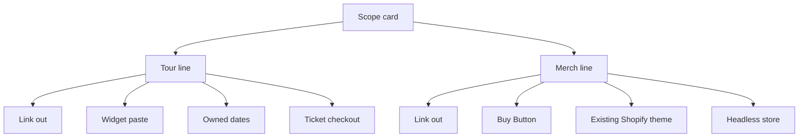

# Scoping a 5-Figure Music Artist Site Without Underbidding: The Intake That Catches Tour + Merch Scope

**I scope a 5-figure music artist site so tour and merch do not hide in the quote by refusing to name a number until two lines are filled.** One line is tour. One line is merch. A blank line is not a page I add in week three. It is a second product with its own bill.

I am William Spurlock, AI Systems Architect and Fractional AI CTO at Spurlock Studios LLC. I have built 600+ automations, 500+ of them still live, across 20,000+ hours architecting agentic systems. That work has saved clients 35,000+ hours. Those hours are not a website fee, and I will not invent a client, a ticket total, or a shirt margin to make this card sound finished.

I explain the fee math for a 5-figure web project in [how I price a 5-figure web project](/blog/pricing-5-figure-web-projects-value-scoping). I show the call where I use a card in [the discovery call I use before a custom site](/blog/discovery-call-template-5-figure-web). Neither piece forces an answer on the two lines I cover here. A color system and a finished artist site come after the lines. They do not replace them.

## How do I scope a 5-figure music artist site so tour and merch do not hide in the quote?

**I put a scope card on the table and I leave the fee blank until the tour line and the merch line each have one closed answer.** "A website" is not an answer. "We'll figure dates out" is not an answer. I need a choice from the closed set, not another description of the site.

<table>
  <thead>
    <tr>
      <th>Line</th>
      <th>Closed answers</th>
      <th>What I send back</th>
    </tr>
  </thead>
  <tbody>
    <tr>
      <td>Tour</td>
      <td>none, link out, widget, owned list</td>
      <td>A blank, a "later," or "sell tickets on the site"</td>
    </tr>
    <tr>
      <td>Merch</td>
      <td>none, link out, Buy Button, existing Shopify theme</td>
      <td>A blank, a dead URL, or "a shop that matches the site"</td>
    </tr>
    <tr>
      <td>Who updates it</td>
      <td>A named person and the login they already have</td>
      <td>"Someone on the team"</td>
    </tr>
    <tr>
      <td>Stop</td>
      <td>Both lines picked from the closed set</td>
      <td>A paragraph where an answer should be</td>
    </tr>
  </tbody>
</table>

I follow four rules every time I fill out this card:

- The example shape is `https://example.com/tour` and `https://example.com/merch`. I do not paste a real artist's URL into a public page.
- Link out means I opened the URL the same day. A 404 is not a link. I wrote that failure mode up in [why a dead merch URL keeps getting cited](/blog/chatgpt-is-sending-fans-to-last-years-tour-and-a-dead-merch-link).
- Widget means a script the host allows. It does not mean I retype the dates into my own list.
- Buy Button means they already pay for Shopify and a supported gateway. It does not mean I design a new store.



Owned dates, ticket checkout, and a headless store sit on the diagram so I can point at them and say no. They are not answers I fold into the site fee. My opinion is blunt: the default answer on both lines is link out. A widget or a Buy Button is the middle, and only when the account already exists. Anything that needs a new checkout is a second project.

The build instruction I hand over after the card is short:

```text
Build only the pages named on the scope card.
Tour answer: widget. Paste the embed they already use on /tour. Do not invent dates. Do not add a checkout.
Merch answer: link. One link to the store URL written on the card. Do not add a cart, a product grid, or a card field.
If a page is not on the card, do not create it.
```

I use that instruction to hold the boundary. It is not a design pass. Type, motion, and cover art wait until the lines are real.

## What gets left out of a music artist site quote when the tour line and the merch line are blank?

**A blank pair of lines hides a store subscription, a card rate, and a dates system that I do not control.** I can still quote the homepage as a 5-figure site. Leave those lines open, and one job can turn into two after the deposit.

I read [Shopify's pricing page](https://www.shopify.com/pricing) on November 3, 2026. These are the USD figures on that page that day. The same FAQ says pricing and payment options can differ by country, and that Shopify Payments exists only in certain countries. I do not convert them.

<table>
  <thead>
    <tr>
      <th>Plan, as listed that day</th>
      <th>Billed monthly</th>
      <th>Billed yearly, per month</th>
      <th>Why it is not my site fee</th>
    </tr>
  </thead>
  <tbody>
    <tr>
      <td>Basic</td>
      <td>$39 USD</td>
      <td>$29 USD</td>
      <td>Their store bill, ongoing</td>
    </tr>
    <tr>
      <td>Grow</td>
      <td>$105 USD</td>
      <td>$79 USD</td>
      <td>Same, plus the staff count on the hero</td>
    </tr>
    <tr>
      <td>Advanced</td>
      <td>$399 USD</td>
      <td>$299 USD</td>
      <td>Same, and the hero includes live third-party shipping rates</td>
    </tr>
    <tr>
      <td>Plus</td>
      <td>Starts at $2,300 USD</td>
      <td>Not listed as a yearly rate on that table</td>
      <td>A commerce contract, not a page</td>
    </tr>
  </tbody>
</table>

The page also showed a trial of 3 days free, then $1 per month for 3 months. The FAQ says most plans start at $1 per month for the first 3 months, then move to standard pricing. I write the standard monthly figure on the card. I do not write the promo. A promo is a Shopify offer with an end. My quote should not pretend the store stays at $1.

Other bills on that same page, none of which are a line item in my design fee:

1. Online standard card rates were 2.9% + 30¢ on Basic, 2.7% + 30¢ on Grow, and 2.5% + 30¢ on Advanced. That is per sale.
2. Third-party transaction fees were 2% on Basic, 1% on Grow, and 0.6% on Advanced. The FAQ says those fees can apply when a third-party provider is used instead of Shopify Payments, and that there are no setup fees on any plan. No setup fee is not a free store.
3. The Grow description says up to 5 staff accounts. The Advanced description says up to 15. The comparison table lists additional staff accounts as 5 on Grow and 15 on Advanced. I ask how many people need a login. I do not assume one shared password.
4. The advanced tax platform is marked Add on for Basic, Grow, Advanced, and Plus. Tax math they want beyond the included tools is an add-on, not a paragraph on the homepage.
5. Build headless storefronts is listed as 1 on Basic, Grow, and Advanced, and 25 on Plus. The number 1 is a cap, not a promise that a custom store is a section.
6. Checkout customization is Limited on Basic, Grow, and Advanced, and Full on Plus. "Make checkout look like the album" is a Plus conversation or a false promise.
7. POS Pro is listed at $89 USD per month per location on Basic, Grow, and Advanced. A merch table at a show is that bill. It is not a page on the site.
8. The comparison table marks third-party calculated shipping rates as an add-on on Grow. I do not promise a live carrier rate on a plan that lists it as an add-on.

[Shopify's Buy Button help](https://help.shopify.com/en/manual/online-sales-channels/buy-button), which I also read on November 3, 2026, says the channel is included in all subscription plans. Inclusion is not the same thing as "already set up." The page says you need a supported payment gateway. No gateway means the merch line cannot say Buy Button yet.

That help page also says Shopify is not the place to paste a Buy Button onto its own online store or blog, because the button can cause problems with checkout. The suggested substitute there is a permalink that pre-loads the cart. If their "site" is already a Shopify theme, the merch answer is the theme. Pasting a button into that theme is the move Shopify tells you not to make.

The pricing FAQ says the Buy Button can sit on an external website or blog, with checkout on Shopify Checkout. I write the middle answer this way: their store, my page, their checkout. The pricing FAQ also says Shopify is certified Level 1 PCI DSS compliant, and that stores powered by Shopify are PCI compliant by default. I use that as a boundary. I do not put a card field on the artist site.

A blank tour line hides a different bill. Bandsintown and Songkick widgets are free to paste relative to a store plan, and they are still a product: an account, a listing, and a host that allows the script. An owned dates page is a content system plus the markup rules below. None of that is "a nav item called Tour."

## How do I fill the tour line and the merch line before I name a number?

**I force each line into one closed answer, then I write the login and the URL on the same line.** A sentence about vibes does not survive this pass. If they cannot pick, I do not invent the pick for them.

<table>
  <thead>
    <tr>
      <th>What I ask</th>
      <th>A finished line</th>
      <th>An unfinished line</th>
    </tr>
  </thead>
  <tbody>
    <tr>
      <td>Where does a fan buy a ticket today?</td>
      <td>widget, Songkick, manager, manual approval off</td>
      <td>"We'll add dates on the site"</td>
    </tr>
    <tr>
      <td>Where does a fan buy a shirt today?</td>
      <td>link, a URL I opened, artist pays the store</td>
      <td>"Somewhere on Instagram"</td>
    </tr>
    <tr>
      <td>Who changes a price or a date next month?</td>
      <td>A name, and the product they log into</td>
      <td>"The internet team"</td>
    </tr>
    <tr>
      <td>What happens if the host blocks scripts?</td>
      <td>The tour line flips to link out</td>
      <td>"You'll make the widget work"</td>
    </tr>
  </tbody>
</table>

The order I actually use:

1. Open the ticket URL they name. If the only answer is "our site should sell them," I stop. That is a box office.
2. Open the shirt URL they name. If it 404s, the merch line is not link out. I say so on the card.
3. Pick the tour answer from the closed set. Widget requires the account they already use, Bandsintown or Songkick, not a new calendar I type by hand.
4. Pick the merch answer from the closed set. Buy Button requires a Shopify plan and a supported gateway they already have.
5. Write the human. Tour updates and merch prices are their job after launch, unless the line explicitly says I am pasting a one-time embed and nothing else.
6. Read the stop line out loud. If either product line is still a sentence, there is no fee on the card.

Bandsintown's help article [Set up your Widget](https://help.artists.bandsintown.com/en/articles/7053415-set-up-your-widget), dated April 17, 2023, says you customize the widget, click Copy Code, and add it to the site. Their own example is the artist URL `https://www.bandsintown.com/a/1025408`, and they say to use `ID_1025408` rather than the name The Head and The Heart when the name fails. I am repeating their example, not naming one of my clients. The same article says old Bandsintown code, including in the header, can break the widget, so a "new widget" job includes deleting the old one.

Songkick's article [Add concerts to your website with the Tourbox widget](https://support.songkick.com/hc/en-us/articles/360012785073-Add-concerts-to-your-website-with-the-Tourbox-widget), updated August 2, 2023, says the widget shows events you listed on Songkick, and that adds and edits in Tourbox update the site. The path they give is Tourbox, then Integrations, then Your website, then paste the HTML. [What is Tourbox?](https://support.songkick.com/hc/en-us/articles/360012565733-What-is-Tourbox), updated January 31, 2024, says one user account can manage multiple artist pages, and that Event Approval can be set to Manual in Settings so dates do not hit the site on their own. If a manager runs three acts, I write the artist page on the line. The wrong ID is a wrong tour.

[How to add events to Songkick with Tourbox for artists](https://support.songkick.com/hc/en-us/articles/360012785193-How-to-add-events-to-Songkick-with-Tourbox-for-artists), updated March 11, 2024, says you can add events, edit them, and add ticket links from that artist's events list. It also says changes for popular artists might need Songkick's approval, and that they normally take 5 working days. After approval, the widget shows the change, and Songkick sends the events to partners including Deezer, Bandcamp, and Soundcloud. I do not promise same-day dates on a widget when their own article says a popular act can wait.

On the merch side, the Buy Button page says updates in the Shopify admin show on the button. A price change is an admin edit, not a code change from me. That boundary lets me keep a Buy Button inside this quote. A new theme, a new product model, or a headless storefront cannot.

## Which tour and merch answers stay a link, and which ones are a second project?

**Link out, a widget paste, and a Buy Button on a non-Shopify site stay in the quote. An owned dates system, a headless store, and any ticket checkout do not.** I would rather lose the job than bury a store inside a homepage fee.

<table>
  <thead>
    <tr>
      <th>Answer on the card</th>
      <th>Stays in this quote</th>
      <th>What I am actually shipping</th>
    </tr>
  </thead>
  <tbody>
    <tr>
      <td>Tour: none</td>
      <td>Yes</td>
      <td>No tour page</td>
    </tr>
    <tr>
      <td>Tour: link out</td>
      <td>Yes</td>
      <td>One link to a URL I opened</td>
    </tr>
    <tr>
      <td>Tour: widget</td>
      <td>Yes</td>
      <td>One page that can run their script, old embed removed</td>
    </tr>
    <tr>
      <td>Tour: owned list</td>
      <td>No</td>
      <td>A dates system and Event markup, scoped alone</td>
    </tr>
    <tr>
      <td>Tour: we sell tickets</td>
      <td>No</td>
      <td>Not this quote. I do not build the box office</td>
    </tr>
    <tr>
      <td>Merch: none</td>
      <td>Yes</td>
      <td>No shop link</td>
    </tr>
    <tr>
      <td>Merch: link out</td>
      <td>Yes</td>
      <td>One working store URL</td>
    </tr>
    <tr>
      <td>Merch: Buy Button</td>
      <td>Yes, if the plan and gateway already exist</td>
      <td>Embed on the artist site, checkout stays on Shopify</td>
    </tr>
    <tr>
      <td>Merch: existing theme</td>
      <td>Only if the job is the theme</td>
      <td>Their Shopify store, not a second marketing site plus a button</td>
    </tr>
    <tr>
      <td>Merch: headless</td>
      <td>No</td>
      <td>A custom storefront. The pricing table's "1" is not a section</td>
    </tr>
  </tbody>
</table>

I refuse the owned list because of Google's rules, not because of taste. The [event structured data guide](https://developers.google.com/search/docs/appearance/structured-data/event) I read on November 3, 2026 says a page needs three required properties before it can be eligible for an event result: `location` as a Place with `location.address` and `location.name`, `name`, and `startDate` in ISO-8601. The name must not be the venue. Google's guide says not to use a generic type such as Concert as the name, and not to put a price or a short-term promo in the name. If you omit `eventStatus`, Google treats the event as EventScheduled. If the show is canceled, you keep `startDate` and change the status. You do not delete the date to "clean it up."

The same guide says Google does not guarantee a rich result even when the markup is valid. It also says it may take several days after publishing before Google finds and crawls the page. Two cities at the same time means two events, not one event with two addresses. A date with no time means sometime that day. A `startDate` at midnight is how you mark a show that starts at midnight, which is usually a mistake. Recommended images are 1920 pixels wide, and the minimum width they name is 720. I scope those image and markup requirements as content work. It is not a nav label.

Ticket markup is stricter still. `offers.url` has to be a landing page that sells admission to that specific event to the public, it has to be a link a person can click on the event page, and it has to be crawlable. `offers.price` is the lowest price including service charges and fees. A free event uses 0. I am not going to invent a fee, and I am not going to build the page that charges one. Songkick's March 11, 2024 article already has a place for a ticket link inside Tourbox. That link points at a vendor. My page can show the widget. It does not become the vendor.

What I will ship inside the quote, once the lines are filled:

- A tour page whose only job is the answer on the line: no page, one outbound link, or one widget with the old code gone.
- A merch treatment whose only job is the answer on the line: no treatment, one outbound link, or a Buy Button on a site that is not the Shopify store.
- A note on the card naming who logs in next month.
- A build fence so the next prompt cannot grow a cart.

What I will not ship inside the quote:

1. A hand-maintained dates list with Event markup, sold as "the tour page."
2. A checkout where the artist site charges the card.
3. A headless storefront so the shop matches the homepage pixel for pixel.
4. Plus, at the $2,300 starting price I read on November 3, 2026, hidden inside a site invoice so checkout customization can say Full.
5. POS Pro at $89 per location, hidden the same way.

## How do I check the quote still matches the tour line and the merch line after a store shows up?

**I re-read the card before I touch the page, and I change the quote when the answer changed.** A store that "shows up" in week two is a new merch line. It is not a favor on the existing fee.

<table>
  <thead>
    <tr>
      <th>What they send later</th>
      <th>If the card already says</th>
      <th>What I do</th>
    </tr>
  </thead>
  <tbody>
    <tr>
      <td>A new Shopify URL</td>
      <td>Merch: none, or merch: link to a different host</td>
      <td>Rewrite the line, then the fee, then the page</td>
    </tr>
    <tr>
      <td>"Can the button match the album"</td>
      <td>Merch: Buy Button</td>
      <td>Keep the embed. Album-matched checkout is the Limited versus Full row, not a CSS tweak</td>
    </tr>
    <tr>
      <td>"Add the dates we typed in a doc"</td>
      <td>Tour: widget</td>
      <td>The doc is the owned-list project. The widget still shows Tourbox or Bandsintown</td>
    </tr>
    <tr>
      <td>A 404 on the store URL</td>
      <td>Merch: link</td>
      <td>The line fails. I do not leave a dead href in the nav</td>
    </tr>
    <tr>
      <td>An embed from before October 10, 2016</td>
      <td>Merch: Buy Button</td>
      <td>Shopify says those buttons are no longer supported. The embed gets recreated in the admin</td>
    </tr>
  </tbody>
</table>

The check I run when the file comes back:

1. Read the tour line and the merch line before I open the design file.
2. Open every URL on the card. A link answer dies on a 404.
3. Confirm the widget host still allows the script. Bandsintown's April 17, 2023 article says WordPress.com needs a Business Wordpress account for their widget, that Wordpress.org sites can run it, and that Hostbaby users have to ask Hostbaby to lift restrictions. I read that article again on November 3, 2026. I am citing the article, not a newer WordPress.com price grid.
4. Confirm manual approval is what they think it is. Manual means the site does not get the date until someone allows it.
5. If the act is popular on Songkick, leave room for the 5 working days their article names. A quiet Tuesday on the site can be their review queue, not a broken embed.
6. Confirm the Shopify login is still theirs. Admin edits show on the Buy Button, so the person who changes a price needs that login.
7. If any answer moved, I edit the card and the fee before I edit the page.

I do not keep a calendar of "check the site every Monday." I check the card when something changes. When the answer is stable, I leave it alone.

If you want a custom artist site, start with [the discovery call I use before a custom site](/blog/discovery-call-template-5-figure-web) and bring the card with both lines filled. I cover the fee conversation in [how I price a 5-figure web project](/blog/pricing-5-figure-web-projects-value-scoping), and I have it after the lines, not before. I am William Spurlock. I direct the site at Spurlock Studios. I do not name a number while a line is blank. You can reach the studio from the [contact section on my site](/#contact).

## FAQ

### Does a Bandsintown widget count as a tour page on a music artist site?

**A Bandsintown widget is a paste, not an owned tour calendar.** The [Set up your Widget](https://help.artists.bandsintown.com/en/articles/7053415-set-up-your-widget) article, dated April 17, 2023, says you copy the code onto the site, and the listing stays tied to Bandsintown. I count that as the widget answer on the tour line. I do not count it as an owned list, and I do not wrap Event markup around a script I do not control.

### Does a Songkick Tourbox widget update the artist site when a date changes?

**It updates when Tourbox updates, unless approval is set to manual, and a popular act can wait.** The [widget article](https://support.songkick.com/hc/en-us/articles/360012785073-Add-concerts-to-your-website-with-the-Tourbox-widget), updated August 2, 2023, says adds and edits in Tourbox show on the site. [What is Tourbox?](https://support.songkick.com/hc/en-us/articles/360012565733-What-is-Tourbox), updated January 31, 2024, says Manual in Settings stops the automatic post. The [add events article](https://support.songkick.com/hc/en-us/articles/360012785193-How-to-add-events-to-Songkick-with-Tourbox-for-artists), updated March 11, 2024, says popular-artist changes might need their team and normally take 5 working days before the widget shows them.

### What does WordPress.com need before a Bandsintown widget will run?

**Bandsintown's April 17, 2023 article says WordPress.com needs a Business Wordpress account for their widget.** That same article says Wordpress.org sites can run it, and that Hostbaby has to lift restrictions before the script is allowed. I treat a blocked script as a failed widget line. The tour answer flips to link out, or the host changes. It does not become a styling ticket.

### Is a Shopify Buy Button the same build as a Shopify online store?

**No. A Buy Button is an embed for a non-Shopify site, and Shopify says not to paste it onto the Shopify store itself.** The [Buy Button page](https://help.shopify.com/en/manual/online-sales-channels/buy-button) I read on November 3, 2026 says the channel is included on every subscription plan, needs a supported payment gateway, and can cause checkout problems on the Shopify store or blog. A theme, a headless storefront, and a Buy Button are three different merch answers.

### What does Shopify list as the monthly price of a store plan?

**On November 3, 2026, Shopify's [pricing page](https://www.shopify.com/pricing) listed Basic at $39 USD per month billed monthly or $29 USD per month billed yearly, Grow at $105 or $79, and Advanced at $399 or $299.** Plus starts at $2,300 USD per month on that page. The same page showed 3 days free, then $1 per month for 3 months, which is not the ongoing bill I write down. The FAQ says pricing can differ by country.

### Do I add Event markup when the dates live in a widget?

**No. Event markup belongs on an owned dates page, and that page is a second project.** A widget is a listing from Bandsintown or Songkick pasted into a page I did not author. Google's [event guide](https://developers.google.com/search/docs/appearance/structured-data/event), read November 3, 2026, requires a Place, a real event name, and a startDate on the page you mark up, and it does not guarantee a rich result. I do not invent that block around an embed.

### What does an owned tour date need before Google can treat it as an event result?

**The event guide requires a Place with a street address and a venue name, an event name that is not the venue and not the word Concert, and a startDate with a date and a time.** The guide I read on November 3, 2026 says a missing eventStatus means EventScheduled, and you keep startDate when a show is canceled. It also says Google does not guarantee the result, and that a crawl can take several days. If a ticket is part of the markup, offers.url has to sell that specific show.

### Should ticket sales sit inside a 5-figure music artist site quote?

**No. Selling the ticket is a box office, and I keep it off this quote.** Google's event guide says offers.url must be a public page that sells admission to that event, and offers.price includes service charges and fees. Songkick's March 11, 2024 article is where a ticket link goes inside Tourbox, which points at a vendor. If the tour line says the site sells tickets, I stop. I do not rename that into a widget so the quote can survive.

### Who should hold the Shopify login when merch is a Buy Button?

**The artist or the manager holds the Shopify login. I do not.** The Buy Button page I read on November 3, 2026 says product edits in the admin show on the button, so the person who changes a price needs that login. On the pricing page that day, Grow says up to 5 staff accounts and Advanced says up to 15. One shared password is not a staff plan, and it is not a login I keep.

### Does a link to last year's merch URL count as merch scope?

**A link counts only when the URL still opens a store.** A dead store URL is the failure I described in [why a dead merch URL keeps getting cited](/blog/chatgpt-is-sending-fans-to-last-years-tour-and-a-dead-merch-link). If the page 404s, the merch line is not "link." It becomes a working URL or a different closed answer, and the old href does not stay in the nav to protect an old quote.
