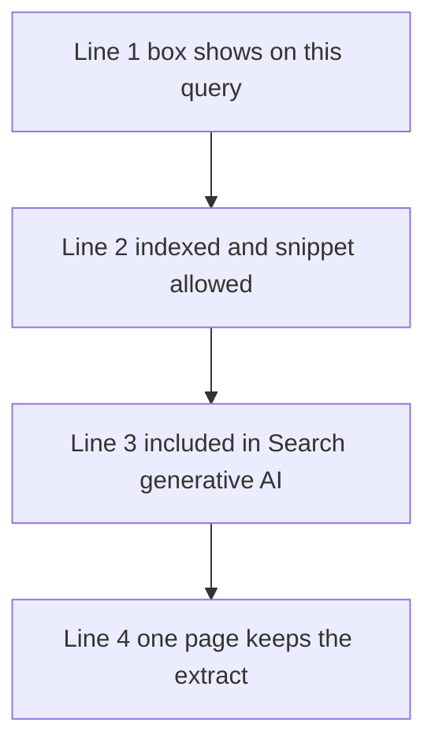

# Should I still chase featured snippets or focus purely on AI answers?

**Keep the extract when a featured snippet still shows on that query. Do not turn snippets off to focus purely on AI answers.** `nosnippet` also blocks that page as a direct input for AI Overviews and AI Mode.

I'm William Spurlock, AI Systems Architect and Fractional AI CTO at Spurlock Studios LLC. I've built 600+ automations, and 500+ are live. I've spent 20,000+ hours architecting agentic systems, and that work has saved clients 35,000+ hours. I've been SEO-certified since 2021. The same habit applies here: one query, one page, a written decision before the next edit.

The product split already lives in [featured snippet versus AI Overview](/blog/featured-snippet-vs-ai-overview-what-changed-and-what-to-do-about-it). The keep, drop, and add map for the whole program lives in [AI visibility versus traditional SEO](/blog/ai-visibility-vs-traditional-seo-what-to-keep-drop-and-add-in-2026). Schema odds live on [schema markup and AI Overview chances](/blog/does-having-schema-markup-increase-your-chances-of-appearing-in-ai-overv). This page only answers the budget question: do I spend the next edit shaping a snippet, or do I stop.

I read the source pages on 18 November 2026. I did not find a click rate, a coverage percentage, or a client story on them. I will not invent one.

## What does it mean to chase a featured snippet if I cannot mark the page?

**A chase is a page shape. It is not an application.** As read on 18 November 2026, the [featured snippets guide](https://developers.google.com/search/docs/appearance/featured-snippets) (last updated 10 December 2025) calls featured snippets special boxes where the format of a regular search result is reversed, showing the descriptive snippet first. They can also appear inside a related questions group, also known as People Also Ask. The same guide says you cannot mark a page as a featured snippet. Google systems determine whether a page would make a good featured snippet for a search, and if so, they put it in the box.

That is the whole chase. I write a passage a system can lift. I do not file a request.

<table>
  <thead>
    <tr>
      <th>What the chase is often sold as</th>
      <th>What the 10 December 2025 guide actually allows</th>
    </tr>
  </thead>
  <tbody>
    <tr>
      <td>A flag that marks this URL as the featured snippet</td>
      <td>You cannot mark the page. Systems decide, then they put it in the box.</td>
    </tr>
    <tr>
      <td>A published minimum word count for the box</td>
      <td>Google does not provide an exact minimum length. Length varies by the information, the language, and the platform.</td>
    </tr>
    <tr>
      <td>A guarantee once the paragraph is short enough</td>
      <td>A low max-snippet setting does not guarantee the box stops, and it does not guarantee the box starts.</td>
    </tr>
    <tr>
      <td>A click that always lands on a hand-placed anchor</td>
      <td>The click scrolls to the extracted section when the browser and Google's systems can do it. Otherwise it opens the top of the source page. The site does not add an annotation for that scroll.</td>
    </tr>
  </tbody>
</table>

The box is not only the strip above the blue links. I keep three places on the slip, from [Google Search Help](https://support.google.com/websearch/answer/9351707) as I read it on 18 November 2026:

- **Top of the search results.** This is the box most people mean by position zero.
- **People Also Ask.** The [visual elements gallery](https://developers.google.com/search/docs/appearance/visual-elements-gallery) (last updated 4 February 2026) says expanding a related question shows a featured snippet.
- **Beside Knowledge Graph information.** The same help page lists that placement. Usually there is one box. Sometimes there can be more.

The help page also says the box shows when Google thinks people want an answer found in a short piece of a website, including on a phone or when someone talks to the device. Policies for the box apply to what appears in the box. They do not apply to ordinary web listings, and they do not remove those listings.

I still write the short answer. I do not pretend Google published a character quota for it.

## What do I lose if I turn snippets off to focus only on AI answers?

**You lose the box, and you also lose the page as a direct input for AI Overviews and AI Mode.** As read on 18 November 2026, the [robots meta specification](https://developers.google.com/search/docs/crawling-indexing/robots-meta-tag) (last updated 24 March 2026) says `nosnippet` applies to web search, Google Images, Discover, AI Overviews, and AI Mode, and prevents the page from being used as a direct input for AI Overviews and AI Mode.

"Focus purely on AI answers" is often a proposal to disable the snippet. On Google's own rule, that proposal closes the AI door it claims to open.

<table>
  <thead>
    <tr>
      <th>Control</th>
      <th>Featured snippet</th>
      <th>Direct input for AI Overviews and AI Mode</th>
    </tr>
  </thead>
  <tbody>
    <tr>
      <td>nosnippet</td>
      <td>Blocks featured snippets and regular snippets on that page. The 10 December 2025 guide says this is the guaranteed opt-out.</td>
      <td>Blocked. The 24 March 2026 spec says the page is not used as a direct input.</td>
    </tr>
    <tr>
      <td>data-nosnippet</td>
      <td>That marked text will not appear in featured snippets or regular snippets. If nosnippet is also present, nosnippet wins.</td>
      <td>The marked section stays out of snippets. I do not treat the attribute as an AI-only mode.</td>
    </tr>
    <tr>
      <td>max-snippet set to 0</td>
      <td>Equivalent to nosnippet on the robots spec.</td>
      <td>Same closed door as nosnippet.</td>
    </tr>
    <tr>
      <td>A shorter max-snippet, above 0</td>
      <td>Less likely to be a featured snippet. Not a guarantee. No exact minimum length is published.</td>
      <td>Limits how much of the page may be used as a direct input. A license or in-page structured data can be a separate permission this limit does not interrupt.</td>
    </tr>
    <tr>
      <td>max-snippet set to -1</td>
      <td>Google chooses the snippet length.</td>
      <td>Google chooses how much text it may use as a direct input, within the spec.</td>
    </tr>
    <tr>
      <td>max-snippet 50 plus nosnippet</td>
      <td>nosnippet wins. The more restrictive rule applies.</td>
      <td>nosnippet wins here too.</td>
    </tr>
  </tbody>
</table>

The supporting-link rule is the same door, stated from the other side. The [AI features guide](https://developers.google.com/search/docs/appearance/ai-features) (last updated 10 December 2025) says a supporting link in AI Overviews or AI Mode requires a page that is indexed and eligible to be shown in Google Search with a snippet. There are no additional technical requirements. Meeting the checklist does not guarantee crawl, index, or serving.

Before anyone calls snippet-off a strategy, I walk through four consequences:

1. **The featured snippet is gone on purpose.** That includes the box at the top and the snippet inside an expanded People Also Ask question.
2. **Regular snippets go with it** when the rule is `nosnippet`, not a mild `max-snippet`.
3. **Direct AI input goes with it.** The 24 March 2026 sentence is the one I refuse to talk past.
4. **There is still no special AI project to switch on.** The same 10 December 2025 guide says there are no additional requirements to appear in AI Overviews or AI Mode, and no other special optimizations are necessary.

I will not publish `nosnippet` just to look like I moved on from snippets. That tag is a shutdown, not a pivot.

## Should I still chase featured snippets or focus purely on AI answers?

**I still chase the extract on a query where the box shows. I do not build a second page that exists only for AI answers.** The [optimization guide](https://developers.google.com/search/docs/fundamentals/ai-optimization-guide) (last updated 10 July 2026) says SEO best practices remain relevant because generative AI features on Google Search are rooted in core ranking and quality systems. From Google Search's perspective, optimizing for generative AI search is still SEO.

The same guide says eligibility needs two gates: the page is indexed and eligible to be shown with a snippet, and the site is included in Search generative AI features in Search Console. Indexing and serving are not guaranteed. AI Overviews, on the 10 December 2025 guide, show only when Google's systems decide an Overview adds something beyond classic Search, and they often do not trigger.

So "focus purely on AI answers" breaks two ways. If you turn snippets off, you fail the supporting-link gate. If you leave snippets on and write a twin URL for every related query, you can walk into scaled content abuse. The 10 July 2026 guide says creating separate pages for every variation, primarily to manipulate rankings or generative AI responses, violates that policy.

I decide on a keep slip. Four lines. One query. No percentage.

<table>
  <thead>
    <tr>
      <th>Line</th>
      <th>What I check</th>
      <th>Keep</th>
      <th>Stop</th>
    </tr>
  </thead>
  <tbody>
    <tr>
      <td>1. Box today</td>
      <td>Does this query show a featured snippet at the top, in People Also Ask, or beside the Knowledge Graph?</td>
      <td>The next edit may shape the passage the box would lift.</td>
      <td>Do not spend the edit on a box that is not on the page.</td>
    </tr>
    <tr>
      <td>2. Snippet allowed</td>
      <td>Is the URL indexed, and is it free of nosnippet and of a max-snippet of 0?</td>
      <td>The page can still be a snippet and a supporting link.</td>
      <td>Fix the control before any chase. The AI input door is shut with the box.</td>
    </tr>
    <tr>
      <td>3. Included</td>
      <td>Is the property included in Search generative AI features?</td>
      <td>The AI column is open. An Overview may still not trigger.</td>
      <td>The AI column is closed even if line 1 is a perfect box.</td>
    </tr>
    <tr>
      <td>4. One page</td>
      <td>Am I about to publish a second URL for a fan-out phrasing of the same job?</td>
      <td>One page holds the short answer and the rest of the explanation.</td>
      <td>Do not mint twin URLs to chase each related search.</td>
    </tr>
  </tbody>
</table>

Google's own fan-out example on that 10 July 2026 page is the query "how to fix a lawn that's full of weeds." The related queries listed there include "best herbicides for lawns," "remove weeds without chemicals," and "how to prevent weeds in lawn." Both AI Overviews and AI Mode may use that kind of fan-out, issuing multiple related searches and showing a wider set of links than a classic result. I would keep one lawn page. I would not publish three more URLs so each related query has a twin. That example is Google's, not a client of mine.

How I fill the slip, in order:

1. **Search the query and write yes or no on line 1.** I want to see a box, not a vendor score. The optimization guide says no third-party tool has access to Google's internal ranking or AI systems.
2. **Open the URL and the robots rules for line 2.** Indexed plus snippet-eligible is the supporting-link bar on both the 10 December 2025 guide and the 10 July 2026 guide.
3. **Check inclusion for line 3.** The optimization guide names Search Console inclusion as eligibility for generative AI features. The clocks on that control live on the schema page linked above. I do not paste a second schedule here.
4. **Circle line 4 before anyone drafts a new URL.** One page. Short answer near the heading. The rest of the answer in text a person can finish.
5. **Leave the odds blank.** The AI features guide calls clicks from results pages that include AI Overviews higher quality, meaning people are more likely to spend more time on the site. It does not print a percentage. Neither does the featured snippets guide.

A no on line 1 does not mean delete the page. It means the next edit is not a snippet sculpture. A no on line 2 means I turned off the thing I thought I was focusing on. A no on line 3 means the AI column is a settings problem, not a paragraph problem.

## How do I decide, one query at a time, whether the next edit is for the snippet?

**The next edit is for the snippet only when line 1 is yes and line 2 is open.** Every other edit is for the person who lands on the page, with snippet eligibility left intact if I still want the AI gate open.

When the box is real, I change the passage the click would land on. The 10 December 2025 guide says the click goes to that section when it can, and to the top of the page when it cannot. I put the direct answer under the heading that matches the query. I do not hide it in a tab.

When the box is absent, I stop sanding the first paragraph for a trophy that is not on the results page. The page can still earn a supporting link later. Overviews often do not trigger, so a quiet AI column is an ordinary outcome, not a failed snippet.

<table>
  <thead>
    <tr>
      <th>Slip result</th>
      <th>What the next edit is</th>
      <th>What I refuse to commission</th>
    </tr>
  </thead>
  <tbody>
    <tr>
      <td>Box yes, snippet allowed, included</td>
      <td>A direct answer under the matching heading, plus the rest of the explanation in text.</td>
      <td>A second URL written only for a fan-out phrasing.</td>
    </tr>
    <tr>
      <td>Box no, snippet allowed, included</td>
      <td>The page a buyer can finish. Snippet eligibility stays.</td>
      <td>A word-count drill aimed at a box this query is not showing.</td>
    </tr>
    <tr>
      <td>Snippet blocked</td>
      <td>Remove nosnippet or max-snippet 0 if AI input and the box both matter.</td>
      <td>A new "AI answer" draft while the robots rule still shuts the door.</td>
    </tr>
    <tr>
      <td>Not included in Search generative AI</td>
      <td>The inclusion setting on the property.</td>
      <td>More snippet copy as if it could open a closed AI column.</td>
    </tr>
  </tbody>
</table>

The 10 July 2026 guide is explicit about the shape of the page once the slip says keep:

- **There is no ideal page length.** Shorter and longer pages can both work. Make the page for the audience.
- **There is no requirement to break the page into tiny pieces.** Google's systems can use the relevant piece.
- **You do not need a special rewrite for generative AI search.** Synonyms and general meaning are enough. I still write a clear answer because a featured snippet lifts a passage, not because an AI rewrite quota exists.
- **Structured data is not the AI switch.** It is not required for generative AI search, and there is no special schema.org markup to add. Keep it when you want a rich result. That case is the schema post, not this one.
- **You do not need a new machine-readable file, an AI text file, or extra markup.** The 10 December 2025 AI features guide says the same thing.

I do not own a character count. The featured snippets guide says a lower `max-snippet` makes the box less likely and still does not guarantee it disappears. Anyone selling a 40-word or 60-word rule as a Google number is selling a number I did not find on 18 November 2026.

## How do I tell a featured snippet apart from an AI Overview in Search Console?

**They are different elements, with different position math, and the Generative AI report's included list does not name featured snippets.** I do not average them into one "AI answers" row and call the strategy done.

As read on 18 November 2026, [Search Console help on impressions, position, and clicks](https://support.google.com/webmasters/answer/7042828) says a featured snippet displays information extracted from a single specific web page and includes a link to that page. Clicking the link counts as a click. Impression and position use the standard rules. The same page says a featured snippet typically occupies position 1. An AI Overview occupies a single position, and every link inside that Overview is assigned that same position. Clicking a link out to a page counts as a click. Standard impression rules apply.

That position split is why a pretty average can lie. One supporting link in an Overview inherits the block's position. It is not a featured snippet win, and it is not ten separate ranks.

<table>
  <thead>
    <tr>
      <th>Question</th>
      <th>Featured snippet</th>
      <th>AI Overview</th>
    </tr>
  </thead>
  <tbody>
    <tr>
      <td>What is extracted?</td>
      <td>Information from one specific web page, plus a link to it.</td>
      <td>An overview with links to supporting pages. Fan-out can pull a wider set.</td>
    </tr>
    <tr>
      <td>What counts as a click?</td>
      <td>The link to the external page.</td>
      <td>A link to an external page inside the Overview.</td>
    </tr>
    <tr>
      <td>Position</td>
      <td>Standard rules. The help page says the box typically occupies position 1.</td>
      <td>One position for the block. Every link in it gets that same position.</td>
    </tr>
    <tr>
      <td>People Also Ask</td>
      <td>Expanding the question is not a click. A link in the expanded section is a click. The impression counts when it is expanded. The gallery says that expanded question shows a featured snippet.</td>
      <td>Not the same element. Do not file an expanded question as an Overview citation.</td>
    </tr>
    <tr>
      <td>Dedicated report</td>
      <td>Not named in the Generative AI report's included list.</td>
      <td>Generative AI performance report: AI Overviews and AI Mode impressions.</td>
    </tr>
  </tbody>
</table>

The [Generative AI performance report help](https://support.google.com/webmasters/answer/16984139), as I read it on 18 November 2026, says the report includes impressions for AI Overviews and AI Mode. The worldwide note on that page is 31 August 2026. Search Labs data is excluded. Featured snippets are not in that included list. Two results from the same site in one generative AI feature count as one impression on the chart. Group the table by page and the row is the page. The usual table cap is 1,000 rows. Dates are Pacific Time. A missing report usually means the site has not received enough of those impressions, or the site was excluded from Search generative AI features.

The [3 June 2026 announcement](https://developers.google.com/search/blog/2026/06/gen-ai-performance-reports) lists impressions, pages, countries, devices, and dates. The same post notes the worldwide rollout as of 31 August 2026 and says more metrics may be added later. I will not pretend a click column exists on the list I read.

What I actually compare, per query, before I kill a snippet habit:

1. **Line 1 from a live results page**, not from the Generative AI report. That report does not list featured snippets.
2. **The Web search type in the main Performance report**, because the 10 December 2025 AI features guide says AI features are included in overall Search traffic there. That row mixes surfaces. It is not a snippet-versus-Overview split.
3. **The Generative AI report for the AI column only**, impressions by page, country, device, and date.
4. **Position with the rule for that element.** Typically position 1 on a featured snippet is not the same fact as "every Overview link shares the block position."
5. **No rate I cannot point at.** Higher quality, on the AI features guide, means more time on the site after a click from a results page that has an AI Overview. It is not a featured-snippet replacement percentage.

If a dashboard prints a winner between the two boxes and will not show Google's page for the number, the number stays off the slip.

## FAQ

### Where can a featured snippet show on the results page?

**At the top of the results, inside People Also Ask, and beside Knowledge Graph information.** [Google Search Help](https://support.google.com/websearch/answer/9351707), as I read it on 18 November 2026, says there is usually one box and sometimes more. The [visual elements gallery](https://developers.google.com/search/docs/appearance/visual-elements-gallery) (last updated 4 February 2026) says expanding a related question shows a featured snippet. I count all three before I say the query has no box.

### Does nosnippet block my page from AI Overviews?

**Yes. It blocks the text snippet, and it prevents the page from being used as a direct input for AI Overviews and AI Mode.** The [robots meta specification](https://developers.google.com/search/docs/crawling-indexing/robots-meta-tag) (last updated 24 March 2026) names web search, Google Images, Discover, AI Overviews, and AI Mode. A supporting link also requires snippet eligibility on the [AI features guide](https://developers.google.com/search/docs/appearance/ai-features) (last updated 10 December 2025). I do not use this tag as an AI strategy.

### Does a shorter max-snippet stop featured snippets?

**It makes a featured snippet less likely. It does not guarantee the box stops, and Google does not publish an exact minimum length.** The [featured snippets guide](https://developers.google.com/search/docs/appearance/featured-snippets) (last updated 10 December 2025) says the guaranteed opt-out is `nosnippet`. On the 24 March 2026 robots spec, `max-snippet` also limits how much text may be used as a direct input for AI Overviews and AI Mode, with a separate exception when the publisher has granted permission through structured data or a license. A value of 0 matches `nosnippet`.

### Do I need special schema to show up in AI answers?

**No. There is no special schema.org markup to add for generative AI search, and structured data is not required for it.** The [optimization guide](https://developers.google.com/search/docs/fundamentals/ai-optimization-guide) (last updated 10 July 2026) and the [AI features guide](https://developers.google.com/search/docs/appearance/ai-features) (last updated 10 December 2025) both say that. Keep structured data when you want a rich result. I score that job on [schema markup and AI Overview chances](/blog/does-having-schema-markup-increase-your-chances-of-appearing-in-ai-overv), not as a snippet replacement.

### Does winning a featured snippet get me cited in an AI Overview?

**No. The guides I read do not say a featured snippet win becomes an AI Overview citation.** A snippet proves Google lifted one page into a box. A supporting link requires the page to be indexed and snippet-eligible, and the site included in Search generative AI features. AI Overviews often do not trigger. The product difference is the [featured snippet versus AI Overview](/blog/featured-snippet-vs-ai-overview-what-changed-and-what-to-do-about-it) page. This slip only stops me from treating the box as a citation coupon.

### What happens when someone clicks a featured snippet?

**The click goes to the section that was in the box when the browser supports it and Google can tell where to land. Otherwise it opens the top of the source page.** The [featured snippets guide](https://developers.google.com/search/docs/appearance/featured-snippets) (last updated 10 December 2025) says the site does not add an annotation to make that scroll happen. In Search Console, that outbound click counts as a click. I put the answer under the heading so the section landing has something to find.

### How does Search Console count position for an AI Overview?

**The Overview occupies one position, and every link inside it is assigned that same position.** [Search Console help](https://support.google.com/webmasters/answer/7042828), as I read it on 18 November 2026, uses standard impression rules and counts a click on a link to an external page. A featured snippet is a different element and typically occupies position 1. I do not read a shared Overview position as a snippet rank.

### Does the Generative AI performance report include featured snippets?

**No. The included list I read names AI Overviews and AI Mode, not featured snippets.** The [report help](https://support.google.com/webmasters/answer/16984139), read on 18 November 2026, carries a worldwide note of 31 August 2026. The [3 June 2026 post](https://developers.google.com/search/blog/2026/06/gen-ai-performance-reports) lists impressions, pages, countries, devices, and dates. Two links from one site inside one generative AI feature count as one chart impression. The table cap is 1,000 rows. A missing report usually means too few impressions, or that the site was excluded.

### Did Google replace featured snippets with AI Overviews?

**No. The featured snippets guide was still a live document when I read it on 18 November 2026, last updated 10 December 2025.** The AI features guide from the same date says SEO best practices remain relevant and that there are no additional requirements for AI Overviews or AI Mode. The 10 July 2026 optimization guide says optimizing for generative AI search is still SEO. I did not find a retirement notice for the box on those pages.

### Should I write a fixed word count just to win the snippet box?

**No. Google does not provide an exact minimum length for a featured snippet.** The [featured snippets guide](https://developers.google.com/search/docs/appearance/featured-snippets) (last updated 10 December 2025) says a shorter `max-snippet` only reduces the chance of the box, without a guarantee. The [optimization guide](https://developers.google.com/search/docs/fundamentals/ai-optimization-guide) (last updated 10 July 2026) says there is no ideal page length. I write a direct answer under the heading because the click tries to land there, then I keep the rest of the page for a person.

## Get an AI-visibility-ready site built

**Bring the query, the URL, and the four lines. I will tell you if the next edit is the extract, or if a robots rule already shut the AI door.** That is the AI-visibility build I sell: one page that can still be a snippet and a supporting link, with the odds line left blank.

The wider keep, drop, and add choices sit on [AI visibility versus traditional SEO](/blog/ai-visibility-vs-traditional-seo-what-to-keep-drop-and-add-in-2026).

[Bring the four lines](/contact)
