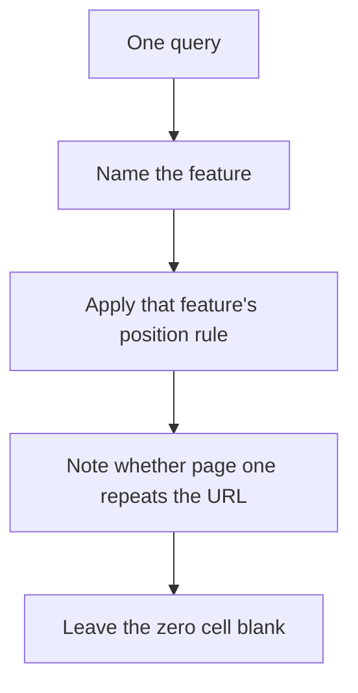

# What is a position zero result and is it still relevant in AI search

**Position zero is a nickname for the featured-snippet box, not a rank I can report.** The box can still sit above the blue links. The digit 0 does not belong in the spreadsheet.

I'm William Spurlock, AI Systems Architect and Fractional AI CTO at Spurlock Studios LLC. I've built 600+ automations, and 500+ are live. I've spent 20,000+ hours architecting agentic systems, and that work has saved clients 35,000+ hours. I've been SEO-certified since 2021. I still open one query and write down what the page showed.

I covered the product split between the box and a generated answer in [featured snippet versus AI Overview](/blog/featured-snippet-vs-ai-overview-what-changed-and-what-to-do-about-it). I made the case for chasing the extract in [whether I still chase featured snippets](/blog/should-i-still-chase-featured-snippets-or-focus-purely-on-ai-answers). The broader answer-engine work is in [answer engine optimization](/blog/answer-engine-optimization-how-to-become-the-answer-ai-gives). Here, I only want to retire the digit.

My blank-zero card has four lines for one query. I always leave the last line empty.

## What is a "position zero" result and is it still relevant in AI search?

**A position zero result is what people called the featured snippet that sat above the first blue link.** The box is still real. The rank is not, and the name does not apply to an AI Overview.

When I read [Google Search Help](https://support.google.com/websearch/answer/9351707) on 19 November 2026, it described a featured snippet as a box with a little piece of a website that helps answer the question. That page lists three places where the box can show:

- **Top of the search results.** This is the placement the nickname was invented for.
- **People Also Ask.** The related-questions group.
- **Next to Knowledge Graph information.** The right side of the page.

Most pages have one box, though some can have more. The help page never calls any of those placements position zero.

The [featured snippets guide](https://developers.google.com/search/docs/appearance/featured-snippets) (last updated 10 December 2025) describes special boxes that reverse a regular search result by putting the descriptive snippet first. The boxes can also appear in a related questions group, better known as People Also Ask. You cannot mark your own page as a featured snippet, and Google gives no exact minimum length. When the browser supports it and Google can identify the passage, a click lands on the section shown in the box. If that cannot happen, the click opens the top of the source page. Your site does not add an annotation to trigger the scroll.

The nickname came from the layout, which the [ranking systems guide](https://developers.google.com/search/docs/appearance/ranking-systems-guide) (last updated 10 December 2025) still describes. When a listing appears as a featured snippet, Google does not repeat it later on the first results page. People saw the box at the top, then noticed that the URL did not appear again among the blue links. Calling it a rank above 1 felt natural, but that was never how the position math worked.

I still care about the box. The featured snippets guide was live when I read it on 19 November 2026. According to the [optimization guide](https://developers.google.com/search/docs/fundamentals/ai-optimization-guide) (last updated 10 July 2026), Google's generative AI features rest on its core ranking and quality systems, and optimizing for generative AI search is still SEO. The [AI features guide](https://developers.google.com/search/docs/appearance/ai-features) (last updated 10 December 2025) adds that AI Overviews and AI Mode have no extra technical requirements. A supporting link must be indexed and eligible to appear with a snippet, but indexing is not guaranteed. AI Overviews often do not trigger at all. Generated answers did not retire the box or create a rank of 0.

<table>
  <thead>
    <tr>
      <th>What people say</th>
      <th>What I can point at</th>
      <th>What I refuse to write</th>
    </tr>
  </thead>
  <tbody>
    <tr>
      <td>Position zero</td>
      <td>A featured snippet, usually the box at the top</td>
      <td>The digit 0</td>
    </tr>
    <tr>
      <td>Own position zero</td>
      <td>This URL is the source link inside that box</td>
      <td>A rank above every blue link</td>
    </tr>
    <tr>
      <td>The AI answer is the new position zero</td>
      <td>An AI Overview, or an AI Mode response, which are different elements</td>
      <td>One column that mixes the box and the generated answer</td>
    </tr>
  </tbody>
</table>

My take is pretty narrow. Use the nickname in conversation when you mean the box. Remove it from every report. I already separated the two products in the [September comparison](/blog/featured-snippet-vs-ai-overview-what-changed-and-what-to-do-about-it). This card deals with the number.

## How do I tell that the nickname and the Search Console number are different?

**Search Console starts at 1, and a featured snippet that links to the source typically occupies position 1.** That is what the position help page says. I found no definition of position 0 on it.

When I read [Search Console help on impressions, position, and clicks](https://support.google.com/webmasters/answer/7042828) on 19 November 2026, it defined position as a relative ranking. Position 1 is the topmost, position 2 comes next, and the count continues from there. Google calculates position only for Google Search results. The page also says its heuristics, including position numbering, can change. That is why I date my reading instead of treating the diagram as permanent.

The count follows links, not whichever block looks tallest on the screen:

- **A position exists only when the element has at least one link that is not a query refinement.** A carousel of links that only start a new Google search does not occupy a position, and it does not push the numbers below it.
- **Ads do not occupy a search position.** A paid unit above the box does not create a zero, and it is not position 1.
- **A featured snippet has a link to the source, so it typically occupies position 1.** The featured-snippet section of the same page says standard position rules apply.
- **A dash is an empty measurement, not a rank of nothing.** A link must get an impression before a position is recorded. A dash can mean the user never saw the property for that query.

Average position starts with the topmost link to your property for each query, then averages those values across the queries where the property appeared. I use the help page's example, not a client account. Query 1 shows the property at positions 2, 4, and 6, which makes 2 the value. Query 2 shows it at 3, 5, and 9, which makes 3 the value. The average is (2 + 3) / 2 = 2.5. Adding a 0 for a snippet would break that topmost-position rule.

The number does not tell you much about the layout either. In the page's diagram, a knowledge panel occupies position 6, and every link in that panel shares the same number. The page says a prominent spot can still carry a large position number. It also says position 11 could mean the top of a knowledge panel on the right or the first result on page 2, depending on the rest of the page. I will not turn one integer into a claim that a page appeared above the fold.

Another zero appears in a different report, but it still is not a rank. The [Generative AI performance report help](https://support.google.com/webmasters/answer/16984139), which I read the same day, says downloaded files turn values shown as ~ or - into zeros. In that export, zero means the value was unavailable. It does not belong in a column called position zero.

<table>
  <thead>
    <tr>
      <th>What I see</th>
      <th>Position rule I read</th>
      <th>Blank-zero line</th>
    </tr>
  </thead>
  <tbody>
    <tr>
      <td>Featured snippet with a source link</td>
      <td>Typically position 1. Standard rules.</td>
      <td>Write 1. Leave 0 blank.</td>
    </tr>
    <tr>
      <td>Ad above the box</td>
      <td>Ads do not occupy a search position.</td>
      <td>Do not invent a slot for the ad.</td>
    </tr>
    <tr>
      <td>Knowledge panel in the help-page diagram</td>
      <td>Position 6 in that diagram, shared by its links.</td>
      <td>Write the number the report shows. Do not call a prominent panel zero.</td>
    </tr>
    <tr>
      <td>Dash, or an export that turned ~ or - into 0</td>
      <td>No recorded position, or a missing value in the AI report download.</td>
      <td>Leave the cell blank. Do not celebrate a zero.</td>
    </tr>
  </tbody>
</table>

What you see in your own search can disagree with the average. The help page says one search can differ from the report because of variables such as search history and location. A single browser session shows me the layout. It does not replace the position column.

## How do I fill a position when the top box is a featured snippet?

**I name the feature, write 1 when the snippet is the topmost source link, and leave the zero cell blank.** There is no application for the box. Google decides whether a page belongs there.

I fill the card's four lines in this order:

1. **Feature.** Featured snippet, and which of the three places: top, People Also Ask, or beside the Knowledge Graph.
2. **Position rule.** Typically 1 when it links to the source and nothing above it occupies a position. I confirm the topmost link before I type the 1.
3. **Page-one repeat.** The ranking systems guide says that listing is not repeated later on the first page. A missing blue link is the dedup, not a second failure.
4. **Zero cell.** Blank. Every time.

<table>
  <thead>
    <tr>
      <th>Line</th>
      <th>Snippet at the top</th>
      <th>What I do not write</th>
    </tr>
  </thead>
  <tbody>
    <tr>
      <td>1. Feature</td>
      <td>Featured snippet, top of the results</td>
      <td>Position zero</td>
    </tr>
    <tr>
      <td>2. Position rule</td>
      <td>Typically 1, because the box links to the source</td>
      <td>0, or "above position 1"</td>
    </tr>
    <tr>
      <td>3. Page-one repeat</td>
      <td>That URL is not repeated later on page one</td>
      <td>Lost the blue link</td>
    </tr>
    <tr>
      <td>4. Zero cell</td>
      <td>Blank</td>
      <td>0</td>
    </tr>
  </tbody>
</table>

The box combines a callout with a dedup. It is not a hidden rank above the ten blue links. The same ranking systems guide says MUM is not currently used for general ranking, though it handles some specific jobs that include featured snippet callouts. A callout model does not give me a reason to store a 0.

I still put a short answer right under the heading. A click tries to land on the section shown in the box, and the guide says the site adds no annotation to make that scroll happen. The optimization guide says there is no ideal page length, so I do not chase a word count to "win zero." Once the passage answers the question, I stop writing.

## What position do I record for an AI Overview instead of zero?

**An AI Overview occupies one position, and every link inside it gets that same position.** I record the report's shared number. I never rename it position zero.

The AI Overviews section of the same [Search Console help page](https://support.google.com/webmasters/answer/7042828) says exactly that. A link out to a page counts as a click, and the standard impression rules apply. Search Labs experiments do not count. The AI features guide says Overviews appear when the systems judge them additive to classic Search, and they often do not trigger. When no Overview appears, nothing failed to earn a zero.

AI Mode is another element. Its position follows the same methodology as a Google Search results page. Carousels and image blocks inside AI Mode generally follow the standard rules for those elements. A follow-up question inside AI Mode counts as a new query. Any impressions, positions, and clicks on that response belong to the new query. There is no position-zero counter beside the first answer. I cover writing for that second turn in [conversational search optimization](/blog/what-is-conversational-search-optimization-and-how-does-it-fit-with-aeo).

People Also Ask sits closer to the snippet than the nickname suggests, and it still does not create a zero. Expanding an item does not count as a click. Once the section is open, links inside it can receive an impression. Standard position rules still apply. Because the featured snippets guide says a box can appear in that group, an expanded related question can hold a featured snippet with a normal position. It does not sit at a rank above 1.

The report for generative AI features will not give you a snippet column either. When I read the [Generative AI performance report](https://support.google.com/webmasters/answer/16984139) on 19 November 2026, it carried a worldwide note dated 31 August 2026. Its included list names AI Overviews and AI Mode, and the page says that list may change later. Featured snippets were not on the list I read. Search Labs data is excluded. If one generative AI feature contains two results from the same site, the chart counts one impression. When I group the table by page, each row represents a page. The table usually stops at 1,000 rows, and its dates use Pacific Time. A missing report usually means the site did not receive enough of those impressions or was excluded from Search generative AI features. I use this report for Overview and AI Mode impressions, not for a position-zero win.

ChatGPT is a third surface, and the nickname does not carry over. When I read [Searching the web with ChatGPT](https://help.openai.com/en/articles/9237897-searching-the-web-with-chatgpt) on 19 November 2026, it said web-search responses may include citations. You can open a citation to check the source, and placement is not guaranteed. The page also says ChatGPT ranks search results with multiple factors. It does not define any result as position zero. I will not stamp a Google 1 onto one of its citations.

<table>
  <thead>
    <tr>
      <th>Feature</th>
      <th>What I write</th>
      <th>What I refuse</th>
    </tr>
  </thead>
  <tbody>
    <tr>
      <td>AI Overview</td>
      <td>One shared position for every link in that Overview</td>
      <td>Position zero, or a separate rank per link</td>
    </tr>
    <tr>
      <td>AI Mode</td>
      <td>Results-page position rules. A follow-up is a new query.</td>
      <td>A private counter that starts at 0</td>
    </tr>
    <tr>
      <td>People Also Ask</td>
      <td>Standard position. Expand is not a click.</td>
      <td>A zero for the collapsed question</td>
    </tr>
    <tr>
      <td>ChatGPT citation</td>
      <td>Cited or not. Placement is not guaranteed.</td>
      <td>A Google position copied onto the citation</td>
    </tr>
  </tbody>
</table>

I make four checks before labeling the top of a results page:

1. **Is the block a reversed snippet from one URL?** Then it is a featured snippet, typically position 1.
2. **Is the block a generated overview with several supporting links?** Then those links share one position.
3. **Is the block an AI Mode response?** Then I use results-page rules, and I start a new row if the person asked a follow-up.
4. **Is the block a citation in ChatGPT?** Then I log the citation. I do not log a zero.

## What breaks on a report if I record a featured snippet as position zero?

**A stored 0 makes the average impossible to compare with Search Console, and it dumps the AI Overview into the snippet's column.** Both problems start with a bad label. Publishing a second URL fixes neither one.

Search Console takes the topmost position for a property and averages those topmost values. Google's worked example reaches 2.5 without using a 0. Say my sheet stores 0 for the snippet on query 1 while the real topmost blue link was 4. I have now invented a number that will never appear in the Performance report. If the average moves next month, I cannot tell whether the box changed, the blue links changed, or my zero spoiled the math.

The other problem is mixing two products. An Overview can share the screen with a snippet or appear where no snippet exists. I separated those products in the September post. If I call both of them position zero, two very different weeks look identical. In one, the Overview cites the page and the box is gone. In the other, the box shows my page and the Overview never triggered. The AI features guide says Overviews often do not trigger, so line 1 of the card must name the feature before anyone reads line 2.

A vendor column named Position 0 does not get a free pass from me. The optimization guide says third-party tools do not have access to Google's internal ranking or AI systems. When a tool prints 0, I ask which element it saw and which help-page rule supports the number. No answer means a blank cell.

I keep the passage because the click still tries to land on that section. I drop the digit. The box remains a useful writing target for queries where it appears. A rank above 1 is not useful because the position definition I read has no such rank.

<table>
  <thead>
    <tr>
      <th>Broken habit</th>
      <th>What the report will do</th>
      <th>Blank-zero card</th>
    </tr>
  </thead>
  <tbody>
    <tr>
      <td>Store 0 for every top box</td>
      <td>The average is no longer the topmost-position average</td>
      <td>Line 2 uses the rule for that feature</td>
    </tr>
    <tr>
      <td>Call an Overview position zero</td>
      <td>Snippet weeks and Overview weeks look the same</td>
      <td>Line 1 names the feature</td>
    </tr>
    <tr>
      <td>Treat a missing blue link as a loss</td>
      <td>The dedup already removed the repeat on page one</td>
      <td>Line 3 records the dedup</td>
    </tr>
    <tr>
      <td>Cheer an export full of zeros</td>
      <td>Those zeros can be ~ or - from the AI report download</td>
      <td>Line 4 stays blank</td>
    </tr>
  </tbody>
</table>

Four things I stop doing on the next report pull:

1. **I delete the position-zero column.** The feature name and the real position replace it.
2. **I stop averaging a homemade 0 with Search Console's topmost position.** One metric, the one on the help page.
3. **I do not open a second URL because page one hid the blue link.** That hide is the dedup described in the ranking systems guide. The chase decision for a second page lives on the [keep-slip post](/blog/should-i-still-chase-featured-snippets-or-focus-purely-on-ai-answers).
4. **I leave the short answer on the page.** The zero was the label. The passage is the thing the click tries to find.

## FAQ

### Did Google define a position zero in Search Console?

**No. The position definition I read starts at 1, and 1 is the topmost position.** When I read [Search Console help](https://support.google.com/webmasters/answer/7042828) on 19 November 2026, it said 2 is the next position, and the count continues from there. Position is calculated only for Google Search results. The page never defined a rank called position zero.

### Does a featured snippet usually count as position 1?

**Yes. A featured snippet that links to the source typically occupies position 1.** The same help page says so, and its featured-snippet section applies the standard position rules. Because the Performance report shows an average, a live search can still look different.

### Do ads above the results create a position zero?

**No. Ads do not occupy a search position.** A paid unit above the box is not rank 0, nor does it move the snippet off position 1 by itself. The help page leaves ads out of the position count.

### If my page is the featured snippet, is that URL repeated as a blue link on page one?

**No. Google does not repeat that listing later on the first page of results.** That rule comes from the [ranking systems guide](https://developers.google.com/search/docs/appearance/ranking-systems-guide) (last updated 10 December 2025). The missing blue link is the dedup at work, not proof that the URL fell out of search.

### Do links inside one AI Overview get separate positions?

**No. An AI Overview occupies a single position, and every link inside it is assigned that same position.** [Search Console help](https://support.google.com/webmasters/answer/7042828) states the rule directly. I do not split one Overview into several ranks or call the shared position zero.

### Is expanding People Also Ask counted as a click?

**No. Clicking to expand the item is not a click.** Once the item is open, links inside the section can receive an impression, and their positions follow the standard rules. The [featured snippets guide](https://developers.google.com/search/docs/appearance/featured-snippets) (last updated 10 December 2025) says a featured snippet can appear inside that related-questions group.

### Does AI Mode keep its own position-zero counter?

**No. Position in AI Mode follows the same methodology as a Google Search results page.** A follow-up in AI Mode becomes a new query with its own impressions, positions, and clicks. I keep no second counter that starts at zero.

### Does ChatGPT name a result position zero?

**No. The search help page I read does not define a result by that name.** When I read [Searching the web with ChatGPT](https://help.openai.com/en/articles/9237897-searching-the-web-with-chatgpt) on 19 November 2026, it said a web-search response may include citations and that placement is not guaranteed. It also says ChatGPT ranks search results with multiple factors. I do not copy a Google position onto a citation.

### Can average position be 1 while my own search looks different?

**Yes. Average position mixes every recorded impression, and one live search can differ.** The help page lists search history and location among the variables. A dash means that cut of the report has no recorded position. One browser session is not the average.

### Should I delete the short answer because zero is not a rank?

**No. I keep the short answer under the heading because a snippet click tries to land on that section.** The [featured snippets guide](https://developers.google.com/search/docs/appearance/featured-snippets) (last updated 10 December 2025) says the site does not add an annotation for the scroll. If the section cannot be determined, the click opens the top of the page. The [optimization guide](https://developers.google.com/search/docs/fundamentals/ai-optimization-guide) (last updated 10 July 2026) says there is no ideal page length. I leave the zero cell blank and keep the passage.

## Get an AI-visibility-ready site built

**Bring one query and the four lines. I will tell you which feature you saw, which position rule applies, and whether the zero cell still holds a digit.** I sell an AI-visibility build that gives the page a chance to become the snippet and labels its rank the same way Search Console does.

You can find the product split in [featured snippet versus AI Overview](/blog/featured-snippet-vs-ai-overview-what-changed-and-what-to-do-about-it). I cover the wider program in [answer engine optimization](/blog/answer-engine-optimization-how-to-become-the-answer-ai-gives).

[Bring the four lines](/contact)
